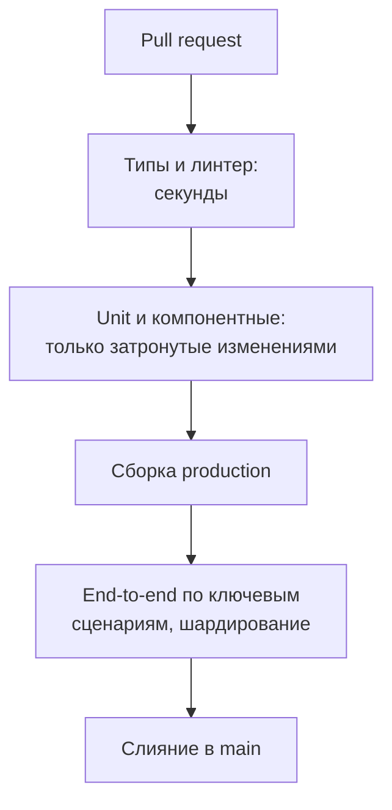

## О чём урок

Тесты в повседневной работе: откуда берутся нестабильные (flaky) тесты и как их находить, перемешивание порядка, тесты в CI и как держать их быстрыми (только затронутые изменениями, шардирование), пороги покрытия, TDD и когда он полезен, и как отвечать на собеседовании на вопросы «как вы протестируете эту фичу» и «что такое хороший тест». Пример запускает настоящий Vitest с перемешиванием порядка тестов.

## Нестабильные тесты

Нестабильный тест то проходит, то падает **без изменений в коде**. Он хуже отсутствующего: команда привыкает перезапускать CI, перестаёт верить красному статусу и пропускает настоящую ошибку.

| Причина | Пример | Исправление |
|---|---|---|
| Общее состояние | Модульная переменная, стор, мок без очистки | Новое состояние в `beforeEach`, `clearMocks`, `restoreMocks` |
| Порядок тестов | Тест рассчитывает, что другой выполнился раньше | Каждый тест готовит всё сам; перемешивание в CI |
| Время | Паузы, «сегодня», полночь, часовой пояс | Поддельные таймеры, `vi.setSystemTime`, фиксированный `TZ` |
| Асинхронность | Проверка до ответа, промис без `await` | `findBy`, `expect.poll`, web-first assertions, `await` везде |
| Сеть и данные | Настоящий API, общая тестовая база | MSW, свои данные на каждый тест |
| Окружение | Шрифты в скриншотах, медленная машина CI, анимации | Docker-образ, отключённые анимации, таймауты с запасом |
| Случайность | `Math.random`, `crypto.randomUUID` в данных | Заглушка или фиксированный seed |

```js run
import { mkdtempSync, rmSync, writeFileSync } from 'node:fs'
import { join } from 'node:path'
import { startVitest } from 'vitest/node'

// Two tests share a module-level cart: the second one silently depends on running first.
const test = `
import { expect, test } from 'vitest'
const cart = []
const add = (item) => cart.push(item)

test('adds an item', () => {
  add('book')
  expect(cart).toHaveLength(1)
})
test('starts empty', () => {
  expect(cart).toHaveLength(0)
})
test('total of two items', () => {
  const local = []
  local.push(10, 20)
  expect(local.reduce((a, b) => a + b, 0)).toBe(30)
})`

const dir = mkdtempSync(join(process.cwd(), 'node_modules', '.vt-'))
writeFileSync(join(dir, 'cart.test.js'), test)
// The same file in different orders, as with sequence.shuffle in CI.
for (const seed of [1, 2, 3, 4, 5, 6]) {
  const vitest = await startVitest('test', [], { root: dir, watch: false, reporters: [{}], sequence: { shuffle: true, seed } })
  const tests = vitest.state.getTestModules()[0].children.allTests()
  const failed = [...tests].filter((t) => t.result().state === 'failed').map((t) => t.name)
  console.log(`seed ${seed}:`, failed.length ? `FAILED ${failed.join(', ')}` : 'passed')
  await vitest.close()
}
rmSync(dir, { recursive: true })
process.exitCode = 0
```

```output
seed 1: FAILED starts empty
seed 2: passed
seed 3: passed
seed 4: FAILED starts empty
seed 5: FAILED starts empty
seed 6: FAILED starts empty
```

- Тест «starts empty» проходит, только если выполнился **раньше** «adds an item». Без перемешивания результат зависит от того, в каком порядке тесты записаны: стоит переставить или добавить тест, и падает тест, который никто не трогал.
- `sequence.shuffle` с разными seed находит такие зависимости; номер seed выводится в отчёте, и падение воспроизводится локально тем же seed.
- Третий тест создаёт свои данные внутри и проходит при любом порядке: так и должны быть устроены тесты.

Что делать с найденным нестабильным тестом: воспроизвести (повторить сотню раз: опция `{ repeats: 100 }` у теста Vitest, `playwright test --repeat-each=100`), починить причину, а на время починки **перенести в карантин** с задачей, а не удалять и не добавлять повторы.

## Тесты в CI



- **Быстрые проверки первыми**: ошибка типов видна за секунды, и дорогие этапы не запускаются зря.
- **Только затронутое**: `vitest --changed` берёт тесты, зависящие от изменённых файлов, `--since-last-run` (Vitest 5.1) только то, что изменилось с прошлого запуска; в монорепозиториях `nx affected` запускает тесты только затронутых проектов (урок трека «Инструменты»).
- **Шардирование**: `vitest --shard=1/4` и `playwright test --shard=1/4` делят набор между машинами.
- **Отчёты**: JUnit для CI, HTML-отчёт и трассировки Playwright как артефакты, чтобы разобрать падение без локального запуска.
- Полный набор, включая все браузеры и визуальные тесты, часто запускают перед релизом или по расписанию, а на каждый pull request только основное.

## Покрытие в CI

```ts
// vitest.config.ts
export default defineConfig({
  test: {
    coverage: {
      provider: 'v8',
      include: ['src/**'],
      thresholds: { lines: 80, branches: 75 }, // the build fails below these numbers
    },
  },
})
```

- Порог задают на уровне, который команда реально держит, и поднимают постепенно; цель «100 %» рождает тесты ради цифры (урок `test-strategy`).
- Важнее покрытие **нового и изменённого** кода: сервисы вроде Codecov показывают его прямо в pull request.

## TDD

Test-driven development: сначала тест, который падает (red), потом минимальный код, чтобы он прошёл (green), потом улучшение кода при зелёных тестах (refactor).

- Хорошо работает для **логики с понятными входами и выходами**: валидация, расчёт цены, парсер, редьюсер, исправление бага (сначала тест, который воспроизводит баг).
- Хуже для вёрстки и исследовательской работы, когда интерфейс ещё не ясен: там тесты пишут после того, как поведение устоялось.
- Польза даже без строгого TDD: тест, написанный до кода, проверяет требование, а не то, что код уже делает.

## Как отвечать на собеседовании

«Как вы протестируете эту фичу» (например, поиск с подсказками):

1. **Риски и требования**: что важно пользователю (подсказки появляются, выбор с клавиатуры, нет гонок при быстром вводе, ошибка сети не ломает поле).
2. **Логика unit-тестами**: фильтрация, подсветка совпадений, debounce на поддельных таймерах.
3. **Компонент тестом компонента**: ввод через `user-event`, запросы через MSW, подсказки ищутся по роли `option`, стрелки и Enter, состояние ошибки, отмена устаревшего запроса.
4. **Один e2e** на основной путь: ввести, выбрать, попасть на страницу результата.
5. **Доступность**: `axe` в тесте компонента, роли `combobox` и `listbox`, фокус.
6. Что **не** тестирую: внутреннее состояние, точное число рендеров, стили.

«Что такое хороший тест»: проверяет поведение, а не реализацию; падает, когда ломается функциональность, и не падает при рефакторинге; независим от других тестов и порядка; быстрый и стабильный; по названию и сообщению об ошибке понятно, что сломалось.

## Главное

- Нестабильный тест хуже отсутствующего; причины: общее состояние, порядок, время, асинхронность, сеть, окружение, случайность.
- Перемешивание порядка (`sequence.shuffle`) находит зависимости между тестами; каждый тест готовит свои данные сам.
- Нестабильный тест воспроизводят повторами, чинят причину, на время переносят в карантин, а не добавляют повторы.
- CI: быстрые проверки первыми, только затронутые тесты, шардирование, отчёты и трассировки как артефакты.
- Порог покрытия разумный и растущий, важнее покрытие изменённого кода; TDD хорош для логики и исправления багов.
- На собеседовании: риски, логика unit-тестами, компонент с MSW и `user-event`, один e2e, доступность, и что не тестирую.
