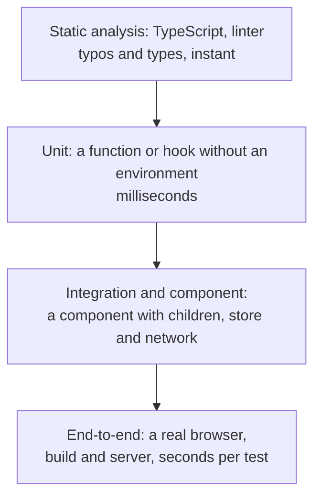

## What this lesson covers

Why the frontend needs tests and how to choose which ones to write: kinds of tests from static analysis to end-to-end, the pyramid and the "trophy" and why the frontend's center of gravity shifts toward integration tests, what to check (behavior) and what not to check (implementation details), and what a coverage percentage really means. The next lessons of the track cover each level with its tools. The example runs in Node.js.

## Why tests

A test is code that checks other code and answers the question "can we ship this". The value of tests is not their number but the **confidence** they give when things change: upgrade a dependency, rewrite a component, fix a bug without breaking the one next to it. A test that fails on every refactoring but catches no bugs does harm: it gets disabled, and there is no confidence.

## Kinds of tests



| Kind | What it checks | Tools | Cost |
|---|---|---|---|
| Static | Types, typos, dangerous constructs | TypeScript, oxlint, ESLint | Almost free, works in the editor |
| Unit | One function, hook, reducer, utility | Vitest, Jest | Fast, but says little about the interface working |
| Component | A component through the user's eyes: render, clicks, input | Testing Library + Vitest, Vitest browser mode | Medium |
| Integration | Several parts together: a page with a router, a store and a mocked network | The same + MSW | Medium, the best price for confidence |
| End-to-end | The user's whole journey in a real browser | Playwright, Cypress | Slow and costlier to maintain |
| Visual and accessibility | How it looks and whether it is accessible | Playwright and Vitest screenshots, axe-core | A category of its own (the `test-a11y-visual` lesson) |

The boundaries are blurry: "a component test of a page with a mocked network" is often called an integration test. What matters more is understanding **what** the test replaces and what it checks for real.

## The pyramid and the trophy

The **test pyramid** advises many unit tests, fewer integration tests and very few end-to-end tests: the lower ones are cheap and fast, the upper ones slow and brittle. For the frontend it has a weak spot: almost all interface logic lives in the combination of components, browser APIs and the network, and unit tests of separate functions say little about whether the page works.

That is why frontend teams often use the **trophy** (testing trophy): a wide base of static analysis, a few unit tests for pure logic, **the bulk in integration and component tests**, and a few end-to-end tests for key flows (login, payment, checkout). web.dev describes other shapes too (the diamond, the honeycomb, the "crab" with an emphasis on visual checks) and advises choosing by the size of the app and the team, not by the picture.

A practical rule: the closer a test is to how the user works with the app, the more confidence it gives; the more it replaces, the faster it is, but the less it proves.

## What to check

- **Behavior that the user or the calling code sees**: text on the screen, accessible elements, API calls, return values, error messages.
- **Edge cases from the requirements**: an empty list, a network error, a slow response, zero and negative numbers, long text.
- **Bugs that already happened**: a test for each fixed bug, so it does not come back.

What not to check:

- **Implementation details**: a component's internal state, names of private functions, CSS classes, the number of renders without a reason. Such tests break on refactoring, although the behavior did not change.
- **The framework and libraries themselves**: that `useState` keeps a value or that the router follows a link.
- **Trivial code** without logic: a getter that returns a field.

## Coverage and its limits

Coverage shows which lines and branches **ran** during the tests, but not that their result was **checked**.

```ts run
import { expect } from 'vitest'

// Price with a discount code; the business rule: discounts never make the total negative.
const correct = (price: number, discount: number) => Math.max(0, price - discount)
// "Mutants": small bugs a refactoring could introduce.
const mutants = {
  'no Math.max  ': (price: number, discount: number) => price - discount,
  'adds discount': (price: number, discount: number) => price + discount,
  'off by one   ': (price: number, discount: number) => Math.max(0, price - discount - 1),
}

type Fn = typeof correct
const suites: Record<string, (fn: Fn) => void> = {
  // Runs every line (100% coverage), but checks almost nothing.
  'weak  ': (fn) => {
    expect(fn(100, 20)).toBeTypeOf('number')
    expect(fn(10, 50)).toBeDefined()
  },
  // Checks the behavior, including the edge case from the rule.
  'strong': (fn) => {
    expect(fn(100, 20)).toBe(80)
    expect(fn(10, 50)).toBe(0)
  },
}

const passes = (suite: (fn: Fn) => void, fn: Fn) => {
  try { suite(fn); return true } catch { return false }
}
for (const [name, suite] of Object.entries(suites)) {
  const caught = Object.entries(mutants).filter(([, m]) => !passes(suite, m)).map(([n]) => n.trim())
  console.log(`${name} suite: correct code ${passes(suite, correct) ? 'passes' : 'FAILS'}, bugs caught ${caught.length}/3`, caught.length ? `(${caught.join(', ')})` : '')
}
```

```output
weak   suite: correct code passes, bugs caught 0/3 
strong suite: correct code passes, bugs caught 3/3 (no Math.max, adds discount, off by one)
```

- The weak suite runs every line of the function, that is, it gives 100% coverage, and misses all three bugs. The strong one catches all of them: it checks specific values and the edge case from the requirement.
- This is how **mutation testing** works (Stryker for JavaScript): the tool itself introduces small bugs into the code and checks whether the tests fail. The share of caught "mutants" is more honest than the coverage percentage.
- Coverage is useful for finding **unchecked** code, not for proving the code is checked. A "100%" goal leads to tests for the sake of the number; the CI threshold is set at a level the team keeps, and coverage of changed files is what gets watched.

## Key points

- The value of tests is confidence when things change; a test that breaks on refactoring and catches no bugs does harm.
- Kinds: static analysis, unit, component and integration, end-to-end, visual and accessibility.
- For the frontend the "trophy" is more practical than the pyramid: the bulk in integration and component tests, a few unit tests and a few end-to-end tests for key flows.
- Check behavior and edge cases from the requirements, a test for each fixed bug; do not check implementation details or the framework itself.
- Coverage shows code that ran, not code that was checked; mutation testing is more honest; set a reasonable threshold, not 100%.
