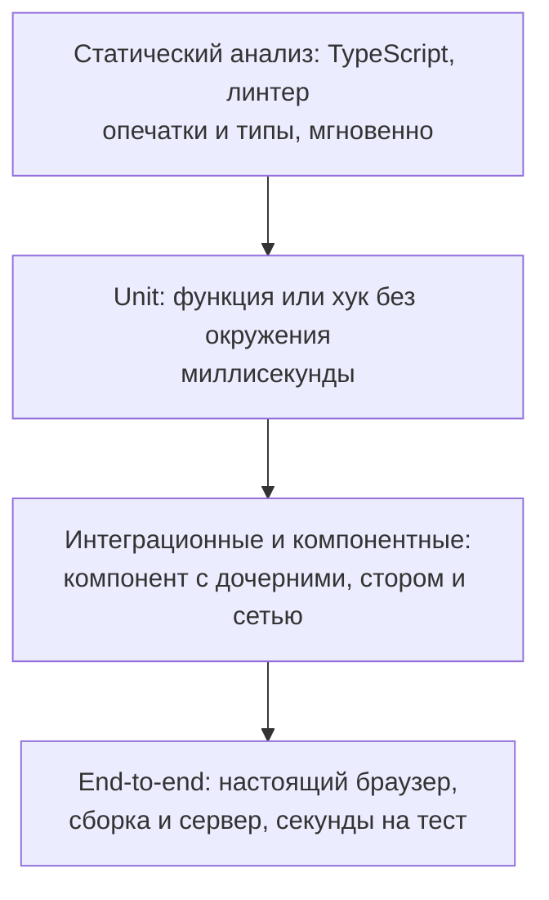

## О чём урок

Зачем фронтенду тесты и как выбрать, какие писать: виды тестов от статического анализа до end-to-end, пирамида и «кубок» и почему у фронтенда центр тяжести смещён к интеграционным тестам, что проверять (поведение) и чего не проверять (детали реализации), что на самом деле значит процент покрытия. Следующие уроки трека разбирают каждый уровень с инструментами. Пример выполняется в Node.js.

## Зачем тесты

Тест это код, который проверяет другой код и отвечает на вопрос «можно ли выпускать». Ценность тестов не в количестве, а в **уверенности**, которую они дают при изменениях: обновить зависимость, переписать компонент, починить баг и не сломать соседнее. Тест, который падает при каждом рефакторинге, но не ловит ошибки, вредит: его отключают, и уверенности нет.

## Виды тестов



| Вид | Что проверяет | Инструменты | Стоимость |
|---|---|---|---|
| Статический | Типы, опечатки, опасные конструкции | TypeScript, oxlint, ESLint | Почти бесплатно, работает в редакторе |
| Unit | Одна функция, хук, редьюсер, утилита | Vitest, Jest | Быстро, но мало говорит о работе интерфейса |
| Компонентный | Компонент глазами пользователя: рендер, клики, ввод | Testing Library + Vitest, браузерный режим Vitest | Средне |
| Интеграционный | Несколько частей вместе: страница с роутером, стором и замоканной сетью | То же + MSW | Средне, лучшая цена за уверенность |
| End-to-end | Весь путь пользователя в настоящем браузере | Playwright, Cypress | Медленно и дороже в поддержке |
| Визуальный и доступности | Как выглядит и доступно ли | Скриншоты Playwright и Vitest, axe-core | Отдельная категория (урок `test-a11y-visual`) |

Границы размыты: «компонентный тест страницы с моком сети» часто называют интеграционным. Важнее понимать, **что** тест подменяет и что проверяет по-настоящему.

## Пирамида и кубок

**Пирамида тестов** советует много unit-тестов, меньше интеграционных и совсем немного end-to-end: нижние дешёвые и быстрые, верхние медленные и хрупкие. Для фронтенда у неё есть слабое место: почти вся логика интерфейса в связке компонентов, браузерных API и сети, и unit-тесты отдельных функций мало говорят о том, работает ли страница.

Поэтому фронтенд-команды часто используют **кубок** (testing trophy): широкое основание из статического анализа, немного unit-тестов на чистую логику, **основная масса интеграционных и компонентных тестов** и несколько end-to-end на ключевые сценарии (вход, оплата, оформление заказа). web.dev описывает и другие формы (ромб, соты, «краб» с упором на визуальные проверки) и советует выбирать по размеру приложения и команды, а не по картинке.

Практическое правило: чем ближе тест к тому, как пользователь работает с приложением, тем больше уверенности он даёт; чем больше он подменяет, тем быстрее, но тем меньше доказывает.

## Что проверять

- **Поведение, которое видит пользователь или вызывающий код**: текст на экране, доступные элементы, вызовы API, возвращаемые значения, сообщения об ошибках.
- **Граничные случаи из требований**: пустой список, ошибка сети, долгий ответ, ноль и отрицательные числа, длинный текст.
- **Ошибки, которые уже были**: тест на каждый исправленный баг, чтобы он не вернулся.

Чего не проверять:

- **Детали реализации**: внутреннее состояние компонента, имена приватных функций, классы CSS, число рендеров без причины. Такие тесты ломаются при рефакторинге, хотя поведение не изменилось.
- **Сам фреймворк и библиотеки**: что `useState` хранит значение, а роутер переходит по ссылке.
- **Тривиальный код** без логики: геттер, который возвращает поле.

## Покрытие и его пределы

Покрытие (coverage) показывает, какие строки и ветви **выполнились** во время тестов, но не то, что их результат **проверили**.

```ts run
import { expect } from 'vitest'

// Price with a discount code; the business rule: discounts never make the total negative.
const correct = (price: number, discount: number) => Math.max(0, price - discount)
// "Mutants": small bugs a refactoring could introduce.
const mutants = {
  'no Math.max  ': (price: number, discount: number) => price - discount,
  'adds discount': (price: number, discount: number) => price + discount,
  'off by one   ': (price: number, discount: number) => Math.max(0, price - discount - 1),
}

type Fn = typeof correct
const suites: Record<string, (fn: Fn) => void> = {
  // Runs every line (100% coverage), but checks almost nothing.
  'weak  ': (fn) => {
    expect(fn(100, 20)).toBeTypeOf('number')
    expect(fn(10, 50)).toBeDefined()
  },
  // Checks the behavior, including the edge case from the rule.
  'strong': (fn) => {
    expect(fn(100, 20)).toBe(80)
    expect(fn(10, 50)).toBe(0)
  },
}

const passes = (suite: (fn: Fn) => void, fn: Fn) => {
  try { suite(fn); return true } catch { return false }
}
for (const [name, suite] of Object.entries(suites)) {
  const caught = Object.entries(mutants).filter(([, m]) => !passes(suite, m)).map(([n]) => n.trim())
  console.log(`${name} suite: correct code ${passes(suite, correct) ? 'passes' : 'FAILS'}, bugs caught ${caught.length}/3`, caught.length ? `(${caught.join(', ')})` : '')
}
```

```output
weak   suite: correct code passes, bugs caught 0/3 
strong suite: correct code passes, bugs caught 3/3 (no Math.max, adds discount, off by one)
```

- Слабый набор выполняет каждую строку функции, то есть даёт 100 % покрытия, и пропускает все три ошибки. Сильный ловит все: он проверяет конкретные значения и граничный случай из требования.
- Так работает **мутационное тестирование** (Stryker для JavaScript): инструмент сам вносит маленькие ошибки в код и проверяет, упадут ли тесты. Доля пойманных «мутантов» честнее процента покрытия.
- Покрытие полезно, чтобы найти **непроверенный** код, а не чтобы доказать, что код проверен. Цель «100 %» приводит к тестам ради цифры; порог в CI ставят на уровне, который команда держит, и смотрят на покрытие изменённых файлов.

## Главное

- Ценность тестов в уверенности при изменениях; тест, который ломается от рефакторинга и не ловит ошибки, вреден.
- Виды: статический анализ, unit, компонентные и интеграционные, end-to-end, визуальные и доступности.
- Для фронтенда «кубок» практичнее пирамиды: основная масса интеграционных и компонентных тестов, немного unit и несколько end-to-end на ключевые сценарии.
- Проверяют поведение и граничные случаи из требований, тест на каждый исправленный баг; не проверяют детали реализации и сам фреймворк.
- Покрытие показывает выполненный, а не проверенный код; мутационное тестирование честнее; порог ставят разумный, а не 100 %.
