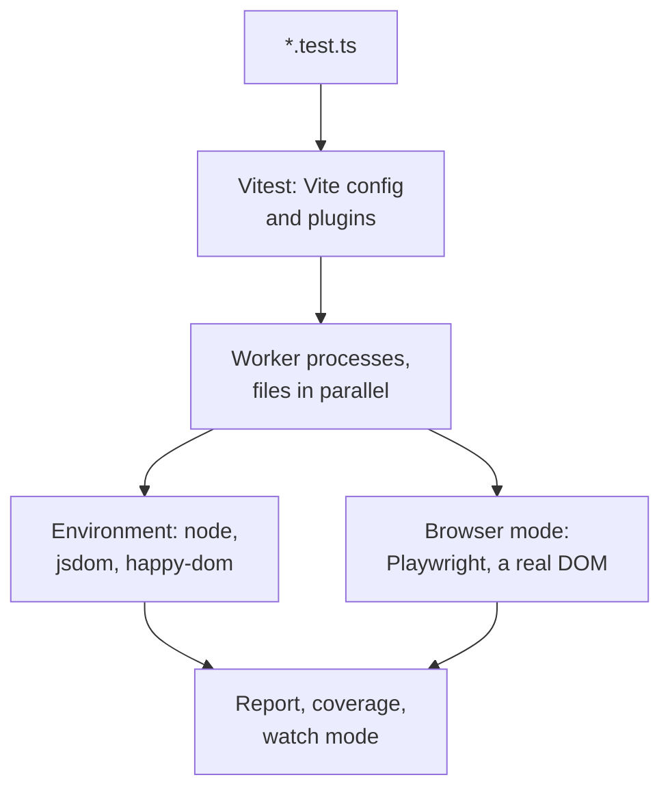

## What this lesson covers

Unit tests with Vitest: why it became the standard for Vite projects (and, since Angular 21, the default in Angular CLI), how it differs from Jest, test structure and hooks, matchers and the difference between `toBe`, `toEqual` and `toStrictEqual`, asynchronous assertions and tests that pass without checking anything, snapshots and when they do harm, execution environments, and what changed in Vitest 5. The examples run in Node.js; the second one runs real Vitest on a temporary file.

## The runner



- **Vitest** takes Vite's configuration: the same aliases, plugins, handling of TypeScript, JSX and CSS modules, with no separate Babel setup. Its API is compatible with Jest (`describe`, `test`, `expect`, `vi` instead of `jest`), so migrating usually comes down to replacing imports.
- **Jest** (version 30) is still maintained and common in older projects and React Native; ES modules in it are still behind a Node flag, and TypeScript goes through Babel or `ts-jest`.
- **Angular** creates new projects with Vitest since version 21; Karma and Jasmine remain for older projects, and Protractor is shut down.
- Files run **in parallel in separate processes**, tests within a file in order. Watch mode reruns only the tests that depend on changed files.

```ts
import { beforeEach, describe, expect, test } from 'vitest'
import { createCart } from './cart'

describe('cart', () => {
  let cart: ReturnType<typeof createCart>
  beforeEach(() => {
    cart = createCart() // a fresh cart for every test: no shared state
  })

  test('adds items and sums the total', () => {
    cart.add({ id: 'book', price: 12 }, 2)
    expect(cart.total()).toBe(24)
  })

  test.each([
    [0, 0],
    [3, 36],
  ])('%i books cost %i', (count, total) => {
    cart.add({ id: 'book', price: 12 }, count)
    expect(cart.total()).toBe(total)
  })
})
```

The structure "arrange, act, assert" in each test; the name describes behavior, not the function: "sums the total", not "test add".

## Matchers

```ts run
import { expect } from 'vitest'

class User {
  constructor(public name: string) {}
}
const check = (label: string, assertion: () => void) => {
  try {
    assertion()
    console.log('pass', label.trim())
  } catch {
    console.log('FAIL', label.trim())
  }
}

check('toBe: same primitive         ', () => expect(0.1 + 0.2).toBe(0.3))
check('toBeCloseTo: floats          ', () => expect(0.1 + 0.2).toBeCloseTo(0.3))
check('toBe: two equal objects      ', () => expect({ id: 1 }).toBe({ id: 1 }))
check('toEqual: two equal objects   ', () => expect({ id: 1 }).toEqual({ id: 1 }))
check('toEqual: undefined property  ', () => expect({ id: 1, note: undefined }).toEqual({ id: 1 }))
check('toStrictEqual: same case     ', () => expect({ id: 1, note: undefined }).toStrictEqual({ id: 1 }))
check('toEqual: class vs literal    ', () => expect(new User('Ann')).toEqual({ name: 'Ann' }))
check('toStrictEqual: class vs literal', () => expect(new User('Ann')).toStrictEqual({ name: 'Ann' }))
check('toMatchObject: subset        ', () => expect({ id: 1, name: 'Ann', role: 'admin' }).toMatchObject({ role: 'admin' }))
check('toThrow: error type          ', () => expect(() => JSON.parse('{')).toThrow(SyntaxError))
```

```output
FAIL toBe: same primitive
pass toBeCloseTo: floats
FAIL toBe: two equal objects
pass toEqual: two equal objects
pass toEqual: undefined property
FAIL toStrictEqual: same case
pass toEqual: class vs literal
FAIL toStrictEqual: class vs literal
pass toMatchObject: subset
pass toThrow: error type
```

- **`toBe`** compares with `Object.is`: for primitives and the same reference. `0.1 + 0.2` is not `0.3` because of binary fractions; for such numbers use `toBeCloseTo`.
- **`toEqual`** compares the structure recursively, but ignores properties set to `undefined` and the object's class.
- **`toStrictEqual`** is stricter: it accounts for `undefined` properties, array holes and the class. For API data and reducers it is usually the right choice.
- **`toMatchObject`** checks a subset: handy when the object has fields irrelevant to the test (dates, IDs).
- For errors, `toThrow` gets a **function**, not the result of a call: `expect(() => parse('{'))`, otherwise the exception is thrown before `expect`.

## Asynchronous assertions

The most common mistake in tests: an assertion inside a promise the test does not wait for.

```js run
import { mkdtempSync, rmSync, writeFileSync } from 'node:fs'
import { join } from 'node:path'
import { startVitest } from 'vitest/node'

// The function returns 41 instead of 42: every test below should fail.
const test = `
import { expect, test } from 'vitest'
const fetchTotal = (ms) => new Promise((resolve) => setTimeout(() => resolve(41), ms))

test('then without await, fast promise', () => {
  fetchTotal(10).then((total) => expect(total).toBe(42))
})
test('then without await, slow promise', () => {
  fetchTotal(1000).then((total) => expect(total).toBe(42))
})
test('resolves without await', async () => {
  expect(fetchTotal(10)).resolves.toBe(42)
})
test('await', async () => {
  expect(await fetchTotal(10)).toBe(42)
})`

const dir = mkdtempSync(join(process.cwd(), 'node_modules', '.vt-'))
writeFileSync(join(dir, 'total.test.js'), test)
const vitest = await startVitest('test', [], { root: dir, watch: false, reporters: [{}] })
for (const t of vitest.state.getTestModules()[0].children.allTests()) console.log(t.result().state.padEnd(7), t.name)
for (const e of vitest.state.getUnhandledErrors()) console.log('outside any test:', e.message.split('\n')[0])
await vitest.close()
rmSync(dir, { recursive: true })
process.exitCode = 0
```

```output
passed  then without await, fast promise
passed  then without await, slow promise
failed  resolves without await
failed  await
outside any test: expected 41 to be 42 // Object.is equality
```

- The function returns 41, not 42, yet **both tests with `.then()` passed**: the test ended before the assertion ran.
- The fast promise managed to settle while Vitest was still running: the error surfaced **outside any test** as unhandled. The slow one settled after the run ended, and the error was lost completely.
- `resolves` without `await` **fails the test** in Vitest 5 (it used to print only a warning). This does not work with `.then()`: the runner does not see the assertion inside the callback.
- The rule: a test with asynchrony is declared `async`, with `await` before every promise and before `expect(...).resolves`. A linter catches this with rules like `no-floating-promises`, and `expect.assertions(n)` checks that exactly `n` assertions ran.

## Snapshots

```ts
test('formats a duration', () => {
  expect(formatDuration(3725)).toMatchInlineSnapshot(`"1:02:05"`)
})
```

- A snapshot saves the result on the first run and compares against it afterwards. An **inline** one (`toMatchInlineSnapshot`) is written right into the test and is visible in review.
- Good for small, stable values: formatting, a serialized error, generated SQL or CSS.
- Bad for large component trees: nobody reads a snapshot hundreds of lines long, it gets updated without looking (`-u`), and the test turns into "something changed". Check specific behavior instead.
- Vitest 5.1 added an interactive review of changed snapshots: each change is accepted or rejected separately.

## The environment

| Environment | What is there | When |
|---|---|---|
| `node` (default) | Only Node.js | Logic, utilities, stores, server code |
| `jsdom` | DOM, events, `localStorage`, no layout | Components; the most complete emulation |
| `happy-dom` | The same, faster but less complete | Components, when speed matters |
| Browser mode | Real Chromium, Firefox or WebKit through Playwright | Layout, sizes, focus, CSS, visual checks |

jsdom does not compute layout: `getBoundingClientRect` returns zeros, and `IntersectionObserver` and `ResizeObserver` are missing. If a test checks something that depends on layout, it moves to browser mode (stable since Vitest 4).

## What is new in Vitest 5

- Unawaited `resolves`, `rejects` and `toMatchFileSnapshot` fail the test.
- **`clearMocks` is on by default**: the call history of mocks is cleared before each test, and tests depend less on order.
- **`vi.when(fn).calledWith(args).thenResolve(value)`**: different mock answers for different arguments without a manual `mockImplementation`.
- Fake timers also fake Temporal along with `Date`; trace view for debugging; nested projects in the config.
- Node.js 22.12+ and Vite 6.4+ are required.

## Key points

- Vitest uses Vite's configuration and is compatible with the Jest API; Angular creates projects with it since v21; Jest 30 lives on in older projects.
- Files run in parallel in separate processes; each test prepares its own state in `beforeEach`.
- `toBe` for primitives and references, `toEqual` for structure, `toStrictEqual` accounting for `undefined` and class, `toMatchObject` for a subset.
- An assertion in `.then()` without `await` always passes; an asynchronous test is `async` with `await` before every promise; Vitest 5 catches `resolves` without `await`.
- Inline snapshots for small stable values; large component snapshots do harm.
- jsdom and happy-dom have no layout; Vitest browser mode does.
