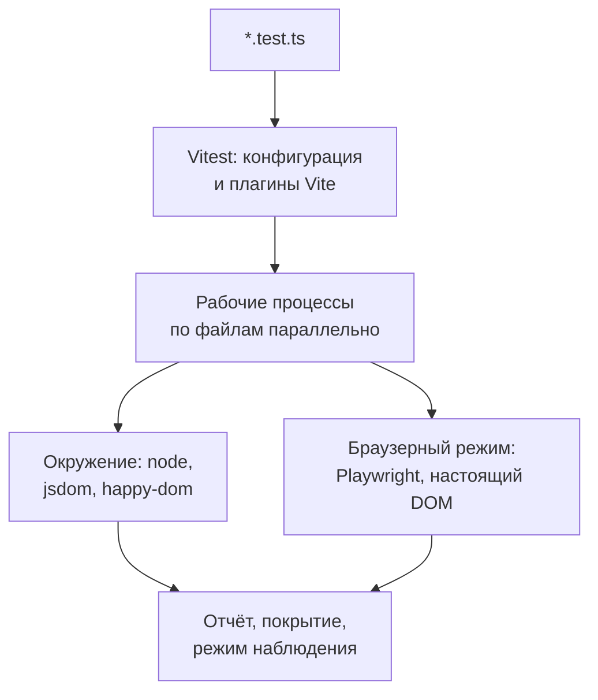

## О чём урок

Unit-тесты на Vitest: почему он стал стандартом для проектов на Vite (и с Angular 21 по умолчанию в Angular CLI), чем отличается от Jest, структура теста и хуки, матчеры и разница `toBe`, `toEqual` и `toStrictEqual`, асинхронные проверки и тесты, которые проходят, ничего не проверив, снапшоты и когда они вредны, окружения выполнения и что изменилось в Vitest 5. Примеры выполняются в Node.js, второй запускает настоящий Vitest на временном файле.

## Раннер



- **Vitest** берёт конфигурацию Vite: те же алиасы, плагины, обработку TypeScript, JSX и CSS-модулей, без отдельной настройки Babel. API совместим с Jest (`describe`, `test`, `expect`, `vi` вместо `jest`), поэтому миграция обычно сводится к замене импортов.
- **Jest** (версия 30) по-прежнему поддерживается и распространён в старых проектах и React Native; ES-модули в нём всё ещё за флагом Node, а TypeScript идёт через Babel или `ts-jest`.
- **Angular** с версии 21 создаёт новые проекты с Vitest; Karma и Jasmine остались для старых проектов, Protractor закрыт.
- Файлы выполняются **параллельно в отдельных процессах**, тесты внутри файла по порядку. Режим наблюдения перезапускает только тесты, зависящие от изменённых файлов.

```ts
import { beforeEach, describe, expect, test } from 'vitest'
import { createCart } from './cart'

describe('cart', () => {
  let cart: ReturnType<typeof createCart>
  beforeEach(() => {
    cart = createCart() // a fresh cart for every test: no shared state
  })

  test('adds items and sums the total', () => {
    cart.add({ id: 'book', price: 12 }, 2)
    expect(cart.total()).toBe(24)
  })

  test.each([
    [0, 0],
    [3, 36],
  ])('%i books cost %i', (count, total) => {
    cart.add({ id: 'book', price: 12 }, count)
    expect(cart.total()).toBe(total)
  })
})
```

Структура «подготовка, действие, проверка» (arrange, act, assert) в каждом тесте; название описывает поведение, а не функцию: «sums the total», а не «test add».

## Матчеры

```ts run
import { expect } from 'vitest'

class User {
  constructor(public name: string) {}
}
const check = (label: string, assertion: () => void) => {
  try {
    assertion()
    console.log('pass', label.trim())
  } catch {
    console.log('FAIL', label.trim())
  }
}

check('toBe: same primitive         ', () => expect(0.1 + 0.2).toBe(0.3))
check('toBeCloseTo: floats          ', () => expect(0.1 + 0.2).toBeCloseTo(0.3))
check('toBe: two equal objects      ', () => expect({ id: 1 }).toBe({ id: 1 }))
check('toEqual: two equal objects   ', () => expect({ id: 1 }).toEqual({ id: 1 }))
check('toEqual: undefined property  ', () => expect({ id: 1, note: undefined }).toEqual({ id: 1 }))
check('toStrictEqual: same case     ', () => expect({ id: 1, note: undefined }).toStrictEqual({ id: 1 }))
check('toEqual: class vs literal    ', () => expect(new User('Ann')).toEqual({ name: 'Ann' }))
check('toStrictEqual: class vs literal', () => expect(new User('Ann')).toStrictEqual({ name: 'Ann' }))
check('toMatchObject: subset        ', () => expect({ id: 1, name: 'Ann', role: 'admin' }).toMatchObject({ role: 'admin' }))
check('toThrow: error type          ', () => expect(() => JSON.parse('{')).toThrow(SyntaxError))
```

```output
FAIL toBe: same primitive
pass toBeCloseTo: floats
FAIL toBe: two equal objects
pass toEqual: two equal objects
pass toEqual: undefined property
FAIL toStrictEqual: same case
pass toEqual: class vs literal
FAIL toStrictEqual: class vs literal
pass toMatchObject: subset
pass toThrow: error type
```

- **`toBe`** сравнивает через `Object.is`: для примитивов и одной и той же ссылки. `0.1 + 0.2` не равно `0.3` из-за двоичных дробей; для таких чисел `toBeCloseTo`.
- **`toEqual`** сравнивает структуру рекурсивно, но игнорирует свойства со значением `undefined` и класс объекта.
- **`toStrictEqual`** строже: учитывает `undefined`-свойства, «дыры» в массивах и класс. Для данных из API и редьюсеров это обычно правильный выбор.
- **`toMatchObject`** проверяет подмножество: удобно, когда в объекте есть поля, неважные для теста (даты, идентификаторы).
- Для ошибок `toThrow` получает **функцию**, а не результат вызова: `expect(() => parse('{'))`, иначе исключение вылетит до `expect`.

## Асинхронные проверки

Самая частая ошибка в тестах: проверка внутри промиса, который тест не дожидается.

```js run
import { mkdtempSync, rmSync, writeFileSync } from 'node:fs'
import { join } from 'node:path'
import { startVitest } from 'vitest/node'

// The function returns 41 instead of 42: every test below should fail.
const test = `
import { expect, test } from 'vitest'
const fetchTotal = (ms) => new Promise((resolve) => setTimeout(() => resolve(41), ms))

test('then without await, fast promise', () => {
  fetchTotal(10).then((total) => expect(total).toBe(42))
})
test('then without await, slow promise', () => {
  fetchTotal(1000).then((total) => expect(total).toBe(42))
})
test('resolves without await', async () => {
  expect(fetchTotal(10)).resolves.toBe(42)
})
test('await', async () => {
  expect(await fetchTotal(10)).toBe(42)
})`

const dir = mkdtempSync(join(process.cwd(), 'node_modules', '.vt-'))
writeFileSync(join(dir, 'total.test.js'), test)
const vitest = await startVitest('test', [], { root: dir, watch: false, reporters: [{}] })
for (const t of vitest.state.getTestModules()[0].children.allTests()) console.log(t.result().state.padEnd(7), t.name)
for (const e of vitest.state.getUnhandledErrors()) console.log('outside any test:', e.message.split('\n')[0])
await vitest.close()
rmSync(dir, { recursive: true })
process.exitCode = 0
```

```output
passed  then without await, fast promise
passed  then without await, slow promise
failed  resolves without await
failed  await
outside any test: expected 41 to be 42 // Object.is equality
```

- Функция возвращает 41, а не 42, но **оба теста с `.then()` прошли**: тест закончился до того, как выполнилась проверка.
- Быстрый промис успел завершиться, пока Vitest ещё работал: ошибка всплыла **вне какого-либо теста** как необработанная. Медленный завершился после конца прогона, и ошибка потерялась совсем.
- `resolves` без `await` в Vitest 5 **роняет тест** (раньше выводилось только предупреждение). С `.then()` так не получится: раннер не видит проверку внутри колбэка.
- Правило: тест с асинхронностью объявляют `async` и ставят `await` перед каждым промисом и перед `expect(...).resolves`. Линтер ловит это правилами вроде `no-floating-promises`, а `expect.assertions(n)` проверяет, что проверок было ровно `n`.

## Снапшоты

```ts
test('formats a duration', () => {
  expect(formatDuration(3725)).toMatchInlineSnapshot(`"1:02:05"`)
})
```

- Снапшот сохраняет результат при первом запуске и сравнивает с ним дальше. **Встроенный** (`toMatchInlineSnapshot`) пишется прямо в тест и виден на ревью.
- Хорош для небольших стабильных значений: форматирование, сериализованная ошибка, сгенерированный SQL или CSS.
- Плох для больших деревьев компонентов: снапшот на сотни строк никто не читает, при изменении его обновляют не глядя (`-u`), и тест превращается в «что-то поменялось». Вместо этого проверяют конкретное поведение.
- В Vitest 5.1 появился интерактивный просмотр изменённых снапшотов: каждое изменение принимают или отклоняют по отдельности.

## Окружение

| Окружение | Что есть | Когда |
|---|---|---|
| `node` (по умолчанию) | Только Node.js | Логика, утилиты, сторы, серверный код |
| `jsdom` | DOM, события, `localStorage`, без вёрстки | Компоненты; самая полная эмуляция |
| `happy-dom` | То же, быстрее, но менее полная | Компоненты, когда важна скорость |
| Браузерный режим | Настоящий Chromium, Firefox или WebKit через Playwright | Вёрстка, размеры, фокус, CSS, визуальные проверки |

jsdom не считает вёрстку: `getBoundingClientRect` возвращает нули, `IntersectionObserver` и `ResizeObserver` отсутствуют. Если тест проверяет то, что зависит от раскладки, его переносят в браузерный режим (стабилен с Vitest 4).

## Что нового в Vitest 5

- Неожиданные `resolves`, `rejects` и `toMatchFileSnapshot` без `await` роняют тест.
- **`clearMocks` включён по умолчанию**: история вызовов моков очищается перед каждым тестом, и тесты меньше зависят от порядка.
- **`vi.when(fn).calledWith(args).thenResolve(value)`**: разные ответы мока на разные аргументы без ручного `mockImplementation`.
- Поддельные таймеры подменяют и Temporal вместе с `Date`; трассировка (trace view) для отладки; вложенные проекты в конфигурации.
- Требуется Node.js 22.12+ и Vite 6.4+.

## Главное

- Vitest использует конфигурацию Vite и совместим с API Jest; Angular с v21 создаёт проекты на нём; Jest 30 жив в старых проектах.
- Файлы параллельно в отдельных процессах; каждый тест готовит своё состояние в `beforeEach`.
- `toBe` для примитивов и ссылок, `toEqual` для структуры, `toStrictEqual` с учётом `undefined` и класса, `toMatchObject` для подмножества.
- Проверка в `.then()` без `await` проходит всегда; асинхронный тест `async` с `await` перед каждым промисом; Vitest 5 ловит `resolves` без `await`.
- Встроенные снапшоты для небольших стабильных значений; большие снапшоты компонентов вредны.
- jsdom и happy-dom без вёрстки; для неё браузерный режим Vitest.
