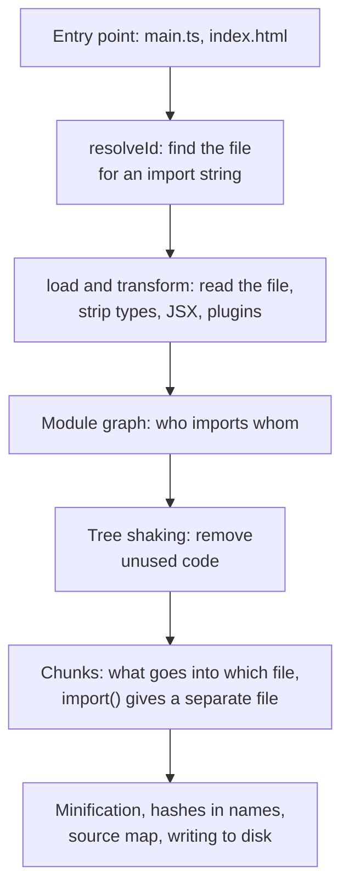

## What this lesson covers

What happens between the sources and the files the browser receives: the build steps from resolving imports to hashes in file names, why bundle at all when browsers understand ES modules, how development mode differs from a production build, and which bundlers are used in 2026 (Vite 8 with Rolldown, webpack 5, Rspack 2, Turbopack, esbuild). The example runs the real `rolldown` bundler with a plugin that prints every step.

## Build steps



- **Resolution** (`resolveId`): turn the string `'react'` or `'./greet'` into a file path. It takes into account `node_modules`, the `exports` field in `package.json`, extensions, aliases like `@/components`.
- **Loading and transforming** (`load`, `transform`): read the file and turn it into JavaScript. TypeScript types and JSX are removed by a compiler (Oxc in Vite 8 and Rolldown, SWC in Rspack and Turbopack, esbuild in Angular CLI); plugins turn CSS modules, images and SVG into modules.
- **Module graph**: the bundler parses each file, finds its imports and repeats the steps for them. When the graph is complete, it is known which exports are really used.
- **Generation**: tree shaking (the `tool-tree-shaking` lesson), splitting into chunks (the `tool-chunks` lesson), minification, a content hash in the file name, a source map.

## Plugins see every step

```ts run
import { rolldown, type Plugin } from 'rolldown'

// Source files live in an object instead of the disk.
const files: Record<string, string> = {
  'main.ts': `import { greet } from './greet.ts'
    const user: string = 'Ann'
    console.log(greet(user))
    document.body.onclick = () => import('./chart.ts').then((m) => m.draw())`,
  'greet.ts': `export const greet = (name: string): string => 'Hello, ' + name`,
  'chart.ts': `export const draw = (): void => console.log('a heavy chart')`,
}

// Modules are processed in parallel, so per-module steps are collected separately.
const perModule: Record<string, string[]> = {}
const build: string[] = []
const mod = (id: string, step: string): void => {
  ;(perModule[id] ??= []).push(step)
}

const pipeline: Plugin = {
  name: 'pipeline-log',
  buildStart: () => void build.push('buildStart'),
  resolveId(source) {
    const id = source.replace('./', '')
    mod(id, `resolveId('${source}')`)
    return id
  },
  load(id) {
    mod(id, 'load')
    return files[id]
  },
  transform(code, id) {
    if (id in files) mod(id, /: (string|void)/.test(code) ? 'transform (types still here)' : 'transform')
  },
  buildEnd: () => void build.push('buildEnd: the module graph is complete'),
  renderStart: () => void build.push('renderStart: chunks are decided'),
  renderChunk: (_code, chunk) => void build.push(`renderChunk ${chunk.fileName}: ${chunk.moduleIds.join(' + ')}`),
  generateBundle: (_, bundle) => void build.push(`generateBundle: ${Object.keys(bundle).join(', ')}`),
}

const bundle = await rolldown({ input: 'main.ts', plugins: [pipeline], logLevel: 'silent' })
const { output } = await bundle.generate({ minify: true, entryFileNames: '[name].js', chunkFileNames: '[name].js' })

console.log(build[0])
for (const id of Object.keys(files)) console.log(`  ${id.padEnd(9)} ${perModule[id].join(' -> ')}`)
console.log(build.slice(1).join('\n'))
console.log('\nmain.js:', output[0].code.trim())
```

```output
buildStart
  main.ts   resolveId('main.ts') -> load -> transform (types still here)
  greet.ts  resolveId('./greet.ts') -> load -> transform (types still here)
  chart.ts  resolveId('./chart.ts') -> load -> transform (types still here)
buildEnd: the module graph is complete
renderStart: chunks are decided
renderChunk main.js: greet.ts + main.ts
renderChunk chart.js: chart.ts
generateBundle: main.js, chart.js

main.js: console.log((e=>`Hello, Ann`)(`Ann`)),document.body.onclick=()=>import(`./chart.js`).then(e=>e.draw());
```

- The hooks follow the steps: `resolveId` and `load` for each module, then `transform`. The plugin received TypeScript **with types** in `transform`: the built-in type stripping runs after user plugins.
- `buildEnd` is called when the graph is complete; after it come `renderStart` and `renderChunk` for each chunk. The dynamic `import('./chart.ts')` produced a separate file `chart.js`.
- `greet.ts` disappeared as a module: the function was inlined into `main.js`, and the minifier computed its result at build time (`Hello, Ann`).
- Vite plugins use the same hooks (they are compatible with Rollup) and add their own for the dev server and HTML (the `tool-vite` lesson).

## Why a bundle when there are ES modules

Browsers run `<script type="module">` and `import` without a build, and HTTP/2 and HTTP/3 send many files over one connection. A build is still needed:

- **The import waterfall**: the browser learns about a module's import only after loading and parsing the importing file. A graph 10 levels deep means 10 sequential network round trips, and an app has hundreds or thousands of modules.
- **What the browser does not understand**: TypeScript, JSX, Vue and Angular templates, importing CSS and images, `'react'` without a path (an import map solves this, but not the rest).
- **Size**: tree shaking, minification and compression of one file work better than of thousands of small ones.
- **Caching**: a content hash in the name lets a file be cached for a year (the `tool-chunks` lesson).

Small sites and internal tools live without a build: native modules plus `<script type="importmap">` for package names. Import maps have been supported in all browsers since 2023.

## Development and production

| | Development | Production |
|---|---|---|
| Goal | Instant start and update after an edit | Minimum bytes and requests for the user |
| Vite 8 | No bundle: modules one by one, dependencies pre-bundled, HMR | Rolldown: graph, tree shaking, chunks, minification with Oxc and Lightning CSS |
| Checks | Development code: React warnings, `import.meta.env.DEV` | Development branches removed |
| Source map | Always | By setting: `build.sourcemap` |

Before version 8, Vite used esbuild for development and Rollup for the build: two different tools sometimes behaved differently. Vite 8 (March 2026) uses Rolldown and Oxc in both modes.

## Bundlers in 2026

| Tool | Where it is used | What matters |
|---|---|---|
| Vite 8 + Rolldown | New SPAs on React, Vue, Svelte; Nuxt, SvelteKit, React Router, Astro | Rolldown is written in Rust, its plugin API is Rollup's |
| webpack 5 | Many existing projects, complex configurations | Maintained (5.112), but slower than native bundlers |
| Rspack 2 | Moving off webpack without rewriting the configuration | Compatible with the webpack API and most plugins, written in Rust |
| Turbopack | Next.js 16 by default | Not used outside Next.js; `next build --webpack` for old setups |
| esbuild | Angular CLI (the `application` builder), building libraries and scripts | Very fast, simpler chunking settings |
| Rollup 4 | Building libraries | The historical standard for packages, Rolldown inherited its API |

The claim in the notes that "webpack is dead" is wrong: webpack 5 is maintained and runs in a huge number of projects. New projects usually start on Vite or in a meta-framework, and large webpack projects move to Rspack if build speed became a problem.

## Key points

- A build: resolving imports, loading and transforming (types, JSX, plugins), the module graph, tree shaking, chunks, minification, hashes.
- Vite and Rollup plugins work through the hooks `resolveId`, `load`, `transform`, `renderChunk`, `generateBundle`; a plugin sees the code before types are stripped.
- A bundle is needed even with ES modules: the import waterfall, non-standard syntax, size, caching; small projects can do without a build using import maps.
- Vite 8 uses Rolldown and Oxc in both development and build; development without a bundle, production with one.
- Bundlers in 2026: Vite 8, webpack 5, Rspack 2, Turbopack in Next.js 16, esbuild in Angular CLI; webpack is alive.
