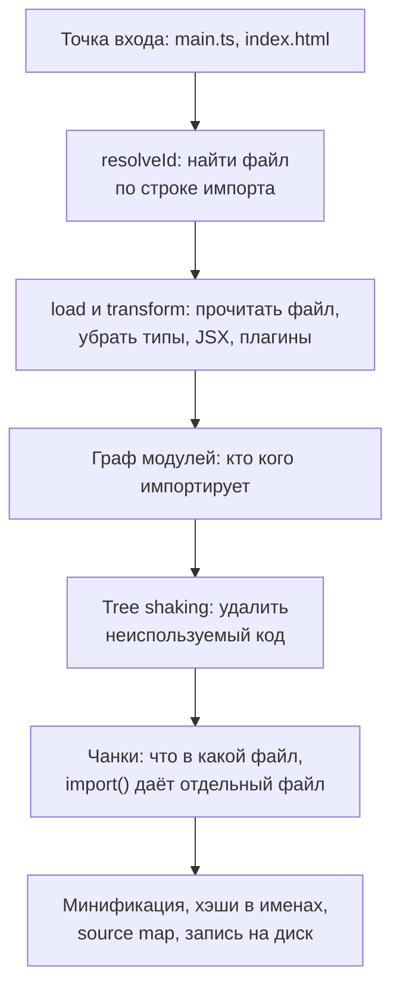

## О чём урок

Что происходит между исходниками и файлами, которые получает браузер: шаги сборки от разрешения импортов до хэшей в именах файлов, зачем собирать бандл, если браузеры понимают ES-модули, чем режим разработки отличается от продакшен-сборки, и какие сборщики используют в 2026 году (Vite 8 с Rolldown, webpack 5, Rspack 2, Turbopack, esbuild). Пример запускает настоящий сборщик `rolldown` с плагином, который печатает каждый шаг.

## Шаги сборки



- **Разрешение** (`resolveId`): строку `'react'` или `'./greet'` превратить в путь к файлу. Учитываются `node_modules`, поле `exports` в `package.json`, расширения, алиасы вроде `@/components`.
- **Загрузка и преобразование** (`load`, `transform`): прочитать файл и превратить его в JavaScript. Типы TypeScript и JSX убирает компилятор (Oxc в Vite 8 и Rolldown, SWC в Rspack и Turbopack, esbuild в Angular CLI), CSS-модули, картинки и SVG превращают в модули плагины.
- **Граф модулей**: сборщик разбирает каждый файл, находит его импорты и повторяет шаги для них. Когда граф готов, известно, какие экспорты реально используются.
- **Генерация**: tree shaking (урок `tool-tree-shaking`), разбиение на чанки (урок `tool-chunks`), минификация, хэш содержимого в имени файла, source map.

## Плагины видят каждый шаг

```ts run
import { rolldown, type Plugin } from 'rolldown'

// Source files live in an object instead of the disk.
const files: Record<string, string> = {
  'main.ts': `import { greet } from './greet.ts'
    const user: string = 'Ann'
    console.log(greet(user))
    document.body.onclick = () => import('./chart.ts').then((m) => m.draw())`,
  'greet.ts': `export const greet = (name: string): string => 'Hello, ' + name`,
  'chart.ts': `export const draw = (): void => console.log('a heavy chart')`,
}

// Modules are processed in parallel, so per-module steps are collected separately.
const perModule: Record<string, string[]> = {}
const build: string[] = []
const mod = (id: string, step: string): void => {
  ;(perModule[id] ??= []).push(step)
}

const pipeline: Plugin = {
  name: 'pipeline-log',
  buildStart: () => void build.push('buildStart'),
  resolveId(source) {
    const id = source.replace('./', '')
    mod(id, `resolveId('${source}')`)
    return id
  },
  load(id) {
    mod(id, 'load')
    return files[id]
  },
  transform(code, id) {
    if (id in files) mod(id, /: (string|void)/.test(code) ? 'transform (types still here)' : 'transform')
  },
  buildEnd: () => void build.push('buildEnd: the module graph is complete'),
  renderStart: () => void build.push('renderStart: chunks are decided'),
  renderChunk: (_code, chunk) => void build.push(`renderChunk ${chunk.fileName}: ${chunk.moduleIds.join(' + ')}`),
  generateBundle: (_, bundle) => void build.push(`generateBundle: ${Object.keys(bundle).join(', ')}`),
}

const bundle = await rolldown({ input: 'main.ts', plugins: [pipeline], logLevel: 'silent' })
const { output } = await bundle.generate({ minify: true, entryFileNames: '[name].js', chunkFileNames: '[name].js' })

console.log(build[0])
for (const id of Object.keys(files)) console.log(`  ${id.padEnd(9)} ${perModule[id].join(' -> ')}`)
console.log(build.slice(1).join('\n'))
console.log('\nmain.js:', output[0].code.trim())
```

```output
buildStart
  main.ts   resolveId('main.ts') -> load -> transform (types still here)
  greet.ts  resolveId('./greet.ts') -> load -> transform (types still here)
  chart.ts  resolveId('./chart.ts') -> load -> transform (types still here)
buildEnd: the module graph is complete
renderStart: chunks are decided
renderChunk main.js: greet.ts + main.ts
renderChunk chart.js: chart.ts
generateBundle: main.js, chart.js

main.js: console.log((e=>`Hello, Ann`)(`Ann`)),document.body.onclick=()=>import(`./chart.js`).then(e=>e.draw());
```

- Хуки идут в порядке шагов: `resolveId` и `load` для каждого модуля, потом `transform`. Плагин в `transform` получил TypeScript **с типами**: встроенное удаление типов идёт после пользовательских плагинов.
- `buildEnd` вызывается, когда граф собран; после этого `renderStart` и `renderChunk` для каждого чанка. Динамический `import('./chart.ts')` дал отдельный файл `chart.js`.
- `greet.ts` исчез как модуль: функция встроилась в `main.js`, а минификатор посчитал её результат на этапе сборки (`Hello, Ann`).
- Плагины Vite используют те же хуки (они совместимы с Rollup) и добавляют свои для сервера разработки и HTML (урок `tool-vite`).

## Зачем бандл, если есть ES-модули

Браузеры выполняют `<script type="module">` и `import` без сборки, а HTTP/2 и HTTP/3 передают много файлов по одному соединению. Сборка всё равно нужна:

- **Водопад импортов**: браузер узнаёт об импорте модуля, только загрузив и разобрав импортирующий файл. Глубина графа в 10 уровней означает 10 последовательных обходов сети, а в приложении сотни и тысячи модулей.
- **Что браузер не понимает**: TypeScript, JSX, шаблоны Vue и Angular, импорт CSS и картинок, `'react'` без пути (это решает import map, но не остальное).
- **Размер**: tree shaking, минификация и сжатие одного файла лучше, чем тысяч маленьких.
- **Кэш**: хэш содержимого в имени позволяет кэшировать файл на год (урок `tool-chunks`).

Без сборки живут небольшие сайты и внутренние инструменты: нативные модули плюс `<script type="importmap">` для имён пакетов. Import maps поддерживаются во всех браузерах с 2023 года.

## Разработка и продакшен

| | Разработка | Продакшен |
|---|---|---|
| Цель | Мгновенный старт и обновление после правки | Минимум байтов и запросов у пользователя |
| Vite 8 | Без бандла: модули по одному, зависимости предварительно собраны, HMR | Rolldown: граф, tree shaking, чанки, минификация Oxc и Lightning CSS |
| Проверки | Код для разработки: предупреждения React, `import.meta.env.DEV` | Ветки для разработки удалены |
| Source map | Всегда | По настройке: `build.sourcemap` |

В Vite до версии 8 разработку обслуживал esbuild, а сборку Rollup: два разных инструмента иногда вели себя по-разному. Vite 8 (март 2026) использует Rolldown и Oxc в обоих режимах.

## Сборщики в 2026 году

| Инструмент | Где используется | Что важно |
|---|---|---|
| Vite 8 + Rolldown | Новые SPA на React, Vue, Svelte; Nuxt, SvelteKit, React Router, Astro | Rolldown написан на Rust, API плагинов как у Rollup |
| webpack 5 | Много существующих проектов, сложные конфигурации | Поддерживается (5.112), но медленнее нативных сборщиков |
| Rspack 2 | Переход с webpack без переписывания конфигурации | Совместим с API и большинством плагинов webpack, написан на Rust |
| Turbopack | Next.js 16 по умолчанию | Отдельно от Next.js не используется; `next build --webpack` для старых настроек |
| esbuild | Angular CLI (сборщик `application`), сборка библиотек и скриптов | Очень быстрый, проще в настройке разбиения |
| Rollup 4 | Сборка библиотек | Исторический стандарт для пакетов, его API унаследовал Rolldown |

Утверждение из заметок «webpack мёртв» неверно: webpack 5 поддерживается и работает в огромном числе проектов. Новые проекты обычно начинают на Vite или в метафреймворке, а большие webpack-проекты переводят на Rspack, если скорость сборки стала проблемой.

## Главное

- Сборка: разрешение импортов, загрузка и преобразование (типы, JSX, плагины), граф модулей, tree shaking, чанки, минификация, хэши.
- Плагины Vite и Rollup работают через хуки `resolveId`, `load`, `transform`, `renderChunk`, `generateBundle`; плагин видит код до удаления типов.
- Бандл нужен и с ES-модулями: водопад импортов, нестандартный синтаксис, размер, кэш; без сборки можно обойтись в маленьких проектах с import maps.
- Vite 8 использует Rolldown и Oxc и в разработке, и в сборке; разработка без бандла, продакшен с бандлом.
- Сборщики 2026: Vite 8, webpack 5, Rspack 2, Turbopack в Next.js 16, esbuild в Angular CLI; webpack жив.
