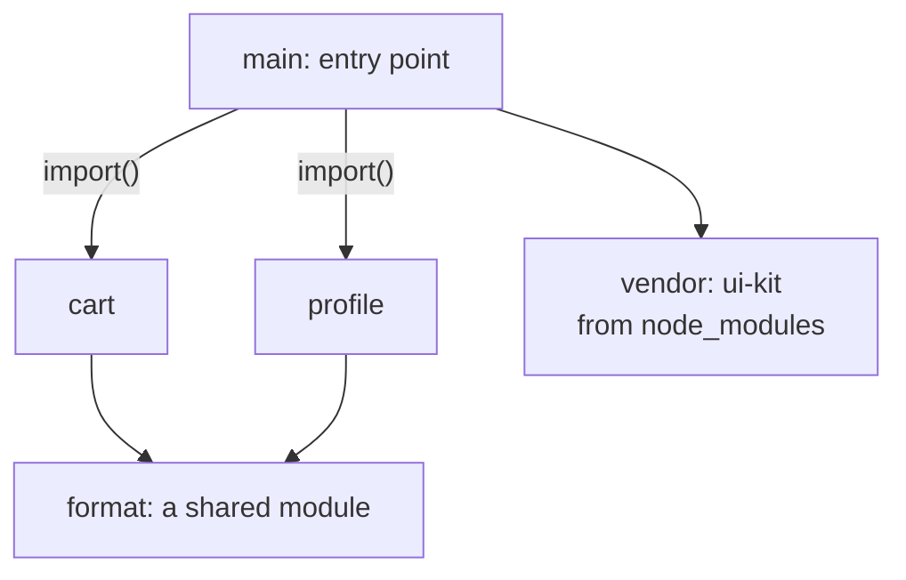
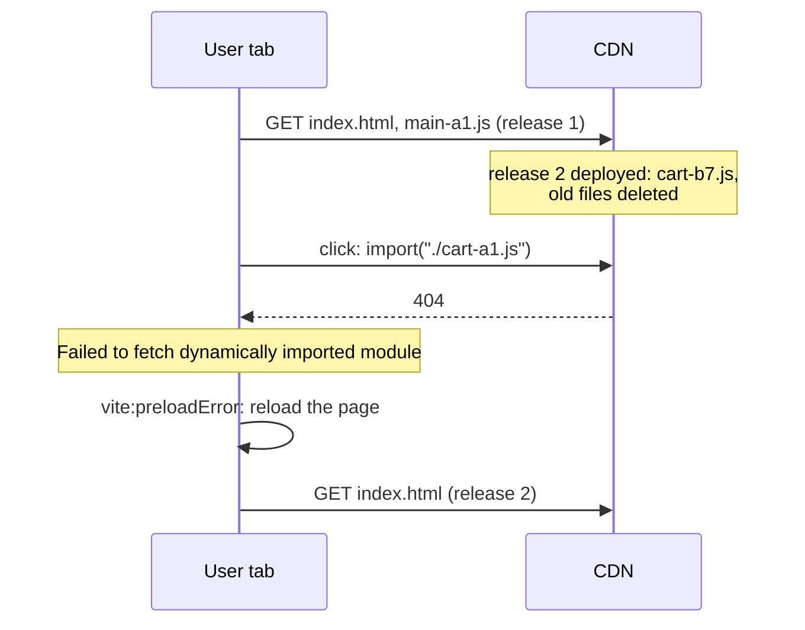

## What this lesson covers

How a bundler lays out modules into files and what follows for caching and deployment: entry, dynamic and shared chunks, manual groups like `vendor`, the content hash and why editing one module changes the names of several files, chunk preloading, source maps and the build manifest, the "Failed to fetch dynamically imported module" error after a deploy. Why to split code and how to choose the boundaries is covered in the `perf-javascript` lesson. The example builds two "releases" with the real Rolldown and compares file names.

## Where chunks come from

- **The entry chunk**: the entry point and everything it imports statically.
- **A dynamic chunk**: each `import()` starts a new chunk (a route, a modal, an editor).
- **A shared chunk**: a module needed by two or more chunks is moved out separately, so the code is not duplicated or loaded twice.
- **Manual groups**: rules like "everything from `node_modules` into `vendor`". In Vite 8 it is `build.rolldownOptions.output.codeSplitting.groups`, in webpack and Rspack `optimization.splitChunks.cacheGroups`. The old `manualChunks` is marked deprecated in Rolldown.



## Hashes and the chain of changes

```ts run
import { rolldown, type Plugin } from 'rolldown'

const project = (formatVersion: string): Record<string, string> => ({
  'main.js': `import { mount } from '/node_modules/ui-kit/index.js'
    mount('#app')
    document.querySelector('#cart').onclick = () => import('./pages/cart.js')
    document.querySelector('#profile').onclick = () => import('./pages/profile.js')`,
  'pages/cart.js': `import { price } from '../utils/format.js'; console.log('cart', price(10))`,
  'pages/profile.js': `import { price } from '../utils/format.js'; console.log('profile', price(0))`,
  'utils/format.js': `export const price = (n) => n.toFixed(2) + ' ${formatVersion}'`,
  '/node_modules/ui-kit/index.js': `export const mount = (sel) => console.log('ui-kit mounted into', sel)`,
})

async function build(files: Record<string, string>): Promise<Record<string, string[]>> {
  const plugin: Plugin = {
    name: 'files',
    resolveId: (source, importer) => (source.startsWith('/') ? source : new URL(source, 'file:///' + (importer ?? '')).pathname.slice(1)),
    load: (id) => files[id],
  }
  const bundle = await rolldown({ input: 'main.js', plugins: [plugin], logLevel: 'silent' })
  const { output } = await bundle.generate({
    entryFileNames: '[name]-[hash].js',
    chunkFileNames: '[name]-[hash].js',
    // Libraries from node_modules go to their own chunk: they change less often than the app.
    codeSplitting: { groups: [{ name: 'vendor', test: /node_modules/ }] },
  })
  const chunks: Record<string, string[]> = {}
  for (const c of output) if (c.type === 'chunk') chunks[c.fileName] = c.moduleIds.map((id) => id.replace('/node_modules/', ''))
  return chunks
}

const v1 = await build(project('EUR'))
const v2 = await build(project('€')) // a one-character change in utils/format.js
console.log('release 1 -> release 2')
for (const [file, modules] of Object.entries(v1)) {
  const name = file.split('-')[0]
  const next = Object.keys(v2).find((f) => f.startsWith(name + '-'))!
  console.log(`${name.padEnd(8)} ${file === next ? 'same name, stays cached ' : 'NEW name, downloaded again'}  modules: ${modules.join(', ')}`)
}
```

```output
release 1 -> release 2
main     NEW name, downloaded again  modules: main.js
cart     NEW name, downloaded again  modules: pages/cart.js
format   NEW name, downloaded again  modules: utils/format.js
profile  NEW name, downloaded again  modules: pages/profile.js
vendor   same name, stays cached   modules: ui-kit/index.js
```

- One character changed in `utils/format.js`, and four files out of five got new names. The reason: `cart` and `profile` contain the import string `./format-<hash>.js`, and `main` contains `./cart-<hash>.js`. A new hash of a leaf module changes the text of everyone referring to it, all the way up to the entry point.
- `vendor` did not change: libraries moved into a separate chunk stay in the browser cache between releases until the dependency itself is updated. This is the main argument for a separate library chunk.
- The flip side: one big `vendor` changes when **any** dependency is updated and is loaded on every page, even if it needs one library. Often only large and rarely changing packages (the framework, the router) are moved out, and the rest is left to automatic splitting.
- The chain can be broken with an import map: code imports a stable name, and the map in the HTML points to the hashed file. This is not the default setting in any popular bundler.

## Preloading

- For the static imports of the entry point Vite adds `<link rel="modulepreload">` to `index.html`: the browser loads them in parallel, not in a chain.
- Vite rewrites a dynamic `import('./cart')` so that the shared chunk `format` is loaded **at the same time** as `cart`, not after it. Without this there would be a waterfall: load `cart`, parse it, learn about `format`, load it.
- Loading a lazy chunk early (on link hover, when idle) is up to the app or the router: the `perf-javascript` lesson.

## Source maps and the manifest

| Vite setting | What it gives |
|---|---|
| `build.sourcemap: true` | `.map` files and a `sourceMappingURL` comment: DevTools show the sources |
| `build.sourcemap: 'hidden'` | `.map` files exist, no comment: maps are uploaded to Sentry or similar and not served to users |
| `build.manifest: true` | `.vite/manifest.json`: which hashed files correspond to which sources; needed when a backend renders the HTML |

A source map restores the source code almost verbatim. It is not a leak of secrets if there are none in the code (and there should be none), but whether to publish the sources is the team's decision; `hidden` lets you read error stacks with original lines without handing out the code.

## Deployment and old chunks



- An open tab keeps running the old `main` and knows the old chunk names. If the deploy deleted the previous release's files, the first navigation to a lazy page fails.
- **Keep old files** for a while after a deploy: upload new files next to the old ones instead of clearing the folder before the upload. Hashed names do not conflict, so both versions live together without trouble.
- **Handle the error**: Vite emits the `vite:preloadError` event; the simple way out is to reload the page, and the user gets the new `index.html`. Guard against an endless reload loop (for example, with a flag in `sessionStorage`).
- `index.html` is cached with revalidation (`no-cache`), hashed files for a year with `immutable` (the `net-caching` lesson).

## Key points

- Chunks: the entry, `import()`, shared by two or more chunks, manual groups (`codeSplitting.groups` in Rolldown, `splitChunks` in webpack).
- The content hash changes for the edited module and for everyone referring to it, up to the entry; `vendor` survives releases.
- One huge `vendor` changes on any dependency update: move out large and stable packages.
- Vite preloads entry chunks (`modulepreload`) and shared chunks together with dynamic ones.
- `sourcemap: 'hidden'` for error reports without publishing maps; `manifest` for backend integration.
- After a deploy old chunks must stay available; `vite:preloadError` and a reload as a safety net.
