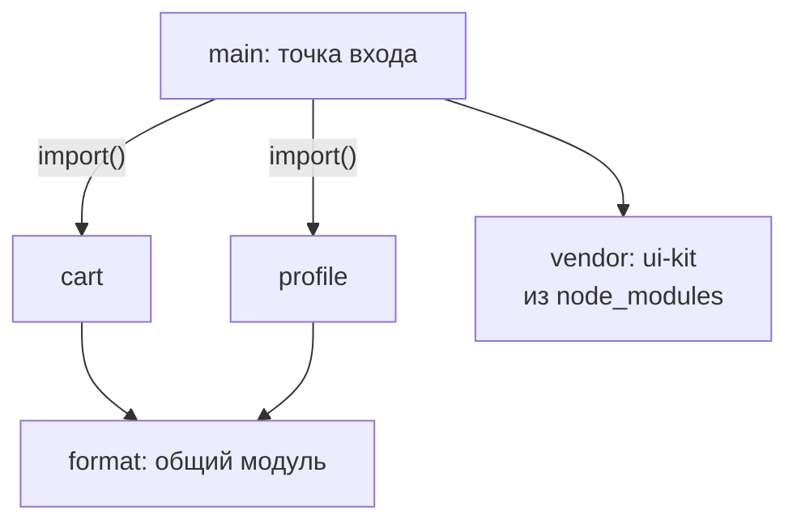
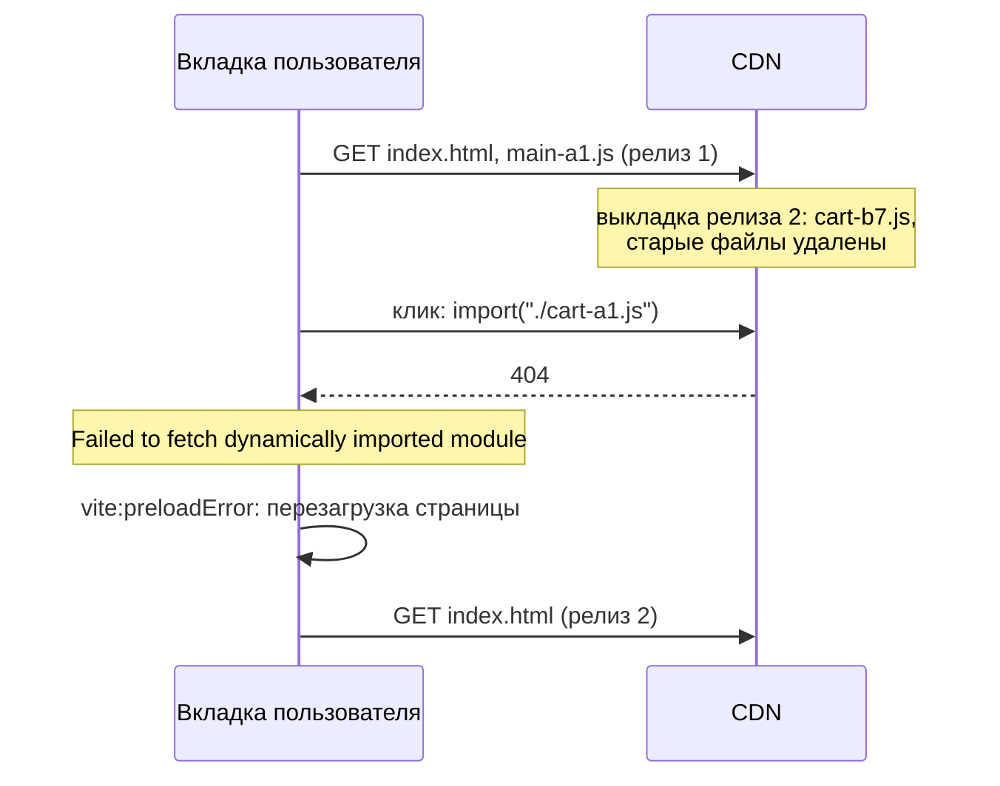

## О чём урок

Как сборщик раскладывает модули по файлам и что из этого следует для кэша и выкладки: чанки входа, динамические и общие, ручные группы вроде `vendor`, хэш содержимого и почему правка одного модуля меняет имена нескольких файлов, предзагрузка чанков, source map и манифест сборки, ошибка «Failed to fetch dynamically imported module» после деплоя. Зачем делить код и как выбрать границы, разобрано в уроке `perf-javascript`. Пример собирает два «релиза» настоящим Rolldown и сравнивает имена файлов.

## Откуда берутся чанки

- **Чанк входа**: точка входа и всё, что она импортирует статически.
- **Динамический чанк**: каждый `import()` начинает новый чанк (маршрут, модальное окно, редактор).
- **Общий чанк**: модуль, который нужен двум и более чанкам, выносится отдельно, чтобы не дублировать код и не загружать его дважды.
- **Ручные группы**: правила вида «всё из `node_modules` в `vendor`». В Vite 8 это `build.rolldownOptions.output.codeSplitting.groups`, в webpack и Rspack `optimization.splitChunks.cacheGroups`. Старый `manualChunks` в Rolldown помечен устаревшим.



## Хэши и цепочка изменений

```ts run
import { rolldown, type Plugin } from 'rolldown'

const project = (formatVersion: string): Record<string, string> => ({
  'main.js': `import { mount } from '/node_modules/ui-kit/index.js'
    mount('#app')
    document.querySelector('#cart').onclick = () => import('./pages/cart.js')
    document.querySelector('#profile').onclick = () => import('./pages/profile.js')`,
  'pages/cart.js': `import { price } from '../utils/format.js'; console.log('cart', price(10))`,
  'pages/profile.js': `import { price } from '../utils/format.js'; console.log('profile', price(0))`,
  'utils/format.js': `export const price = (n) => n.toFixed(2) + ' ${formatVersion}'`,
  '/node_modules/ui-kit/index.js': `export const mount = (sel) => console.log('ui-kit mounted into', sel)`,
})

async function build(files: Record<string, string>): Promise<Record<string, string[]>> {
  const plugin: Plugin = {
    name: 'files',
    resolveId: (source, importer) => (source.startsWith('/') ? source : new URL(source, 'file:///' + (importer ?? '')).pathname.slice(1)),
    load: (id) => files[id],
  }
  const bundle = await rolldown({ input: 'main.js', plugins: [plugin], logLevel: 'silent' })
  const { output } = await bundle.generate({
    entryFileNames: '[name]-[hash].js',
    chunkFileNames: '[name]-[hash].js',
    // Libraries from node_modules go to their own chunk: they change less often than the app.
    codeSplitting: { groups: [{ name: 'vendor', test: /node_modules/ }] },
  })
  const chunks: Record<string, string[]> = {}
  for (const c of output) if (c.type === 'chunk') chunks[c.fileName] = c.moduleIds.map((id) => id.replace('/node_modules/', ''))
  return chunks
}

const v1 = await build(project('EUR'))
const v2 = await build(project('€')) // a one-character change in utils/format.js
console.log('release 1 -> release 2')
for (const [file, modules] of Object.entries(v1)) {
  const name = file.split('-')[0]
  const next = Object.keys(v2).find((f) => f.startsWith(name + '-'))!
  console.log(`${name.padEnd(8)} ${file === next ? 'same name, stays cached ' : 'NEW name, downloaded again'}  modules: ${modules.join(', ')}`)
}
```

```output
release 1 -> release 2
main     NEW name, downloaded again  modules: main.js
cart     NEW name, downloaded again  modules: pages/cart.js
format   NEW name, downloaded again  modules: utils/format.js
profile  NEW name, downloaded again  modules: pages/profile.js
vendor   same name, stays cached   modules: ui-kit/index.js
```

- Изменился один символ в `utils/format.js`, а новые имена получили четыре файла из пяти. Причина: `cart` и `profile` содержат строку импорта `./format-<hash>.js`, а `main` содержит `./cart-<hash>.js`. Новый хэш листового модуля меняет текст всех, кто на него ссылается, и так до точки входа.
- `vendor` не изменился: библиотеки, вынесенные в отдельный чанк, остаются в кэше браузера между релизами, пока не обновится сама зависимость. Это главный довод за отдельный чанк библиотек.
- Обратная сторона: один большой `vendor` меняется при обновлении **любой** зависимости и загружается на каждой странице, даже если ей нужна одна библиотека. Часто выносят только крупные и редко меняющиеся пакеты (фреймворк, роутер), а остальное оставляют автоматическому разбиению.
- Цепочку можно разорвать через import map: код импортирует стабильное имя, а карта в HTML указывает на файл с хэшем. Это не настройка по умолчанию ни в одном популярном сборщике.

## Предзагрузка

- Для статических импортов точки входа Vite добавляет в `index.html` `<link rel="modulepreload">`: браузер загружает их параллельно, а не по цепочке.
- Динамический `import('./cart')` Vite переписывает так, что общий чанк `format` загружается **одновременно** с `cart`, а не после него. Без этого был бы водопад: загрузили `cart`, разобрали, узнали про `format`, загрузили его.
- Загрузить ленивый чанк заранее (при наведении на ссылку, в простое) решает приложение или роутер: урок `perf-javascript`.

## Source map и манифест

| Настройка Vite | Что даёт |
|---|---|
| `build.sourcemap: true` | Файлы `.map` и комментарий `sourceMappingURL`: DevTools показывают исходники |
| `build.sourcemap: 'hidden'` | Файлы `.map` есть, комментария нет: карты загружают в Sentry или аналог, а пользователям их не отдают |
| `build.manifest: true` | `.vite/manifest.json`: какие файлы с хэшами соответствуют каким исходникам; нужен, когда HTML рендерит бэкенд |

Source map восстанавливает исходный код почти дословно. Это не утечка секретов, если их нет в коде (их и не должно быть), но публиковать исходники или нет, решает команда; `hidden` позволяет читать стек ошибок с исходными строками, не раздавая код.

## Деплой и старые чанки



- Открытая вкладка продолжает работать на старом `main` и знает старые имена чанков. Если деплой удалил файлы прошлого релиза, первый же переход на ленивую страницу падает.
- **Хранить старые файлы** некоторое время после деплоя: загружать новые файлы рядом со старыми, а не очищать папку перед загрузкой. Имена с хэшем не конфликтуют, поэтому обе версии спокойно живут вместе.
- **Обработать ошибку**: Vite генерирует событие `vite:preloadError`; простой выход перезагрузить страницу, и пользователь получит новый `index.html`. Защитите от бесконечного цикла перезагрузок (например, флагом в `sessionStorage`).
- `index.html` кэшируют с проверкой (`no-cache`), файлы с хэшем на год с `immutable` (урок `net-caching`).

## Главное

- Чанки: вход, `import()`, общий для двух и более чанков, ручные группы (`codeSplitting.groups` в Rolldown, `splitChunks` в webpack).
- Хэш содержимого меняется у изменённого модуля и у всех, кто на него ссылается, вплоть до входа; `vendor` переживает релизы.
- Один огромный `vendor` меняется при любом обновлении зависимостей: выносят крупные и стабильные пакеты.
- Vite предзагружает чанки входа (`modulepreload`) и общие чанки вместе с динамическими.
- `sourcemap: 'hidden'` для отчётов об ошибках без публикации карт; `manifest` для интеграции с бэкендом.
- После деплоя старые чанки должны оставаться доступными; `vite:preloadError` и перезагрузка как страховка.
