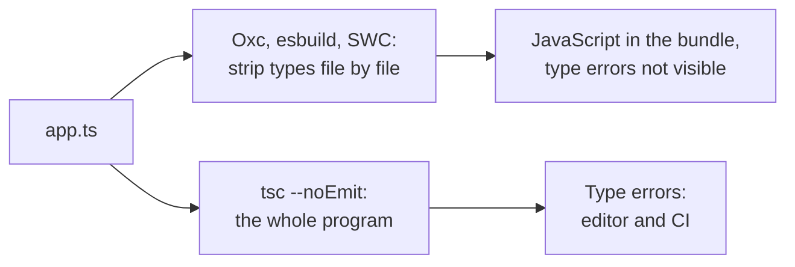

## What this lesson covers

How TypeScript, JSX, linters and formatters fit into the build: why the bundler does not check types and where to do it, the `isolatedModules`, `verbatimModuleSyntax` and `erasableSyntaxOnly` settings, TypeScript 7 in Go and running `.ts` directly in Node.js, the JSX transform, ESLint 10, Oxlint and Biome, Prettier and Oxfmt, where to run the checks. The example compiles one file with a type error in three ways.

## Stripping types and checking types: different jobs



```ts run
/// <reference types="node" />
import { execFileSync } from 'node:child_process'
import { mkdtempSync, rmSync, writeFileSync } from 'node:fs'
import { tmpdir } from 'node:os'
import { join } from 'node:path'
import ts from 'typescript'

const source = `
type User = { name: string; age: number }
export const label = (u: User): string => u.name.toUpperCase() + ', ' + u.age
console.log(label({ name: 'Ann', age: '33' }))  // a type error: age is a string

export enum Role { Admin, Guest }               // enum is not just a type: it becomes code
`

// 1. What Vite, esbuild, SWC and Oxc do: remove the types file by file, without checking them.
const js = ts.transpileModule(source, { compilerOptions: { target: ts.ScriptTarget.ES2022, module: ts.ModuleKind.ESNext } })
console.log('transpile only, errors:', js.diagnostics?.length ?? 0)
console.log(js.outputText.trim())

// 2. What tsc --noEmit does: builds the whole program and checks types.
function check(options: ts.CompilerOptions): string[] {
  const host = ts.createCompilerHost(options)
  const read = host.readFile
  host.readFile = (f) => (f === 'app.ts' ? source : read(f))
  host.fileExists = (f) => f === 'app.ts' || ts.sys.fileExists(f)
  const program = ts.createProgram(['app.ts'], options, host)
  return ts.getPreEmitDiagnostics(program).map((d) => `TS${d.code}: ${ts.flattenDiagnosticMessageText(d.messageText, ' ')}`)
}
console.log('\ntsc --noEmit:')
console.log(check({ noEmit: true, strict: true, types: [] }).join('\n'))
console.log('\ntsc --noEmit with erasableSyntaxOnly:')
console.log(check({ noEmit: true, strict: true, types: [], erasableSyntaxOnly: true }).join('\n'))

// 3. Node.js 24 runs .ts files by stripping types: no checking, and no enum.
const dir = mkdtempSync(join(tmpdir(), 'ts-')) // Node does not strip types inside node_modules
const runNode = (code: string): string => {
  writeFileSync(join(dir, 'app.ts'), code)
  try {
    return execFileSync(process.execPath, [join(dir, 'app.ts')], { encoding: 'utf8', stdio: 'pipe' }).trim()
  } catch (e) {
    return String((e as { stderr: string }).stderr).match(/ERR_\w+/)?.[0] ?? 'failed'
  }
}
console.log('\nnode app.ts:', runNode(source))
console.log('node app.ts without the enum:', runNode(source.replace(/export enum.*/, '')))
rmSync(dir, { recursive: true })
```

```output
transpile only, errors: 0
export const label = (u) => u.name.toUpperCase() + ', ' + u.age;
console.log(label({ name: 'Ann', age: '33' })); // a type error: age is a string
export var Role;
(function (Role) {
    Role[Role["Admin"] = 0] = "Admin";
    Role[Role["Guest"] = 1] = "Guest";
})(Role || (Role = {})); // enum is not just a type: it becomes code

tsc --noEmit:
TS2322: Type 'string' is not assignable to type 'number'.

tsc --noEmit with erasableSyntaxOnly:
TS2322: Type 'string' is not assignable to type 'number'.
TS1294: This syntax is not allowed when 'erasableSyntaxOnly' is enabled.

node app.ts: ERR_UNSUPPORTED_TYPESCRIPT_SYNTAX
node app.ts without the enum: ANN, 33
```

- **Type stripping** (how Vite, esbuild, SWC, Oxc and `transpileModule` work) processes each file separately and knows nothing about other files. That is why it is fast, and that is why it **finds no type errors**: the file with `age: '33'` became JavaScript without a single error.
- **Type checking** is done by `tsc --noEmit` (`vue-tsc` in Vue projects): it builds the whole program. In a Vite project it is a separate step: in the editor through the language server and in CI, often `"build": "tsc -b && vite build"`. Angular CLI checks types and templates itself during the build.
- **`enum`** is not just a type: it turns into code. That is why Node.js, which runs `.ts` by simply stripping types (by default since versions 22.18 and 23.6), fails on `enum` with `ERR_UNSUPPORTED_TYPESCRIPT_SYNTAX`. Without the `enum`, Node ran the file with the type error: no checking here either.
- The **`erasableSyntaxOnly`** setting (TypeScript 5.8) forbids constructs that cannot simply be erased: `enum`, `namespace` with code, parameter properties in constructors. Instead of `enum` you write an `as const` object and a union type.

## tsconfig settings for bundlers

| Setting | Why |
|---|---|
| `isolatedModules: true` | An error on what cannot be compiled one file at a time (for example, re-exporting a type without `type`) |
| `verbatimModuleSyntax: true` | Type-only imports are written `import type`; other imports stay as they are, without the compiler guessing |
| `erasableSyntaxOnly: true` | Only syntax that can be erased: the code works with Node.js and any compiler that does not check types |
| `noEmit: true` | `tsc` only checks, the bundler writes the files |
| `moduleResolution: "bundler"` | Import resolution like Vite and webpack: `exports` in `package.json`, no extensions |

## TypeScript 7

TypeScript 7 (July 2026) is the same language, but the compiler is rewritten in Go: a full check is usually 8–12 times faster than with TypeScript 6, plus multithreading and a new language server. It installs the same way (`npm install -D typescript`, the `tsc` command). The previous version, 6.0, was the last one in JavaScript. Tools that use the compiler's programmatic API are waiting for a stable API in later versions, so part of the ecosystem is moving gradually.

## JSX

- **The classic transform**: `<Button />` becomes `React.createElement(Button)`, so every file needs `import React`. The Babel plugin from the notes worked this way.
- **The automatic one** (React 17 and later, the default now): the compiler adds `import { jsx } from 'react/jsx-runtime'` by itself, a React import in the file is not needed. The setting is `"jsx": "react-jsx"` in tsconfig.
- Babel is no longer required for JSX: `@vitejs/plugin-react` 6 uses Oxc and does not depend on Babel. Babel stays for the React Compiler, which still works as a Babel plugin.

## Linters and formatters

| Tool | What it does | What matters |
|---|---|---|
| ESLint 10 | A linter with a huge plugin ecosystem | Only the flat config `eslint.config.js`: `.eslintrc` was removed in version 10 |
| typescript-eslint | Rules for TS, including ones that use type information | Type-aware rules are slow: enable them selectively |
| Oxlint | A linter in Rust, hundreds of ESLint, React, TS and import rules | Tens of times faster; often put before ESLint or instead of it |
| Biome 2 | A linter and a formatter in one Rust tool | One configuration, its own rule set |
| Prettier 3 | A formatter | The formatting standard, no need to argue about style |
| Oxfmt | A Prettier-compatible formatter in Rust | Still before version 1.0 |

- A linter looks for **bugs and dangerous constructs** (`react-hooks/rules-of-hooks`, unused variables, `no-floating-promises`); a formatter only places spaces and line breaks. Style rules are left to the formatter so the two do not fight.
- `react-hooks/exhaustive-deps` is not disabled with a comment without a reason: the `react-effects` lesson.

## Where to run the checks

1. **The editor**: the TypeScript language server and the linter show errors right away, the formatter runs on save.
2. **Before a commit**: `lint-staged` runs the linter and the formatter only on changed files to keep the hook fast. A hook can be bypassed, so it is a convenience, not a guarantee.
3. **CI**: type checking, the linter, a formatting check (`prettier --check`), tests and the build on every pull request. This is the only place that cannot be skipped.

## Key points

- The bundler strips types file by file and does not check them; `tsc --noEmit` (`vue-tsc`) runs separately, in the editor and in CI.
- `enum` and other non-erasable constructs need compilation; `erasableSyntaxOnly` forbids them, Node.js 24 runs `.ts` without them.
- `isolatedModules`, `verbatimModuleSyntax`, `moduleResolution: "bundler"` for projects on bundlers.
- TypeScript 7 in Go: the same language, checking 8–12 times faster.
- JSX: the automatic runtime; Babel is needed only for the React Compiler.
- ESLint 10 only with the flat config; Oxlint and Biome are faster; a formatter separate from the linter; mandatory checks in CI.
