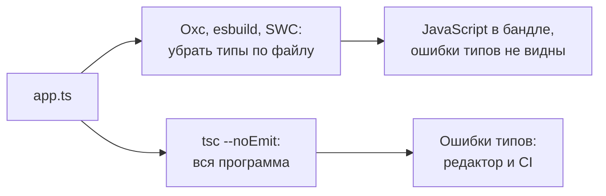

## О чём урок

Как TypeScript, JSX, линтеры и форматтеры встроены в сборку: почему сборщик не проверяет типы и где это делать, настройки `isolatedModules`, `verbatimModuleSyntax` и `erasableSyntaxOnly`, TypeScript 7 на Go и запуск `.ts` прямо в Node.js, преобразование JSX, ESLint 10, Oxlint и Biome, Prettier и Oxfmt, где запускать проверки. Пример компилирует один файл с ошибкой типа тремя способами.

## Убрать типы и проверить типы: разные задачи



```ts run
/// <reference types="node" />
import { execFileSync } from 'node:child_process'
import { mkdtempSync, rmSync, writeFileSync } from 'node:fs'
import { tmpdir } from 'node:os'
import { join } from 'node:path'
import ts from 'typescript'

const source = `
type User = { name: string; age: number }
export const label = (u: User): string => u.name.toUpperCase() + ', ' + u.age
console.log(label({ name: 'Ann', age: '33' }))  // a type error: age is a string

export enum Role { Admin, Guest }               // enum is not just a type: it becomes code
`

// 1. What Vite, esbuild, SWC and Oxc do: remove the types file by file, without checking them.
const js = ts.transpileModule(source, { compilerOptions: { target: ts.ScriptTarget.ES2022, module: ts.ModuleKind.ESNext } })
console.log('transpile only, errors:', js.diagnostics?.length ?? 0)
console.log(js.outputText.trim())

// 2. What tsc --noEmit does: builds the whole program and checks types.
function check(options: ts.CompilerOptions): string[] {
  const host = ts.createCompilerHost(options)
  const read = host.readFile
  host.readFile = (f) => (f === 'app.ts' ? source : read(f))
  host.fileExists = (f) => f === 'app.ts' || ts.sys.fileExists(f)
  const program = ts.createProgram(['app.ts'], options, host)
  return ts.getPreEmitDiagnostics(program).map((d) => `TS${d.code}: ${ts.flattenDiagnosticMessageText(d.messageText, ' ')}`)
}
console.log('\ntsc --noEmit:')
console.log(check({ noEmit: true, strict: true, types: [] }).join('\n'))
console.log('\ntsc --noEmit with erasableSyntaxOnly:')
console.log(check({ noEmit: true, strict: true, types: [], erasableSyntaxOnly: true }).join('\n'))

// 3. Node.js 24 runs .ts files by stripping types: no checking, and no enum.
const dir = mkdtempSync(join(tmpdir(), 'ts-')) // Node does not strip types inside node_modules
const runNode = (code: string): string => {
  writeFileSync(join(dir, 'app.ts'), code)
  try {
    return execFileSync(process.execPath, [join(dir, 'app.ts')], { encoding: 'utf8', stdio: 'pipe' }).trim()
  } catch (e) {
    return String((e as { stderr: string }).stderr).match(/ERR_\w+/)?.[0] ?? 'failed'
  }
}
console.log('\nnode app.ts:', runNode(source))
console.log('node app.ts without the enum:', runNode(source.replace(/export enum.*/, '')))
rmSync(dir, { recursive: true })
```

```output
transpile only, errors: 0
export const label = (u) => u.name.toUpperCase() + ', ' + u.age;
console.log(label({ name: 'Ann', age: '33' })); // a type error: age is a string
export var Role;
(function (Role) {
    Role[Role["Admin"] = 0] = "Admin";
    Role[Role["Guest"] = 1] = "Guest";
})(Role || (Role = {})); // enum is not just a type: it becomes code

tsc --noEmit:
TS2322: Type 'string' is not assignable to type 'number'.

tsc --noEmit with erasableSyntaxOnly:
TS2322: Type 'string' is not assignable to type 'number'.
TS1294: This syntax is not allowed when 'erasableSyntaxOnly' is enabled.

node app.ts: ERR_UNSUPPORTED_TYPESCRIPT_SYNTAX
node app.ts without the enum: ANN, 33
```

- **Удаление типов** (так работают Vite, esbuild, SWC, Oxc и `transpileModule`) обрабатывает каждый файл отдельно и не знает о других файлах. Поэтому оно быстрое и поэтому **не находит ошибок типов**: файл с `age: '33'` превратился в JavaScript без единой ошибки.
- **Проверку типов** делает `tsc --noEmit` (в проектах Vue `vue-tsc`): он строит всю программу. В Vite-проекте это отдельный шаг: в редакторе через языковой сервер и в CI, часто `"build": "tsc -b && vite build"`. Angular CLI проверяет типы и шаблоны сам при сборке.
- **`enum`** не просто тип: он превращается в код. Поэтому Node.js, который запускает `.ts` простым удалением типов (по умолчанию с версий 22.18 и 23.6), на `enum` падает с `ERR_UNSUPPORTED_TYPESCRIPT_SYNTAX`. Без `enum` Node выполнил файл с ошибкой типа: проверки нет и здесь.
- Настройка **`erasableSyntaxOnly`** (TypeScript 5.8) запрещает конструкции, которые нельзя просто стереть: `enum`, `namespace` с кодом, свойства в параметрах конструктора. Вместо `enum` пишут объект `as const` и тип-объединение.

## Настройки tsconfig для сборщиков

| Настройка | Зачем |
|---|---|
| `isolatedModules: true` | Ошибка на том, что нельзя скомпилировать по одному файлу (например, реэкспорт типа без `type`) |
| `verbatimModuleSyntax: true` | Импорты только типов пишут `import type`; остальные импорты остаются как есть, без догадок компилятора |
| `erasableSyntaxOnly: true` | Только синтаксис, который стирается: код совместим с Node.js и любым компилятором без проверки типов |
| `noEmit: true` | `tsc` только проверяет, файлы пишет сборщик |
| `moduleResolution: "bundler"` | Разрешение импортов как у Vite и webpack: `exports` в `package.json`, без расширений |

## TypeScript 7

TypeScript 7 (июль 2026) это тот же язык, но компилятор переписан на Go: полная проверка обычно в 8–12 раз быстрее, чем на TypeScript 6, плюс многопоточность и новый языковой сервер. Устанавливается так же (`npm install -D typescript`, команда `tsc`). Предыдущая версия 6.0 была последней на JavaScript. Инструменты, которые используют программный API компилятора, ждут стабильного API в следующих версиях, поэтому часть экосистемы переходит постепенно.

## JSX

- **Классическое преобразование**: `<Button />` превращается в `React.createElement(Button)`, поэтому в каждом файле нужен `import React`. Так работал Babel-плагин из заметок.
- **Автоматическое** (React 17 и новее, по умолчанию сейчас): компилятор сам добавляет `import { jsx } from 'react/jsx-runtime'`, импорт React в файле не нужен. Настройка `"jsx": "react-jsx"` в tsconfig.
- Babel для JSX больше не обязателен: `@vitejs/plugin-react` 6 использует Oxc и не зависит от Babel. Babel остаётся для React Compiler, который пока работает как плагин Babel.

## Линтеры и форматтеры

| Инструмент | Что делает | Что важно |
|---|---|---|
| ESLint 10 | Линтер, огромная экосистема плагинов | Только плоская конфигурация `eslint.config.js`: `.eslintrc` удалён в версии 10 |
| typescript-eslint | Правила для TS, в том числе с информацией о типах | Правила с типами медленные: их включают точечно |
| Oxlint | Линтер на Rust, сотни правил ESLint, React, TS, импортов | В десятки раз быстрее; часто ставят перед ESLint или вместо него |
| Biome 2 | Линтер и форматтер в одном инструменте на Rust | Одна конфигурация, свой набор правил |
| Prettier 3 | Форматтер | Стандарт форматирования, спорить о стиле не нужно |
| Oxfmt | Форматтер на Rust, совместимый с Prettier | Пока до версии 1.0 |

- Линтер ищет **ошибки и опасные конструкции** (`react-hooks/rules-of-hooks`, неиспользуемые переменные, `no-floating-promises`), форматтер только расставляет пробелы и переносы. Правила о стиле отдают форматтеру, чтобы они не спорили.
- `react-hooks/exhaustive-deps` не отключают комментарием без причины: урок `react-effects`.

## Где запускать проверки

1. **Редактор**: языковой сервер TypeScript и линтер показывают ошибки сразу, форматтер срабатывает при сохранении.
2. **Перед коммитом**: `lint-staged` запускает линтер и форматтер только для изменённых файлов, чтобы хук был быстрым. Хук можно обойти, поэтому он удобство, а не гарантия.
3. **CI**: проверка типов, линтер, проверка форматирования (`prettier --check`), тесты и сборка на каждый pull request. Это единственное место, которое нельзя пропустить.

## Главное

- Сборщик убирает типы по файлу и не проверяет их; `tsc --noEmit` (`vue-tsc`) запускают отдельно, в редакторе и CI.
- `enum` и другие нестираемые конструкции требуют компиляции; `erasableSyntaxOnly` их запрещает, Node.js 24 выполняет `.ts` без них.
- `isolatedModules`, `verbatimModuleSyntax`, `moduleResolution: "bundler"` для проектов на сборщиках.
- TypeScript 7 на Go: тот же язык, проверка в 8–12 раз быстрее.
- JSX: автоматический runtime, Babel нужен только для React Compiler.
- ESLint 10 только с плоской конфигурацией; Oxlint и Biome быстрее; форматтер отдельно от линтера; обязательные проверки в CI.
