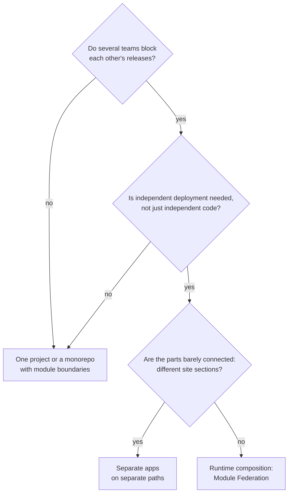
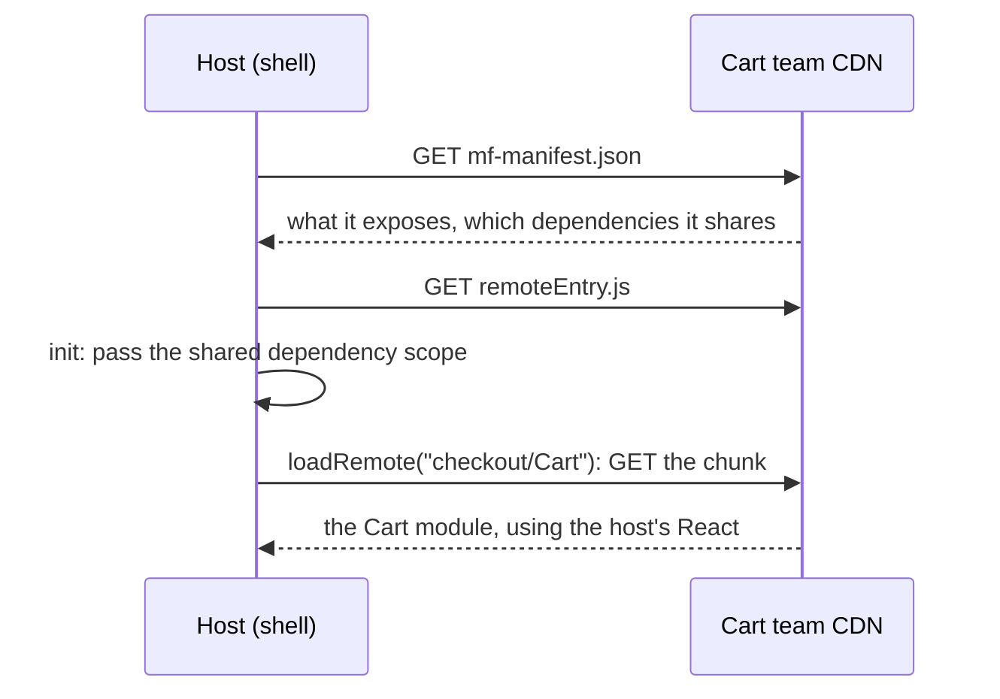

## What this lesson covers

Micro-frontends: what problem they solve and when they are not needed, ways to compose a page from parts (packages, the server, iframes, Module Federation, single-spa, import maps, Web Components), how Module Federation 2.0 works and how it shares common dependencies, typical problems and their solutions. The example runs the real Module Federation runtime and shows how many copies of React three apps get with different settings.

## What it is and why

Micro-frontends split the interface into parts that **different teams build and deploy independently**: the cart ships without waiting for the profile's release. It is an organizational decision, not a technical one: it pays off when the main bottleneck is coordinating releases between teams.



The numbers in the notes ("more than 8–10 developers", "more than 500 thousand lines") are rules of thumb without a source: what decides is not the code size but how many teams block each other and how often. A modular monolith in a monorepo with boundary checks (the `tool-monorepo` lesson) gives independent code without the cost of runtime composition.

## Ways to compose

| Way | How | Pros | Cons |
|---|---|---|---|
| npm packages | Parts are published as libraries, the app bundles them | Simple, one bundle | Not independent deployment: the app needs a release |
| Separate apps on paths | `/shop` and `/account` are separate SPAs behind one domain | Full isolation, simple | A reload on navigation, the shared header is duplicated |
| Server composition | A server or the edge assembles HTML from fragments | Fast first render, SEO | Complex infrastructure, interactivity separately |
| iframe | Each part in its own window | Full isolation, safe | Sizing, focus, routing, accessibility |
| Module Federation | The host loads modules from remote builds at run time, shared dependencies are shared | Independent deployment, one page | Versions, debugging, infrastructure |
| single-spa, import maps | A router mounts apps, modules through an import map | Different frameworks on one page | More JavaScript, more manual work |
| Web Components | A part ships a custom element | A standard, any framework inside | Passing complex data, SSR |

## Module Federation 2.0



- The **host** (shell) declares `remotes`, the **remote app** declares `exposes`: which modules are available from outside (`'./Cart': './src/Cart.tsx'`). Both sides declare `shared`: which dependencies may be shared.
- The **manifest** `mf-manifest.json` describes the remote app; the host can learn remote addresses at run time, and the cart team deploys a new version without rebuilding the host.
- The **runtime** (`@module-federation/runtime`) loads remote modules (`loadRemote`), decides which copy of a shared dependency to use, and offers plugin hooks.
- MF 2.0 works with webpack, Rspack, Vite (`@module-federation/vite`), Rsbuild; Nx can generate a host and remotes for React and Angular. For Angular there is also Native Federation, built on import maps.

## Shared dependencies

```js run
import { createInstance } from '@module-federation/runtime'

// The real Module Federation runtime; "react" here is a stand-in object, so no network is needed.
const short = (m) => String(m).replace(/^[\s\S]*?Version/, 'Version').replace(' of shared singleton module react', '').split(')')[0]
const warnings = []
console.warn = (...args) => warnings.push(short(args.at(-1)))

async function scenario(title, apps, extra = {}) {
  console.log(`\n${title}`)
  // Each app ships its own build of the library; get() loads that build once.
  const shared = ([name, version]) => {
    let build
    const get = async () => () => (build ??= { version, from: name })
    return { react: { version, get, shareConfig: { requiredVersion: '^' + version.split('.')[0] + '.0.0', ...extra } } }
  }
  // The host (shell) owns the share scope; each remote gets it when its container is initialized.
  const host = createInstance({ name: apps[0][0], remotes: [], shared: shared(apps[0]) })
  const instances = [host]
  for (const app of apps.slice(1)) {
    const remote = createInstance({ name: app[0], remotes: [], shared: shared(app) })
    // What container initialization does: put the remote's versions into the host's scope and use that scope.
    const scope = host.shareScopeMap.default
    for (const [pkg, versions] of Object.entries(remote.shareScopeMap.default)) Object.assign((scope[pkg] ??= {}), versions)
    remote.initShareScopeMap('default', scope)
    instances.push(remote)
  }
  const copies = new Set()
  for (const mf of instances) {
    try {
      const react = (await mf.loadShare('react'))()
      copies.add(react)
      console.log(`  ${mf.name.padEnd(9)} needs ^${mf.options.shared.react[0].version.split('.')[0]}, uses react ${react.version} from ${react.from}`)
    } catch (e) {
      console.log(`  ${mf.name.padEnd(9)} error: ${short(e.message)}`)
    }
  }
  console.log(`  copies of react in memory: ${copies.size}`)
  if (warnings.length) console.log('  warning:', warnings.splice(0).join(' | '))
}

const apps = [['shell', '19.2.0'], ['checkout', '19.1.0'], ['profile', '18.3.1']]
await scenario('default settings', apps)
await scenario('singleton: true', apps, { singleton: true })
await scenario('singleton: true, strictVersion: true', apps, { singleton: true, strictVersion: true })
```

```output

default settings
  shell     needs ^19, uses react 19.2.0 from shell
  checkout  needs ^19, uses react 19.2.0 from shell
  profile   needs ^18, uses react 18.3.1 from profile
  copies of react in memory: 2

singleton: true
  shell     needs ^19, uses react 19.2.0 from shell
  checkout  needs ^19, uses react 19.2.0 from shell
  profile   needs ^18, uses react 19.2.0 from shell
  copies of react in memory: 1
  warning: Version 19.2.0 from shell does not satisfy the requirement of profile which needs ^18.0.0

singleton: true, strictVersion: true
  shell     needs ^19, uses react 19.2.0 from shell
  checkout  needs ^19, uses react 19.2.0 from shell
  profile   error: Version 19.2.0 from shell does not satisfy the requirement of profile which needs ^18.0.0
  copies of react in memory: 1
```

- **With default settings** versions are compared with ranges: `checkout` asked for `^19` and got the host's 19.2.0, while `profile` on React 18 loaded its own copy. For utilities this is fine, for React it is not: two React instances on a page break hooks and context at the boundary between apps.
- **`singleton: true`**: one copy on the page, the newest. `profile` got 19.2.0 despite its `^18`, with only a warning in the console: code written for 18 runs on 19 at its own risk.
- **`strictVersion: true`**: the incompatibility becomes a loading error instead of a silent problem in production.
- Hence the rule: the framework, the router, the store and the design system are declared `singleton`, and their major versions are **agreed** between teams. The independence of micro-frontends does not extend to the React version.
- The notes say Rspack with MF 2.0 "deduplicates better than webpack": the sharing rules are set by the same `shared` configuration and the same runtime, they do not depend on the bundler.

## Problems and solutions

| Problem | Solution |
|---|---|
| One library loads several times | `shared` with `singleton`, agreed major versions, a check in CI |
| One part's styles break another | CSS modules, prefixes, `@layer`, Shadow DOM in Web Components; a shared design system |
| Communication between parts | Events (`CustomEvent`), the URL, a small shared contract; not a shared global store |
| Routing | The host owns the top level of the URL, a part owns its subpath |
| Authentication | A session in a cookie on the shared domain; tokens are not passed between parts through `window` |
| A remote app is unavailable | An error boundary and a fallback UI around each remote part |
| Performance | The chain of manifest, `remoteEntry`, chunks: preloading (`preloadRemote`), a CDN, a shared dependency cache |
| Compatibility | Contract and end-to-end tests on the assembled page; versioning of `exposes` |

## Key points

- Micro-frontends give independent deployment of parts by different teams; they answer an organizational problem.
- If teams do not block each other, a monorepo with module boundaries is enough.
- Composition: packages, apps on paths, the server, iframes, Module Federation, single-spa and import maps, Web Components.
- MF 2.0: the host, `remotes`, `exposes`, `shared`, the manifest and the runtime; works with webpack, Rspack, Vite.
- Without `singleton`, incompatible versions give two React copies; `singleton` gives one and a warning, `strictVersion` an error.
- The framework and the design system are shared as `singleton` with agreed versions; styles are isolated, parts talk through events and the URL.
