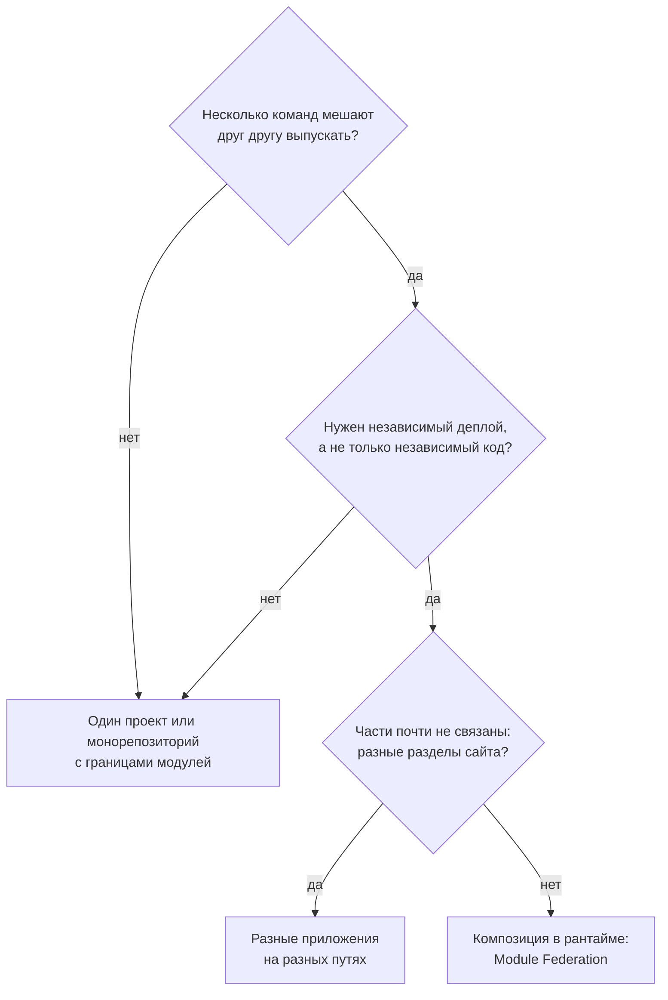
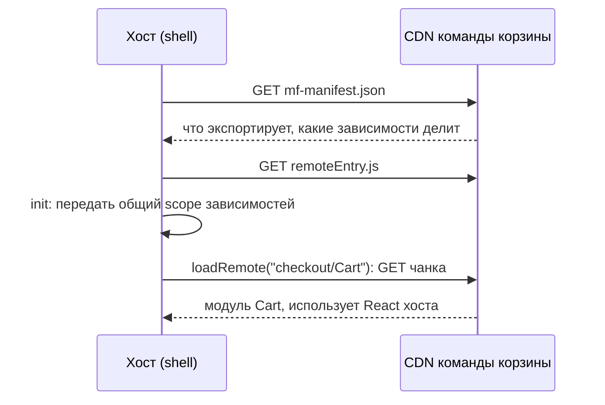

## О чём урок

Микрофронтенды: какую проблему они решают и когда не нужны, способы сборки страницы из частей (пакеты, сервер, iframe, Module Federation, single-spa, import maps, Web Components), как устроен Module Federation 2.0 и как он делит общие зависимости, типичные проблемы и их решения. Пример запускает настоящий рантайм Module Federation и показывает, сколько копий React получат три приложения при разных настройках.

## Что это и зачем

Микрофронтенды делят интерфейс на части, которые **разные команды собирают и выкладывают независимо**: корзину выпускают, не дожидаясь релиза профиля. Это организационное решение, а не техническое: оно окупается, когда главное узкое место это согласование релизов между командами.



Цифры из заметок («больше 8–10 разработчиков», «больше 500 тысяч строк») это ориентиры без источника: решает не размер кода, а то, сколько команд и как часто блокируют друг друга. Модульный монолит в монорепозитории с проверкой границ (урок `tool-monorepo`) даёт независимость кода без цены рантайм-композиции.

## Способы композиции

| Способ | Как | Плюсы | Минусы |
|---|---|---|---|
| npm-пакеты | Части публикуются как библиотеки, приложение их собирает | Просто, один бандл | Не независимый деплой: нужен релиз приложения |
| Разные приложения на путях | `/shop` и `/account` отдельные SPA за общим доменом | Полная изоляция, просто | Перезагрузка при переходе, общая шапка дублируется |
| Серверная композиция | Сервер или edge собирает HTML из фрагментов | Быстрый первый показ, SEO | Сложная инфраструктура, интерактивность отдельно |
| iframe | Каждая часть в своём окне | Полная изоляция, безопасно | Размеры, фокус, маршрутизация, доступность |
| Module Federation | Хост загружает модули удалённых сборок в рантайме, общие зависимости делятся | Независимый деплой, одна страница | Версии, отладка, инфраструктура |
| single-spa, import maps | Маршрутизатор монтирует приложения, модули по import map | Разные фреймворки на одной странице | Больше JavaScript, больше ручной работы |
| Web Components | Часть отдаёт пользовательский элемент | Стандарт, любой фреймворк внутри | Передача сложных данных, SSR |

## Module Federation 2.0



- **Хост** (shell) объявляет `remotes`, **удалённое приложение** объявляет `exposes`: какие модули доступны снаружи (`'./Cart': './src/Cart.tsx'`). Обе стороны объявляют `shared`: какие зависимости можно делить.
- **Манифест** `mf-manifest.json` описывает удалённое приложение; хост может узнать адреса удалённых приложений в рантайме, и команда корзины выкладывает новую версию без пересборки хоста.
- **Рантайм** (`@module-federation/runtime`) загружает удалённые модули (`loadRemote`), решает, какую копию общей зависимости использовать, и даёт хуки плагинов.
- MF 2.0 работает с webpack, Rspack, Vite (`@module-federation/vite`), Rsbuild; Nx умеет генерировать хост и удалённые приложения для React и Angular. Для Angular есть и Native Federation на import maps.

## Общие зависимости

```js run
import { createInstance } from '@module-federation/runtime'

// The real Module Federation runtime; "react" here is a stand-in object, so no network is needed.
const short = (m) => String(m).replace(/^[\s\S]*?Version/, 'Version').replace(' of shared singleton module react', '').split(')')[0]
const warnings = []
console.warn = (...args) => warnings.push(short(args.at(-1)))

async function scenario(title, apps, extra = {}) {
  console.log(`\n${title}`)
  // Each app ships its own build of the library; get() loads that build once.
  const shared = ([name, version]) => {
    let build
    const get = async () => () => (build ??= { version, from: name })
    return { react: { version, get, shareConfig: { requiredVersion: '^' + version.split('.')[0] + '.0.0', ...extra } } }
  }
  // The host (shell) owns the share scope; each remote gets it when its container is initialized.
  const host = createInstance({ name: apps[0][0], remotes: [], shared: shared(apps[0]) })
  const instances = [host]
  for (const app of apps.slice(1)) {
    const remote = createInstance({ name: app[0], remotes: [], shared: shared(app) })
    // What container initialization does: put the remote's versions into the host's scope and use that scope.
    const scope = host.shareScopeMap.default
    for (const [pkg, versions] of Object.entries(remote.shareScopeMap.default)) Object.assign((scope[pkg] ??= {}), versions)
    remote.initShareScopeMap('default', scope)
    instances.push(remote)
  }
  const copies = new Set()
  for (const mf of instances) {
    try {
      const react = (await mf.loadShare('react'))()
      copies.add(react)
      console.log(`  ${mf.name.padEnd(9)} needs ^${mf.options.shared.react[0].version.split('.')[0]}, uses react ${react.version} from ${react.from}`)
    } catch (e) {
      console.log(`  ${mf.name.padEnd(9)} error: ${short(e.message)}`)
    }
  }
  console.log(`  copies of react in memory: ${copies.size}`)
  if (warnings.length) console.log('  warning:', warnings.splice(0).join(' | '))
}

const apps = [['shell', '19.2.0'], ['checkout', '19.1.0'], ['profile', '18.3.1']]
await scenario('default settings', apps)
await scenario('singleton: true', apps, { singleton: true })
await scenario('singleton: true, strictVersion: true', apps, { singleton: true, strictVersion: true })
```

```output

default settings
  shell     needs ^19, uses react 19.2.0 from shell
  checkout  needs ^19, uses react 19.2.0 from shell
  profile   needs ^18, uses react 18.3.1 from profile
  copies of react in memory: 2

singleton: true
  shell     needs ^19, uses react 19.2.0 from shell
  checkout  needs ^19, uses react 19.2.0 from shell
  profile   needs ^18, uses react 19.2.0 from shell
  copies of react in memory: 1
  warning: Version 19.2.0 from shell does not satisfy the requirement of profile which needs ^18.0.0

singleton: true, strictVersion: true
  shell     needs ^19, uses react 19.2.0 from shell
  checkout  needs ^19, uses react 19.2.0 from shell
  profile   error: Version 19.2.0 from shell does not satisfy the requirement of profile which needs ^18.0.0
  copies of react in memory: 1
```

- **Без настроек** версии сравниваются с диапазонами: `checkout` просил `^19` и получил 19.2.0 хоста, а `profile` на React 18 загрузил свою копию. Для утилит это нормально, для React нет: два экземпляра React на странице ломают хуки и контекст на границе приложений.
- **`singleton: true`**: на странице одна копия, самая новая. `profile` получил 19.2.0 вопреки своему `^18` и только предупреждение в консоли: код, рассчитанный на 18, работает с 19 на свой риск.
- **`strictVersion: true`**: несовместимость становится ошибкой загрузки, а не тихой проблемой в проде.
- Отсюда правило: фреймворк, роутер, стор и дизайн-система объявляются `singleton`, а их мажорные версии **согласуются** между командами. Независимость микрофронтендов не распространяется на версию React.
- В заметках сказано, что Rspack с MF 2.0 «дедуплицирует лучше webpack»: правила разделения задаёт одна и та же конфигурация `shared` и один рантайм, от сборщика они не зависят.

## Проблемы и решения

| Проблема | Решение |
|---|---|
| Одна библиотека загружается несколько раз | `shared` с `singleton`, согласованные мажорные версии, проверка в CI |
| Стили одной части ломают другую | CSS-модули, префиксы, `@layer`, Shadow DOM в Web Components; общая дизайн-система |
| Общение частей | События (`CustomEvent`), URL, маленький общий контракт; не общий глобальный стор |
| Маршрутизация | Хост владеет верхним уровнем URL, часть владеет своим подпутём |
| Авторизация | Сессия в cookie на общем домене, токены не передают между частями через `window` |
| Удалённое приложение недоступно | Error boundary и запасной интерфейс вокруг каждой удалённой части |
| Производительность | Цепочка манифест, `remoteEntry`, чанки: предзагрузка (`preloadRemote`), CDN, общий кэш зависимостей |
| Совместимость | Контрактные и end-to-end тесты на собранной странице; версионирование `exposes` |

## Главное

- Микрофронтенды дают независимый деплой частей разными командами; это ответ на организационную проблему.
- Если команды не блокируют друг друга, достаточно монорепозитория с границами модулей.
- Композиция: пакеты, приложения на путях, сервер, iframe, Module Federation, single-spa и import maps, Web Components.
- MF 2.0: хост, `remotes`, `exposes`, `shared`, манифест и рантайм; работает с webpack, Rspack, Vite.
- Без `singleton` несовместимые версии дают две копии React; `singleton` даёт одну и предупреждение, `strictVersion` ошибку.
- Фреймворк и дизайн-систему делят как `singleton` и согласуют версии; стили изолируют, общаются через события и URL.
