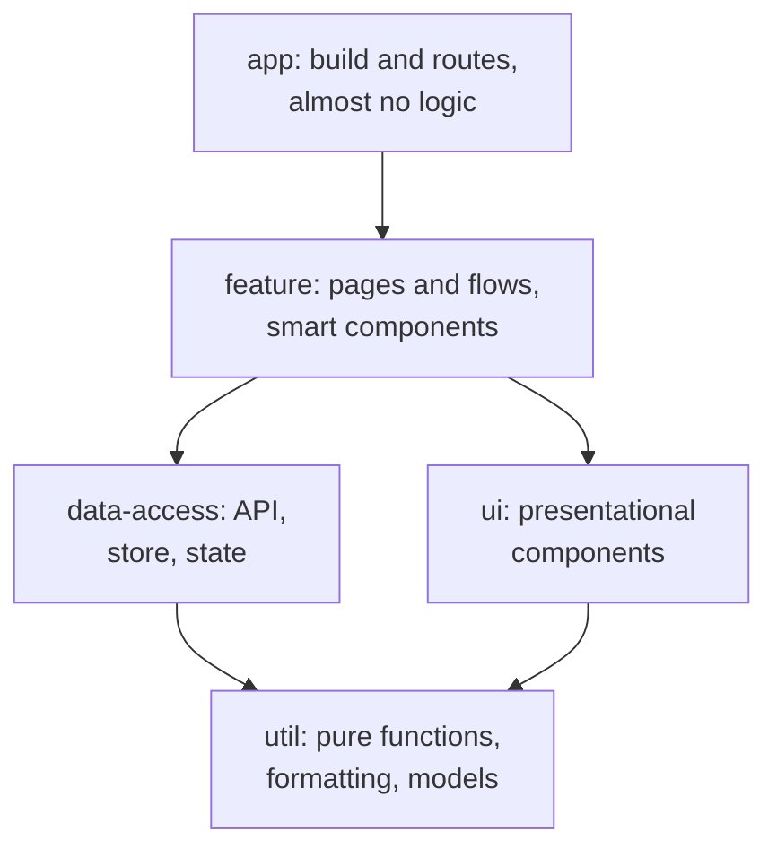

## What this lesson covers

A monorepo versus separate repositories, package manager workspaces, Nx: the project graph, the task pipeline, the computation cache, `affected` (task-based in Nx 24), module boundaries through tags, library types and folder structure, a comparison with Turborepo. The example is a model of Nx's computations in JavaScript: affected projects, the task hash and the cache, a boundary check.

## A monorepo or not

| | Monorepo | Separate repositories (polyrepo) |
|---|---|---|
| Shared code | The library is right there, an API change and all its consumers in one pull request | Publish a package, bump versions in every repository |
| Dependency versions | Usually one React version for everyone | Each team has its own |
| Types and refactoring | Type checking and renaming across all the code at once | Breaks at the next package update |
| CI | Needs tools so as not to rebuild everything | Each repository is small and simple |
| Access and autonomy | Shared rules, a shared `main` | Full team isolation |

A monorepo is not "one big project": inside are independent apps and libraries with explicit dependencies. Without tools it turns into a slow monolith, which is why Nx or Turborepo are needed.

## Workspaces

```yaml
packages: # pnpm-workspace.yaml
  - apps/*
  - libs/*
```

```json
{ "name": "@acme/shop", "dependencies": { "@acme/ui": "workspace:*" } }
```

- The package manager (pnpm, npm, Yarn, Bun) links the repository's packages with symbolic links: `@acme/ui` comes from `libs/ui`, not from the registry. The `workspace:*` protocol is replaced by a real version on publishing.
- Workspaces solve installation and links, but not build order, caching and choosing what is affected. Nx and Turborepo do that.

## What Nx computes

```js run
import { createHash } from 'node:crypto'

// A model of what Nx computes: the project graph, affected projects, the task cache and boundary rules.
const projects = {
  'shop-app':         { deps: ['shop-feature-cart', 'shared-ui'],                tags: ['scope:shop', 'type:app'] },
  'admin-app':        { deps: ['admin-feature-users', 'shared-ui'],              tags: ['scope:admin', 'type:app'] },
  'shop-feature-cart':{ deps: ['shop-data-cart', 'shared-ui', 'shared-util-format'], tags: ['scope:shop', 'type:feature'] },
  'admin-feature-users': { deps: ['shared-ui'],                                  tags: ['scope:admin', 'type:feature'] },
  'shop-data-cart':   { deps: ['shared-util-format'],                            tags: ['scope:shop', 'type:data-access'] },
  'shared-ui':        { deps: [],                                                tags: ['scope:shared', 'type:ui'] },
  'shared-util-format': { deps: [],                                              tags: ['scope:shared', 'type:util'] },
}
const files = Object.fromEntries(Object.keys(projects).map((p) => [p, `source of ${p}`]))

// 1. Affected: the changed project and everything that depends on it, directly or not.
function affected(changed) {
  const result = new Set([changed])
  let grew = true
  while (grew) {
    grew = false
    for (const [name, p] of Object.entries(projects)) {
      if (!result.has(name) && p.deps.some((d) => result.has(d))) result.add(name), (grew = true)
    }
  }
  return [...result]
}
console.log('changed shared-util-format, affected:', affected('shared-util-format').join(', '))

// 2. Cache: a task's hash covers its own files, the hashes of its dependencies and the command.
const cache = new Map()
const hashes = {}
function build(name) {
  if (hashes[name]) return hashes[name]
  const depHashes = projects[name].deps.map(build)
  const hash = createHash('sha256').update(files[name] + depHashes.join() + 'vite build').digest('hex').slice(0, 8)
  hashes[name] = hash
  log.push(cache.has(hash) ? `${name} (cache)` : `${name} BUILT`)
  cache.set(hash, `dist of ${name}`)
  return hash
}
let log = []
const buildAll = (title) => {
  log = []
  for (const k in hashes) delete hashes[k]
  Object.keys(projects).forEach(build)
  console.log(`${title}: ${log.filter((l) => l.endsWith('BUILT')).length} built, ${log.filter((l) => l.endsWith('(cache)')).length} from cache`)
  console.log('   ', log.filter((l) => l.endsWith('BUILT')).map((l) => l.replace(' BUILT', '')).join(', ') || 'nothing')
}
buildAll('first build')
buildAll('same code again')
files['shared-ui'] += ' + a new button variant'
buildAll('after a change in shared-ui')

// 3. Boundaries: a lint rule checks imports against project tags.
const rules = {
  'type:feature': ['type:feature', 'type:data-access', 'type:ui', 'type:util'],
  'type:data-access': ['type:data-access', 'type:util'],
  'type:ui': ['type:ui', 'type:util'],
  'type:util': ['type:util'],
}
function canImport(from, to) {
  const tag = (p, kind) => projects[p].tags.find((t) => t.startsWith(kind))
  const scopeOk = tag(to, 'scope:') === 'scope:shared' || tag(to, 'scope:') === tag(from, 'scope:')
  const typeOk = !rules[tag(from, 'type:')] || rules[tag(from, 'type:')].includes(tag(to, 'type:'))
  return scopeOk && typeOk ? 'allowed' : `forbidden (${!scopeOk ? 'another scope' : 'layer'})`
}
console.log('\nadmin-feature-users -> shop-feature-cart:', canImport('admin-feature-users', 'shop-feature-cart'))
console.log('shop-data-cart -> shop-feature-cart:', canImport('shop-data-cart', 'shop-feature-cart'))
console.log('shop-feature-cart -> shared-ui:', canImport('shop-feature-cart', 'shared-ui'))
```

```output
changed shared-util-format, affected: shared-util-format, shop-feature-cart, shop-data-cart, shop-app
first build: 7 built, 0 from cache
    shared-util-format, shop-data-cart, shared-ui, shop-feature-cart, shop-app, admin-feature-users, admin-app
same code again: 0 built, 7 from cache
    nothing
after a change in shared-ui: 5 built, 2 from cache
    shared-ui, shop-feature-cart, shop-app, admin-feature-users, admin-app

admin-feature-users -> shop-feature-cart: forbidden (another scope)
shop-data-cart -> shop-feature-cart: forbidden (layer)
shop-feature-cart -> shared-ui: allowed
```

- **The project graph**: Nx builds it by itself from imports in the code and from `package.json`; `nx graph` shows it in the browser. Without the graph there is no answer to what a change affects.
- **Affected projects**: `shared-util-format` changed, so it needs checking, and so does everything that depends on it, directly or through a chain; `admin-app` is not affected. The `nx affected -t lint test build` command compares the branch with `main`.
- **The cache**: a task's hash is made of the project's files, the dependencies' hashes, the command and the settings. Running the same code again built nothing. An edit in `shared-ui` rebuilt it and its dependents, while `shared-util-format` and `shop-data-cart` came from the cache. With a remote cache (Nx Cloud or your own storage) a result built on one machine is received by everyone: colleagues and CI.
- **Boundaries**: the `scope:*` and `type:*` tags and a lint rule forbid importing another domain (`admin` from `shop`) and importing "upward" across layers (`data-access` from `feature`).

In Nx 24 (October 2026) `affected` works **by task** by default, not by project: if only a test file changed, that project's `test` runs, but `build` does not. In existing workspaces the migration keeps the old behavior (`affected.legacy: true`) until the team turns it off.

## The task pipeline

```json
{
  "targetDefaults": {
    "build": {
      "dependsOn": ["^build"],
      "inputs": ["production", "^production"],
      "outputs": ["{projectRoot}/dist"],
      "cache": true
    }
  },
  "namedInputs": {
    "production": ["default", "!{projectRoot}/**/*.spec.ts"]
  }
}
```

- `dependsOn: ["^build"]`: build a project's dependencies before the project (`^` means "of the dependencies"). Nx runs independent tasks in parallel.
- `inputs` define what goes into the hash. If test files are excluded from `production`, editing a test does not invalidate the build cache. A mistake in `inputs` gives a false cache hit, and that is the most dangerous configuration mistake.
- `outputs`: what to save in the cache and restore on a hit.

## Library types



- Nx recommends four types: `feature`, `ui`, `data-access`, `util`. Dependencies go only downward: `ui` knows nothing about the store, `util` depends on nobody.
- Folders are grouped **by domain**, then by type: `libs/shop/feature-cart`, `libs/shop/data-access-cart`, `libs/shared/ui`. The structure in the notes (`core`, `shared/components`, `shared/pipes`, `state`, `feature-modules`) splits by technical kind: the store of all features in one `state` library ties the domains together, and the boundary "the cart does not import users" can no longer be checked.
- The notes' item "centralized state management" has nothing to do with a monorepo: it is an app architecture decision, and in a monorepo state is in fact split by domain.
- Generators create a project with its settings: `nx g @nx/angular:library libs/shop/feature-cart`, `--dry-run` shows the files without writing them.

## Nx and Turborepo

| | Nx | Turborepo |
|---|---|---|
| Project graph | By itself from imports and `package.json` | From `package.json` workspaces |
| Affected | `nx affected`, by task in Nx 24 | `turbo run build --affected` |
| Cache | Local and remote | Local and remote |
| Beyond that | Generators, plugins for Angular, React, Vite and others, module boundaries, version migrations | Minimal setup, only running tasks |

Lerna, the classic monorepo tool, is now maintained by the Nx team and uses Nx to run tasks.

## Key points

- A monorepo: shared code and refactoring in one pull request, one version of dependencies; it needs a tool so that CI does not rebuild everything.
- Workspaces link packages (`workspace:*`); Nx and Turborepo add the graph, ordering, caching and `affected`.
- A task's hash: files, dependency hashes, the command; a remote cache is shared by the team and CI; mistakes in `inputs` give false hits.
- Nx 24: task-based `affected` by default; `dependsOn: ["^build"]` builds dependencies first.
- Library types `feature`, `ui`, `data-access`, `util`, dependencies only downward; the linter checks `scope` and `type` tags.
- Folders by domain, not by technical kind; one store for all domains destroys the boundaries.
