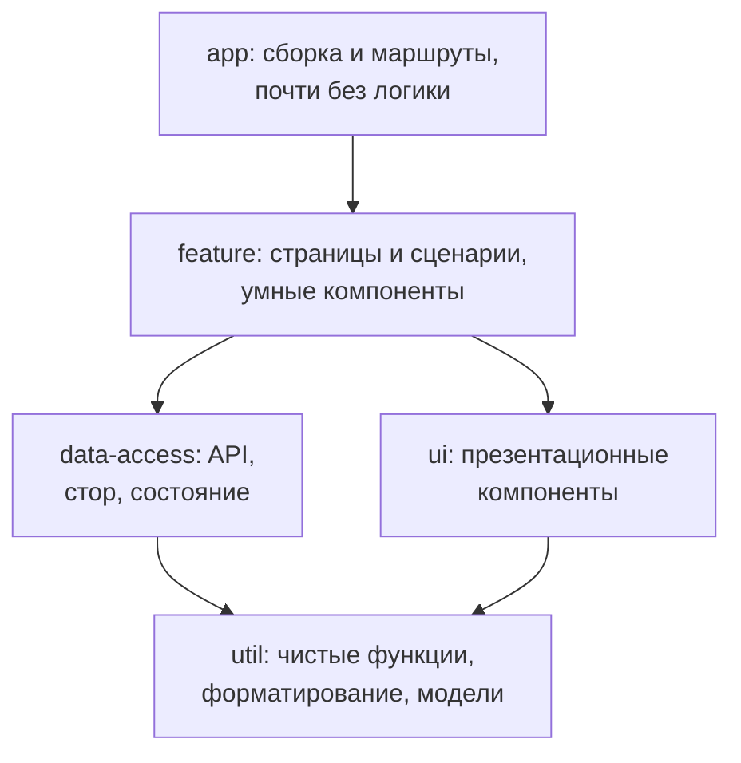

## О чём урок

Монорепозиторий против отдельных репозиториев, workspaces менеджера пакетов, Nx: граф проектов, конвейер задач, кэш вычислений, `affected` (в Nx 24 по задачам), границы модулей через теги, типы библиотек и структура папок, сравнение с Turborepo. Пример это модель вычислений Nx на JavaScript: затронутые проекты, хэш задачи и кэш, проверка границ.

## Монорепозиторий или нет

| | Монорепозиторий | Отдельные репозитории (polyrepo) |
|---|---|---|
| Общий код | Библиотека рядом, правка API и всех потребителей в одном pull request | Публикация пакета, обновление версий в каждом репозитории |
| Версии зависимостей | Обычно одна версия React на всех | У каждой команды свои |
| Типы и рефакторинг | Проверка типов и переименование по всему коду сразу | Ломается при следующем обновлении пакета |
| CI | Нужны инструменты, чтобы не пересобирать всё | Каждый репозиторий маленький и простой |
| Доступ и автономия | Общие правила, общий `main` | Полная изоляция команд |

Монорепозиторий это не «один большой проект»: внутри независимые приложения и библиотеки с явными зависимостями. Без инструментов он превращается в медленный монолит, поэтому и нужны Nx или Turborepo.

## Workspaces

```yaml
packages: # pnpm-workspace.yaml
  - apps/*
  - libs/*
```

```json
{ "name": "@acme/shop", "dependencies": { "@acme/ui": "workspace:*" } }
```

- Менеджер пакетов (pnpm, npm, Yarn, Bun) связывает пакеты репозитория символическими ссылками: `@acme/ui` берётся из `libs/ui`, а не из реестра. Протокол `workspace:*` при публикации заменяется на реальную версию.
- Workspaces решают установку и связи, но не порядок сборки, кэш и выбор затронутого. Это делают Nx и Turborepo.

## Что вычисляет Nx

```js run
import { createHash } from 'node:crypto'

// A model of what Nx computes: the project graph, affected projects, the task cache and boundary rules.
const projects = {
  'shop-app':         { deps: ['shop-feature-cart', 'shared-ui'],                tags: ['scope:shop', 'type:app'] },
  'admin-app':        { deps: ['admin-feature-users', 'shared-ui'],              tags: ['scope:admin', 'type:app'] },
  'shop-feature-cart':{ deps: ['shop-data-cart', 'shared-ui', 'shared-util-format'], tags: ['scope:shop', 'type:feature'] },
  'admin-feature-users': { deps: ['shared-ui'],                                  tags: ['scope:admin', 'type:feature'] },
  'shop-data-cart':   { deps: ['shared-util-format'],                            tags: ['scope:shop', 'type:data-access'] },
  'shared-ui':        { deps: [],                                                tags: ['scope:shared', 'type:ui'] },
  'shared-util-format': { deps: [],                                              tags: ['scope:shared', 'type:util'] },
}
const files = Object.fromEntries(Object.keys(projects).map((p) => [p, `source of ${p}`]))

// 1. Affected: the changed project and everything that depends on it, directly or not.
function affected(changed) {
  const result = new Set([changed])
  let grew = true
  while (grew) {
    grew = false
    for (const [name, p] of Object.entries(projects)) {
      if (!result.has(name) && p.deps.some((d) => result.has(d))) result.add(name), (grew = true)
    }
  }
  return [...result]
}
console.log('changed shared-util-format, affected:', affected('shared-util-format').join(', '))

// 2. Cache: a task's hash covers its own files, the hashes of its dependencies and the command.
const cache = new Map()
const hashes = {}
function build(name) {
  if (hashes[name]) return hashes[name]
  const depHashes = projects[name].deps.map(build)
  const hash = createHash('sha256').update(files[name] + depHashes.join() + 'vite build').digest('hex').slice(0, 8)
  hashes[name] = hash
  log.push(cache.has(hash) ? `${name} (cache)` : `${name} BUILT`)
  cache.set(hash, `dist of ${name}`)
  return hash
}
let log = []
const buildAll = (title) => {
  log = []
  for (const k in hashes) delete hashes[k]
  Object.keys(projects).forEach(build)
  console.log(`${title}: ${log.filter((l) => l.endsWith('BUILT')).length} built, ${log.filter((l) => l.endsWith('(cache)')).length} from cache`)
  console.log('   ', log.filter((l) => l.endsWith('BUILT')).map((l) => l.replace(' BUILT', '')).join(', ') || 'nothing')
}
buildAll('first build')
buildAll('same code again')
files['shared-ui'] += ' + a new button variant'
buildAll('after a change in shared-ui')

// 3. Boundaries: a lint rule checks imports against project tags.
const rules = {
  'type:feature': ['type:feature', 'type:data-access', 'type:ui', 'type:util'],
  'type:data-access': ['type:data-access', 'type:util'],
  'type:ui': ['type:ui', 'type:util'],
  'type:util': ['type:util'],
}
function canImport(from, to) {
  const tag = (p, kind) => projects[p].tags.find((t) => t.startsWith(kind))
  const scopeOk = tag(to, 'scope:') === 'scope:shared' || tag(to, 'scope:') === tag(from, 'scope:')
  const typeOk = !rules[tag(from, 'type:')] || rules[tag(from, 'type:')].includes(tag(to, 'type:'))
  return scopeOk && typeOk ? 'allowed' : `forbidden (${!scopeOk ? 'another scope' : 'layer'})`
}
console.log('\nadmin-feature-users -> shop-feature-cart:', canImport('admin-feature-users', 'shop-feature-cart'))
console.log('shop-data-cart -> shop-feature-cart:', canImport('shop-data-cart', 'shop-feature-cart'))
console.log('shop-feature-cart -> shared-ui:', canImport('shop-feature-cart', 'shared-ui'))
```

```output
changed shared-util-format, affected: shared-util-format, shop-feature-cart, shop-data-cart, shop-app
first build: 7 built, 0 from cache
    shared-util-format, shop-data-cart, shared-ui, shop-feature-cart, shop-app, admin-feature-users, admin-app
same code again: 0 built, 7 from cache
    nothing
after a change in shared-ui: 5 built, 2 from cache
    shared-ui, shop-feature-cart, shop-app, admin-feature-users, admin-app

admin-feature-users -> shop-feature-cart: forbidden (another scope)
shop-data-cart -> shop-feature-cart: forbidden (layer)
shop-feature-cart -> shared-ui: allowed
```

- **Граф проектов**: Nx строит его сам по импортам в коде и по `package.json`; `nx graph` показывает его в браузере. Без графа не ответить на вопрос, что затронуто изменением.
- **Затронутые проекты**: изменился `shared-util-format`, и проверять нужно его и всё, что от него зависит, прямо или через цепочку; `admin-app` не затронут. Команда `nx affected -t lint test build` сравнивает ветку с `main`.
- **Кэш**: хэш задачи складывается из файлов проекта, хэшей зависимостей, команды и настроек. Повторный запуск того же кода ничего не собрал. Правка в `shared-ui` пересобрала его и зависимых, а `shared-util-format` и `shop-data-cart` взяты из кэша. С удалённым кэшем (Nx Cloud или своё хранилище) результат, собранный на одной машине, получают все: коллеги и CI.
- **Границы**: теги `scope:*` и `type:*` и правило линтера запрещают импорт чужого домена (`admin` из `shop`) и импорт «вверх» по слоям (`data-access` из `feature`).

В Nx 24 (октябрь 2026) `affected` по умолчанию работает **по задачам**, а не по проектам: если изменился только файл теста, запустится `test` этого проекта, а `build` нет. В существующих рабочих пространствах миграция оставляет старое поведение (`affected.legacy: true`), пока команда его не отключит.

## Конвейер задач

```json
{
  "targetDefaults": {
    "build": {
      "dependsOn": ["^build"],
      "inputs": ["production", "^production"],
      "outputs": ["{projectRoot}/dist"],
      "cache": true
    }
  },
  "namedInputs": {
    "production": ["default", "!{projectRoot}/**/*.spec.ts"]
  }
}
```

- `dependsOn: ["^build"]`: перед сборкой проекта собрать его зависимости (`^` означает «у зависимостей»). Независимые задачи Nx запускает параллельно.
- `inputs` определяют, что входит в хэш. Если исключить файлы тестов из `production`, правка теста не сбросит кэш сборки. Ошибка в `inputs` даёт ложное попадание в кэш, и это самая опасная ошибка настройки.
- `outputs`: что сохранить в кэш и восстановить при попадании.

## Типы библиотек



- Nx рекомендует четыре типа: `feature`, `ui`, `data-access`, `util`. Зависимости идут только вниз: `ui` не знает про стор, `util` ни от кого не зависит.
- Папки группируют **по домену**, потом по типу: `libs/shop/feature-cart`, `libs/shop/data-access-cart`, `libs/shared/ui`. Структура из заметок (`core`, `shared/components`, `shared/pipes`, `state`, `feature-modules`) делит по техническому признаку: стор всех фич в одной библиотеке `state` связывает домены между собой, и границу «корзина не импортирует пользователей» уже не проверить.
- Пункт заметок «централизованное управление состоянием» к монорепозиторию не относится: это решение архитектуры приложения, и в монорепозитории состояние как раз делят по доменам.
- Генераторы создают проект с настройками: `nx g @nx/angular:library libs/shop/feature-cart`, `--dry-run` показывает файлы без записи.

## Nx и Turborepo

| | Nx | Turborepo |
|---|---|---|
| Граф проектов | Сам по импортам и `package.json` | По `package.json` workspaces |
| Затронутое | `nx affected`, по задачам в Nx 24 | `turbo run build --affected` |
| Кэш | Локальный и удалённый | Локальный и удалённый |
| Сверх этого | Генераторы, плагины для Angular, React, Vite и других, границы модулей, миграции версий | Минимальная настройка, только запуск задач |

Lerna, классический инструмент для монорепозиториев, сейчас поддерживает команда Nx, и он использует Nx для запуска задач.

## Главное

- Монорепозиторий: общий код и рефакторинг в одном pull request, одна версия зависимостей; нужен инструмент, чтобы CI не пересобирал всё.
- Workspaces связывают пакеты (`workspace:*`), Nx и Turborepo добавляют граф, порядок, кэш и `affected`.
- Хэш задачи: файлы, хэши зависимостей, команда; удалённый кэш общий для команды и CI; ошибки в `inputs` дают ложные попадания.
- Nx 24: `affected` по задачам по умолчанию; `dependsOn: ["^build"]` строит зависимости первыми.
- Типы библиотек `feature`, `ui`, `data-access`, `util`, зависимости только вниз; теги `scope` и `type` проверяет линтер.
- Папки по домену, а не по техническому типу; общий стор на все домены разрушает границы.
