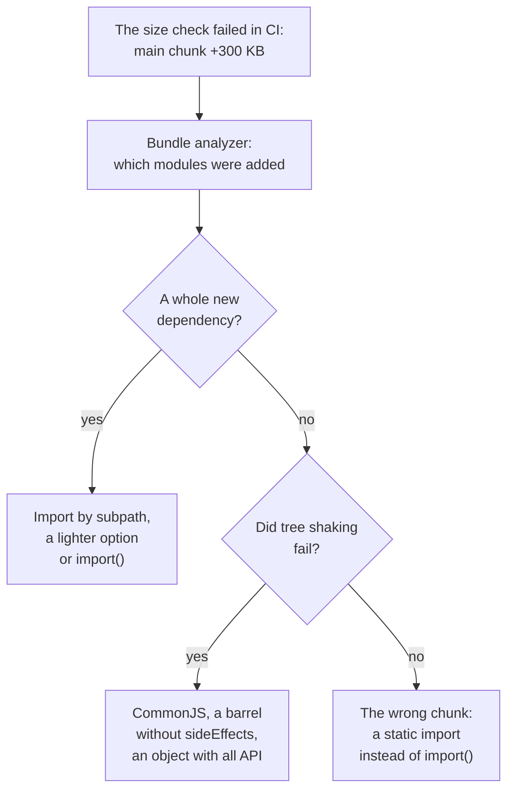

## What this lesson covers

Tools in everyday work and in interviews: semantic versioning and ranges in `package.json`, updating dependencies, a shared component library as a package (`exports`, `peerDependencies`, Changesets, Storybook), building with Angular CLI and size budgets, what to do when the bundle grew or the build is slow, and short answers to common questions. The example checks version ranges with the real `semver` library that npm uses.

## Versions and ranges

A semantic version is `MAJOR.MINOR.PATCH`: a patch fixes bugs, a minor adds features without breaking anything, a major breaks compatibility.

```ts run
import semver from 'semver'

// Versions of a package published to the registry.
const published = ['1.4.2', '1.4.9', '1.5.0', '2.0.0-rc.1', '2.0.0', '0.4.2', '0.4.9', '0.5.0']
const ranges = ['1.4.2', '~1.4.2', '^1.4.2', '^0.4.2', '>=1.4.2 <2', '*']

console.log('range'.padEnd(11), published.join(' '))
for (const range of ranges) {
  const row = published.map((v) => (semver.satisfies(v, range) ? '+' : '.').padEnd(v.length)).join(' ')
  console.log(range.padEnd(11), row, '->', semver.maxSatisfying(published, range))
}

// What a changeset of each kind does to the version.
console.log()
for (const from of ['1.4.2', '0.4.2']) {
  const next = (['patch', 'minor', 'major'] as const).map((kind) => `${kind} ${semver.inc(from, kind)}`)
  console.log(`${from}: ${next.join(', ')}`)
}
```

```output
range       1.4.2 1.4.9 1.5.0 2.0.0-rc.1 2.0.0 0.4.2 0.4.9 0.5.0
1.4.2       +     .     .     .          .     .     .     .     -> 1.4.2
~1.4.2      +     +     .     .          .     .     .     .     -> 1.4.9
^1.4.2      +     +     +     .          .     .     .     .     -> 1.5.0
^0.4.2      .     .     .     .          .     +     +     .     -> 0.4.9
>=1.4.2 <2  +     +     +     .          .     .     .     .     -> 1.5.0
*           +     +     +     .          +     +     +     +     -> 2.0.0

1.4.2: patch 1.4.3, minor 1.5.0, major 2.0.0
0.4.2: patch 0.4.3, minor 0.5.0, major 1.0.0
```

- `^1.4.2` allows minor and patch (up to 2.0.0), `~1.4.2` only patch, an exact version nothing. This is the default for `npm install` and `pnpm add`: `package.json` gets a `^`.
- **`^0.4.2` behaves like `~`**: before version 1.0 every minor counts as breaking, so `0.5.0` does not match. Packages that stay on `0.x` for years are only updated by hand.
- Prereleases (`2.0.0-rc.1`) do not match even `*`: they are installed only explicitly.
- A range says what **may** be installed; what **is** installed is fixed by the lockfile. It is committed, and CI installs strictly from it (`pnpm install --frozen-lockfile`, `npm ci`). Without a lockfile two machines build different code.
- Updates are automated by Renovate or Dependabot: a pull request per update, tests in CI, grouping of small updates. A delay for fresh versions (`minimumReleaseAge` in pnpm) protects against infected releases: the `sec-supply-chain` lesson.

## A shared library as a package

```json
{
  "name": "@acme/ui",
  "version": "3.2.0",
  "type": "module",
  "exports": {
    ".": { "types": "./dist/index.d.ts", "default": "./dist/index.js" },
    "./button": { "types": "./dist/button.d.ts", "default": "./dist/button.js" },
    "./styles.css": "./dist/styles.css"
  },
  "sideEffects": ["**/*.css"],
  "peerDependencies": { "react": "^19.0.0" }
}
```

- `exports` defines the public paths: only what is listed can be imported, internal files are closed. Subpaths (`@acme/ui/button`) give a cheap import without a barrel file.
- React is in `peerDependencies`, not `dependencies`: the library uses the app's React instead of bringing its own copy (the same two-instances problem as in the `tool-microfrontends` lesson).
- **Changesets**: in each pull request the developer adds a file with the kind of change (patch, minor, major) and a description; at release time the tool bumps versions by semver, writes `CHANGELOG.md` and publishes the packages, including dependent packages in the monorepo.
- **Storybook 10** shows components in isolation, serves as the design system's documentation, and its stories run as tests (the `test-components` lesson).

## Angular CLI

| What | How it is now |
|---|---|
| Builder | `@angular/build:application` on esbuild, the dev server on Vite; the default for new projects since Angular 17 |
| Template compilation | AOT by default since Angular 9 (Ivy); JIT only for special cases |
| Production build | `ng build` uses the `production` configuration by default since Angular 12 |
| `--prod` | Deprecated in Angular 12, removed in Angular 14: `ng build --prod` gives "Unknown argument". Use `-c production` instead |
| Budgets | `budgets` in `angular.json`: a warning and a build error when the size is exceeded |

```json
"budgets": [
  { "type": "initial", "maximumWarning": "250kb", "maximumError": "500kb" },
  { "type": "anyComponentStyle", "maximumWarning": "4kb", "maximumError": "8kb" }
]
```

The notes recommend `ng build --prod` and `ng serve --prod` and say Angular CLI builds with webpack: that is how the old `browser` builder works, which was the default up to Angular 16; projects are moved to the new one with `ng update` or by hand. Details of Angular compilation are in the `ng-internals` lesson.

## The bundle grew: what to do



- Size is checked **in CI on every pull request**: Angular budgets, `size-limit`, a comparison with the size on `main`. Growth noticed half a year later can no longer be tied to its cause.
- Analyzers: `rollup-plugin-visualizer` for Vite, `source-map-explorer` for any build with source maps, the Turbopack Bundle Analyzer in Next.js.

## The build or CI is slow

- Measure where the time goes: installation, type checking, the linter, tests, the build. Often the slow part is not the bundler but type checking or type-aware lint rules.
- A dependency cache in CI (the pnpm store), a task cache (Nx, Turborepo) both local and remote, `affected` instead of a full run.
- Fast tools in Rust and Go: Vite 8 with Rolldown, Rspack instead of webpack, Oxlint before ESLint, TypeScript 7.
- In parallel and in parts: test sharding, independent tasks at the same time.

## Common questions

- **How does Vite differ from webpack?** In development Vite does not bundle and serves ES modules on request, so it starts instantly; for the build it uses Rolldown. webpack bundles in development too and has a huge ecosystem of loaders and plugins.
- **What is tree shaking and when does it fail?** Removing unused exports by static analysis of ES modules. It fails with CommonJS, with code that may have a side effect, with object properties and class methods.
- **Why a hash in the file name?** To cache files forever: a new version gets a new name, and `index.html` is revalidated on every visit.
- **A monorepo or micro-frontends?** Different things: a monorepo is about storing code and making shared changes, micro-frontends are about independent deployment. They are often combined: an Nx monorepo with a host and Module Federation remotes.
- **Why does Vite not show type errors?** It strips types file by file without checking; `tsc --noEmit` runs separately.

## Key points

- `^` allows minor and patch, `~` only patch; before 1.0 `^0.x` behaves like `~`; what is installed is decided by the lockfile.
- A library package: `exports` with subpaths, `sideEffects`, the framework in `peerDependencies`, releases through Changesets.
- Angular CLI: esbuild and Vite since version 17, AOT by default, `ng build` in production by default, `--prod` removed in 14, budgets in `angular.json`.
- Size is checked in CI on every pull request; the cause is found with a bundle analyzer.
- A slow CI: measure, cache dependencies and tasks, run only what is affected, fast tools.
