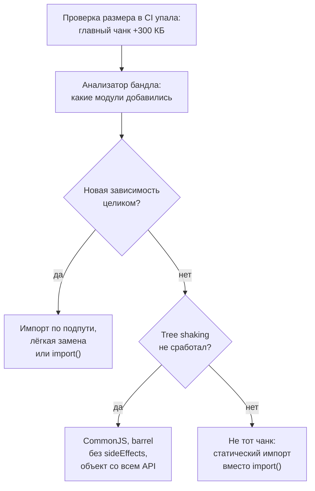

## О чём урок

Инструменты в повседневной работе и на собеседовании: семантическое версионирование и диапазоны в `package.json`, обновление зависимостей, общая библиотека компонентов как пакет (`exports`, `peerDependencies`, Changesets, Storybook), сборка в Angular CLI и бюджеты размера, что делать, если бандл вырос или сборка тормозит, и короткие ответы на частые вопросы. Пример проверяет диапазоны версий настоящей библиотекой `semver`, которую использует npm.

## Версии и диапазоны

Семантическая версия `MAJOR.MINOR.PATCH`: patch исправляет ошибки, minor добавляет возможности без поломок, major ломает совместимость.

```ts run
import semver from 'semver'

// Versions of a package published to the registry.
const published = ['1.4.2', '1.4.9', '1.5.0', '2.0.0-rc.1', '2.0.0', '0.4.2', '0.4.9', '0.5.0']
const ranges = ['1.4.2', '~1.4.2', '^1.4.2', '^0.4.2', '>=1.4.2 <2', '*']

console.log('range'.padEnd(11), published.join(' '))
for (const range of ranges) {
  const row = published.map((v) => (semver.satisfies(v, range) ? '+' : '.').padEnd(v.length)).join(' ')
  console.log(range.padEnd(11), row, '->', semver.maxSatisfying(published, range))
}

// What a changeset of each kind does to the version.
console.log()
for (const from of ['1.4.2', '0.4.2']) {
  const next = (['patch', 'minor', 'major'] as const).map((kind) => `${kind} ${semver.inc(from, kind)}`)
  console.log(`${from}: ${next.join(', ')}`)
}
```

```output
range       1.4.2 1.4.9 1.5.0 2.0.0-rc.1 2.0.0 0.4.2 0.4.9 0.5.0
1.4.2       +     .     .     .          .     .     .     .     -> 1.4.2
~1.4.2      +     +     .     .          .     .     .     .     -> 1.4.9
^1.4.2      +     +     +     .          .     .     .     .     -> 1.5.0
^0.4.2      .     .     .     .          .     +     +     .     -> 0.4.9
>=1.4.2 <2  +     +     +     .          .     .     .     .     -> 1.5.0
*           +     +     +     .          +     +     +     +     -> 2.0.0

1.4.2: patch 1.4.3, minor 1.5.0, major 2.0.0
0.4.2: patch 0.4.3, minor 0.5.0, major 1.0.0
```

- `^1.4.2` разрешает minor и patch (до 2.0.0), `~1.4.2` только patch, точная версия ничего. Это поведение по умолчанию для `npm install` и `pnpm add`: в `package.json` пишется `^`.
- **`^0.4.2` ведёт себя как `~`**: до версии 1.0 каждый minor считается ломающим, поэтому `0.5.0` не подходит. Пакеты, которые годами живут на `0.x`, обновляются только руками.
- Предрелизы (`2.0.0-rc.1`) не попадают даже в `*`: их ставят только явно.
- Диапазон говорит, что **можно** поставить; что **поставлено**, фиксирует lock-файл. Его коммитят, а в CI ставят строго по нему (`pnpm install --frozen-lockfile`, `npm ci`). Без lock-файла две машины соберут разный код.
- Обновления автоматизируют Renovate или Dependabot: pull request на каждое обновление, тесты в CI, группировка мелких обновлений. Задержка для свежих версий (`minimumReleaseAge` в pnpm) защищает от заражённых релизов: урок `sec-supply-chain`.

## Общая библиотека как пакет

```json
{
  "name": "@acme/ui",
  "version": "3.2.0",
  "type": "module",
  "exports": {
    ".": { "types": "./dist/index.d.ts", "default": "./dist/index.js" },
    "./button": { "types": "./dist/button.d.ts", "default": "./dist/button.js" },
    "./styles.css": "./dist/styles.css"
  },
  "sideEffects": ["**/*.css"],
  "peerDependencies": { "react": "^19.0.0" }
}
```

- `exports` задаёт публичные пути: импортировать можно только перечисленное, внутренние файлы закрыты. Подпути (`@acme/ui/button`) дают дешёвый импорт без barrel-файла.
- React в `peerDependencies`, а не в `dependencies`: библиотека использует React приложения, а не приносит свою копию (та же проблема двух экземпляров, что в уроке `tool-microfrontends`).
- **Changesets**: в каждом pull request разработчик добавляет файл с типом изменения (patch, minor, major) и описанием; при выпуске инструмент поднимает версии по semver, пишет `CHANGELOG.md` и публикует пакеты, в том числе зависимые пакеты монорепозитория.
- **Storybook 10** показывает компоненты в изоляции, служит документацией дизайн-системы, а истории запускаются как тесты (урок `test-components`).

## Angular CLI

| Что | Как сейчас |
|---|---|
| Сборщик | `@angular/build:application` на esbuild, сервер разработки на Vite; по умолчанию для новых проектов с Angular 17 |
| Компиляция шаблонов | AOT по умолчанию с Angular 9 (Ivy); JIT только для особых случаев |
| Продакшен-сборка | `ng build` использует конфигурацию `production` по умолчанию с Angular 12 |
| `--prod` | Устарел в Angular 12, удалён в Angular 14: `ng build --prod` даёт «Unknown argument». Вместо него `-c production` |
| Бюджеты | `budgets` в `angular.json`: предупреждение и ошибка сборки при превышении размера |

```json
"budgets": [
  { "type": "initial", "maximumWarning": "250kb", "maximumError": "500kb" },
  { "type": "anyComponentStyle", "maximumWarning": "4kb", "maximumError": "8kb" }
]
```

Заметки советуют `ng build --prod` и `ng serve --prod` и пишут, что Angular CLI собирает через webpack: так работает старый сборщик `browser`, который был по умолчанию до Angular 16; проекты переводят на новый командой `ng update` или вручную. Подробности о компиляции Angular в уроке `ng-internals`.

## Бандл вырос: что делать



- Размер проверяют **в CI на каждый pull request**: бюджеты Angular, `size-limit`, сравнение с размером в `main`. Рост, замеченный через полгода, уже не связать с причиной.
- Анализатор: `rollup-plugin-visualizer` для Vite, `source-map-explorer` для любой сборки с source map, Turbopack Bundle Analyzer в Next.js.

## Сборка или CI медленные

- Измерить, где время: установка, проверка типов, линтер, тесты, сборка. Часто тормозит не сборщик, а проверка типов или правила линтера с информацией о типах.
- Кэш зависимостей в CI (хранилище pnpm), кэш задач (Nx, Turborepo) локальный и удалённый, `affected` вместо полного прогона.
- Быстрые инструменты на Rust и Go: Vite 8 с Rolldown, Rspack вместо webpack, Oxlint перед ESLint, TypeScript 7.
- Параллельно и по частям: шардинг тестов, независимые задачи одновременно.

## Частые вопросы

- **Чем Vite отличается от webpack?** Vite в разработке не собирает бандл и отдаёт ES-модули по запросу, поэтому стартует мгновенно; в сборке использует Rolldown. webpack собирает бандл и в разработке, у него огромная экосистема загрузчиков и плагинов.
- **Что такое tree shaking и когда он не работает?** Удаление неиспользуемых экспортов по статическому анализу ES-модулей. Не работает с CommonJS, с кодом, у которого может быть побочный эффект, со свойствами объектов и методами классов.
- **Зачем хэш в имени файла?** Чтобы кэшировать файлы навсегда: новая версия получает новое имя, а `index.html` проверяется при каждом заходе.
- **Монорепозиторий или микрофронтенды?** Разные вещи: монорепозиторий про хранение кода и общие изменения, микрофронтенды про независимый деплой. Их часто совмещают: Nx-монорепозиторий с хостом и удалёнными приложениями Module Federation.
- **Почему Vite не показывает ошибки типов?** Он убирает типы по файлу без проверки; `tsc --noEmit` запускают отдельно.

## Главное

- `^` разрешает minor и patch, `~` только patch; до 1.0 `^0.x` ведёт себя как `~`; что поставлено, решает lock-файл.
- Пакет библиотеки: `exports` с подпутями, `sideEffects`, фреймворк в `peerDependencies`, выпуск через Changesets.
- Angular CLI: esbuild и Vite с версии 17, AOT по умолчанию, `ng build` в production по умолчанию, `--prod` удалён в 14, бюджеты в `angular.json`.
- Размер проверяют в CI на каждый pull request; причину ищут анализатором бандла.
- Медленный CI: измерить, кэшировать зависимости и задачи, запускать только затронутое, быстрые инструменты.
