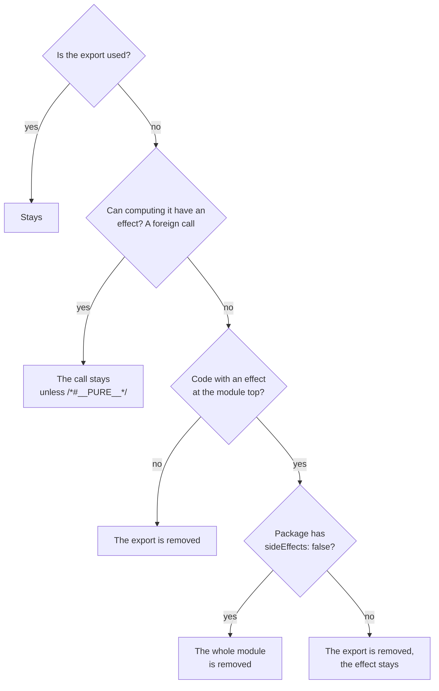

## What this lesson covers

How a bundler decides what to drop: "used" marks from the entry point, side effects and why code at the top level of a module stays, the `/*#__PURE__*/` annotation, the `sideEffects` field and barrel files, objects, classes and dynamic `import()`. The basics (ES modules versus CommonJS, lodash) are covered in the `perf-javascript` lesson; here are the mechanics and a check of the claims from the notes. The example builds the same cases with two real bundlers: Rolldown (Vite 8) and esbuild (Angular CLI).

## How it works

Tree shaking is removing unused code by static analysis of ES modules. The bundler:

1. Starts at the entry point and marks as needed the code that **runs on load** (calls, assignments to global objects) or **is used** by needed code.
2. Follows the imports: an imported and used export is needed, and so are its dependencies.
3. Everything not marked does not get into the bundle. The minifier then removes what stayed unreachable inside functions (dead code elimination).

The main question for each piece: **can it do something when it runs**. If the bundler is not sure, the code stays: removing needed code is worse than keeping extra code.



## A check on two bundlers

```ts run
import { build } from 'esbuild'
import { rolldown, type Plugin } from 'rolldown'

type Case = { name: string; files: Record<string, string>; unused: string[]; sideEffectsFalse?: string[] }
// String markers survive minification, so we can see what stayed in the bundle.
const lib = `export const add = (a, b) => 'sum ' + (a + b)
export const sub = (a, b) => 'difference ' + (a - b)`

const cases: Case[] = [
  {
    name: 'console.log at the top of a module',
    files: { 'lib.js': `console.log('lib loaded')\n${lib}`, 'app.js': `import { add } from './lib.js'; console.log(add(1, 2))` },
    unused: ['difference', 'lib loaded'],
  },
  {
    name: 'import * as m, then m.add',
    files: { 'lib.js': lib, 'app.js': `import * as m from './lib.js'; console.log(m.add(1, 2))` },
    unused: ['difference'],
  },
  {
    name: 'export default { add, sub }',
    files: { 'lib.js': `${lib}\nexport default { add, sub }`, 'app.js': `import m from './lib.js'; console.log(m.add(1, 2))` },
    unused: ['difference'],
  },
  {
    name: 'class with an unused method',
    files: {
      'lib.js': `export class Api { get(u) { return 'GET ' + u } post(u) { return 'POST ' + u } }`,
      'app.js': `import { Api } from './lib.js'; console.log(new Api().get('/x'))`,
    },
    unused: ['POST'],
  },
  {
    name: 'unused call into another package',
    files: {
      'lib.js': `import { make } from 'ui-kit'\nexport const big = make('big table')\nexport const small = 1`,
      'app.js': `import { small } from './lib.js'; console.log(small)`,
    },
    unused: ['big table'],
  },
  {
    name: 'the same call marked /*#__PURE__*/',
    files: {
      'lib.js': `import { make } from 'ui-kit'\nexport const big = /*#__PURE__*/ make('big table')\nexport const small = 1`,
      'app.js': `import { small } from './lib.js'; console.log(small)`,
    },
    unused: ['big table'],
  },
  {
    name: 'barrel index.js, a.js logs on import',
    files: {
      'index.js': `export { a } from './a.js'\nexport { b } from './b.js'`,
      'a.js': `console.log('a.js loaded')\nexport const a = 'A'`,
      'b.js': `export const b = 'B'`,
      'app.js': `import { b } from './index.js'; console.log(b)`,
    },
    unused: ['a.js loaded'],
  },
  {
    name: 'the same barrel with "sideEffects": false',
    files: {
      'index.js': `export { a } from './a.js'\nexport { b } from './b.js'`,
      'a.js': `console.log('a.js loaded')\nexport const a = 'A'`,
      'b.js': `export const b = 'B'`,
      'app.js': `import { b } from './index.js'; console.log(b)`,
    },
    unused: ['a.js loaded'],
    sideEffectsFalse: ['index.js', 'a.js', 'b.js'],
  },
  {
    name: 'const { add } = await import()',
    files: { 'lib.js': lib, 'app.js': `const { add } = await import('./lib.js'); console.log(add(1, 2))` },
    unused: ['difference'],
  },
]

async function withRolldown(c: Case): Promise<string> {
  // A real package declares "sideEffects" in package.json; a plugin passes the same flag.
  const plugin: Plugin = {
    name: 'files',
    resolveId(source) {
      const id = source.replace('./', '')
      if (!(id in c.files)) return { id, external: true } // 'ui-kit' is not bundled: its code is unknown
      return { id, moduleSideEffects: !c.sideEffectsFalse?.includes(id) }
    },
    load: (id) => c.files[id],
  }
  const bundle = await rolldown({ input: 'app.js', plugins: [plugin], logLevel: 'silent' })
  const { output } = await bundle.generate({ minify: true })
  return output.map((chunk) => (chunk.type === 'chunk' ? chunk.code : '')).join('')
}

async function withEsbuild(c: Case): Promise<string> {
  const result = await build({
    entryPoints: ['app.js'], bundle: true, minify: true, format: 'esm', splitting: true, outdir: 'out', write: false, logLevel: 'silent',
    plugins: [{
      name: 'files',
      setup(b) {
        b.onResolve({ filter: /.*/ }, ({ path }) => {
          const id = path.replace('./', '')
          if (!(id in c.files)) return { path: id, external: true }
          return { path: id, namespace: 'mem', sideEffects: !c.sideEffectsFalse?.includes(id) }
        })
        b.onLoad({ filter: /.*/, namespace: 'mem' }, ({ path }) => ({ contents: c.files[path], loader: 'js' }))
      },
    }],
  })
  return result.outputFiles.map((f) => f.text).join('')
}

const report = (code: string, c: Case) => {
  const kept = c.unused.filter((s) => code.includes(s))
  return kept.length ? `kept: ${kept.join(', ')}` : 'removed'
}
console.log('case'.padEnd(42), 'Rolldown'.padEnd(18), 'esbuild')
for (const c of cases) {
  console.log(c.name.padEnd(42), report(await withRolldown(c), c).padEnd(18), report(await withEsbuild(c), c))
}
```

```output
case                                       Rolldown           esbuild
console.log at the top of a module         kept: lib loaded   kept: lib loaded
import * as m, then m.add                  removed            removed
export default { add, sub }                kept: difference   kept: difference
class with an unused method                kept: POST         kept: POST
unused call into another package           kept: big table    kept: big table
the same call marked /*#__PURE__*/         removed            removed
barrel index.js, a.js logs on import       kept: a.js loaded  kept: a.js loaded
the same barrel with "sideEffects": false  removed            removed
const { add } = await import()             removed            kept: difference
```

- **`console.log` at the top of a module** stayed, while the unused `sub` was removed. The notes say such code "blocks the whole file": that is wrong, only the effect itself stays.
- **`import * as m`** with static access `m.add` does not get in the way: both bundlers removed `sub`. It is bad when the namespace object is used as a whole: `Object.keys(m)`, `m[name]`, passing it to a function.
- **`export default { add, sub }`** kept `sub` in both bundlers: the whole object counts as used. The problem is not `export default` but an object holding all the functions. `export default function App()` is removed as well as a named export.
- **Class methods** are not removed: the access `api.post` may be computed at run time, so the whole class gets into the bundle. Libraries whose whole API is methods of one object or class (`moment`, many SDKs) tree-shake poorly; separate functions (`date-fns`) tree-shake well.
- **A call to a function from another package** stayed, although nobody needs the result: the bundler does not know whether `make` has a side effect. The `/*#__PURE__*/` annotation promises there is none, and the call is removed. JSX compilers and libraries add it (`React.forwardRef`, `createContext`, `defineComponent`). A false annotation silently breaks code.
- **A barrel file** `index.js` with re-exports: the module `a.js` with `console.log` stayed in the bundle, although nothing was imported from it. With `"sideEffects": false` in the package's `package.json` the bundler dropped the whole module.
- **`const { add } = await import()`**: Rolldown removed `sub` from the dynamic chunk, esbuild kept it. This is one of the places where bundlers differ.

## The sideEffects field

```json
{
  "name": "@acme/ui",
  "sideEffects": ["**/*.css", "./src/polyfills.js"]
}
```

- `false`: any module of the package from which nothing is used can be dropped entirely.
- An array: these files are needed for their effect on import, the rest can be dropped. Styles (`import './button.css'`) and polyfills must be listed, otherwise with `false` they disappear from the build.
- The field is read from the `package.json` of the **package** that owns the module: for your own code in a monorepo it is set in the library's `package.json`.

## Barrel files

An `index.ts` that re-exports everything from a folder is handy for imports, but:

- Without `sideEffects: false` the bundler must run every module the barrel refers to, for the sake of their possible effects.
- In development and in tests (Vite, Vitest, Jest) there is no tree shaking: `import { Button } from '@acme/ui'` loads **all** modules of the package. With large icon and component libraries this costs seconds at server startup and for every test file.
- The way out: import from specific files (`@acme/ui/button`), declare `exports` by subpath in `package.json`, keep a barrel only at the package boundary, not in every folder.

## What else gets in the way

- **CommonJS**: `require` and `module.exports` get in whole (the `perf-javascript` lesson). A package that publishes only CommonJS cannot be tree-shaken.
- **Changing global objects** on import: `Array.prototype.x = ...`, `window.lib = ...`, registering in a shared registry.
- **Dynamic access**: Vite and webpack turn `` import(`./locales/${lang}.js`) `` into a set of chunks by the path pattern, and every matching file gets into the build; access to a namespace by a computed name (`m[name]`) keeps all exports.
- **Development mode**: tree shaking happens only during the build. Size must be checked on `vite build`, not in the dev server's DevTools.

## Key points

- The bundler marks code that runs on load or is used and drops the rest; when in doubt, code stays.
- `console.log` at the top of a module keeps only itself, not the whole file; `import * as` with static access works.
- Not removed: properties of an exported object, class methods, calls to unknown functions without `/*#__PURE__*/`.
- `sideEffects: false` allows dropping a whole module; CSS and polyfills are listed in an array.
- Barrel files without `sideEffects` pull extra code into the build and slow down development and tests.
- Bundlers differ in details (dynamic `import()`): size is checked on a real build.
