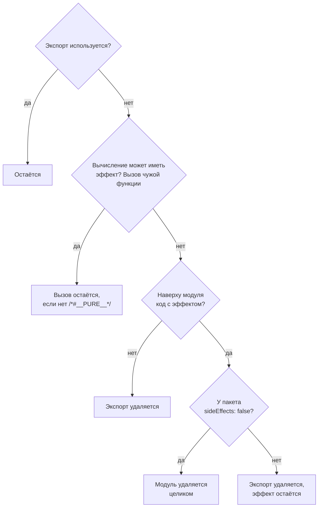

## О чём урок

Как сборщик решает, что выбросить: метки «используется» от точки входа, побочные эффекты и почему код на верхнем уровне модуля остаётся, аннотация `/*#__PURE__*/`, поле `sideEffects` и barrel-файлы, объекты, классы и динамический `import()`. Основы (ES-модули против CommonJS, lodash) разобраны в уроке `perf-javascript`; здесь механика и проверка утверждений из заметок. Пример собирает одни и те же случаи двумя настоящими сборщиками: Rolldown (Vite 8) и esbuild (Angular CLI).

## Как это работает

Tree shaking это удаление неиспользуемого кода по статическому анализу ES-модулей. Сборщик:

1. Начинает с точки входа и помечает как нужный код, который **выполняется при загрузке** (вызовы, присваивания глобальным объектам) или **используется** нужным кодом.
2. Идёт по импортам: импортированный и использованный экспорт нужен, его зависимости тоже.
3. Всё, что не помечено, не попадает в бандл. Минификатор потом удаляет то, что осталось недостижимым внутри функций (dead code elimination).

Главный вопрос для каждого фрагмента: **может ли он что-то сделать при выполнении**. Если сборщик не уверен, код остаётся: удалить нужный код хуже, чем оставить лишний.



## Проверка на двух сборщиках

```ts run
import { build } from 'esbuild'
import { rolldown, type Plugin } from 'rolldown'

type Case = { name: string; files: Record<string, string>; unused: string[]; sideEffectsFalse?: string[] }
// String markers survive minification, so we can see what stayed in the bundle.
const lib = `export const add = (a, b) => 'sum ' + (a + b)
export const sub = (a, b) => 'difference ' + (a - b)`

const cases: Case[] = [
  {
    name: 'console.log at the top of a module',
    files: { 'lib.js': `console.log('lib loaded')\n${lib}`, 'app.js': `import { add } from './lib.js'; console.log(add(1, 2))` },
    unused: ['difference', 'lib loaded'],
  },
  {
    name: 'import * as m, then m.add',
    files: { 'lib.js': lib, 'app.js': `import * as m from './lib.js'; console.log(m.add(1, 2))` },
    unused: ['difference'],
  },
  {
    name: 'export default { add, sub }',
    files: { 'lib.js': `${lib}\nexport default { add, sub }`, 'app.js': `import m from './lib.js'; console.log(m.add(1, 2))` },
    unused: ['difference'],
  },
  {
    name: 'class with an unused method',
    files: {
      'lib.js': `export class Api { get(u) { return 'GET ' + u } post(u) { return 'POST ' + u } }`,
      'app.js': `import { Api } from './lib.js'; console.log(new Api().get('/x'))`,
    },
    unused: ['POST'],
  },
  {
    name: 'unused call into another package',
    files: {
      'lib.js': `import { make } from 'ui-kit'\nexport const big = make('big table')\nexport const small = 1`,
      'app.js': `import { small } from './lib.js'; console.log(small)`,
    },
    unused: ['big table'],
  },
  {
    name: 'the same call marked /*#__PURE__*/',
    files: {
      'lib.js': `import { make } from 'ui-kit'\nexport const big = /*#__PURE__*/ make('big table')\nexport const small = 1`,
      'app.js': `import { small } from './lib.js'; console.log(small)`,
    },
    unused: ['big table'],
  },
  {
    name: 'barrel index.js, a.js logs on import',
    files: {
      'index.js': `export { a } from './a.js'\nexport { b } from './b.js'`,
      'a.js': `console.log('a.js loaded')\nexport const a = 'A'`,
      'b.js': `export const b = 'B'`,
      'app.js': `import { b } from './index.js'; console.log(b)`,
    },
    unused: ['a.js loaded'],
  },
  {
    name: 'the same barrel with "sideEffects": false',
    files: {
      'index.js': `export { a } from './a.js'\nexport { b } from './b.js'`,
      'a.js': `console.log('a.js loaded')\nexport const a = 'A'`,
      'b.js': `export const b = 'B'`,
      'app.js': `import { b } from './index.js'; console.log(b)`,
    },
    unused: ['a.js loaded'],
    sideEffectsFalse: ['index.js', 'a.js', 'b.js'],
  },
  {
    name: 'const { add } = await import()',
    files: { 'lib.js': lib, 'app.js': `const { add } = await import('./lib.js'); console.log(add(1, 2))` },
    unused: ['difference'],
  },
]

async function withRolldown(c: Case): Promise<string> {
  // A real package declares "sideEffects" in package.json; a plugin passes the same flag.
  const plugin: Plugin = {
    name: 'files',
    resolveId(source) {
      const id = source.replace('./', '')
      if (!(id in c.files)) return { id, external: true } // 'ui-kit' is not bundled: its code is unknown
      return { id, moduleSideEffects: !c.sideEffectsFalse?.includes(id) }
    },
    load: (id) => c.files[id],
  }
  const bundle = await rolldown({ input: 'app.js', plugins: [plugin], logLevel: 'silent' })
  const { output } = await bundle.generate({ minify: true })
  return output.map((chunk) => (chunk.type === 'chunk' ? chunk.code : '')).join('')
}

async function withEsbuild(c: Case): Promise<string> {
  const result = await build({
    entryPoints: ['app.js'], bundle: true, minify: true, format: 'esm', splitting: true, outdir: 'out', write: false, logLevel: 'silent',
    plugins: [{
      name: 'files',
      setup(b) {
        b.onResolve({ filter: /.*/ }, ({ path }) => {
          const id = path.replace('./', '')
          if (!(id in c.files)) return { path: id, external: true }
          return { path: id, namespace: 'mem', sideEffects: !c.sideEffectsFalse?.includes(id) }
        })
        b.onLoad({ filter: /.*/, namespace: 'mem' }, ({ path }) => ({ contents: c.files[path], loader: 'js' }))
      },
    }],
  })
  return result.outputFiles.map((f) => f.text).join('')
}

const report = (code: string, c: Case) => {
  const kept = c.unused.filter((s) => code.includes(s))
  return kept.length ? `kept: ${kept.join(', ')}` : 'removed'
}
console.log('case'.padEnd(42), 'Rolldown'.padEnd(18), 'esbuild')
for (const c of cases) {
  console.log(c.name.padEnd(42), report(await withRolldown(c), c).padEnd(18), report(await withEsbuild(c), c))
}
```

```output
case                                       Rolldown           esbuild
console.log at the top of a module         kept: lib loaded   kept: lib loaded
import * as m, then m.add                  removed            removed
export default { add, sub }                kept: difference   kept: difference
class with an unused method                kept: POST         kept: POST
unused call into another package           kept: big table    kept: big table
the same call marked /*#__PURE__*/         removed            removed
barrel index.js, a.js logs on import       kept: a.js loaded  kept: a.js loaded
the same barrel with "sideEffects": false  removed            removed
const { add } = await import()             removed            kept: difference
```

- **`console.log` наверху модуля** остался, а неиспользуемый `sub` удалён. В заметках сказано, что такой код «блокирует весь файл»: это неверно, остаётся только сам эффект.
- **`import * as m`** при статическом обращении `m.add` не мешает: оба сборщика удалили `sub`. Плохо, когда объект пространства имён используют целиком: `Object.keys(m)`, `m[name]`, передают его в функцию.
- **`export default { add, sub }`** оставил `sub` в обоих сборщиках: объект целиком считается используемым. Проблема не в `export default`, а в объекте со всеми функциями. `export default function App()` удаляется так же хорошо, как именованный экспорт.
- **Методы класса** не удаляются: обращение `api.post` может быть вычислено во время выполнения, поэтому класс попадает в бандл целиком. Библиотеки, где всё API это методы одного объекта или класса (`moment`, многие SDK), плохо поддаются tree shaking; отдельные функции (`date-fns`) поддаются хорошо.
- **Вызов функции из другого пакета** остался, хотя результат никому не нужен: сборщик не знает, есть ли у `make` побочный эффект. Аннотация `/*#__PURE__*/` обещает, что эффекта нет, и вызов удаляется. Её расставляют компиляторы JSX и библиотеки (`React.forwardRef`, `createContext`, `defineComponent`). Ложная аннотация молча ломает код.
- **Barrel-файл** `index.js` с реэкспортами: модуль `a.js` с `console.log` остался в бандле, хотя из него ничего не импортировали. С `"sideEffects": false` в `package.json` пакета сборщик выбросил модуль целиком.
- **`const { add } = await import()`**: Rolldown удалил `sub` из динамического чанка, esbuild оставил. Это одно из мест, где сборщики расходятся.

## Поле sideEffects

```json
{
  "name": "@acme/ui",
  "sideEffects": ["**/*.css", "./src/polyfills.js"]
}
```

- `false`: любой модуль пакета, из которого ничего не используется, можно выбросить целиком.
- Массив: эти файлы нужны ради эффекта при импорте, остальные можно выбрасывать. Стили (`import './button.css'`) и полифилы перечисляют обязательно, иначе с `false` они пропадут из сборки.
- Поле читается из `package.json` **пакета**, которому принадлежит модуль: для своего кода в монорепозитории его ставят в `package.json` библиотеки.

## Barrel-файлы

`index.ts`, который реэкспортирует всё из папки, удобен для импорта, но:

- Без `sideEffects: false` сборщик обязан выполнить все модули, на которые ссылается barrel, ради их возможных эффектов.
- В разработке и в тестах (Vite, Vitest, Jest) tree shaking нет: `import { Button } from '@acme/ui'` загружает **все** модули пакета. На больших библиотеках иконок и компонентов это секунды на старте сервера и каждого тестового файла.
- Выход: импортировать из конкретных файлов (`@acme/ui/button`), объявить `exports` по подпутям в `package.json`, держать barrel только на границе пакета, а не в каждой папке.

## Что ещё мешает

- **CommonJS**: `require` и `module.exports` попадают целиком (урок `perf-javascript`). Пакет, который публикует только CommonJS, не поддаётся tree shaking.
- **Изменение глобальных объектов** при импорте: `Array.prototype.x = ...`, `window.lib = ...`, регистрация в общем реестре.
- **Динамическое обращение**: `` import(`./locales/${lang}.js`) `` Vite и webpack превращают в набор чанков по шаблону пути, и в сборку попадают все подходящие файлы; обращение по вычисленному имени к пространству имён (`m[name]`) удерживает все экспорты.
- **Режим разработки**: tree shaking выполняется только при сборке. Проверять размер нужно на `vite build`, а не в DevTools сервера разработки.

## Главное

- Сборщик помечает код, который выполняется при загрузке или используется, и выбрасывает остальное; при сомнении код остаётся.
- `console.log` наверху модуля оставляет только себя, а не весь файл; `import * as` со статическим доступом работает.
- Не удаляются: свойства экспортированного объекта, методы классов, вызовы неизвестных функций без `/*#__PURE__*/`.
- `sideEffects: false` разрешает выбросить модуль целиком; CSS и полифилы перечисляют в массиве.
- Barrel-файлы без `sideEffects` тянут лишнее в сборку и замедляют разработку и тесты.
- Сборщики расходятся в деталях (динамический `import()`): размер проверяют на реальной сборке.
