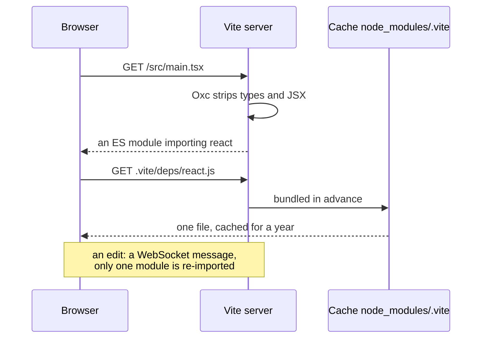

## What this lesson covers

How Vite works: the dev server without a bundle and why it starts fast, dependency pre-bundling, hot module replacement (HMR), environment variables and the `VITE_` prefix, plugins and virtual modules, `vite build` and `vite preview`, library mode. The example runs a real Vite 8 build with a custom plugin.

## The dev server



- Vite **does not bundle** in development. The browser requests modules one by one, the server transforms a file at request time (types, JSX, `.vue`, CSS) and returns an ES module. Startup does not depend on the size of the app: only what is opened gets processed.
- **Dependency pre-bundling** on the first run does two things. It converts packages in CommonJS and UMD into ES modules: in development everything is served as ESM. It merges packages made of many files into one: `lodash-es` has over 600 internal modules, and without this `import { debounce } from 'lodash-es'` would cause hundreds of requests. The result lives in `node_modules/.vite` and is cached by the browser.
- **HMR**: after an edit the server reports over a WebSocket which module changed, and the browser imports it again without a reload. React component state is kept by Fast Refresh from `@vitejs/plugin-react`; for Vue `@vitejs/plugin-vue` does it. If no module "accepts" the update (`import.meta.hot.accept`), the page reloads.

## Environment variables

| What | Meaning |
|---|---|
| `.env`, `.env.local`, `.env.production`, `.env.[mode].local` | Files are read by mode; `.local` files are not committed |
| `import.meta.env.VITE_*` | Variables with the prefix get into the code **as text** |
| `import.meta.env.MODE`, `DEV`, `PROD`, `BASE_URL` | Built-in values |
| Variables without the prefix | Do not get into client code |

Values are substituted at build time, so everything starting with `VITE_` is visible in the bundle: secrets do not belong there (the `sec-model` lesson). `if (import.meta.env.DEV)` branches are removed entirely in a production build.

## A plugin and a virtual module

```ts run
import { mkdirSync, mkdtempSync, readdirSync, rmSync, writeFileSync } from 'node:fs'
import { join } from 'node:path'
import { build, type Plugin } from 'vite'

// A tiny project in a temporary folder.
const root = mkdtempSync(join(process.cwd(), 'node_modules', '.vt-'))
const write = (file: string, text: string) => {
  mkdirSync(join(root, file, '..'), { recursive: true })
  writeFileSync(join(root, file), text)
}
write('index.html', '<script type="module" src="/src/main.js"></script>')
write('.env', 'VITE_API_URL=https://api.example.com\nDB_PASSWORD=secret123')
write('src/pages/home.js', 'export default "home"')
write('src/pages/cart.js', 'export default "cart"')
write('src/main.js', `
  import { routes } from 'virtual:routes'
  console.log('routes', routes)
  console.log('api', import.meta.env.VITE_API_URL, 'mode', import.meta.env.MODE)
  console.log('password', import.meta.env.DB_PASSWORD)
  if (import.meta.env.DEV) console.log('dev-only debug panel')`)

// A plugin: the 'virtual:routes' module does not exist on disk, it is generated from src/pages.
const routesPlugin: Plugin = {
  name: 'routes',
  resolveId: (id) => (id === 'virtual:routes' ? '\0virtual:routes' : null),
  load(id) {
    if (id !== '\0virtual:routes') return null
    const pages = readdirSync(join(root, 'src/pages')).map((f) => f.replace('.js', '')).sort()
    return `export const routes = ${JSON.stringify(pages.map((p) => '/' + p))}`
  },
}

const result = await build({ root, logLevel: 'silent', plugins: [routesPlugin], build: { write: false, minify: false } })
type Out = { fileName: string; type: string; code?: string; source?: string }
const output = (Array.isArray(result) ? result[0] : result) as { output: Out[] }
const hide = (s: string) => s.replace(/-[\w-]{8}\./g, '-<hash>.')
for (const file of output.output) console.log('file:', hide(file.fileName))
console.log(hide(String(output.output.find((f) => f.fileName === 'index.html')!.source).trim()))
const js = output.output.find((f) => f.type === 'chunk')!.code!
console.log(js.split('\n').filter((line) => line.includes('console.log')).map((l) => l.trim()).join('\n'))
rmSync(root, { recursive: true })
```

```output
file: assets/index-<hash>.js
file: index.html
<script type="module" crossorigin src="/assets/index-<hash>.js"></script>
console.log("routes", ["/cart", "/home"]);
console.log("api", "https://api.example.com", "mode", "production");
console.log("password", void 0);
```

- The `virtual:routes` module does not exist on disk: the plugin named it `\0virtual:routes` in `resolveId` (the `\0` character conventionally means "not a file, other plugins keep out") and generated its code in `load` from the list of files in `src/pages`. File-based routing, icons, translations and the PWA manifest work this way.
- `VITE_API_URL` was substituted as a string, `DB_PASSWORD` without the prefix became `undefined`, and the `console.log` from the `DEV` branch disappeared.
- Vite rewrote `index.html`: the script path became a hashed file in `assets/`. HTML is the build's entry point, like `main.js` for Rolldown.

## Vite plugins

```ts
import type { Plugin } from 'vite'

export default function myPlugin(): Plugin {
  return {
    name: 'my-plugin',
    enforce: 'pre',          // before built-in plugins; 'post' after
    apply: 'build',          // only during the build; 'serve' only in development
    config: () => ({ define: { __BUILD_TIME__: JSON.stringify(Date.now()) } }),
    configureServer(server) { server.middlewares.use('/health', (_req, res) => res.end('ok')) },
    transformIndexHtml: (html) => html.replace('<head>', '<head><meta name="x-build" content="1">'),
    resolveId: () => null,   // Rollup and Rolldown hooks work here too
  }
}
```

- Rollup hooks (`resolveId`, `load`, `transform`, `generateBundle`) work both in development and in the build; that is why most Rollup plugins fit Vite.
- Vite only: `config` and `configResolved` (change or read the settings), `configureServer` (your own middleware), `transformIndexHtml`, `hotUpdate` (custom HMR logic).
- Order: first plugins with `enforce: 'pre'`, then built-in ones, then regular ones, then `post`.

## Build, preview, library

- `vite build` builds the production version into `dist`: Rolldown, JS minification with Oxc, CSS with Lightning CSS, the build target `baseline-widely-available`.
- `vite preview` starts a local server for `dist` to check the build. It is not a production server: in production `dist` is served by a CDN or a web server.
- Library mode (`build.lib`) builds a package: dependencies go to `external`, the format is ES, types are generated separately (`tsc` or a plugin).
- For SSR and several environments (browser, server, edge) Vite has offered the Environment API since version 6; meta-frameworks use it themselves.
- An experimental Full Bundle Mode is in progress: bundling in development too, for large projects where thousands of modules are slow even without a build.

## Key points

- Development without a bundle: modules on request, on-the-fly transforms, startup independent of project size.
- Dependencies are pre-bundled: CommonJS into ESM and many files into one (`lodash-es`), cached in `node_modules/.vite`.
- HMR over a WebSocket; framework plugins keep state; without `accept` the page reloads.
- Only `VITE_*` gets into client code, as text in the bundle; `DEV` branches are removed in the build.
- Plugins: Rollup hooks plus `config`, `configureServer`, `transformIndexHtml`, `hotUpdate`; virtual modules with `\0`.
- `vite build` for `dist`, `vite preview` only for checking, `build.lib` for packages.
