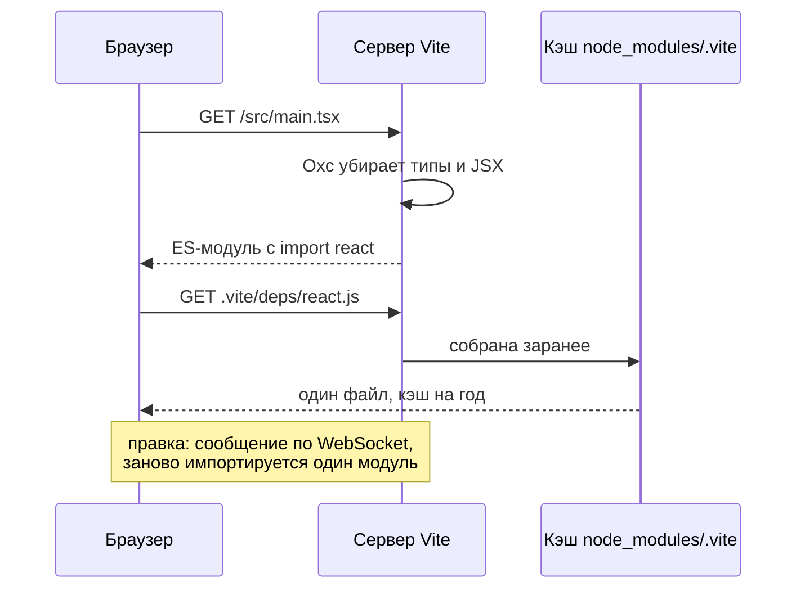

## О чём урок

Как устроен Vite: сервер разработки без бандла и почему он стартует быстро, предварительная сборка зависимостей, горячая замена модулей (HMR), переменные окружения и префикс `VITE_`, плагины и виртуальные модули, `vite build` и `vite preview`, режим библиотеки. Пример запускает настоящую сборку Vite 8 с собственным плагином.

## Сервер разработки



- Vite **не собирает бандл** в разработке. Браузер запрашивает модули по одному, сервер преобразует файл в момент запроса (типы, JSX, `.vue`, CSS) и отдаёт ES-модуль. Старт не зависит от размера приложения: обрабатывается только то, что открыто.
- **Предварительная сборка зависимостей** при первом запуске делает две вещи. Переводит пакеты на CommonJS и UMD в ES-модули: в разработке всё отдаётся как ESM. Склеивает пакеты из множества файлов в один: в `lodash-es` больше 600 внутренних модулей, и без этого `import { debounce } from 'lodash-es'` дал бы сотни запросов. Результат лежит в `node_modules/.vite` и кэшируется браузером.
- **HMR**: после правки сервер по WebSocket сообщает, какой модуль изменился, и браузер импортирует его заново без перезагрузки. Состояние компонентов React сохраняет Fast Refresh из `@vitejs/plugin-react`, у Vue это делает `@vitejs/plugin-vue`. Если модуль никто не «принимает» (`import.meta.hot.accept`), страница перезагружается.

## Переменные окружения

| Что | Значение |
|---|---|
| `.env`, `.env.local`, `.env.production`, `.env.[mode].local` | Файлы читаются по режиму; `.local` не коммитят |
| `import.meta.env.VITE_*` | Переменные с префиксом попадают в код **как текст** |
| `import.meta.env.MODE`, `DEV`, `PROD`, `BASE_URL` | Встроенные значения |
| Переменные без префикса | В клиентский код не попадают |

Значения подставляются при сборке, поэтому в бандле видно всё, что начинается с `VITE_`: секретам там не место (урок `sec-model`). Ветки `if (import.meta.env.DEV)` в продакшен-сборке удаляются целиком.

## Плагин и виртуальный модуль

```ts run
import { mkdirSync, mkdtempSync, readdirSync, rmSync, writeFileSync } from 'node:fs'
import { join } from 'node:path'
import { build, type Plugin } from 'vite'

// A tiny project in a temporary folder.
const root = mkdtempSync(join(process.cwd(), 'node_modules', '.vt-'))
const write = (file: string, text: string) => {
  mkdirSync(join(root, file, '..'), { recursive: true })
  writeFileSync(join(root, file), text)
}
write('index.html', '<script type="module" src="/src/main.js"></script>')
write('.env', 'VITE_API_URL=https://api.example.com\nDB_PASSWORD=secret123')
write('src/pages/home.js', 'export default "home"')
write('src/pages/cart.js', 'export default "cart"')
write('src/main.js', `
  import { routes } from 'virtual:routes'
  console.log('routes', routes)
  console.log('api', import.meta.env.VITE_API_URL, 'mode', import.meta.env.MODE)
  console.log('password', import.meta.env.DB_PASSWORD)
  if (import.meta.env.DEV) console.log('dev-only debug panel')`)

// A plugin: the 'virtual:routes' module does not exist on disk, it is generated from src/pages.
const routesPlugin: Plugin = {
  name: 'routes',
  resolveId: (id) => (id === 'virtual:routes' ? '\0virtual:routes' : null),
  load(id) {
    if (id !== '\0virtual:routes') return null
    const pages = readdirSync(join(root, 'src/pages')).map((f) => f.replace('.js', '')).sort()
    return `export const routes = ${JSON.stringify(pages.map((p) => '/' + p))}`
  },
}

const result = await build({ root, logLevel: 'silent', plugins: [routesPlugin], build: { write: false, minify: false } })
type Out = { fileName: string; type: string; code?: string; source?: string }
const output = (Array.isArray(result) ? result[0] : result) as { output: Out[] }
const hide = (s: string) => s.replace(/-[\w-]{8}\./g, '-<hash>.')
for (const file of output.output) console.log('file:', hide(file.fileName))
console.log(hide(String(output.output.find((f) => f.fileName === 'index.html')!.source).trim()))
const js = output.output.find((f) => f.type === 'chunk')!.code!
console.log(js.split('\n').filter((line) => line.includes('console.log')).map((l) => l.trim()).join('\n'))
rmSync(root, { recursive: true })
```

```output
file: assets/index-<hash>.js
file: index.html
<script type="module" crossorigin src="/assets/index-<hash>.js"></script>
console.log("routes", ["/cart", "/home"]);
console.log("api", "https://api.example.com", "mode", "production");
console.log("password", void 0);
```

- Модуля `virtual:routes` нет на диске: плагин в `resolveId` назвал его `\0virtual:routes` (символ `\0` по соглашению означает «не файл, другим плагинам не трогать»), а в `load` сгенерировал код из списка файлов в `src/pages`. Так работают маршрутизация на файлах, иконки, переводы, PWA-манифест.
- `VITE_API_URL` подставился строкой, `DB_PASSWORD` без префикса стал `undefined`, а `console.log` из ветки `DEV` исчез.
- Vite переписал `index.html`: путь к скрипту стал хэшированным файлом в `assets/`. HTML это точка входа сборки, как `main.js` у Rolldown.

## Плагины Vite

```ts
import type { Plugin } from 'vite'

export default function myPlugin(): Plugin {
  return {
    name: 'my-plugin',
    enforce: 'pre',          // раньше встроенных плагинов; 'post' после
    apply: 'build',          // только при сборке; 'serve' только в разработке
    config: () => ({ define: { __BUILD_TIME__: JSON.stringify(Date.now()) } }),
    configureServer(server) { server.middlewares.use('/health', (_req, res) => res.end('ok')) },
    transformIndexHtml: (html) => html.replace('<head>', '<head><meta name="x-build" content="1">'),
    resolveId: () => null,   // хуки Rollup и Rolldown работают и здесь
  }
}
```

- Хуки Rollup (`resolveId`, `load`, `transform`, `generateBundle`) работают и в разработке, и в сборке; поэтому большинство плагинов Rollup подходят Vite.
- Только у Vite: `config` и `configResolved` (изменить или прочитать настройки), `configureServer` (свой middleware), `transformIndexHtml`, `hotUpdate` (своя логика HMR).
- Порядок: сначала плагины с `enforce: 'pre'`, потом встроенные, потом обычные, потом `post`.

## Сборка, просмотр, библиотека

- `vite build` собирает продакшен-версию в `dist`: Rolldown, минификация JS через Oxc, CSS через Lightning CSS, цель сборки `baseline-widely-available`.
- `vite preview` запускает локальный сервер для `dist`, чтобы проверить сборку. Это не продакшен-сервер: в проде `dist` отдаёт CDN или веб-сервер.
- Режим библиотеки (`build.lib`) собирает пакет: зависимости выносят в `external`, формат ES, типы генерируют отдельно (`tsc` или плагин).
- Для SSR и нескольких окружений (браузер, сервер, edge) Vite с версии 6 даёт Environment API; метафреймворки используют его сами.
- В работе экспериментальный Full Bundle Mode: бандл и в разработке, для больших проектов, где тысячи модулей тормозят даже без сборки.

## Главное

- Разработка без бандла: модули по запросу, преобразование на лету, старт не зависит от размера проекта.
- Зависимости собираются заранее: CommonJS в ESM и много файлов в один (`lodash-es`), кэш в `node_modules/.vite`.
- HMR через WebSocket; состояние сохраняют плагины фреймворков; без `accept` страница перезагружается.
- В клиентский код попадают только `VITE_*`, как текст в бандле; ветки `DEV` удаляются при сборке.
- Плагины: хуки Rollup плюс `config`, `configureServer`, `transformIndexHtml`, `hotUpdate`; виртуальные модули с `\0`.
- `vite build` для `dist`, `vite preview` только для проверки, `build.lib` для пакетов.
