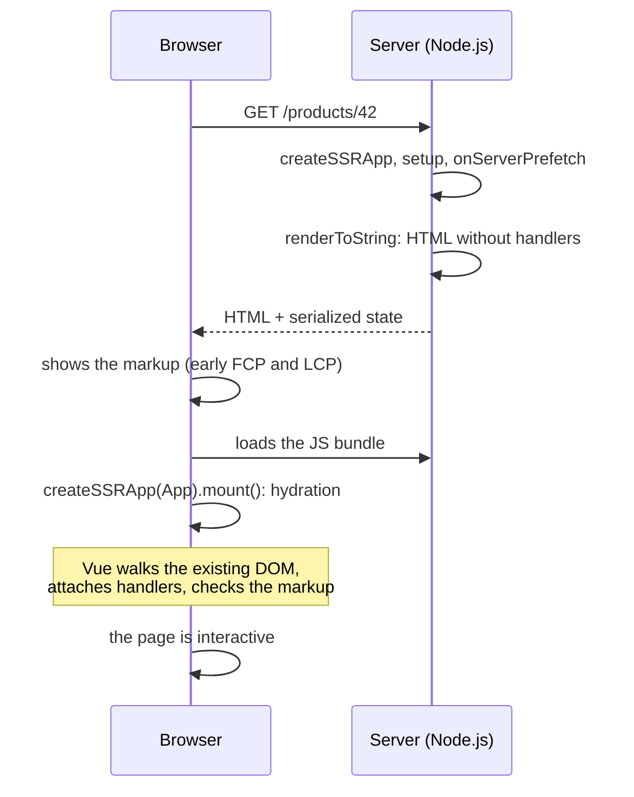
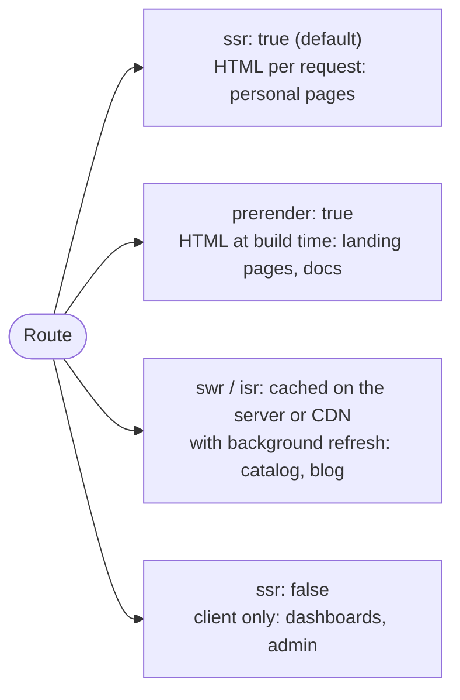

## What this lesson covers

How a Vue application renders on the server and comes alive in the browser: `createSSRApp`, `renderToString` and hydration, mismatches and lazy hydration from 3.5, state under SSR, Nuxt 4 with a rendering mode per route, and component testing with Vitest. The examples run on Vue 3.5. The router has its own lesson.

## SSR and hydration



`createSSRApp` and `renderToString` from `vue/server-renderer` render the app to HTML on the server; on the client `createSSRApp(App).mount('#app')` **hydrates** the existing markup instead of creating new nodes.

```js run
import { createSSRApp, ref, useId } from 'vue'
import { renderToString } from 'vue/server-renderer'

const Field = {
  props: ['label'],
  setup: () => ({ id: useId() }),
  template: `<label :for="id">{{ label }}</label><input :id="id">`,
}

const app = createSSRApp({
  components: { Field },
  setup: () => ({ items: ref(['Ann', 'Bob']) }),
  template: `<form><Field label="Name" /><Field label="Email" /></form><ul><li v-for="i in items" :key="i">{{ i }}</li></ul>`,
})

const html = await renderToString(app)
console.log(html.replace(/<!--[[\]]-->/g, ''))
```

```output
<form><label for="v-0">Name</label><input id="v-0"><label for="v-1">Email</label><input id="v-1"></form><ul><li>Ann</li><li>Bob</li></ul>
```

- The client's first render must produce the same HTML as the server, otherwise Vue warns about a mismatch and re-renders the node. Values that inevitably differ (time, locale) are marked with `data-allow-mismatch` (3.5).
- `useId()` (3.5) gives identical ids on the server and the client; `Math.random()` does not work for this.
- On the server `onMounted` and post-render watchers do not run, and there is no `window` or `document`: browser code goes into `onMounted`.
- State must not live in global modules: the server handles many requests in one process. Pinia creates a store per request and passes the state to the client.
- **Lazy hydration** (3.5): `defineAsyncComponent({ loader, hydrate: hydrateOnVisible() })` keeps a component as static HTML until it appears on screen; there are also `hydrateOnIdle`, `hydrateOnInteraction`, `hydrateOnMediaQuery`.

## Nuxt

In practice SSR is done with **Nuxt** (version 4), a framework on top of Vue, Vue Router and Vite: file-based routes in `app/pages`, server handlers in `server/` (the Nitro engine), auto-imported components and composables, data loading with `useFetch` and `useAsyncData`, which run on the server and pass the result to the client inside the HTML so the client does not request the same data again.

Nuxt's main strength is that the rendering mode is chosen **per route** through `routeRules`:



```ts
// nuxt.config.ts
export default defineNuxtConfig({
  routeRules: {
    '/': { prerender: true },
    '/products/**': { swr: 3600 },
    '/admin/**': { ssr: false },
  },
})
```

For static sites and docs without a server, use Nuxt SSG or VitePress.

## Tests

| Level | Tool | What it checks |
|---|---|---|
| Logic, composables, stores | Vitest | Functions and reactive state without a DOM |
| Components | Vitest + jsdom/happy-dom + Vue Test Utils or Testing Library | Rendering, events, `emit`, slots |
| Browser scenarios | Playwright (or Cypress) | A real browser, routes, network |

```ts
import { mount, flushPromises } from '@vue/test-utils'
import { createTestingPinia } from '@pinia/testing'
import { expect, it } from 'vitest'
import Counter from './Counter.vue'

it('increments and emits change', async () => {
  const wrapper = mount(Counter, {
    props: { start: 1 },
    global: { plugins: [createTestingPinia()] }, // store actions become spies
  })
  await wrapper.get('button').trigger('click') // await: the DOM updates after nextTick
  expect(wrapper.text()).toContain('2')
  expect(wrapper.emitted('change')).toEqual([[2]])
  await flushPromises() // settle pending fetches
})
```

- `trigger` and `setValue` return a promise that waits for `nextTick`: without `await` the assertion sees the old DOM.
- Testing Library for Vue (`render`, `screen.getByRole`, `userEvent`) finds elements the way a user sees them and does not depend on the component internals; Vue Test Utils gives more access to the instance (`emitted`, `vm`).
- Test a composable with lifecycle hooks inside a small wrapper component; without hooks, calling it inside an `effectScope` is enough.
- Pinia: `createTestingPinia()` turns actions into spies for component tests, `setActivePinia(createPinia())` for tests of the store itself.

## Key points

- `createSSRApp` and `renderToString` on the server, hydration on the client: Vue reuses the existing DOM and attaches handlers.
- The first client render must match the server markup; `useId`, `data-allow-mismatch`, browser code in `onMounted`.
- Lazy hydration (3.5) postpones bringing invisible or unimportant parts to life.
- Global module state under SSR is shared by all requests; Pinia isolates requests.
- Nuxt 4: SSR, SSG, SPA and caching per route through `routeRules`, data through `useFetch` and `useAsyncData`.
- Tests: Vitest, Vue Test Utils or Testing Library, `createTestingPinia`, Playwright for E2E.
