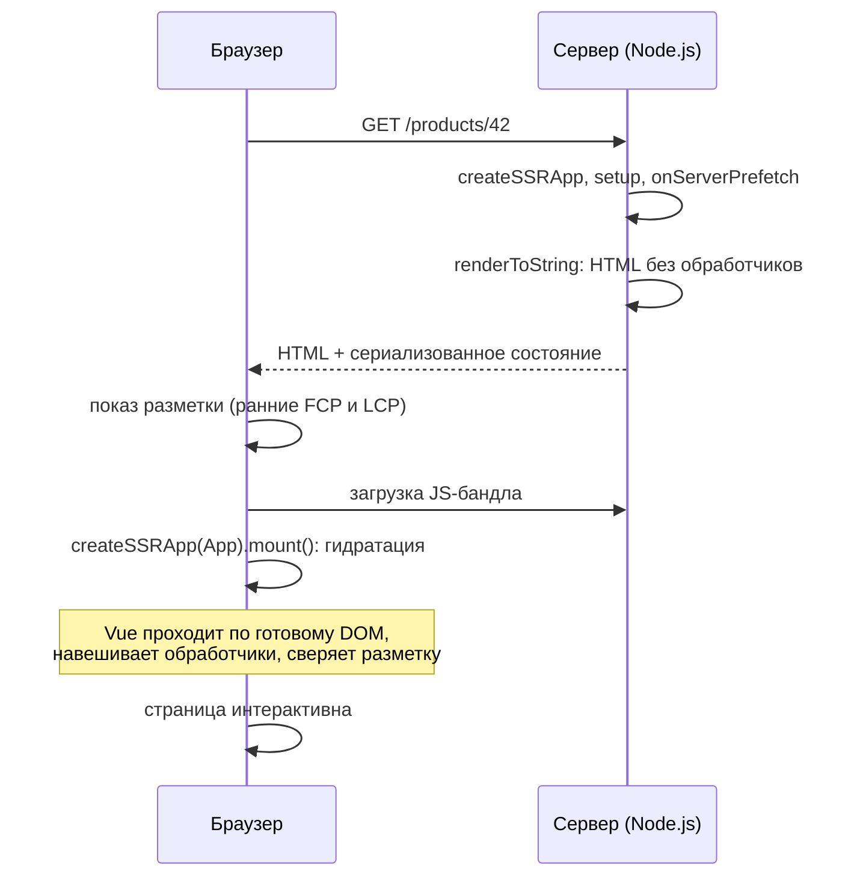
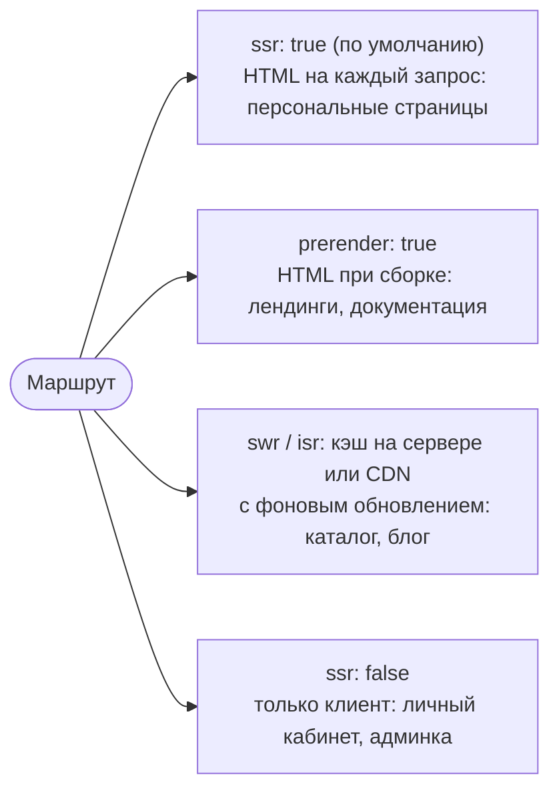

## О чём урок

Как приложение на Vue рендерится на сервере и оживает в браузере: `createSSRApp`, `renderToString` и гидратация, несовпадения и ленивая гидратация из 3.5, состояние при SSR, Nuxt 4 с режимами рендера для каждого маршрута и тестирование компонентов на Vitest. Примеры выполняются на Vue 3.5. Роутер разобран в отдельном уроке.

## SSR и гидратация



`createSSRApp` и `renderToString` из `vue/server-renderer` рендерят приложение в HTML на сервере; на клиенте `createSSRApp(App).mount('#app')` **гидратирует** готовую разметку вместо создания новой.

```js run
import { createSSRApp, ref, useId } from 'vue'
import { renderToString } from 'vue/server-renderer'

const Field = {
  props: ['label'],
  setup: () => ({ id: useId() }),
  template: `<label :for="id">{{ label }}</label><input :id="id">`,
}

const app = createSSRApp({
  components: { Field },
  setup: () => ({ items: ref(['Ann', 'Bob']) }),
  template: `<form><Field label="Name" /><Field label="Email" /></form><ul><li v-for="i in items" :key="i">{{ i }}</li></ul>`,
})

const html = await renderToString(app)
console.log(html.replace(/<!--[[\]]-->/g, ''))
```

```output
<form><label for="v-0">Name</label><input id="v-0"><label for="v-1">Email</label><input id="v-1"></form><ul><li>Ann</li><li>Bob</li></ul>
```

- HTML первого рендера на клиенте должен совпасть с серверным, иначе Vue предупредит о несовпадении и перерисует узел. Значения, которые неизбежно отличаются (время, локаль), помечают `data-allow-mismatch` (3.5).
- `useId()` (3.5) даёт одинаковые id на сервере и клиенте; `Math.random()` для этого не годится.
- На сервере не выполняются `onMounted` и наблюдатели после рендера, нет `window` и `document`: браузерный код идёт в `onMounted`.
- Состояние нельзя держать в глобальных модулях: сервер обслуживает много запросов в одном процессе. Pinia создаёт свой стор на каждый запрос и передаёт состояние клиенту.
- **Ленивая гидратация** (3.5): `defineAsyncComponent({ loader, hydrate: hydrateOnVisible() })` оставляет компонент статичным HTML, пока он не появится на экране; есть `hydrateOnIdle`, `hydrateOnInteraction`, `hydrateOnMediaQuery`.

## Nuxt

На практике SSR делают через **Nuxt** (версия 4), фреймворк поверх Vue, Vue Router и Vite: файловые маршруты в `app/pages`, серверные обработчики в `server/` (движок Nitro), автоимпорты компонентов и composables, загрузка данных `useFetch` и `useAsyncData`, которые выполняются на сервере и передают результат клиенту в HTML, чтобы клиент не запрашивал те же данные повторно.

Главная сила Nuxt в том, что режим рендера выбирается **для каждого маршрута** через `routeRules`:



```ts
// nuxt.config.ts
export default defineNuxtConfig({
  routeRules: {
    '/': { prerender: true },
    '/products/**': { swr: 3600 },
    '/admin/**': { ssr: false },
  },
})
```

Для статических сайтов и документации без сервера используют SSG Nuxt или VitePress.

## Тесты

| Уровень | Инструмент | Что проверяет |
|---|---|---|
| Логика, composables, сторы | Vitest | Функции и реактивное состояние без DOM |
| Компоненты | Vitest + jsdom/happy-dom + Vue Test Utils или Testing Library | Рендер, события, `emit`, слоты |
| Сценарии в браузере | Playwright (или Cypress) | Настоящий браузер, маршруты, сеть |

```ts
import { mount, flushPromises } from '@vue/test-utils'
import { createTestingPinia } from '@pinia/testing'
import { expect, it } from 'vitest'
import Counter from './Counter.vue'

it('increments and emits change', async () => {
  const wrapper = mount(Counter, {
    props: { start: 1 },
    global: { plugins: [createTestingPinia()] }, // store actions become spies
  })
  await wrapper.get('button').trigger('click') // await: the DOM updates after nextTick
  expect(wrapper.text()).toContain('2')
  expect(wrapper.emitted('change')).toEqual([[2]])
  await flushPromises() // settle pending fetches
})
```

- `trigger` и `setValue` возвращают промис, который ждёт `nextTick`: без `await` проверка увидит старый DOM.
- Testing Library для Vue (`render`, `screen.getByRole`, `userEvent`) ищет элементы так, как их видит пользователь, и не зависит от внутреннего устройства компонента; Vue Test Utils даёт больше доступа к экземпляру (`emitted`, `vm`).
- Composable с хуками жизненного цикла тестируют внутри небольшого компонента-обёртки; без хуков достаточно вызвать его в `effectScope`.
- Pinia: `createTestingPinia()` подменяет действия шпионами для тестов компонентов, `setActivePinia(createPinia())` для тестов самого стора.

## Главное

- `createSSRApp` и `renderToString` на сервере, гидратация на клиенте: Vue переиспользует готовый DOM и навешивает обработчики.
- Разметка первого рендера на клиенте должна совпасть с серверной; `useId`, `data-allow-mismatch`, браузерный код в `onMounted`.
- Ленивая гидратация (3.5) откладывает оживление невидимых или неважных частей.
- Глобальное состояние в модулях при SSR общее для всех запросов; Pinia изолирует запросы.
- Nuxt 4: SSR, SSG, SPA и кэширование для каждого маршрута через `routeRules`, данные через `useFetch` и `useAsyncData`.
- Тесты: Vitest, Vue Test Utils или Testing Library, `createTestingPinia`, Playwright для E2E.
