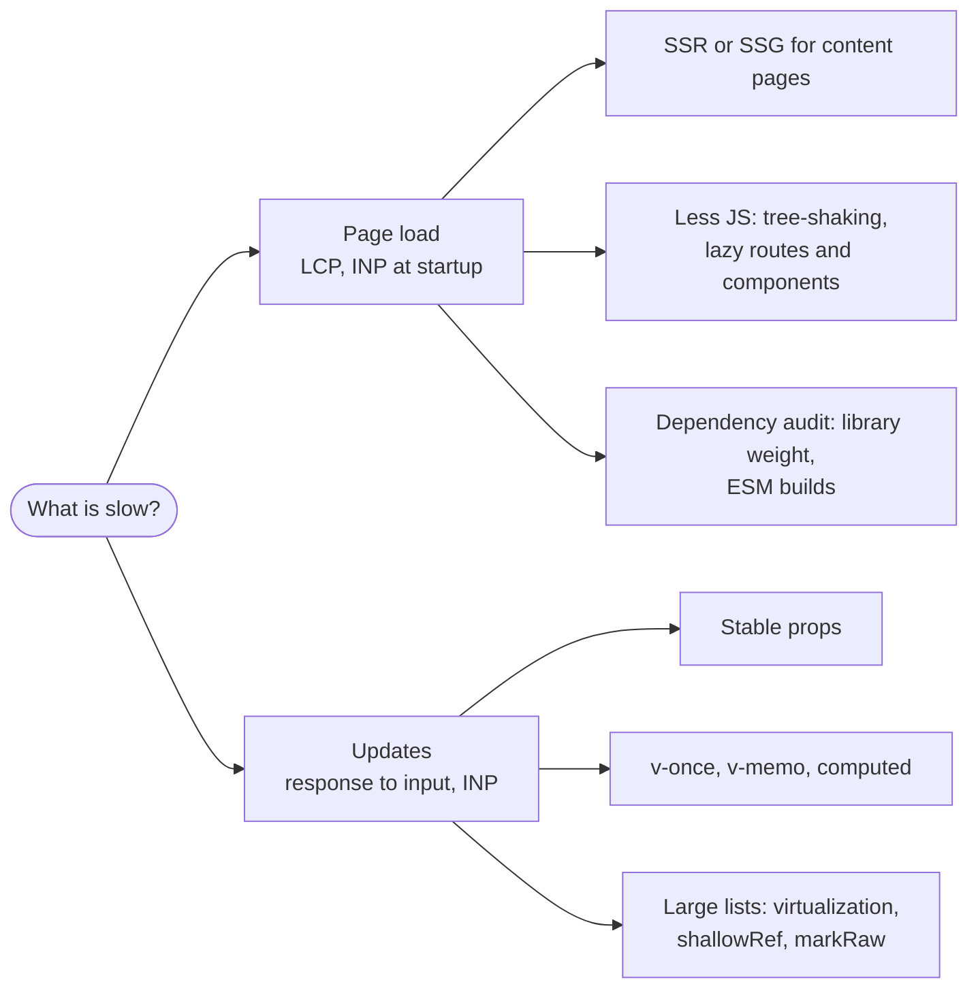
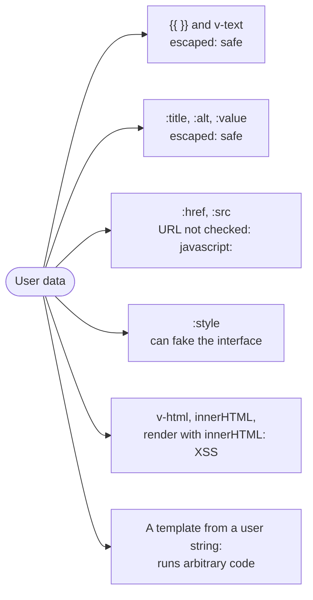

## What this lesson covers

The three "best practices" sections of the Vue docs that come up in interviews: performance (loading and updates), accessibility (routing, forms, semantics) and security (what Vue escapes for you and what stays your job). The examples run in jsdom on Vue 3.5.

## Performance: two different problems



**Loading.** The architecture choice matters more than micro-optimizations: SSR or SSG (Nuxt, VitePress) for content and SEO, an SPA for apps behind a login. Next is bundle size: templates are compiled at build time (the compiler does not ship to the browser), the bundler drops unused Vue APIs, pages load through `() => import()`, heavy components through `defineAsyncComponent`. Check libraries for weight and an ESM build (lodash-es instead of lodash).

**Updates.** A component updates when its props or the data it read change, so props should change only for the components the change concerns:

```js dom
import { createApp, nextTick, ref } from 'vue'

const renders = { byId: 0, byFlag: 0 }
const ItemById = {
  props: ['item', 'activeId'],
  render() {
    renders.byId++ // every item reads activeId, so every item updates when it changes
    return this.item.id === this.activeId ? '*' : '-'
  },
}
const ItemByFlag = {
  props: ['item', 'active'],
  render() {
    renders.byFlag++ // only the items whose `active` actually flips update
    return this.active ? '*' : '-'
  },
}

const items = Array.from({ length: 1000 }, (_, i) => ({ id: i }))
const activeId = ref(1)
const el = document.createElement('div')
createApp({
  components: { ItemById, ItemByFlag },
  setup: () => ({ items, activeId }),
  template: `
    <ItemById v-for="item in items" :key="item.id" :item="item" :active-id="activeId" />
    <ItemByFlag v-for="item in items" :key="item.id" :item="item" :active="item.id === activeId" />`,
}).mount(el)
renders.byId = renders.byFlag = 0
activeId.value = 2
await nextTick()
console.log(renders)
```

```output
{ byId: 1000, byFlag: 2 }
```

Selecting another item updated **all 1000** components receiving `activeId`, and only **two** receiving a ready `active` flag. The rule from the docs: compute in the parent what the child needs and pass a stable value.

- `v-once` for content that never changes after the first render; `v-memo="[item.id === selectedId]"` for large lists where only a couple of rows change.
- Since 3.4 a `computed` notifies dependents only when its value changes; but if the getter returns a **new object** every time, it always "changed". You can compare with the previous value yourself: the getter receives it as its first argument (`computed((old) => ...)`).
- Keep large immutable structures in a `shallowRef` or mark them with `markRaw`: deep reactivity costs memory and time to create proxies.
- Virtualize long lists (`useVirtualList` from VueUse, vue-virtual-scroller): only visible rows are in the DOM.
- Extra abstractions cost too: a thousand instances of a wrapper component are noticeably more expensive than a thousand elements; keep markup simple in hot lists.
- Measure before optimizing: Performance in Chrome DevTools, the performance tab of Vue DevTools, `app.config.performance = true` for marks in the profile.

## Accessibility

- **A "Skip to main content" link** first on the page: keyboard and screen reader users skip the navigation.
- **A route change in an SPA** is not announced to screen readers the way a page load is. After navigation move focus to the skip link or the new page's heading and update `document.title`:

```ts
router.afterEach((to) => {
  document.title = `${to.meta.title} · Shop`
  nextTick(() => document.querySelector<HTMLElement>('#main-heading')?.focus()) // tabindex="-1" on the h1
})
```

- **Semantics**: headings in level order, landmarks `<main>`, `<nav>`, `<header>`; a button is a `<button>`, a link is an `<a href>`, not a `<div @click>`, which is unreachable by keyboard and not announced as a button.
- **Forms**: every field has a `<label for>` (an id from `useId()`, matching on server and client), hints and errors are linked with `aria-describedby`, errors are announced with `role="alert"` or `aria-live`. A `placeholder` is not a label.
- **Modals**: focus moves inside on open, returns to the button on close, `Escape` closes; a native `<dialog>` with `showModal()` traps focus and makes the background `inert` by itself.
- Turn `<Transition>` animations off under `prefers-reduced-motion`; text contrast at least 4.5:1 (WCAG 2.2 AA).

## Security



```js dom
import { createApp } from 'vue'

const comment = {
  text: '',
  website: 'javascript:alert(document.cookie)',
}
function safeUrl(raw) {
  try {
    const url = new URL(raw, location.origin)
    return ['http:', 'https:', 'mailto:'].includes(url.protocol) ? url.href : '#'
  } catch {
    return '#'
  }
}

const el = document.createElement('div')
createApp({
  setup: () => ({ comment, safeUrl }),
  template: `
    <p class="text">{{ comment.text }}</p>
    <p class="html" v-html="comment.text"></p>
    <a class="raw" :href="comment.website">site</a>
    <a class="safe" :href="safeUrl(comment.website)">site</a>`,
}).mount(el)
console.log('{{ }}    :', el.querySelector('.text').innerHTML)
console.log('v-html   :', el.querySelector('.html').innerHTML)
console.log(':href    :', el.querySelector('.raw').getAttribute('href'))
console.log('safeUrl  :', el.querySelector('.safe').getAttribute('href'))
```

```output
{{ }}    : &lt;img src=x onerror="alert(document.cookie)"&gt;
v-html   : 
:href    : javascript:alert(document.cookie)
safeUrl  : #
```

- **Rule number one** in the docs: never use untrusted content as a component **template**. A template compiles to JavaScript, so this equals running someone else's code. The same goes for server rendering where a user string lands in the markup before Vue.
- Interpolation and attribute bindings are escaped through `textContent` and `setAttribute`, which is why `` was shown as text.
- `v-html` inserts the string as is. If HTML is really needed (articles from a CMS, markdown), clean it with a sanitizer (DOMPurify) on the server or client; the built-in `Element.setHTML()` from the Sanitizer API is arriving in browsers, but support is not complete yet.
- **Vue does not check URLs**: `javascript:` in `:href` runs on click. Run user links through a protocol check (like `safeUrl` above), ideally on the server as well when saving.
- `:style` with user values lets someone, for example, lay a transparent link over the whole page (clickjacking); allow only specific properties.
- The rest is general web security, not Vue: a CSP without `unsafe-inline` and `unsafe-eval` (the full Vue build with the in-browser template compiler needs `unsafe-eval`, a Vite build does not), no tokens in `localStorage`, CSRF protection, permission checks on the server.

## Key points

- Load performance: SSR/SSG where it fits, templates compiled at build time, lazy routes and components, light dependencies.
- Update performance: stable props (pass a flag, not a shared `activeId`), `v-once`, `v-memo`, `shallowRef`, virtualization, measure with a profiler.
- Accessibility: a skip link, focus and title after a route change, semantic elements, field labels through `useId`, `aria-live` for errors, modals on `<dialog>`.
- Security: `{{ }}` and attributes are escaped; `v-html` only with sanitized HTML; check the protocol of URLs in `:href`; never compile templates from user strings.
