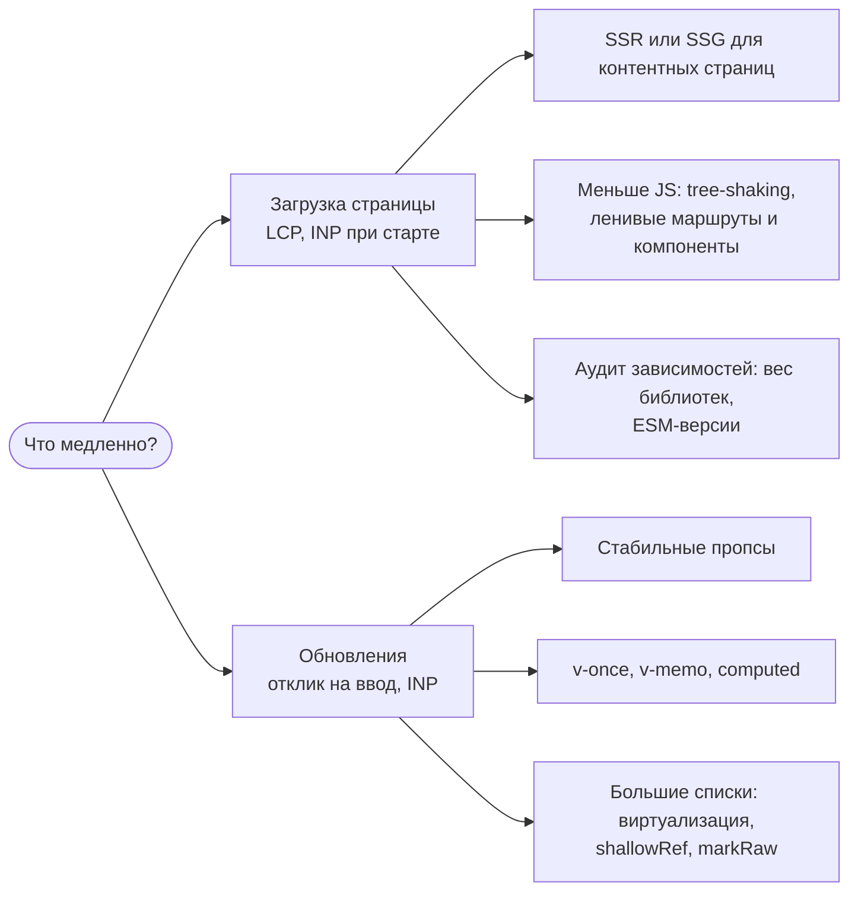
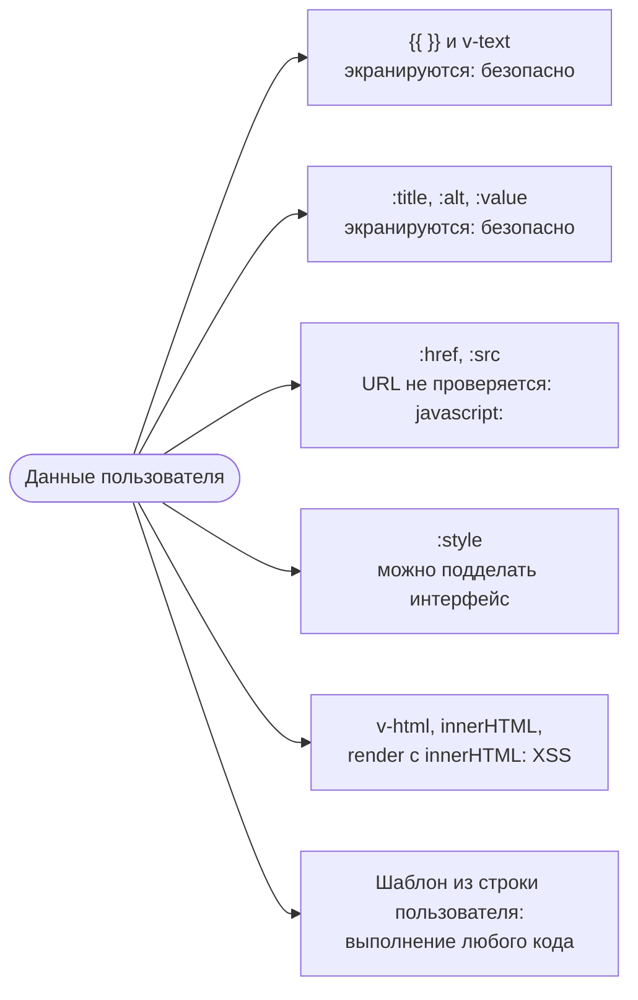

## О чём урок

Три раздела «лучших практик» из документации Vue, о которых спрашивают на собеседованиях: производительность (загрузка и обновления), доступность (маршрутизация, формы, семантика) и безопасность (что Vue экранирует сам, а что остаётся на разработчике). Примеры выполняются в jsdom на Vue 3.5.

## Производительность: две разные задачи



**Загрузка.** Выбор архитектуры важнее микрооптимизаций: для контента и SEO это SSR или SSG (Nuxt, VitePress), для приложений за логином SPA. Дальше размер бандла: шаблоны компилируются при сборке (компилятор в браузер не попадает), сборщик выбрасывает неиспользуемое API Vue, страницы грузятся через `() => import()`, тяжёлые компоненты через `defineAsyncComponent`. Библиотеки проверяют на вес и наличие ESM-сборки (lodash-es вместо lodash).

**Обновления.** Компонент обновляется, когда меняются его пропсы или прочитанные им данные, поэтому пропсы должны меняться только у тех, кого изменение касается:

```js dom
import { createApp, nextTick, ref } from 'vue'

const renders = { byId: 0, byFlag: 0 }
const ItemById = {
  props: ['item', 'activeId'],
  render() {
    renders.byId++ // every item reads activeId, so every item updates when it changes
    return this.item.id === this.activeId ? '*' : '-'
  },
}
const ItemByFlag = {
  props: ['item', 'active'],
  render() {
    renders.byFlag++ // only the items whose `active` actually flips update
    return this.active ? '*' : '-'
  },
}

const items = Array.from({ length: 1000 }, (_, i) => ({ id: i }))
const activeId = ref(1)
const el = document.createElement('div')
createApp({
  components: { ItemById, ItemByFlag },
  setup: () => ({ items, activeId }),
  template: `
    <ItemById v-for="item in items" :key="item.id" :item="item" :active-id="activeId" />
    <ItemByFlag v-for="item in items" :key="item.id" :item="item" :active="item.id === activeId" />`,
}).mount(el)
renders.byId = renders.byFlag = 0
activeId.value = 2
await nextTick()
console.log(renders)
```

```output
{ byId: 1000, byFlag: 2 }
```

Выбор другого элемента обновил **все 1000** компонентов, получающих `activeId`, и только **два**, получающих готовый флаг `active`. Правило из документации: вычислять в родителе то, что нужно ребёнку, и передавать стабильное значение.

- `v-once` для содержимого, которое не меняется после первого рендера; `v-memo="[item.id === selectedId]"` для больших списков, где меняется пара строк.
- `computed` с 3.4 уведомляет зависимых только при изменении значения; но если геттер каждый раз возвращает **новый объект**, он всегда «изменился». Сравнить с прошлым значением можно вручную: геттер получает его первым аргументом (`computed((old) => ...)`).
- Большие неизменяемые структуры держат в `shallowRef` или помечают `markRaw`: глубокая реактивность стоит памяти и времени на создание прокси.
- Длинные списки виртуализируют (`useVirtualList` из VueUse, vue-virtual-scroller): в DOM только видимые строки.
- Лишние абстракции тоже стоят: тысяча экземпляров компонента-обёртки заметно дороже тысячи элементов; в горячих списках проще разметка.
- Измерять перед оптимизацией: Performance в Chrome DevTools, вкладка производительности Vue DevTools, `app.config.performance = true` для меток в профиле.

## Доступность

- **Ссылка «Перейти к основному содержимому»** первой в странице: пользователи клавиатуры и скринридеров пропускают навигацию.
- **Смена маршрута в SPA** не сообщается скринридеру, как обычная загрузка страницы. После навигации переносят фокус на ссылку пропуска или заголовок новой страницы и меняют `document.title`:

```ts
router.afterEach((to) => {
  document.title = `${to.meta.title} · Shop`
  nextTick(() => document.querySelector<HTMLElement>('#main-heading')?.focus()) // tabindex="-1" on the h1
})
```

- **Семантика**: заголовки по порядку уровней, ориентиры `<main>`, `<nav>`, `<header>`; кнопка это `<button>`, ссылка это `<a href>`, а не `<div @click>`, который недоступен с клавиатуры и не объявляется как кнопка.
- **Формы**: у каждого поля `<label for>` (id из `useId()`, совпадающий на сервере и клиенте), инструкции и ошибки связаны через `aria-describedby`, ошибки объявляются через `role="alert"` или `aria-live`. `placeholder` не заменяет подпись.
- **Модалки**: фокус внутрь при открытии, возврат на кнопку при закрытии, `Escape` закрывает; нативный `<dialog>` с `showModal()` делает ловушку фокуса и `inert` для фона сам.
- Анимации `<Transition>` отключают при `prefers-reduced-motion`; контраст текста не ниже 4.5:1 (WCAG 2.2 AA).

## Безопасность



```js dom
import { createApp } from 'vue'

const comment = {
  text: '',
  website: 'javascript:alert(document.cookie)',
}
function safeUrl(raw) {
  try {
    const url = new URL(raw, location.origin)
    return ['http:', 'https:', 'mailto:'].includes(url.protocol) ? url.href : '#'
  } catch {
    return '#'
  }
}

const el = document.createElement('div')
createApp({
  setup: () => ({ comment, safeUrl }),
  template: `
    <p class="text">{{ comment.text }}</p>
    <p class="html" v-html="comment.text"></p>
    <a class="raw" :href="comment.website">site</a>
    <a class="safe" :href="safeUrl(comment.website)">site</a>`,
}).mount(el)
console.log('{{ }}    :', el.querySelector('.text').innerHTML)
console.log('v-html   :', el.querySelector('.html').innerHTML)
console.log(':href    :', el.querySelector('.raw').getAttribute('href'))
console.log('safeUrl  :', el.querySelector('.safe').getAttribute('href'))
```

```output
{{ }}    : &lt;img src=x onerror="alert(document.cookie)"&gt;
v-html   : 
:href    : javascript:alert(document.cookie)
safeUrl  : #
```

- **Правило номер один** из документации: никогда не использовать недоверенное содержимое как **шаблон** компонента. Шаблон компилируется в JavaScript, и это равносильно выполнению чужого кода. То же с серверным рендером, где пользовательская строка попадает в разметку до Vue.
- Интерполяция и привязка атрибутов экранируются через `textContent` и `setAttribute`, поэтому `` вывелся текстом.
- `v-html` вставляет строку как есть. Если HTML действительно нужен (статьи из CMS, markdown), его очищают санитайзером (DOMPurify) на сервере или клиенте; встроенный `Element.setHTML()` из Sanitizer API появляется в браузерах, но поддержка пока неполная.
- **URL Vue не проверяет**: `javascript:` в `:href` выполнится при клике. Ссылки от пользователей пропускают через проверку протокола (как `safeUrl` выше) и лучше ещё и на сервере при сохранении.
- `:style` с пользовательскими значениями позволяет, например, наложить прозрачную ссылку поверх всей страницы (кликджекинг); разрешают только конкретные свойства.
- Остальное это общая веб-безопасность, а не Vue: CSP без `unsafe-inline` и `unsafe-eval` (полная сборка Vue с компилятором шаблонов в браузере требует `unsafe-eval`, а сборка Vite нет), токены не в `localStorage`, защита от CSRF, проверка прав на сервере.

## Главное

- Производительность загрузки: SSR/SSG по задаче, шаблоны компилируются при сборке, ленивые маршруты и компоненты, лёгкие зависимости.
- Производительность обновлений: стабильные пропсы (передавать флаг, а не общий `activeId`), `v-once`, `v-memo`, `shallowRef`, виртуализация, измерять профайлером.
- Доступность: ссылка пропуска, фокус и заголовок после смены маршрута, семантические элементы, подписи полей через `useId`, `aria-live` для ошибок, модалки на `<dialog>`.
- Безопасность: `{{ }}` и атрибуты экранируются; `v-html` только с очищенным HTML; URL в `:href` проверять на протокол; никогда не компилировать шаблоны из пользовательских строк.
