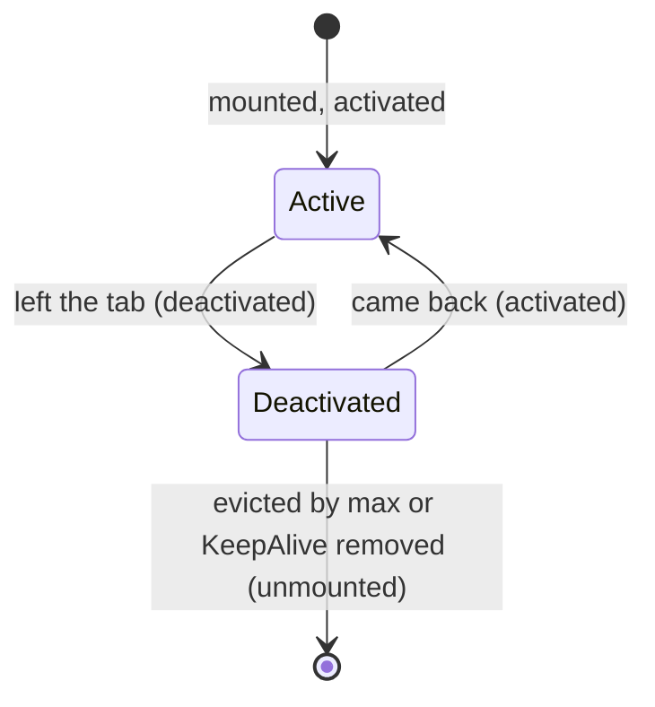
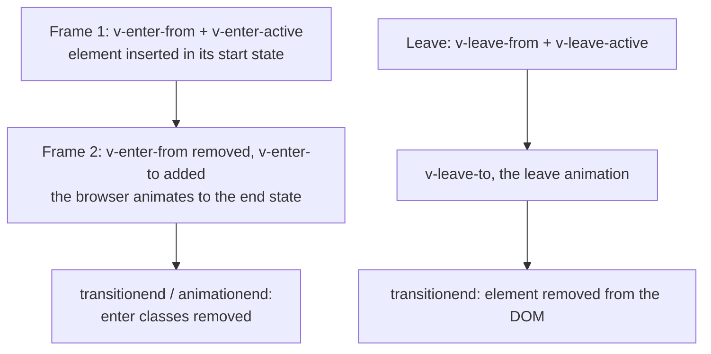

## What this lesson covers

The components that ship with Vue and solve tasks that are awkward in plain code: the dynamic `<component :is>`, instance caching with `<KeepAlive>`, rendering elsewhere in the DOM with `<Teleport>`, animations with `<Transition>` and `<TransitionGroup>`, async components and `<Suspense>`. The examples run in jsdom on Vue 3.5.

## Dynamic component and KeepAlive

`<component :is="X">` renders a component chosen at runtime (tabs, wizard steps, widgets from configuration). When `is` changes, the old instance is unmounted together with its state. `<KeepAlive>` instead **deactivates** it and keeps it in memory:

```js dom
import { createApp, nextTick, onActivated, onDeactivated, onMounted, onUnmounted, ref, shallowRef } from 'vue'

function tab(name) {
  return {
    name,
    setup() {
      const clicks = ref(0)
      onMounted(() => console.log(`${name}: mounted`))
      onActivated(() => console.log(`${name}: activated`))
      onDeactivated(() => console.log(`${name}: deactivated`))
      onUnmounted(() => console.log(`${name}: unmounted`))
      return { clicks }
    },
    template: `<button @click="clicks++">${name} {{ clicks }}</button>`,
  }
}
const Profile = tab('Profile')
const Settings = tab('Settings')
const Logs = tab('Logs')

const current = shallowRef(Profile)
const el = document.createElement('div')
createApp({
  setup: () => ({ current }),
  template: `<KeepAlive :include="['Profile', 'Settings']"><component :is="current" /></KeepAlive>`,
}).mount(el)

el.querySelector('button').click()
el.querySelector('button').click()
for (const next of [Settings, Logs, Profile]) {
  current.value = next
  await nextTick()
}
console.log('back on Profile:', el.textContent)
```

```output
Profile: mounted
Profile: activated
Profile: deactivated
Settings: mounted
Settings: activated
Settings: deactivated
Logs: mounted
Logs: unmounted
Profile: activated
back on Profile: Profile 2
```



- Profile's state (two clicks) survived the switch, and `mounted` did not run again. Logs is not in `include` and was unmounted as usual.
- `include` and `exclude` match the component **name** (`name`; for an SFC with `<script setup>` it is inferred from the file name). `max` limits the cache: when it overflows, the least recently used instance is evicted.
- `onActivated` and `onDeactivated` replace `onMounted`/`onUnmounted` for things that should run only on the visible tab: timers, server polling, `window` subscriptions.
- Vue Router pages are cached the same way: `<RouterView v-slot="{ Component }"><KeepAlive><component :is="Component" /></KeepAlive></RouterView>`.
- Keep the component for `:is` in a `shallowRef` or `markRaw`: there is no reason to make the component object itself reactive, and Vue warns about it.

## Teleport

`<Teleport to="body">` renders its content elsewhere in the document but **keeps it in the component tree**: props, events and `provide`/`inject` work as usual.

```js dom
import { createApp, nextTick, provide, inject, ref } from 'vue'

const Modal = {
  setup: () => ({ theme: inject('theme') }),
  emits: ['close'],
  template: `<div class="modal" :class="theme" role="dialog"><button @click="$emit('close')">Close</button></div>`,
}

const app = document.createElement('div')
app.id = 'app'
document.body.append(app)
createApp({
  components: { Modal },
  setup() {
    provide('theme', 'dark')
    const open = ref(true)
    return { open, onClose: () => ((open.value = false), console.log('close event reached the parent')) }
  },
  template: `<section style="overflow: hidden"><Teleport to="body"><Modal v-if="open" @close="onClose" /></Teleport></section>`,
}).mount(app)

console.log('inside #app:', app.innerHTML)
console.log('last in body:', document.body.lastElementChild.outerHTML)
document.querySelector('.modal button').click()
await nextTick()
console.log('modal left:', document.querySelector('.modal'))
```

```output
inside #app: <section style="overflow: hidden;"><!--teleport start--><!--teleport end--></section>
last in body: <div class="modal dark" role="dialog"><button>Close</button></div>
close event reached the parent
modal left: null
```

- Why: modals, toasts and tooltips must not be clipped by an ancestor's `overflow: hidden` or caught under its `z-index` and `transform`. Only comment markers stayed in place.
- `to` takes a selector or an element, and the target must exist at mount time. Since 3.5, `defer` postpones resolving the target until the rest of the application is mounted, so you can teleport into an element the same app renders later in the template.
- `:disabled="isMobile"` turns teleporting off and renders the content in place.
- Several `Teleport`s into one target append their content in order. With SSR the teleported HTML is returned separately (`ctx.teleports`) and the server inserts it into the page.
- A native `<dialog>` with `showModal()` and the Popover API put the element into the top layer themselves, so they often need no `Teleport`.

## Transition and TransitionGroup

`<Transition>` animates entering and leaving of **one** element or component (`v-if`, `v-show`, a changing `key` or `:is`). Vue applies classes at the right moments, and CSS describes the animation itself:



```vue
<template>
  <Transition name="fade" mode="out-in">
    <component :is="view" :key="route.path" />
  </Transition>
</template>

<style>
.fade-enter-active,
.fade-leave-active {
  transition: opacity 0.2s ease;
}
.fade-enter-from,
.fade-leave-to {
  opacity: 0;
}
@media (prefers-reduced-motion: reduce) {
  .fade-enter-active,
  .fade-leave-active {
    transition: none;
  }
}
</style>
```

- `name` sets the class prefix (`fade-enter-from` instead of `v-enter-from`). Vue learns the duration from computed styles (`transition`, `animation`) or from `:duration`.
- `mode="out-in"` removes the old element first and then shows the new one; without it both animate at once.
- JavaScript hooks `@before-enter`, `@enter(el, done)`, `@leave(el, done)` for animations with the Web Animations API or GSAP; `appear` animates the first render too.
- `<TransitionGroup tag="ul">` animates the items of a `v-for` list (keys are required), and the `v-move` class animates reordering with the FLIP technique.
- Respect `prefers-reduced-motion`: motion harms people with vestibular disorders.

## Async components

`defineAsyncComponent(() => import('./Chart.vue'))` creates a wrapper that loads the component code on first render, and the bundler puts it into a separate chunk.

```js dom
import { createApp, defineAsyncComponent, h, nextTick } from 'vue'

let finishLoading
const Chart = defineAsyncComponent({
  loader: () => new Promise((resolve) => (finishLoading = resolve)), // stands for import('./Chart.vue')
  loadingComponent: { render: () => h('p', 'Loading chart…') },
  errorComponent: { render: () => h('p', 'Could not load the chart') },
  delay: 0, // default 200 ms: no flash of the spinner on fast networks
  timeout: 3000,
})

const el = document.createElement('div')
createApp({ render: () => h(Chart, { points: 3 }) }).mount(el)
await nextTick()
console.log(el.innerHTML)
finishLoading({ props: ['points'], render() { return h('svg', { 'data-points': this.points }) } })
await new Promise((r) => setTimeout(r))
console.log(el.innerHTML)
```

```output
<p points="3">Loading chart…</p>
<svg data-points="3"></svg>
```

- `loadingComponent` shows after `delay` (200 ms by default, to avoid a flash on fast networks), `errorComponent` on a load error or after `timeout`. The wrapper's props go both to the loaded component and to the loading component (hence the `points` attribute on `<p>`).
- What to split out: heavy, rarely needed parts (charts, editors, modals) and route pages (there `() => import()` in the route does it).
- Since 3.5 SSR has **lazy hydration**: `hydrate: hydrateOnVisible()`, `hydrateOnIdle()`, `hydrateOnInteraction('click')`, `hydrateOnMediaQuery(...)` (see the SSR lesson).

## Suspense

`<Suspense>` waits for all async dependencies in its subtree (components with `async setup` or a top-level `await` in `<script setup>`, async components) and shows the `fallback` slot until then:

```js dom
import { createApp, h, Suspense } from 'vue'

const wait = (ms, value) => new Promise((r) => setTimeout(() => r(value), ms))
const User = {
  async setup() {
    const name = await wait(10, 'Ann') // an async setup makes the component wait for Suspense
    return () => h('b', name)
  },
}
const Orders = {
  async setup() {
    const count = await wait(30, 3)
    return () => h('i', `${count} orders`)
  },
}

const el = document.createElement('div')
createApp({
  render: () => h(Suspense, null, { default: () => h('div', [h(User), h(Orders)]), fallback: () => h('p', 'Loading…') }),
}).mount(el)
console.log(el.innerHTML)
await wait(15)
console.log(el.innerHTML)
await wait(30)
console.log(el.innerHTML)
```

```output
<Suspense> is an experimental feature and its API will likely change.
<p>Loading…</p>
<p>Loading…</p>
<div><b>Ann</b><i>3 orders</i></div>
```

- The first line is Vue's own message: `Suspense` is still **experimental**. The user waited until both components loaded and saw them together, without separate "jumping" spinners in each.
- Events `@pending`, `@resolve`, `@fallback`; errors from async `setup` are caught by `onErrorCaptured` higher in the tree.
- In practice data is more often loaded without `Suspense`: a loading state in a composable or a query library, and in Nuxt `useFetch` and `useAsyncData`.

## Key points

- `<component :is>` picks a component at runtime; keep the component object in a `shallowRef`.
- `<KeepAlive>` keeps instances: `include`, `exclude`, `max`, hooks `onActivated`/`onDeactivated`.
- `<Teleport>` moves the DOM but not the component tree: events and `inject` work; `defer` and `disabled`.
- `<Transition>` applies `enter-from`, `enter-active`, `enter-to` and `leave-*` classes; `mode="out-in"`, `TransitionGroup` with `v-move`; honor `prefers-reduced-motion`.
- `defineAsyncComponent` moves a component into a chunk; `delay`, `timeout`, loading and error components.
- `<Suspense>` waits for async `setup`s in the subtree and shows `fallback`; it is experimental.
