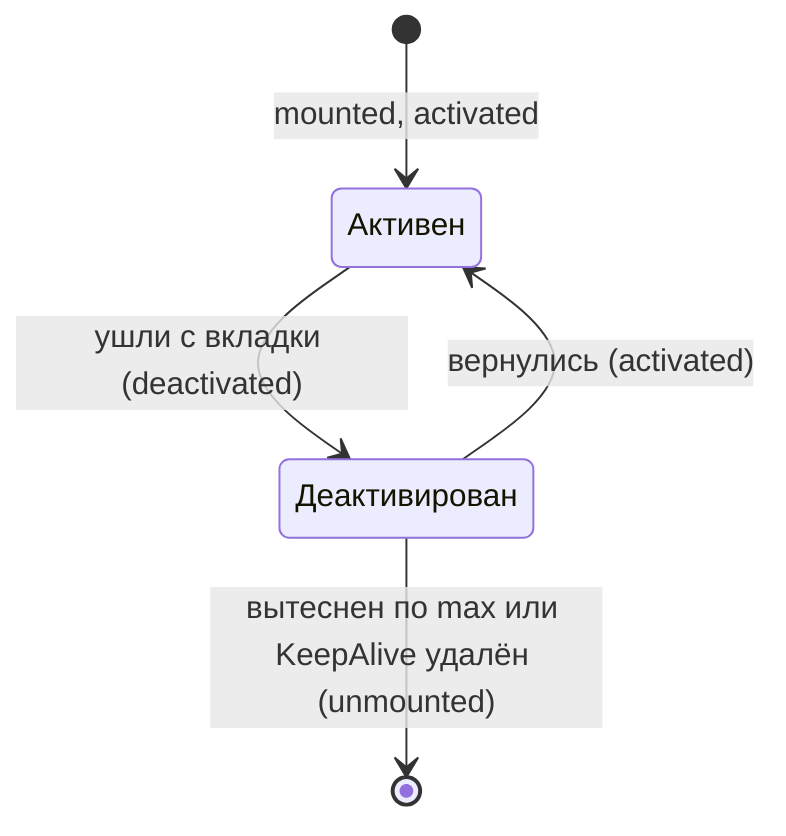
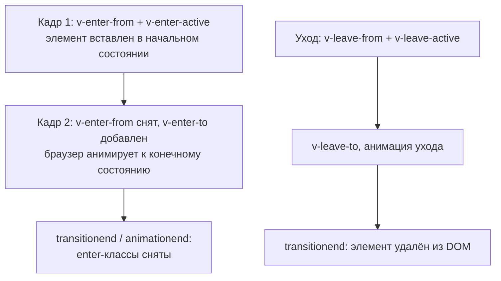

## О чём урок

Компоненты, которые входят в Vue и решают задачи, неудобные для обычного кода: динамический компонент `<component :is>`, кэширование экземпляров `<KeepAlive>`, рендер в другое место DOM `<Teleport>`, анимации `<Transition>` и `<TransitionGroup>`, асинхронные компоненты и `<Suspense>`. Примеры выполняются в jsdom на Vue 3.5.

## Динамический компонент и KeepAlive

`<component :is="X">` рендерит компонент, выбранный во время выполнения (вкладки, шаги мастера, виджеты из конфигурации). При смене `is` старый экземпляр размонтируется вместе с состоянием. `<KeepAlive>` вместо этого **деактивирует** его и держит в памяти:

```js dom
import { createApp, nextTick, onActivated, onDeactivated, onMounted, onUnmounted, ref, shallowRef } from 'vue'

function tab(name) {
  return {
    name,
    setup() {
      const clicks = ref(0)
      onMounted(() => console.log(`${name}: mounted`))
      onActivated(() => console.log(`${name}: activated`))
      onDeactivated(() => console.log(`${name}: deactivated`))
      onUnmounted(() => console.log(`${name}: unmounted`))
      return { clicks }
    },
    template: `<button @click="clicks++">${name} {{ clicks }}</button>`,
  }
}
const Profile = tab('Profile')
const Settings = tab('Settings')
const Logs = tab('Logs')

const current = shallowRef(Profile)
const el = document.createElement('div')
createApp({
  setup: () => ({ current }),
  template: `<KeepAlive :include="['Profile', 'Settings']"><component :is="current" /></KeepAlive>`,
}).mount(el)

el.querySelector('button').click()
el.querySelector('button').click()
for (const next of [Settings, Logs, Profile]) {
  current.value = next
  await nextTick()
}
console.log('back on Profile:', el.textContent)
```

```output
Profile: mounted
Profile: activated
Profile: deactivated
Settings: mounted
Settings: activated
Settings: deactivated
Logs: mounted
Logs: unmounted
Profile: activated
back on Profile: Profile 2
```



- Состояние Profile (два клика) пережило переключение, `mounted` второй раз не вызвался. Logs не входит в `include` и был размонтирован как обычно.
- `include` и `exclude` сравнивают с **именем** компонента (`name`; у SFC с `<script setup>` оно выводится из имени файла). `max` ограничивает кэш: при переполнении вытесняется давно не использованный экземпляр.
- `onActivated` и `onDeactivated` заменяют `onMounted`/`onUnmounted` для того, что должно работать только на видимой вкладке: таймеры, опрос сервера, подписки на `window`.
- В Vue Router так кэшируют страницы: `<RouterView v-slot="{ Component }"><KeepAlive><component :is="Component" /></KeepAlive></RouterView>`.
- Компонент для `:is` кладут в `shallowRef` или `markRaw`: делать сам объект компонента реактивным незачем, и Vue предупредит.

## Teleport

`<Teleport to="body">` рендерит содержимое в другом месте документа, но **оставляет его в дереве компонентов**: пропсы, события, `provide`/`inject` работают как обычно.

```js dom
import { createApp, nextTick, provide, inject, ref } from 'vue'

const Modal = {
  setup: () => ({ theme: inject('theme') }),
  emits: ['close'],
  template: `<div class="modal" :class="theme" role="dialog"><button @click="$emit('close')">Close</button></div>`,
}

const app = document.createElement('div')
app.id = 'app'
document.body.append(app)
createApp({
  components: { Modal },
  setup() {
    provide('theme', 'dark')
    const open = ref(true)
    return { open, onClose: () => ((open.value = false), console.log('close event reached the parent')) }
  },
  template: `<section style="overflow: hidden"><Teleport to="body"><Modal v-if="open" @close="onClose" /></Teleport></section>`,
}).mount(app)

console.log('inside #app:', app.innerHTML)
console.log('last in body:', document.body.lastElementChild.outerHTML)
document.querySelector('.modal button').click()
await nextTick()
console.log('modal left:', document.querySelector('.modal'))
```

```output
inside #app: <section style="overflow: hidden;"><!--teleport start--><!--teleport end--></section>
last in body: <div class="modal dark" role="dialog"><button>Close</button></div>
close event reached the parent
modal left: null
```

- Зачем: модалки, тосты, всплывающие подсказки не должны обрезаться `overflow: hidden` или попадать под `z-index` и `transform` предка. В DOM остались только комментарии-метки.
- `to` принимает селектор или элемент, цель должна существовать к моменту монтирования. С 3.5 `defer` откладывает поиск цели до момента, когда смонтирована остальная часть приложения, поэтому можно телепортировать в элемент, который рендерит то же приложение позже по шаблону.
- `:disabled="isMobile"` выключает перенос и рендерит содержимое на месте.
- Несколько `Teleport` в одну цель добавляют содержимое по порядку. При SSR телепортированный HTML отдаётся отдельно (`ctx.teleports`) и вставляется в страницу сервером.
- Нативный `<dialog>` с `showModal()` и Popover API сами выводят элемент в верхний слой (top layer), поэтому для них `Teleport` часто не нужен.

## Transition и TransitionGroup

`<Transition>` анимирует появление и исчезновение **одного** элемента или компонента (`v-if`, `v-show`, смена `key` или `:is`). Vue расставляет классы в нужные моменты, а саму анимацию описывает CSS:



```vue
<template>
  <Transition name="fade" mode="out-in">
    <component :is="view" :key="route.path" />
  </Transition>
</template>

<style>
.fade-enter-active,
.fade-leave-active {
  transition: opacity 0.2s ease;
}
.fade-enter-from,
.fade-leave-to {
  opacity: 0;
}
@media (prefers-reduced-motion: reduce) {
  .fade-enter-active,
  .fade-leave-active {
    transition: none;
  }
}
</style>
```

- Префикс классов задаёт `name` (`fade-enter-from` вместо `v-enter-from`). Длительность Vue узнаёт из вычисленных стилей (`transition`, `animation`) или из `:duration`.
- `mode="out-in"` сначала убирает старый элемент, потом показывает новый; без него оба анимируются одновременно.
- JavaScript-хуки `@before-enter`, `@enter(el, done)`, `@leave(el, done)` для анимаций через Web Animations API или GSAP; `appear` анимирует и первый рендер.
- `<TransitionGroup tag="ul">` анимирует элементы списка `v-for` (обязательны ключи), а класс `v-move` анимирует перестановку через технику FLIP.
- Уважайте `prefers-reduced-motion`: людям с вестибулярными нарушениями движение вредит.

## Асинхронные компоненты

`defineAsyncComponent(() => import('./Chart.vue'))` создаёт обёртку, которая загрузит код компонента при первом рендере, и сборщик вынесет его в отдельный чанк.

```js dom
import { createApp, defineAsyncComponent, h, nextTick } from 'vue'

let finishLoading
const Chart = defineAsyncComponent({
  loader: () => new Promise((resolve) => (finishLoading = resolve)), // stands for import('./Chart.vue')
  loadingComponent: { render: () => h('p', 'Loading chart…') },
  errorComponent: { render: () => h('p', 'Could not load the chart') },
  delay: 0, // default 200 ms: no flash of the spinner on fast networks
  timeout: 3000,
})

const el = document.createElement('div')
createApp({ render: () => h(Chart, { points: 3 }) }).mount(el)
await nextTick()
console.log(el.innerHTML)
finishLoading({ props: ['points'], render() { return h('svg', { 'data-points': this.points }) } })
await new Promise((r) => setTimeout(r))
console.log(el.innerHTML)
```

```output
<p points="3">Loading chart…</p>
<svg data-points="3"></svg>
```

- `loadingComponent` показывается после `delay` (по умолчанию 200 мс, чтобы не мигать на быстрой сети), `errorComponent` при ошибке загрузки или по `timeout`. Пропсы обёртки передаются и в загруженный компонент, и в компонент загрузки (поэтому у `<p>` атрибут `points`).
- Что выносить: тяжёлые редко нужные части (графики, редакторы, модалки), страницы маршрутов (там это делает `() => import()` в маршруте).
- С 3.5 у SSR есть **ленивая гидратация**: `hydrate: hydrateOnVisible()`, `hydrateOnIdle()`, `hydrateOnInteraction('click')`, `hydrateOnMediaQuery(...)` (урок о SSR).

## Suspense

`<Suspense>` ждёт все асинхронные зависимости в своём поддереве (компоненты с `async setup` или с `await` на верхнем уровне `<script setup>`, асинхронные компоненты) и до этого показывает слот `fallback`:

```js dom
import { createApp, h, Suspense } from 'vue'

const wait = (ms, value) => new Promise((r) => setTimeout(() => r(value), ms))
const User = {
  async setup() {
    const name = await wait(10, 'Ann') // an async setup makes the component wait for Suspense
    return () => h('b', name)
  },
}
const Orders = {
  async setup() {
    const count = await wait(30, 3)
    return () => h('i', `${count} orders`)
  },
}

const el = document.createElement('div')
createApp({
  render: () => h(Suspense, null, { default: () => h('div', [h(User), h(Orders)]), fallback: () => h('p', 'Loading…') }),
}).mount(el)
console.log(el.innerHTML)
await wait(15)
console.log(el.innerHTML)
await wait(30)
console.log(el.innerHTML)
```

```output
<Suspense> is an experimental feature and its API will likely change.
<p>Loading…</p>
<p>Loading…</p>
<div><b>Ann</b><i>3 orders</i></div>
```

- Первая строка это сообщение самого Vue: `Suspense` по-прежнему **экспериментальный**. Пользователь ждал, пока загрузятся оба компонента, и увидел их одновременно, без «прыгающих» индикаторов загрузки в каждом.
- События `@pending`, `@resolve`, `@fallback`; ошибки асинхронного `setup` ловят `onErrorCaptured` выше по дереву.
- На практике данные чаще загружают без `Suspense`: состояние загрузки в composable или в библиотеке запросов, а в Nuxt `useFetch` и `useAsyncData`.

## Главное

- `<component :is>` выбирает компонент во время выполнения; объект компонента держат в `shallowRef`.
- `<KeepAlive>` сохраняет экземпляры: `include`, `exclude`, `max`, хуки `onActivated`/`onDeactivated`.
- `<Teleport>` переносит DOM, но не дерево компонентов: события и `inject` работают; `defer` и `disabled`.
- `<Transition>` расставляет классы `enter-from`, `enter-active`, `enter-to` и `leave-*`; `mode="out-in"`, `TransitionGroup` с `v-move`; учитывать `prefers-reduced-motion`.
- `defineAsyncComponent` выносит компонент в чанк; `delay`, `timeout`, компоненты загрузки и ошибки.
- `<Suspense>` ждёт асинхронные `setup` поддерева и показывает `fallback`; он экспериментальный.
