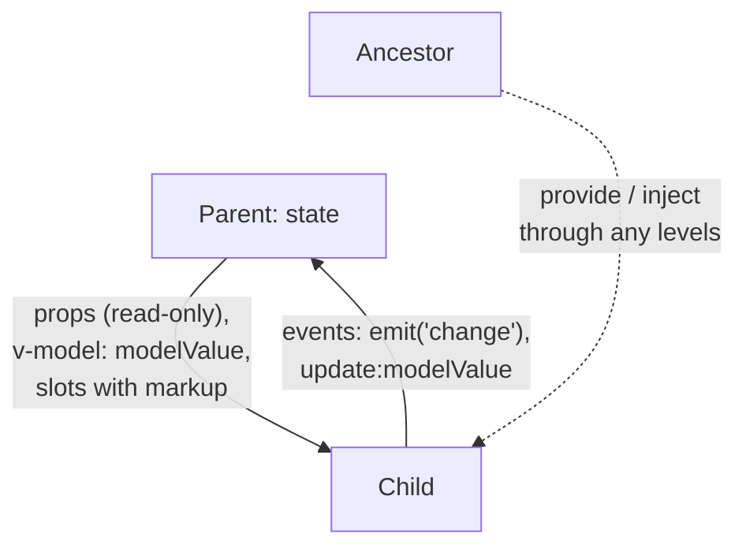

## What this lesson covers

How Vue components are written today: a single-file component with `<script setup>`, props and events, `defineModel` for `v-model`, slots and scoped slots, `provide`/`inject`, prop validation and attribute fallthrough, generic components, element refs. The `<script setup>` examples are shown as SFC code, and the runnable ones use the same API without the SFC compiler and run in jsdom on Vue 3.5.

## A single-file component and script setup

```vue
<script setup lang="ts">
import { computed } from 'vue'

const { label, max = 5 } = defineProps<{ label: string; max?: number }>() // reactive since 3.5
const emit = defineEmits<{ change: [value: number] }>()
const rating = defineModel<number>({ default: 0 }) // two-way: v-model on the parent

const stars = computed(() => Array.from({ length: max }, (_, i) => i < rating.value))
function pick(i: number) {
  rating.value = i + 1
  emit('change', i + 1) // not rating.value: see below
}
</script>

<template>
  <span :aria-label="label">
    <button v-for="(on, i) in stars" :key="i" @click="pick(i)">{{ on ? '★' : '☆' }}</button>
  </span>
</template>
```



- Everything declared in `<script setup>` (variables, functions, imports) is available to the template; no `return` is needed.
- `defineProps`, `defineEmits`, `defineModel`, `defineSlots`, `defineExpose` are **compiler macros**: they are not imported and work only in `<script setup>`.
- Since 3.5, destructuring `defineProps` is reactive, and defaults use plain syntax; `withDefaults` is no longer needed.
- `defineModel()` (stable since 3.4) returns a ref: reading gives the `modelValue` prop, writing emits `update:modelValue`. Named models: `defineModel('title')` and `v-model:title`.
- Props are read-only: the child reports changes with an event instead of mutating the prop. Vue does not copy an object prop, so mutating its fields "works", but it breaks the one-way data flow.

The same component without the SFC compiler: `useModel` is the function `defineModel` expands to. Note the model's value right after writing:

```js dom
import { createApp, ref, useModel } from 'vue'

const Rating = {
  props: { label: String, modelValue: { type: Number, default: 0 } },
  emits: ['update:modelValue', 'change'],
  setup(props, { emit }) {
    const rating = useModel(props, 'modelValue')
    const pick = (i) => {
      rating.value = i + 1 // emits update:modelValue
      emit('change', { sent: i + 1, modelRightAfterSet: rating.value })
    }
    return { rating, pick }
  },
  template: `<span :aria-label="label"><button v-for="i in 5" :key="i" @click="pick(i - 1)">{{ i <= rating ? '★' : '☆' }}</button></span>`,
}

const el = document.createElement('div')
const vm = createApp({
  components: { Rating },
  setup: () => ({ score: ref(2), log: (v) => console.log('change event:', JSON.stringify(v)) }),
  template: `<Rating label="Quality" v-model="score" @change="log" /><p>score: {{ score }}</p>`,
}).mount(el)
await Promise.resolve()
el.querySelectorAll('button')[3].click()
await new Promise((r) => setTimeout(r))
console.log(el.textContent, '| parent ref:', vm.score)
```

```output
change event: {"sent":4,"modelRightAfterSet":2}
★★★★☆score: 4 | parent ref: 4
```

When the parent holds the value through `v-model`, writing to the model only emits `update:modelValue`; the new value comes back to the child as a prop on the next update. So right after the assignment the model is still old, and the event carries the computed value rather than `rating.value`. Without `v-model` on the parent, the model keeps the value locally and changes at once.

## Slots

A slot is a place where the parent passes markup. A **scoped slot** hands the child's data to the parent: the component owns the logic and structure, and the parent decides how each item looks.

```js dom
import { createApp, nextTick } from 'vue'

const DataList = {
  props: ['items'],
  template: `
    <ul>
      <li v-for="(item, index) in items" :key="item.id">
        <slot :item="item" :index="index">{{ item.name }}</slot>
      </li>
    </ul>
    <p v-if="$slots.footer"><slot name="footer" /></p>`,
}

const el = document.createElement('div')
createApp({
  components: { DataList },
  setup: () => ({ people: [{ id: 1, name: 'Ann' }, { id: 2, name: 'Bob' }] }),
  template: `
    <DataList :items="people">
      <template #default="{ item, index }">{{ index + 1 }}. {{ item.name.toUpperCase() }}</template>
      <template #footer>{{ people.length }} people</template>
    </DataList>
    <DataList :items="people" />`,
}).mount(el)
await nextTick()
console.log([...el.querySelectorAll('ul')].map((ul) => [...ul.children].map((li) => li.textContent.trim()).join(' | ')))
console.log(el.querySelector('p').textContent.trim())
```

```output
[ '1. ANN | 2. BOB', 'Ann | Bob' ]
2 people
```

The second list without a slot showed the default content. `$slots` (or `useSlots()`) lets you check whether a slot was passed.

## Props in depth: validation and attribute fallthrough

In TypeScript props are described by a type in `defineProps<...>()`. Without one (or for runtime checks) use the object declaration: type, required, default, validator. Violations produce warnings in development mode only:

```js dom
import { createApp } from 'vue'

const Avatar = {
  props: {
    src: { type: String, required: true },
    size: { type: String, default: 'md', validator: (value) => ['sm', 'md', 'lg'].includes(value) },
    rounded: Boolean, // boolean casting: <Avatar rounded /> means true
  },
  template: ``,
}

const warn = console.warn
console.warn = (message) => console.log('warning:', message.split('\n')[0])
const el = document.createElement('div')
createApp({ components: { Avatar }, template: `<Avatar size="xl" rounded />` }).mount(el)
console.warn = warn
console.log(el.innerHTML)
```

```output
warning: [Vue warn]: Missing required prop: "src"
warning: [Vue warn]: Invalid prop: custom validator check failed for prop "size".

```

- Defaults for objects and arrays use a factory: `default: () => []`, otherwise all instances would share one array.
- A `Boolean` prop with no value (`<Avatar rounded />`) is `true`, a missing one is `false`.
- Templates use `kebab-case` (`:active-id`), JavaScript uses `camelCase` (`activeId`); Vue maps them itself.

**Attribute fallthrough.** Everything passed to a component that it did not declare in `props` or `emits` (`class`, `style`, `id`, `data-*`, `aria-*`, event listeners) lands in `$attrs` and is automatically applied to the **root** element:

```js dom
import { createApp } from 'vue'

const BaseButton = {
  props: ['variant'],
  template: `<button class="btn" :class="variant"><slot /></button>`,
}
const TextField = {
  inheritAttrs: false, // attrs go to the input, not to the root label
  props: ['label'],
  template: `<label>{{ label }} <input v-bind="$attrs"></label>`,
}

const el = document.createElement('div')
createApp({
  components: { BaseButton, TextField },
  setup: () => ({ save: () => console.log('click listener fell through to <button>') }),
  template: `
    <BaseButton variant="primary" class="wide" data-test="save" @click="save">Save</BaseButton>
    <TextField label="Email" type="email" placeholder="you@example.com" class="field" />`,
}).mount(el)
console.log(el.innerHTML.replace(/\n\s*/g, ''))
el.querySelector('button').click()
```

```output
<button class="btn primary wide" data-test="save">Save</button><label>Email <input type="email" placeholder="you@example.com" class="field"></label>
click listener fell through to <button>
```

- `class` and `style` merge with the root's own classes (`btn primary wide`); everything else overrides.
- `inheritAttrs: false` (in `<script setup>` through `defineOptions({ inheritAttrs: false })`) turns automatic fallthrough off, and `v-bind="$attrs"` applies the attributes where needed, for example to an `<input>` inside a wrapper.
- A multi-root component has no automatic fallthrough: Vue warns until `$attrs` is bound explicitly. In `<script setup>` attributes are available through `useAttrs()`; they are not reactive for `watch`, but always current during render.

## Generic components and typing

```vue
<script setup lang="ts" generic="T extends { id: string | number }">
const props = defineProps<{ items: T[]; selected?: T }>()
const emit = defineEmits<{ select: [item: T] }>()
defineSlots<{ default(props: { item: T; active: boolean }): any }>()
</script>
```

- `generic="T"` makes the component generic: with `<DataList :items="users">` TypeScript infers `T` as the user type, and `item` is typed in the slot and the event.
- `defineSlots` types slots, `defineExpose` exposes methods to a parent `ref`, `InjectionKey<T>` types `provide`/`inject`.
- Template type checking is done by `vue-tsc` (in CI: `vue-tsc --noEmit`), editor support by the Vue extension (Volar).

## provide and inject

`provide(key, value)` in a component makes a value available to all descendants at any depth, and `inject(key, default)` reads it. The key is best a `Symbol` typed as `InjectionKey<T>`. If you provide a ref, descendants get a reactive value; to keep them from changing it directly, provide `readonly(ref)` plus an update function.

```js dom
import { createApp, inject, nextTick, provide, readonly, ref } from 'vue'

const ThemeKey = Symbol('theme')

const DeepButton = {
  setup() {
    const { theme, toggle } = inject(ThemeKey)
    return { theme, toggle }
  },
  template: `<button :class="theme" @click="toggle">{{ theme }}</button>`,
}
const Toolbar = { components: { DeepButton }, template: `<nav><DeepButton /></nav>` }

const el = document.createElement('div')
createApp({
  components: { Toolbar },
  setup() {
    const theme = ref('light')
    provide(ThemeKey, { theme: readonly(theme), toggle: () => (theme.value = theme.value === 'light' ? 'dark' : 'light') })
  },
  template: `<Toolbar />`,
}).mount(el)
el.querySelector('button').click()
await nextTick()
console.log(el.innerHTML)
```

```output
<nav><button class="dark">dark</button></nav>
```

`app.provide(...)` gives a value to the whole app: this is how the router, Pinia and i18n are installed. For state shared by many components, Pinia is the usual choice (see the composables lesson).

## Element refs and ids

- `useTemplateRef('input')` (3.5) returns a ref to the element or component with `ref="input"`; the value appears after mounting. A `<script setup>` component is closed: only what is passed to `defineExpose` is visible from outside.
- `useId()` (3.5) generates ids that match on the server and the client, for `label for` and `aria-*`.
- Directives, lists, events and `v-model` on form fields are covered in the templates lesson, and `KeepAlive`, `Teleport`, `Transition`, async components and `Suspense` in the built-in components lesson.

## Key points

- SFC with `<script setup>`: the `defineProps`, `defineEmits`, `defineModel` macros; prop destructuring is reactive since 3.5.
- Props down, events up; `defineModel` gives `v-model` in one line.
- Scoped slots hand the child's data to the parent's markup.
- `provide`/`inject` for subtree data, ideally with a `Symbol` key and `readonly`.
- Props are checked in development (type, `required`, `validator`); undeclared attributes and listeners fall through to the root, `inheritAttrs: false` and `v-bind="$attrs"` change that.
- `generic` in `<script setup>`, `defineSlots`, `vue-tsc` for template types.
- `useTemplateRef` and `useId` from 3.5.
