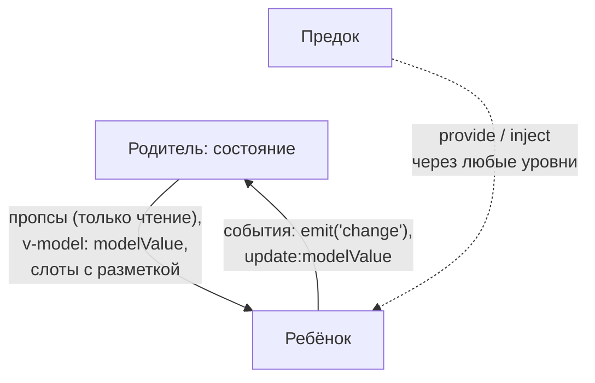

## О чём урок

Как пишут компоненты Vue сейчас: однофайловый компонент с `<script setup>`, пропсы и события, `defineModel` для `v-model`, слоты и scoped-слоты, `provide`/`inject`, валидация пропсов и проброс атрибутов, обобщённые компоненты, ссылки на элементы. Примеры с `<script setup>` показаны как код SFC, а запускаемые написаны тем же API без компилятора SFC и выполняются в jsdom на Vue 3.5.

## Однофайловый компонент и script setup

```vue
<script setup lang="ts">
import { computed } from 'vue'

const { label, max = 5 } = defineProps<{ label: string; max?: number }>() // reactive since 3.5
const emit = defineEmits<{ change: [value: number] }>()
const rating = defineModel<number>({ default: 0 }) // two-way: v-model on the parent

const stars = computed(() => Array.from({ length: max }, (_, i) => i < rating.value))
function pick(i: number) {
  rating.value = i + 1
  emit('change', i + 1) // not rating.value: see below
}
</script>

<template>
  <span :aria-label="label">
    <button v-for="(on, i) in stars" :key="i" @click="pick(i)">{{ on ? '★' : '☆' }}</button>
  </span>
</template>
```



- Всё, что объявлено в `<script setup>` (переменные, функции, импорты), доступно шаблону; `return` не нужен.
- `defineProps`, `defineEmits`, `defineModel`, `defineSlots`, `defineExpose` это **макросы компилятора**: их не импортируют, они работают только в `<script setup>`.
- С 3.5 деструктуризация `defineProps` реактивна, а значения по умолчанию задаются обычным синтаксисом; `withDefaults` больше не нужен.
- `defineModel()` (стабилен с 3.4) возвращает ref: чтение даёт проп `modelValue`, запись отправляет `update:modelValue`. Именованные модели: `defineModel('title')` и `v-model:title`.
- Пропсы только для чтения: ребёнок сообщает об изменениях событием, а не мутирует проп. Объект в пропсе Vue не копирует, и мутация его полей «сработает», но нарушит однонаправленный поток данных.

Тот же компонент без компилятора SFC: `useModel` это функция, в которую раскрывается `defineModel`. Обратите внимание на значение модели сразу после записи:

```js dom
import { createApp, ref, useModel } from 'vue'

const Rating = {
  props: { label: String, modelValue: { type: Number, default: 0 } },
  emits: ['update:modelValue', 'change'],
  setup(props, { emit }) {
    const rating = useModel(props, 'modelValue')
    const pick = (i) => {
      rating.value = i + 1 // emits update:modelValue
      emit('change', { sent: i + 1, modelRightAfterSet: rating.value })
    }
    return { rating, pick }
  },
  template: `<span :aria-label="label"><button v-for="i in 5" :key="i" @click="pick(i - 1)">{{ i <= rating ? '★' : '☆' }}</button></span>`,
}

const el = document.createElement('div')
const vm = createApp({
  components: { Rating },
  setup: () => ({ score: ref(2), log: (v) => console.log('change event:', JSON.stringify(v)) }),
  template: `<Rating label="Quality" v-model="score" @change="log" /><p>score: {{ score }}</p>`,
}).mount(el)
await Promise.resolve()
el.querySelectorAll('button')[3].click()
await new Promise((r) => setTimeout(r))
console.log(el.textContent, '| parent ref:', vm.score)
```

```output
change event: {"sent":4,"modelRightAfterSet":2}
★★★★☆score: 4 | parent ref: 4
```

Когда родитель держит значение через `v-model`, запись в модель только отправляет `update:modelValue`; новое значение вернётся в ребёнка пропом при следующем обновлении. Поэтому сразу после присваивания модель ещё старая, и в событие передают вычисленное значение, а не `rating.value`. Без `v-model` у родителя модель хранит значение локально и меняется сразу.

## Слоты

Слот это место, куда родитель передаёт разметку. **Scoped-слот** отдаёт родителю данные ребёнка: компонент управляет логикой и структурой, а родитель решает, как выглядит каждый элемент.

```js dom
import { createApp, nextTick } from 'vue'

const DataList = {
  props: ['items'],
  template: `
    <ul>
      <li v-for="(item, index) in items" :key="item.id">
        <slot :item="item" :index="index">{{ item.name }}</slot>
      </li>
    </ul>
    <p v-if="$slots.footer"><slot name="footer" /></p>`,
}

const el = document.createElement('div')
createApp({
  components: { DataList },
  setup: () => ({ people: [{ id: 1, name: 'Ann' }, { id: 2, name: 'Bob' }] }),
  template: `
    <DataList :items="people">
      <template #default="{ item, index }">{{ index + 1 }}. {{ item.name.toUpperCase() }}</template>
      <template #footer>{{ people.length }} people</template>
    </DataList>
    <DataList :items="people" />`,
}).mount(el)
await nextTick()
console.log([...el.querySelectorAll('ul')].map((ul) => [...ul.children].map((li) => li.textContent.trim()).join(' | ')))
console.log(el.querySelector('p').textContent.trim())
```

```output
[ '1. ANN | 2. BOB', 'Ann | Bob' ]
2 people
```

Второй список без слота показал содержимое по умолчанию. `$slots` (или `useSlots()`) позволяет проверить, передан ли слот.

## Пропсы подробнее: валидация и проброс атрибутов

В TypeScript пропсы описывают типом в `defineProps<...>()`. Без него (или для проверки во время выполнения) используют объявление объектом: тип, обязательность, значение по умолчанию, валидатор. Нарушения дают предупреждения только в режиме разработки:

```js dom
import { createApp } from 'vue'

const Avatar = {
  props: {
    src: { type: String, required: true },
    size: { type: String, default: 'md', validator: (value) => ['sm', 'md', 'lg'].includes(value) },
    rounded: Boolean, // boolean casting: <Avatar rounded /> means true
  },
  template: ``,
}

const warn = console.warn
console.warn = (message) => console.log('warning:', message.split('\n')[0])
const el = document.createElement('div')
createApp({ components: { Avatar }, template: `<Avatar size="xl" rounded />` }).mount(el)
console.warn = warn
console.log(el.innerHTML)
```

```output
warning: [Vue warn]: Missing required prop: "src"
warning: [Vue warn]: Invalid prop: custom validator check failed for prop "size".

```

- Значения по умолчанию для объектов и массивов задают фабрикой: `default: () => []`, иначе все экземпляры делили бы один массив.
- `Boolean`-проп без значения (`<Avatar rounded />`) равен `true`, отсутствующий равен `false`.
- В шаблоне пишут `kebab-case` (`:active-id`), в JavaScript `camelCase` (`activeId`); Vue сопоставляет их сам.

**Проброс атрибутов (fallthrough).** Всё, что передали компоненту, но он не объявил в `props` или `emits` (`class`, `style`, `id`, `data-*`, `aria-*`, слушатели событий), попадает в `$attrs` и автоматически навешивается на **корневой** элемент:

```js dom
import { createApp } from 'vue'

const BaseButton = {
  props: ['variant'],
  template: `<button class="btn" :class="variant"><slot /></button>`,
}
const TextField = {
  inheritAttrs: false, // attrs go to the input, not to the root label
  props: ['label'],
  template: `<label>{{ label }} <input v-bind="$attrs"></label>`,
}

const el = document.createElement('div')
createApp({
  components: { BaseButton, TextField },
  setup: () => ({ save: () => console.log('click listener fell through to <button>') }),
  template: `
    <BaseButton variant="primary" class="wide" data-test="save" @click="save">Save</BaseButton>
    <TextField label="Email" type="email" placeholder="you@example.com" class="field" />`,
}).mount(el)
console.log(el.innerHTML.replace(/\n\s*/g, ''))
el.querySelector('button').click()
```

```output
<button class="btn primary wide" data-test="save">Save</button><label>Email <input type="email" placeholder="you@example.com" class="field"></label>
click listener fell through to <button>
```

- `class` и `style` объединяются с собственными классами корня (`btn primary wide`), остальное перезаписывает.
- `inheritAttrs: false` (в `<script setup>` через `defineOptions({ inheritAttrs: false })`) отключает автоматический проброс, и `v-bind="$attrs"` навешивает атрибуты куда нужно, например на `<input>` внутри обёртки.
- У компонента с несколькими корнями автоматического проброса нет: Vue предупредит, пока `$attrs` не привязан явно. В `<script setup>` атрибуты доступны через `useAttrs()`; они не реактивны для `watch`, но всегда актуальны при рендере.

## Обобщённые компоненты и типизация

```vue
<script setup lang="ts" generic="T extends { id: string | number }">
const props = defineProps<{ items: T[]; selected?: T }>()
const emit = defineEmits<{ select: [item: T] }>()
defineSlots<{ default(props: { item: T; active: boolean }): any }>()
</script>
```

- `generic="T"` делает компонент обобщённым: при `<DataList :items="users">` TypeScript выводит `T` как тип пользователя, и в слоте и событии `item` типизирован.
- `defineSlots` типизирует слоты, `defineExpose` открывает методы для `ref` родителя, `InjectionKey<T>` типизирует `provide`/`inject`.
- Проверку типов в шаблонах выполняет `vue-tsc` (в CI: `vue-tsc --noEmit`), подсветку в редакторе даёт расширение Vue (Volar).

## provide и inject

`provide(key, value)` в компоненте делает значение доступным всем потомкам на любой глубине, `inject(key, default)` его получает. Ключ лучше делать `Symbol` с типом `InjectionKey<T>`. Если передать ref, потомки получат реактивное значение; чтобы они не меняли его напрямую, отдают `readonly(ref)` и функцию изменения.

```js dom
import { createApp, inject, nextTick, provide, readonly, ref } from 'vue'

const ThemeKey = Symbol('theme')

const DeepButton = {
  setup() {
    const { theme, toggle } = inject(ThemeKey)
    return { theme, toggle }
  },
  template: `<button :class="theme" @click="toggle">{{ theme }}</button>`,
}
const Toolbar = { components: { DeepButton }, template: `<nav><DeepButton /></nav>` }

const el = document.createElement('div')
createApp({
  components: { Toolbar },
  setup() {
    const theme = ref('light')
    provide(ThemeKey, { theme: readonly(theme), toggle: () => (theme.value = theme.value === 'light' ? 'dark' : 'light') })
  },
  template: `<Toolbar />`,
}).mount(el)
el.querySelector('button').click()
await nextTick()
console.log(el.innerHTML)
```

```output
<nav><button class="dark">dark</button></nav>
```

`app.provide(...)` даёт значение всему приложению: так подключаются роутер, Pinia и i18n. Для общего состояния многих компонентов обычно берут Pinia (урок о composables).

## Ссылки на элементы и id

- `useTemplateRef('input')` (3.5) возвращает ref на элемент или компонент с `ref="input"`; значение появляется после монтирования. Компонент с `<script setup>` закрыт: наружу видно только то, что передано в `defineExpose`.
- `useId()` (3.5) генерирует id, одинаковые на сервере и клиенте, для `label for` и `aria-*`.
- Директивы, списки, события и `v-model` на полях формы разобраны в уроке о шаблонах, а `KeepAlive`, `Teleport`, `Transition`, асинхронные компоненты и `Suspense` в уроке о встроенных компонентах.

## Главное

- SFC с `<script setup>`: макросы `defineProps`, `defineEmits`, `defineModel`; деструктуризация пропсов реактивна с 3.5.
- Пропсы вниз, события вверх; `defineModel` даёт `v-model` одной строкой.
- Scoped-слоты отдают данные ребёнка разметке родителя.
- `provide`/`inject` для данных поддерева, лучше с `Symbol`-ключом и `readonly`.
- Пропсы проверяются в разработке (тип, `required`, `validator`); необъявленные атрибуты и слушатели пробрасываются на корень, `inheritAttrs: false` и `v-bind="$attrs"` меняют это.
- `generic` в `<script setup>`, `defineSlots`, `vue-tsc` для типов шаблонов.
- `useTemplateRef` и `useId` из 3.5.
