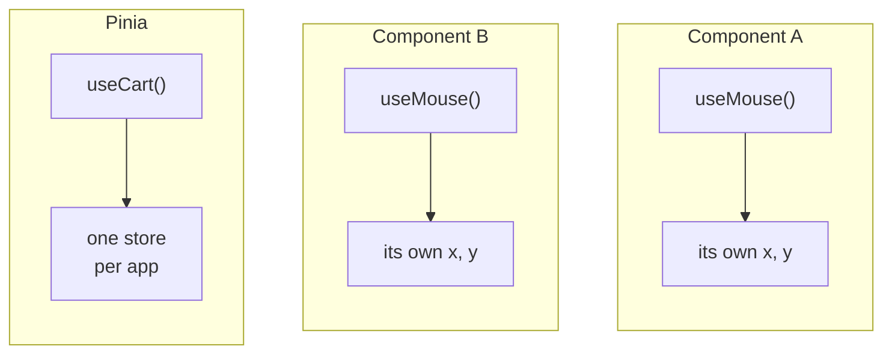
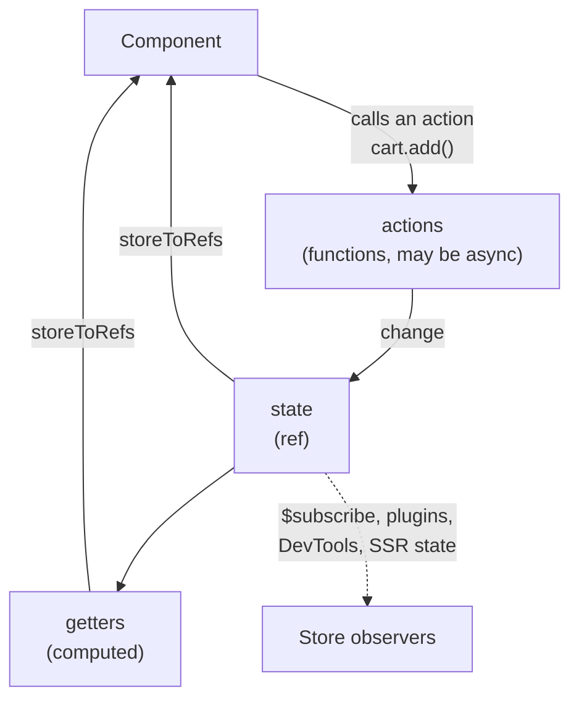
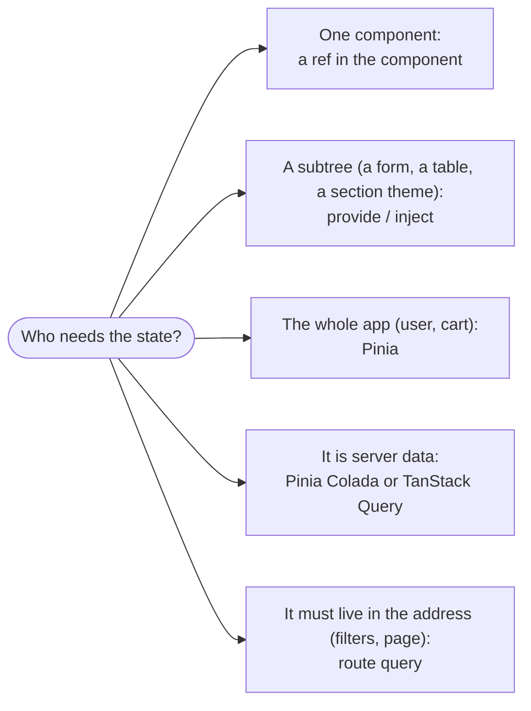

## What this lesson covers

How Vue reuses stateful logic: composables, `useX` functions on the Composition API that replaced mixins. And how state is shared between components: Pinia, the official store (version 4). This lesson covers the rules of good composables, cleanup through effect scopes, setup-style stores, `storeToRefs` and subscriptions. The examples run on Vue 3.5 and Pinia 4.1 in Node.js.

## A composable

A composable is a function that uses `ref`, `computed`, watchers and lifecycle hooks inside and returns reactive state. It is called in `setup` (synchronously), and everything it creates belongs to the component.

```ts
// useMouse.ts
import { onMounted, onUnmounted, ref } from 'vue'

export function useMouse() {
  const x = ref(0)
  const y = ref(0)
  const update = (e: MouseEvent) => {
    x.value = e.pageX
    y.value = e.pageY
  }
  onMounted(() => window.addEventListener('mousemove', update))
  onUnmounted(() => window.removeEventListener('mousemove', update))
  return { x, y } // plain object of refs: destructuring keeps reactivity
}
```



Each call of a composable creates **new** state for its component: a composable reuses logic, not data. If state must be shared, move it outside the function (a module variable) or into a Pinia store, which is created once.

Rules:

- the name starts with `use`, and it is called only synchronously in `setup` or another composable (after `await`, hooks are no longer bound to the component);
- return **an object of refs**, not a `reactive`: then `const { x } = useMouse()` stays reactive;
- accept arguments as `MaybeRefOrGetter` and read them with `toValue()`: that way the function works with a plain value, a ref or a getter;
- anything that subscribed to the outside world unsubscribes: `onUnmounted` or `onScopeDispose`.

Why not mixins (Options API): mixins have implicit property sources, name clashes and no parameters. A composable is a plain function with an explicit return. A ready-made collection of composables: VueUse.

## Effect scopes and cleanup

A component collects all its `computed`s and watchers into an **effect scope** (`effectScope`) and stops them on unmount. A composable can be used outside a component too if you create a scope by hand; `onScopeDispose` fires when the scope stops.

```ts run
import { effectScope, onScopeDispose, ref, toValue, watch, type MaybeRefOrGetter } from 'vue'

function usePolling(url: MaybeRefOrGetter<string>, ms: number) {
  const ticks = ref(0)
  const timer = setInterval(() => ticks.value++, ms)
  watch(() => toValue(url), (next) => console.log('now polling', next))
  onScopeDispose(() => {
    clearInterval(timer)
    console.log('stopped polling')
  })
  return { ticks }
}

const endpoint = ref('/api/a')
const scope = effectScope()
const { ticks } = scope.run(() => usePolling(endpoint, 10))!
await new Promise((r) => setTimeout(r, 35))
endpoint.value = '/api/b'
await new Promise((r) => setTimeout(r, 0))
scope.stop() // what unmounting does for a component
const after = ticks.value
await new Promise((r) => setTimeout(r, 30))
console.log('ticked before stop:', after > 0, '| frozen after stop:', ticks.value === after)
endpoint.value = '/api/c' // the watcher is stopped too
```

```output
now polling /api/b
stopped polling
ticked before stop: true | frozen after stop: true
```

## Pinia: a setup-style store

Pinia holds state shared by different parts of the app: the user, the cart, settings. A setup-style store is written like a composable: `ref`s become state, `computed`s getters, functions actions. The store is created once per app on the first `useStore()`.



```ts run
import { createPinia, defineStore, setActivePinia, storeToRefs } from 'pinia'
import { computed, ref } from 'vue'

setActivePinia(createPinia()) // app.use(pinia) in a real app

const useCart = defineStore('cart', () => {
  const items = ref<{ name: string; price: number; qty: number }[]>([])
  const total = computed(() => items.value.reduce((sum, i) => sum + i.price * i.qty, 0))
  function add(name: string, price: number) {
    const found = items.value.find((i) => i.name === name)
    if (found) found.qty++
    else items.value.push({ name, price, qty: 1 })
  }
  return { items, total, add }
})

const cart = useCart()
console.log('same store:', useCart() === cart)
cart.$subscribe((mutation) => console.log('changed:', mutation.type))

const { total } = storeToRefs(cart) // keeps reactivity, unlike `const { total } = cart`
const { add } = cart // actions can be destructured directly
const copied = cart.total // a plain number
add('tea', 3)
add('tea', 3)
await Promise.resolve()
cart.$patch((state) => state.items.push({ name: 'cake', price: 5, qty: 1 }))
await Promise.resolve()
console.log('total ref:', total.value, '| copied number:', copied)
```

```output
same store: true
changed: direct
changed: patch function
total ref: 11 | copied number: 0
```

- A store is a `reactive` object: it cannot be destructured directly without losing reactivity. For state and getters use `storeToRefs(store)`; actions can be destructured as is.
- Several changes in one synchronous piece give one notification to a subscriber (`$subscribe` works like a Vue watcher and batches changes the same way).
- `$patch` changes several fields in one operation; `$reset()` exists only in options-style stores (in a setup store you write it yourself).
- There is an options style (`state`, `getters`, `actions`), closer to Vuex; new code is more often setup-style.
- Pinia 4 ships as ESM only, and `@vue/devtools-api` for the DevTools integration is installed separately; Pinia 3 dropped Vue 2 support. Vuex is not recommended for new projects.

## Where to keep state



- A plain global `reactive` in a module works on the client too, but under SSR it becomes shared by all requests, while Pinia keeps separate state per request. Pinia also gives DevTools, plugins (for example, persisting to `localStorage`) and easy mocking in tests.
- Server data is a cache, not app state: refetching, staleness, request deduplication. Use a query library for it instead of writing this by hand in a store.
- State that should survive a reload and be shareable by link (filters, sorting, page number) lives in the address.

| | Setup store | Options store |
|---|---|---|
| State | `ref` | `state: () => ({ ... })` |
| Getters | `computed` | `getters` |
| Actions | functions | `actions` with `this` |
| Can use | any composables, `watch`, `inject` | only what the options offer |
| `$reset()` | write it yourself | built in |

## Key points

- A composable is a `useX` function with reactive state, called synchronously in `setup`; it returns an object of refs.
- Arguments as `MaybeRefOrGetter` with `toValue`, cleanup with `onUnmounted` or `onScopeDispose`.
- `effectScope` collects effects and stops them at once; this is how a component cleans up on unmount.
- Pinia: a setup store like a composable, `storeToRefs` for destructuring, `$patch`, `$subscribe`.
- Pinia 4 is ESM-only; a global `reactive` is unsafe under SSR.
- State by scope: component, subtree (`provide`), app (Pinia), server cache (a query library), address (filters).
