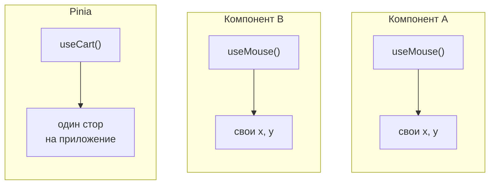
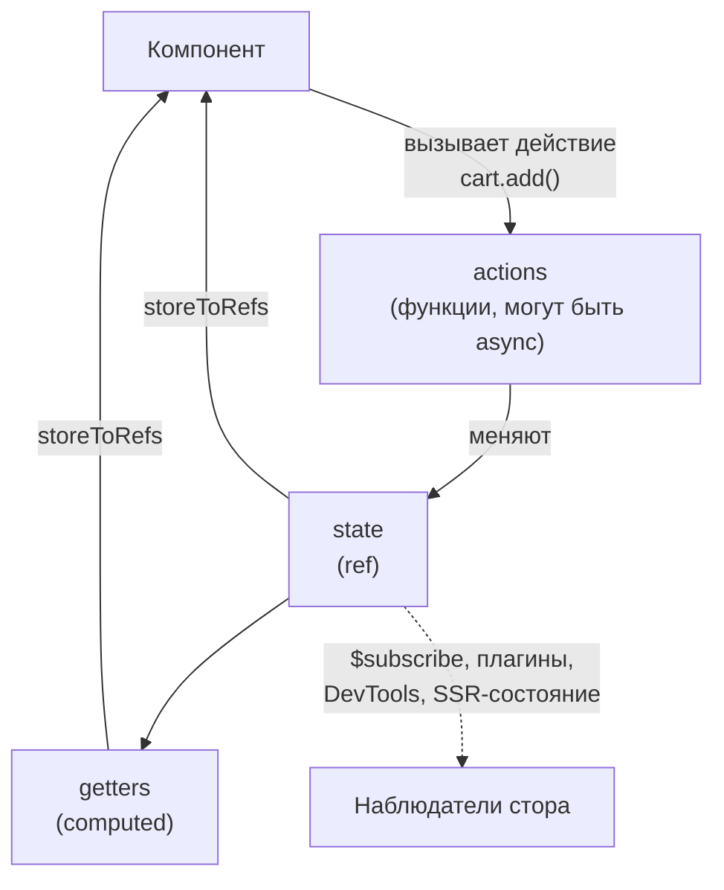
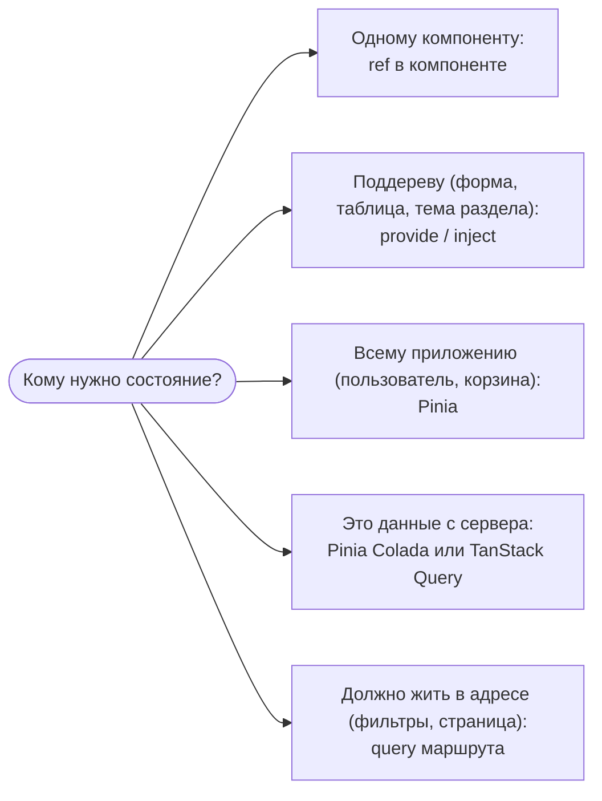

## О чём урок

Как в Vue переиспользуют логику с состоянием: composables, функции `useX` на Composition API, которые заменили миксины. И как делят состояние между компонентами: Pinia, официальный стор (версия 4). Здесь правила хороших composables, очистка через области эффектов, сторы в стиле setup, `storeToRefs` и подписки. Примеры выполняются на Vue 3.5 и Pinia 4.1 в Node.js.

## Composable

Composable это функция, которая внутри использует `ref`, `computed`, наблюдатели и хуки жизненного цикла и возвращает реактивное состояние. Вызывается в `setup` (синхронно), и всё созданное в нём принадлежит компоненту.

```ts
// useMouse.ts
import { onMounted, onUnmounted, ref } from 'vue'

export function useMouse() {
  const x = ref(0)
  const y = ref(0)
  const update = (e: MouseEvent) => {
    x.value = e.pageX
    y.value = e.pageY
  }
  onMounted(() => window.addEventListener('mousemove', update))
  onUnmounted(() => window.removeEventListener('mousemove', update))
  return { x, y } // plain object of refs: destructuring keeps reactivity
}
```



Каждый вызов composable создаёт **новое** состояние для своего компонента: composable переиспользует логику, а не данные. Если состояние должно быть общим, его выносят за функцию (переменная модуля) или в стор Pinia, который создаётся один раз.

Правила:

- имя начинается с `use`, вызов только синхронно в `setup` или другом composable (после `await` хуки уже не привязаны к компоненту);
- возвращают **объект из ref**, а не `reactive`: тогда `const { x } = useMouse()` остаётся реактивным;
- аргументы принимают как `MaybeRefOrGetter` и читают через `toValue()`: так функция работает и с обычным значением, и с ref, и с геттером;
- всё, что подписалось на внешний мир, отписывается: `onUnmounted` или `onScopeDispose`.

Почему не миксины (Options API): у миксинов неявные источники свойств, конфликты имён и нельзя передать параметры. Composable это обычная функция с явным возвратом. Готовая коллекция composables: VueUse.

## Области эффектов и очистка

Компонент собирает все свои `computed` и наблюдатели в **область эффектов** (`effectScope`) и останавливает их при размонтировании. Composable можно использовать и вне компонента, если создать область вручную; `onScopeDispose` срабатывает при её остановке.

```ts run
import { effectScope, onScopeDispose, ref, toValue, watch, type MaybeRefOrGetter } from 'vue'

function usePolling(url: MaybeRefOrGetter<string>, ms: number) {
  const ticks = ref(0)
  const timer = setInterval(() => ticks.value++, ms)
  watch(() => toValue(url), (next) => console.log('now polling', next))
  onScopeDispose(() => {
    clearInterval(timer)
    console.log('stopped polling')
  })
  return { ticks }
}

const endpoint = ref('/api/a')
const scope = effectScope()
const { ticks } = scope.run(() => usePolling(endpoint, 10))!
await new Promise((r) => setTimeout(r, 35))
endpoint.value = '/api/b'
await new Promise((r) => setTimeout(r, 0))
scope.stop() // what unmounting does for a component
const after = ticks.value
await new Promise((r) => setTimeout(r, 30))
console.log('ticked before stop:', after > 0, '| frozen after stop:', ticks.value === after)
endpoint.value = '/api/c' // the watcher is stopped too
```

```output
now polling /api/b
stopped polling
ticked before stop: true | frozen after stop: true
```

## Pinia: стор в стиле setup

Pinia хранит состояние, общее для разных частей приложения: пользователь, корзина, настройки. Стор в стиле setup пишется как composable: `ref` становятся состоянием, `computed` геттерами, функции действиями. Стор создаётся один раз на приложение при первом `useStore()`.



```ts run
import { createPinia, defineStore, setActivePinia, storeToRefs } from 'pinia'
import { computed, ref } from 'vue'

setActivePinia(createPinia()) // app.use(pinia) in a real app

const useCart = defineStore('cart', () => {
  const items = ref<{ name: string; price: number; qty: number }[]>([])
  const total = computed(() => items.value.reduce((sum, i) => sum + i.price * i.qty, 0))
  function add(name: string, price: number) {
    const found = items.value.find((i) => i.name === name)
    if (found) found.qty++
    else items.value.push({ name, price, qty: 1 })
  }
  return { items, total, add }
})

const cart = useCart()
console.log('same store:', useCart() === cart)
cart.$subscribe((mutation) => console.log('changed:', mutation.type))

const { total } = storeToRefs(cart) // keeps reactivity, unlike `const { total } = cart`
const { add } = cart // actions can be destructured directly
const copied = cart.total // a plain number
add('tea', 3)
add('tea', 3)
await Promise.resolve()
cart.$patch((state) => state.items.push({ name: 'cake', price: 5, qty: 1 }))
await Promise.resolve()
console.log('total ref:', total.value, '| copied number:', copied)
```

```output
same store: true
changed: direct
changed: patch function
total ref: 11 | copied number: 0
```

- Стор это объект `reactive`: его нельзя деструктурировать напрямую, иначе потеряется реактивность. Для состояния и геттеров `storeToRefs(store)`, действия деструктурируют как есть.
- Несколько изменений в одном синхронном куске дают одно уведомление подписчику (`$subscribe` устроен как наблюдатель Vue и группирует изменения так же).
- `$patch` меняет несколько полей одной операцией; `$reset()` есть только у сторов в стиле options (в setup-сторе его пишут сами).
- Есть стиль options (`state`, `getters`, `actions`), он ближе к Vuex; новый код чаще пишут в стиле setup.
- Pinia 4 поставляется только как ESM, а `@vue/devtools-api` для интеграции с DevTools ставят отдельно; Pinia 3 убрала поддержку Vue 2. Vuex для новых проектов не рекомендуется.

## Где держать состояние



- Простой глобальный `reactive` в модуле тоже работает на клиенте, но при SSR он станет общим для всех запросов, а у Pinia своё состояние на каждый запрос. Плюс Pinia даёт DevTools, плагины (например, сохранение в `localStorage`) и удобную подмену в тестах.
- Серверные данные это кэш, а не состояние приложения: повторная загрузка, устаревание, дедупликация запросов. Для них берут библиотеку запросов, а не пишут это в сторе вручную.
- Состояние, которое должно переживать перезагрузку и делиться ссылкой (фильтры, сортировка, номер страницы), хранят в адресе.

| | Setup-стор | Options-стор |
|---|---|---|
| Состояние | `ref` | `state: () => ({ ... })` |
| Геттеры | `computed` | `getters` |
| Действия | функции | `actions` с `this` |
| Можно использовать | любые composables, `watch`, `inject` | только то, что есть в опциях |
| `$reset()` | писать самому | есть |

## Главное

- Composable это функция `useX` с реактивным состоянием, вызываемая синхронно в `setup`; возвращает объект из ref.
- Аргументы через `MaybeRefOrGetter` и `toValue`, очистка через `onUnmounted` или `onScopeDispose`.
- `effectScope` собирает эффекты и останавливает их разом, так компонент очищает себя при размонтировании.
- Pinia: setup-стор как composable, `storeToRefs` для деструктуризации, `$patch`, `$subscribe`.
- Pinia 4 только ESM; глобальный `reactive` небезопасен при SSR.
- Состояние по месту: компонент, поддерево (`provide`), приложение (Pinia), серверный кэш (библиотека запросов), адрес (фильтры).
