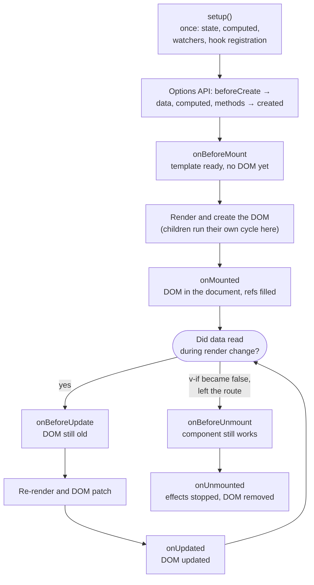
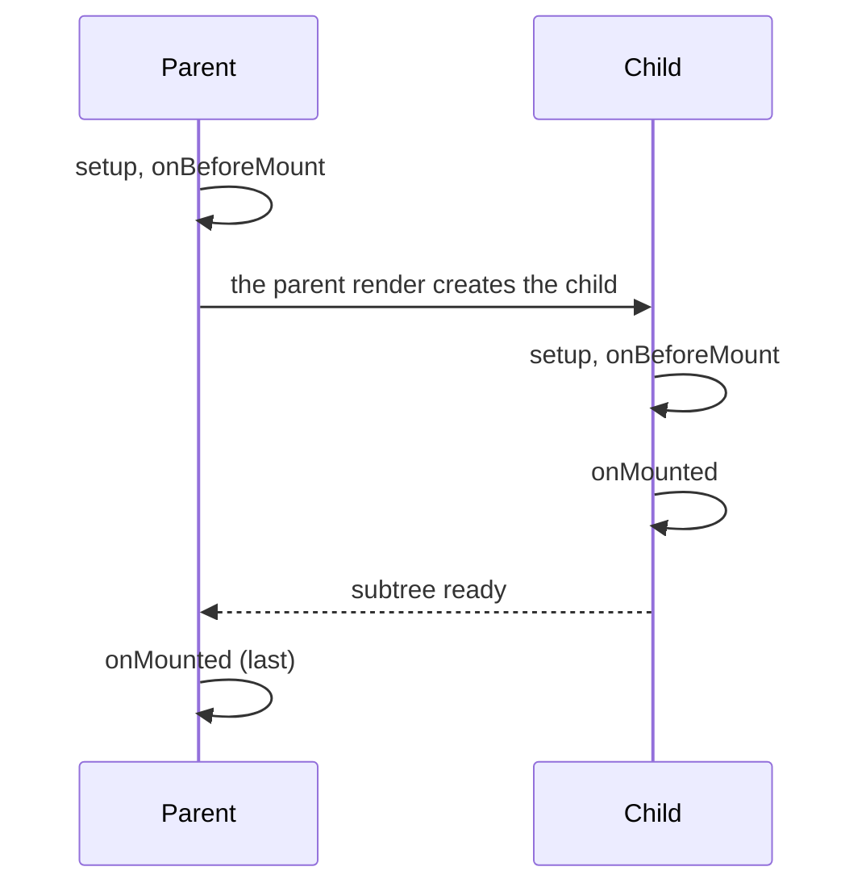

## What this lesson covers

What happens to a Vue component from creation to removal: when `setup` runs, which hooks are called on mount, update and unmount, in what order they run for a parent and a child, how Options API hooks map to the Composition API, and how to catch errors from child components. The order in the examples comes from running them on Vue 3.5.

## The lifecycle diagram



- **`setup` runs once** when the instance is created and is not called on updates. This is the key difference from a React function component, which runs again on every render: in Vue only the render function (the compiled template) runs again.
- Composition API hooks (`onMounted` and the rest) are registered **synchronously** in `setup`: after an `await` Vue no longer knows which component the call belongs to and prints a warning.
- `setup` has no `this`: props come as the first argument, and `emit`, `slots`, `attrs`, `expose` as the second.

## Parent and child order

```js dom
import { createApp, h, nextTick, onBeforeMount, onBeforeUnmount, onBeforeUpdate, onMounted, onUnmounted, onUpdated, ref } from 'vue'

function logHooks(name) {
  console.log(`${name}: setup`)
  onBeforeMount(() => console.log(`${name}: onBeforeMount`))
  onMounted(() => console.log(`${name}: onMounted`))
  onBeforeUpdate(() => console.log(`${name}: onBeforeUpdate`))
  onUpdated(() => console.log(`${name}: onUpdated`))
  onBeforeUnmount(() => console.log(`${name}: onBeforeUnmount`))
  onUnmounted(() => console.log(`${name}: onUnmounted`))
}

const n = ref(0)
const show = ref(true)
const Child = {
  props: ['n'],
  setup(props) {
    logHooks('child')
    return () => h('b', props.n)
  },
}
const Parent = {
  setup() {
    logHooks('parent')
    return () => h('div', show.value ? [h(Child, { n: n.value })] : [])
  },
}

createApp(Parent).mount(document.createElement('div'))
console.log('--- n.value++')
n.value++
await nextTick()
console.log('--- show.value = false')
show.value = false
await nextTick()
```

```output
parent: setup
parent: onBeforeMount
child: setup
child: onBeforeMount
child: onMounted
parent: onMounted
--- n.value++
parent: onBeforeUpdate
child: onBeforeUpdate
child: onUpdated
parent: onUpdated
--- show.value = false
parent: onBeforeUpdate
child: onBeforeUnmount
child: onUnmounted
parent: onUpdated
```



- "Before" hooks run **top-down**, "after" hooks **bottom-up**: the parent's `onMounted` runs last, once the whole subtree is mounted. That is why child elements and components are already available in the parent's `onMounted`.
- `setup` did not run a second time: the update went only through rendering.
- The child updated because its prop changed. Had the parent re-rendered because of data the child does not receive, the child would not have updated (see the rendering lesson).
- Removing the child is an update of the parent: the child's `onBeforeUnmount` and `onUnmounted` run inside the parent's patch.

## Options API and Composition API hooks

| Options API | Composition API | When |
|---|---|---|
| `beforeCreate`, `created` | code in `setup()` | Instance creation, before the DOM |
| `beforeMount` | `onBeforeMount` | Before the first render |
| `mounted` | `onMounted` | DOM created and inserted |
| `beforeUpdate` | `onBeforeUpdate` | Data changed, DOM still old |
| `updated` | `onUpdated` | DOM updated |
| `beforeUnmount` (Vue 2: `beforeDestroy`) | `onBeforeUnmount` | Before removal |
| `unmounted` (Vue 2: `destroyed`) | `onUnmounted` | After removal |
| `activated`, `deactivated` | `onActivated`, `onDeactivated` | A component inside `<KeepAlive>` is shown or hidden |
| `errorCaptured` | `onErrorCaptured` | An error in a descendant |
| `serverPrefetch` | `onServerPrefetch` | Data loading during SSR |
| `renderTracked`, `renderTriggered` | `onRenderTracked`, `onRenderTriggered` | Debugging: which dependency was tracked and which triggered a render (development only) |

When a component has both `setup` and options, `setup` runs before all of them:

```js dom
import { createApp } from 'vue'

const Legacy = {
  data() {
    console.log('data()')
    return { title: 'Hi' }
  },
  setup() {
    console.log('setup(): no this, props are the first argument')
  },
  beforeCreate() {
    console.log('beforeCreate: data yet?', this.title)
  },
  created() {
    console.log('created: data', this.title, '| DOM', this.$el)
  },
  beforeMount() {
    console.log('beforeMount: DOM', this.$el)
  },
  mounted() {
    console.log('mounted: DOM', this.$el.outerHTML)
  },
  template: `<h1>{{ title }}</h1>`,
}
createApp(Legacy).mount(document.createElement('div'))
```

```output
setup(): no this, props are the first argument
beforeCreate: data yet? undefined
data()
created: data Hi | DOM null
beforeMount: DOM null
mounted: DOM <h1>Hi</h1>
```

## What goes in which hook

- **Loading data**: directly in `setup` (or `created`), without waiting for `onMounted`: the request starts earlier. With SSR use `onServerPrefetch`, in Nuxt `useFetch`.
- **Working with the DOM**, measuring sizes, third-party libraries (a map, an editor, a chart): `onMounted`; get elements with `useTemplateRef`.
- **Subscriptions** to `window`, timers, WebSocket, `IntersectionObserver`: create them in `onMounted`, remove them in `onUnmounted` (or `onScopeDispose` in a composable). Vue stops watchers and `computed`s created synchronously in `setup` by itself.
- **`onUpdated`** is rarely needed: to react to specific data there is `watch` with `flush: 'post'`. Changing state in `onUpdated` causes another render; if every update changes the data again, you get a loop, and in development Vue stops it with an error about exceeding the maximum number of recursive updates.
- **`onBeforeUnmount`**: the last place where the component fully works (for example, to save a draft).

## Errors: onErrorCaptured and errorHandler

`onErrorCaptured(err, instance, info)` catches errors from descendants: in rendering, hooks, event handlers and watchers. Returning `false` stops propagation; otherwise the error goes on to ancestors and to `app.config.errorHandler`, where it is sent to monitoring.

```js dom
import { createApp, h, nextTick, onErrorCaptured, ref } from 'vue'

const Widget = {
  props: ['user'],
  setup: (props) => () => h('p', props.user.name.toUpperCase()),
}
const Boundary = {
  setup(_, { slots }) {
    const error = ref(null)
    onErrorCaptured((err, instance, info) => {
      error.value = err.message
      console.log('captured in', info)
      return false // stop: do not pass the error to app.config.errorHandler
    })
    return () => (error.value ? h('p', { role: 'alert' }, 'Widget failed') : slots.default())
  },
}

const el = document.createElement('div')
const app = createApp({ render: () => h(Boundary, () => [h(Widget, { user: {} })]) })
app.config.errorHandler = (err) => console.log('global handler:', err.message)
app.mount(el)
await nextTick()
console.log(el.innerHTML)
```

```output
captured in render function
<p role="alert">Widget failed</p>
```

This is how Vue does the equivalent of a React Error Boundary. Errors in async code outside Vue (a promise without `await` in a handler, `setTimeout`) do not get here: catch them with `window.addEventListener('unhandledrejection', ...)` or `try/catch`.

## Key points

- `setup` runs once; an update only repeats the render.
- Order: `setup` → `onBeforeMount` → render (the whole child subtree) → `onMounted`; on change `onBeforeUpdate` → patch → `onUpdated`; on removal `onBeforeUnmount` → `onUnmounted`.
- "Before" hooks top-down, "after" hooks bottom-up: the parent's `onMounted` is last.
- `setup` runs before `beforeCreate`; in `created` data exists, the DOM does not.
- Load data in `setup`, touch the DOM in `onMounted`, remove subscriptions in `onUnmounted`.
- `onErrorCaptured` with `return false` works as an error boundary, `app.config.errorHandler` for monitoring.
