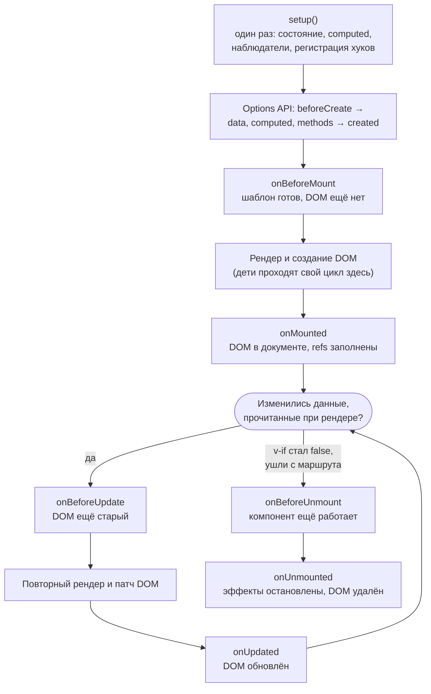
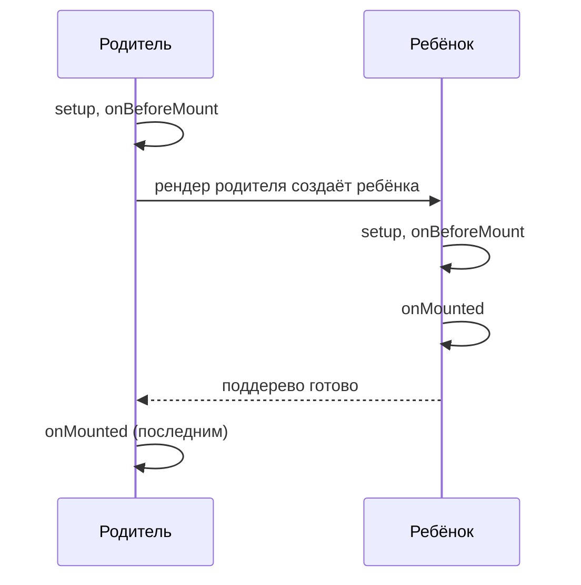

## О чём урок

Что происходит с компонентом Vue от создания до удаления: когда выполняется `setup`, какие хуки вызываются при монтировании, обновлении и размонтировании, в каком порядке они идут у родителя и ребёнка, как хуки Options API соответствуют Composition API и как перехватывать ошибки дочерних компонентов. Порядок в примерах получен запуском на Vue 3.5.

## Схема жизненного цикла



- **`setup` выполняется один раз** при создании экземпляра и при обновлениях не вызывается. В этом главное отличие от функционального компонента React, который выполняется заново на каждом рендере: в Vue повторно выполняется только render-функция (скомпилированный шаблон).
- Хуки Composition API (`onMounted` и другие) регистрируют **синхронно** в `setup`: после `await` Vue уже не знает, к какому компоненту относится вызов, и выдаст предупреждение.
- В `setup` нет `this`: пропсы приходят первым аргументом, а `emit`, `slots`, `attrs`, `expose` вторым.

## Порядок у родителя и ребёнка

```js dom
import { createApp, h, nextTick, onBeforeMount, onBeforeUnmount, onBeforeUpdate, onMounted, onUnmounted, onUpdated, ref } from 'vue'

function logHooks(name) {
  console.log(`${name}: setup`)
  onBeforeMount(() => console.log(`${name}: onBeforeMount`))
  onMounted(() => console.log(`${name}: onMounted`))
  onBeforeUpdate(() => console.log(`${name}: onBeforeUpdate`))
  onUpdated(() => console.log(`${name}: onUpdated`))
  onBeforeUnmount(() => console.log(`${name}: onBeforeUnmount`))
  onUnmounted(() => console.log(`${name}: onUnmounted`))
}

const n = ref(0)
const show = ref(true)
const Child = {
  props: ['n'],
  setup(props) {
    logHooks('child')
    return () => h('b', props.n)
  },
}
const Parent = {
  setup() {
    logHooks('parent')
    return () => h('div', show.value ? [h(Child, { n: n.value })] : [])
  },
}

createApp(Parent).mount(document.createElement('div'))
console.log('--- n.value++')
n.value++
await nextTick()
console.log('--- show.value = false')
show.value = false
await nextTick()
```

```output
parent: setup
parent: onBeforeMount
child: setup
child: onBeforeMount
child: onMounted
parent: onMounted
--- n.value++
parent: onBeforeUpdate
child: onBeforeUpdate
child: onUpdated
parent: onUpdated
--- show.value = false
parent: onBeforeUpdate
child: onBeforeUnmount
child: onUnmounted
parent: onUpdated
```



- «Before»-хуки идут **сверху вниз**, «after»-хуки **снизу вверх**: `onMounted` родителя вызывается последним, когда смонтировано всё поддерево. Поэтому в `onMounted` родителя дочерние элементы и компоненты уже доступны.
- `setup` второй раз не выполнился: обновление прошло только через рендер.
- Ребёнок обновился, потому что изменился его проп. Если бы родитель перерисовался из-за данных, которые ребёнок не получает, ребёнок не обновился бы (урок о рендере).
- Удаление ребёнка это обновление родителя: `onBeforeUnmount` и `onUnmounted` ребёнка выполняются внутри патча родителя.

## Хуки Options API и Composition API

| Options API | Composition API | Когда |
|---|---|---|
| `beforeCreate`, `created` | код в `setup()` | Создание экземпляра, до DOM |
| `beforeMount` | `onBeforeMount` | Перед первым рендером |
| `mounted` | `onMounted` | DOM создан и вставлен |
| `beforeUpdate` | `onBeforeUpdate` | Данные изменились, DOM старый |
| `updated` | `onUpdated` | DOM обновлён |
| `beforeUnmount` (Vue 2: `beforeDestroy`) | `onBeforeUnmount` | Перед удалением |
| `unmounted` (Vue 2: `destroyed`) | `onUnmounted` | После удаления |
| `activated`, `deactivated` | `onActivated`, `onDeactivated` | Компонент в `<KeepAlive>` показан или скрыт |
| `errorCaptured` | `onErrorCaptured` | Ошибка в потомке |
| `serverPrefetch` | `onServerPrefetch` | Загрузка данных при SSR |
| `renderTracked`, `renderTriggered` | `onRenderTracked`, `onRenderTriggered` | Отладка: какая зависимость отслежена и какая вызвала рендер (только в разработке) |

Когда в одном компоненте есть и `setup`, и опции, `setup` выполняется раньше всех:

```js dom
import { createApp } from 'vue'

const Legacy = {
  data() {
    console.log('data()')
    return { title: 'Hi' }
  },
  setup() {
    console.log('setup(): no this, props are the first argument')
  },
  beforeCreate() {
    console.log('beforeCreate: data yet?', this.title)
  },
  created() {
    console.log('created: data', this.title, '| DOM', this.$el)
  },
  beforeMount() {
    console.log('beforeMount: DOM', this.$el)
  },
  mounted() {
    console.log('mounted: DOM', this.$el.outerHTML)
  },
  template: `<h1>{{ title }}</h1>`,
}
createApp(Legacy).mount(document.createElement('div'))
```

```output
setup(): no this, props are the first argument
beforeCreate: data yet? undefined
data()
created: data Hi | DOM null
beforeMount: DOM null
mounted: DOM <h1>Hi</h1>
```

## Что делать в каком хуке

- **Загрузка данных**: прямо в `setup` (или `created`), не дожидаясь `onMounted`: запрос уходит раньше. С SSR для этого `onServerPrefetch`, в Nuxt `useFetch`.
- **Работа с DOM**, измерение размеров, сторонние библиотеки (карта, редактор, график): `onMounted`; элементы берут через `useTemplateRef`.
- **Подписки** на `window`, таймеры, WebSocket, `IntersectionObserver`: создают в `onMounted`, снимают в `onUnmounted` (или `onScopeDispose` в composable). Наблюдатели и `computed`, созданные синхронно в `setup`, Vue останавливает сам.
- **`onUpdated`** нужен редко: для реакции на конкретные данные есть `watch` с `flush: 'post'`. Изменение состояния в `onUpdated` вызывает ещё один рендер; если каждое обновление снова меняет данные, получается цикл, и в разработке Vue остановит его с ошибкой о превышении числа рекурсивных обновлений.
- **`onBeforeUnmount`**: последнее место, где компонент полностью работает (например, сохранить черновик).

## Ошибки: onErrorCaptured и errorHandler

`onErrorCaptured(err, instance, info)` ловит ошибки потомков: в рендере, хуках, обработчиках событий, наблюдателях. Возврат `false` останавливает всплытие; иначе ошибка идёт к предкам и в `app.config.errorHandler`, где её отправляют в мониторинг.

```js dom
import { createApp, h, nextTick, onErrorCaptured, ref } from 'vue'

const Widget = {
  props: ['user'],
  setup: (props) => () => h('p', props.user.name.toUpperCase()),
}
const Boundary = {
  setup(_, { slots }) {
    const error = ref(null)
    onErrorCaptured((err, instance, info) => {
      error.value = err.message
      console.log('captured in', info)
      return false // stop: do not pass the error to app.config.errorHandler
    })
    return () => (error.value ? h('p', { role: 'alert' }, 'Widget failed') : slots.default())
  },
}

const el = document.createElement('div')
const app = createApp({ render: () => h(Boundary, () => [h(Widget, { user: {} })]) })
app.config.errorHandler = (err) => console.log('global handler:', err.message)
app.mount(el)
await nextTick()
console.log(el.innerHTML)
```

```output
captured in render function
<p role="alert">Widget failed</p>
```

Так в Vue делают аналог Error Boundary из React. Ошибки в асинхронном коде вне Vue (промис без `await` в обработчике, `setTimeout`) сюда не попадают: их ловят `window.addEventListener('unhandledrejection', ...)` или `try/catch`.

## Главное

- `setup` выполняется один раз; при обновлении повторяется только рендер.
- Порядок: `setup` → `onBeforeMount` → рендер (дети целиком) → `onMounted`; при изменении `onBeforeUpdate` → патч → `onUpdated`; при удалении `onBeforeUnmount` → `onUnmounted`.
- «Before»-хуки сверху вниз, «after»-хуки снизу вверх: `onMounted` родителя последний.
- `setup` выполняется раньше `beforeCreate`; в `created` данные есть, DOM нет.
- Данные загружают в `setup`, DOM трогают в `onMounted`, подписки снимают в `onUnmounted`.
- `onErrorCaptured` с `return false` работает как граница ошибок, `app.config.errorHandler` для мониторинга.
