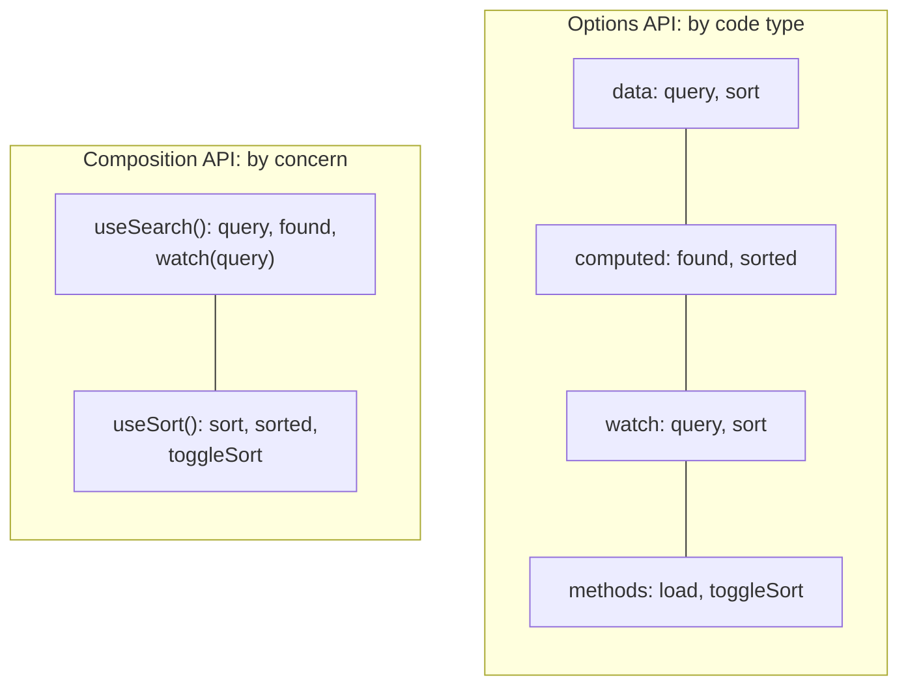
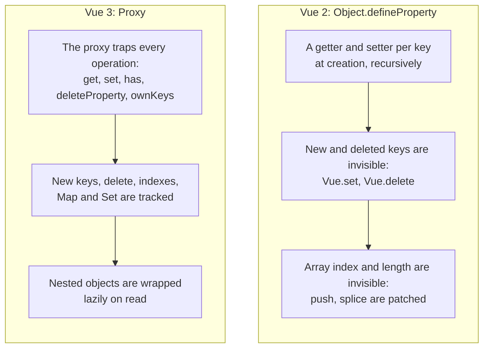

## What this lesson covers

Two ways to write Vue components and how they really differ, why mixins gave way to composables, what changed from Vue 2 to Vue 3 (asked almost every time, because a lot of code still runs on Vue 2), and how the application level works: `createApp`, plugins, global properties. The examples run on Vue 3.5.

## One component written two ways

```js dom
import { computed, createApp, nextTick, onMounted, ref, watch } from 'vue'

const OptionsSearch = {
  props: ['items'],
  data: () => ({ query: '' }),
  computed: {
    found() {
      return this.items.filter((item) => item.includes(this.query))
    },
  },
  watch: {
    query(now, before) {
      console.log(`options: "${before}" → "${now}", ${this.found.length} found`)
    },
  },
  mounted() {
    console.log('options: mounted with', this.found.length, 'items')
  },
  template: `<input v-model="query"><p>{{ found.join(', ') }}</p>`,
}

const CompositionSearch = {
  props: ['items'],
  setup(props) {
    const query = ref('')
    const found = computed(() => props.items.filter((item) => item.includes(query.value)))
    watch(query, (now, before) => console.log(`composition: "${before}" → "${now}", ${found.value.length} found`))
    onMounted(() => console.log('composition: mounted with', found.value.length, 'items'))
    return { query, found }
  },
  template: `<input v-model="query"><p>{{ found.join(', ') }}</p>`,
}

const el = document.createElement('div')
document.body.append(el)
createApp({
  components: { OptionsSearch, CompositionSearch },
  data: () => ({ fruits: ['apple', 'banana', 'cherry'] }),
  template: `<OptionsSearch :items="fruits" /><CompositionSearch :items="fruits" />`,
}).mount(el)
for (const input of el.querySelectorAll('input')) {
  input.value = 'an'
  input.dispatchEvent(new Event('input'))
}
await nextTick()
console.log([...el.querySelectorAll('p')].map((p) => p.textContent))
```

```output
options: mounted with 3 items
composition: mounted with 3 items
options: "" → "an", 1 found
composition: "" → "an", 1 found
[ 'banana', 'banana' ]
```

The behavior is identical: both APIs run on the same reactivity system. The Options API is implemented on top of the Composition API: `data` becomes `reactive`, `computed` becomes `computed`, `watch` becomes `watch`.



| | Options API | Composition API |
|---|---|---|
| Organization | By type: `data`, `computed`, `methods`, `watch`, hooks | By concern: everything about search together, everything about sorting together |
| Accessing state | `this.query` | `query.value` in code, `query` in the template |
| Reusing logic | Mixins (implicit, name clashes) | Composables (plain functions with an explicit return) |
| TypeScript | Types inferred through `defineComponent`, harder | Plain variables and functions, inference out of the box |
| Bundle size | Property names on `this` are not minified | Local variables are minified; the Options API can be turned off with the `__VUE_OPTIONS_API__: false` flag |
| Status | Supported, not deprecated | Recommended for new and large apps |

`<script setup>` is syntactic sugar over `setup()`: the compiler returns everything declared to the template, so there is less code and better performance (the template is compiled in the same scope, without a proxy). For simple components the Options API is still a fine choice, but mixing both styles in one component without a reason is best avoided.

## Mixins and why composables replaced them

```js dom
import { createApp } from 'vue'

const loggerMixin = {
  data: () => ({ title: 'from mixin', logs: 0 }),
  created() {
    console.log('mixin created')
  },
  methods: {
    save: () => 'mixin save',
  },
}
const Editor = {
  mixins: [loggerMixin],
  data: () => ({ title: 'from component' }),
  created() {
    console.log('component created')
  },
  methods: {
    save: () => 'component save',
  },
  template: `<p>{{ title }} | logs: {{ logs }} | {{ save() }}</p>`,
}
const el = document.createElement('div')
createApp(Editor).mount(el)
console.log(el.textContent)
```

```output
mixin created
component created
from component | logs: 0 | component save
```

Merge rules: `data` is merged (the component wins on conflict), all hooks run (the mixin's first), and methods with the same name in the component silently override the mixin's. That leads to the three problems the docs list: **unclear where a property comes from** (`logs` came from the mixin, nothing in the component shows it), **name clashes** between mixins, and **implicit coupling** through shared `this` properties. A composable solves all of these: `const { logs } = useLogger()` shows the source explicitly, variables can be renamed, and data is passed as arguments. Mixins remain in Vue 3 for compatibility but are not used in new code.

## Vue 2 and Vue 3: reactivity

The main reason for many differences is the reactivity mechanism:

```js run
// Vue 2 made data reactive with Object.defineProperty: only keys that existed at creation
function defineReactive(obj, onChange) {
  for (const key of Object.keys(obj)) {
    let value = obj[key]
    Object.defineProperty(obj, key, {
      get: () => value,
      set: (next) => ((value = next), onChange(key)),
      enumerable: true,
    })
  }
  return obj
}
const vue2 = defineReactive({ name: 'Ann' }, (key) => console.log('vue2 noticed', key))
vue2.name = 'Bob'
vue2.age = 30 // a new key: no setter, nobody is notified (hence Vue.set)
delete vue2.name // deletion is invisible too (hence Vue.delete)

// Vue 3 wraps the object in a Proxy: every operation goes through a trap
const vue3 = new Proxy(
  { name: 'Ann' },
  {
    set: (target, key, value) => ((target[key] = value), console.log('vue3 noticed', key), true),
    deleteProperty: (target, key) => (delete target[key], console.log('vue3 noticed delete', key), true),
  },
)
vue3.name = 'Bob'
vue3.age = 30
delete vue3.name
const list = new Proxy([], { set: (t, k, v) => ((t[k] = v), console.log('vue3 array set', k), true) })
list[0] = 'x' // in Vue 2 an index assignment was not reactive either
```

```output
vue2 noticed name
vue3 noticed name
vue3 noticed age
vue3 noticed delete name
vue3 array set 0
```



## Vue 2 and Vue 3: what changed

| Vue 2 | Vue 3 | Why |
|---|---|---|
| `Object.defineProperty`, `Vue.set`, `Vue.delete` | `Proxy`, plain assignment and `delete` | Reactivity without limits, less memory |
| `new Vue({ el, router, store })`, global `Vue.use`, `Vue.component` | `createApp(App).use(router).mount('#app')` | Several isolated apps on a page; the global API does not leak between them and tests |
| A single root element | Fragments: multiple roots | Fewer wrapper elements |
| Options API | Options and Composition API (backported to 2.7) | Logic reuse and TypeScript |
| `v-model` = `value` + `input`, the `.sync` modifier | `modelValue` + `update:modelValue`, several `v-model:name`, `.sync` removed | One mechanism for two-way binding |
| `v-for` takes precedence over `v-if` | `v-if` takes precedence over `v-for` | Fewer hidden bugs |
| `$listeners`, `class` and `style` separate from `$attrs` | Everything in `$attrs`, the `emits` option | Simpler attribute forwarding |
| Filters `{{ price \| currency }}` | Removed: methods or `computed` | Non-standard syntax |
| An event bus `$on`, `$off`, `$once` | Removed: `mitt`, `provide`/`inject`, Pinia | Implicit coupling |
| `beforeDestroy`, `destroyed` | `beforeUnmount`, `unmounted` | Consistent names |
| — | `Teleport`, `Suspense`, `defineAsyncComponent` | New built-in features |
| Vuex | Pinia | Simpler API, types, setup stores |
| Global API on the `Vue` object (`Vue.nextTick`) | Named imports (`import { nextTick } from 'vue'`) | Tree-shaking: unused code stays out of the bundle |

Vue 2 reached end of life on December 31, 2023. Migration is gradual: the `@vue/compat` migration build warns about every deprecated API; first update dependencies (Router 4+, Pinia instead of Vuex), then remove the warnings.

## createApp and plugins

`createApp(App)` creates the application; everything "global" is registered on it: `app.component`, `app.directive`, `app.provide`, `app.config.errorHandler`, `app.config.globalProperties`. A **plugin** is an object with an `install(app, options)` method (or just a function) that does these registrations for the user. That is how Vue Router, Pinia and i18n are installed.

```js dom
import { createApp, inject } from 'vue'

const I18nKey = Symbol('i18n')
const i18n = {
  install(app, { messages, locale }) {
    const t = (key) => messages[locale][key] ?? key
    app.provide(I18nKey, t) // for setup(): inject(I18nKey)
    app.config.globalProperties.$t = t // for templates and Options API: $t('hello')
    app.directive('t', (el, binding) => (el.textContent = t(binding.value)))
  },
}

const Greeting = {
  setup: () => ({ tr: inject(I18nKey) }),
  template: `<p>{{ $t('hello') }} | {{ tr('bye') }} | <span v-t="'hello'"></span></p>`,
}
const el = document.createElement('div')
createApp(Greeting)
  .use(i18n, { locale: 'ru', messages: { ru: { hello: 'Привет', bye: 'Пока' } } })
  .mount(el)
console.log(el.innerHTML)
```

```output
<p>Привет | Пока | <span>Привет</span></p>
```

- `app.provide` + `inject` is the best way to expose a plugin's service: explicit, typed through `InjectionKey`, works in `setup`.
- `globalProperties` are for templates and the Options API (`$t`, `$router`); in TypeScript declare them by extending `ComponentCustomProperties`.
- A plugin runs once per app; a repeated `app.use` of the same plugin is ignored.

## Key points

- The Options API and the Composition API run on the same reactivity; the Options API is not deprecated, but new apps use the Composition API and `<script setup>`.
- The Composition API groups code by concern and works better with TypeScript and minification; logic is reused through composables.
- Mixins mean unclear property sources, name clashes and implicit coupling; composables are explicit.
- Vue 3: `Proxy` instead of `defineProperty` (no `Vue.set`), `createApp`, fragments, `Teleport`, the new `v-model`, `v-if` over `v-for`, no filters or event bus, `beforeUnmount`/`unmounted` hooks, tree-shaking.
- Vue 2 has been unsupported since the end of 2023; migrate through `@vue/compat`.
- A plugin is `install(app, options)`: `app.provide`, `globalProperties`, `app.component`, `app.directive`.
