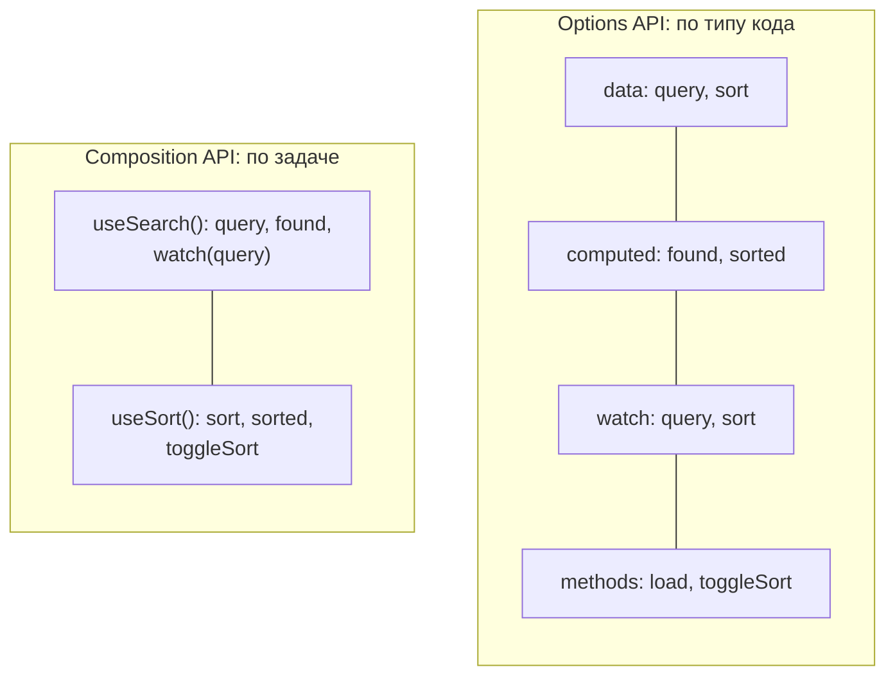
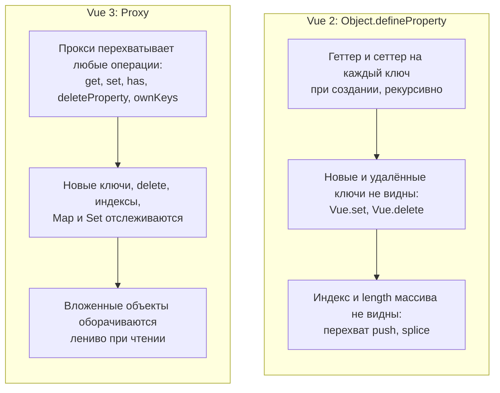

## О чём урок

Два способа писать компоненты Vue и чем они различаются на деле, почему миксины уступили composables, что изменилось от Vue 2 к Vue 3 (вопрос, который задают почти всегда, потому что много кода ещё на Vue 2) и как устроен уровень приложения: `createApp`, плагины, глобальные свойства. Примеры выполняются на Vue 3.5.

## Один компонент двумя способами

```js dom
import { computed, createApp, nextTick, onMounted, ref, watch } from 'vue'

const OptionsSearch = {
  props: ['items'],
  data: () => ({ query: '' }),
  computed: {
    found() {
      return this.items.filter((item) => item.includes(this.query))
    },
  },
  watch: {
    query(now, before) {
      console.log(`options: "${before}" → "${now}", ${this.found.length} found`)
    },
  },
  mounted() {
    console.log('options: mounted with', this.found.length, 'items')
  },
  template: `<input v-model="query"><p>{{ found.join(', ') }}</p>`,
}

const CompositionSearch = {
  props: ['items'],
  setup(props) {
    const query = ref('')
    const found = computed(() => props.items.filter((item) => item.includes(query.value)))
    watch(query, (now, before) => console.log(`composition: "${before}" → "${now}", ${found.value.length} found`))
    onMounted(() => console.log('composition: mounted with', found.value.length, 'items'))
    return { query, found }
  },
  template: `<input v-model="query"><p>{{ found.join(', ') }}</p>`,
}

const el = document.createElement('div')
document.body.append(el)
createApp({
  components: { OptionsSearch, CompositionSearch },
  data: () => ({ fruits: ['apple', 'banana', 'cherry'] }),
  template: `<OptionsSearch :items="fruits" /><CompositionSearch :items="fruits" />`,
}).mount(el)
for (const input of el.querySelectorAll('input')) {
  input.value = 'an'
  input.dispatchEvent(new Event('input'))
}
await nextTick()
console.log([...el.querySelectorAll('p')].map((p) => p.textContent))
```

```output
options: mounted with 3 items
composition: mounted with 3 items
options: "" → "an", 1 found
composition: "" → "an", 1 found
[ 'banana', 'banana' ]
```

Поведение одинаковое: оба API работают на одной системе реактивности. Options API реализован поверх Composition API: `data` превращается в `reactive`, `computed` в `computed`, `watch` в `watch`.



| | Options API | Composition API |
|---|---|---|
| Организация | По типу: `data`, `computed`, `methods`, `watch`, хуки | По задаче: всё про поиск рядом, всё про сортировку рядом |
| Доступ к состоянию | `this.query` | `query.value` в коде, `query` в шаблоне |
| Переиспользование логики | Миксины (неявно, конфликты имён) | Composables (обычные функции с явным возвратом) |
| TypeScript | Типы выводятся через `defineComponent`, сложнее | Обычные переменные и функции, вывод типов «из коробки» |
| Размер бандла | Имена свойств на `this` не минифицируются | Локальные переменные минифицируются; Options API можно выключить флагом `__VUE_OPTIONS_API__: false` |
| Статус | Поддерживается, не устарел | Рекомендуется для новых и больших приложений |

`<script setup>` это синтаксический сахар над `setup()`: компилятор сам возвращает всё объявленное в шаблон, поэтому кода меньше, а производительность выше (шаблон компилируется в ту же область видимости, без прокси). Для простых компонентов Options API по-прежнему нормальный выбор, но смешивать оба стиля в одном компоненте без необходимости не стоит.

## Миксины и почему их заменили composables

```js dom
import { createApp } from 'vue'

const loggerMixin = {
  data: () => ({ title: 'from mixin', logs: 0 }),
  created() {
    console.log('mixin created')
  },
  methods: {
    save: () => 'mixin save',
  },
}
const Editor = {
  mixins: [loggerMixin],
  data: () => ({ title: 'from component' }),
  created() {
    console.log('component created')
  },
  methods: {
    save: () => 'component save',
  },
  template: `<p>{{ title }} | logs: {{ logs }} | {{ save() }}</p>`,
}
const el = document.createElement('div')
createApp(Editor).mount(el)
console.log(el.textContent)
```

```output
mixin created
component created
from component | logs: 0 | component save
```

Правила слияния: `data` объединяется (при конфликте побеждает компонент), хуки вызываются все (сначала миксина), одноимённые методы компонента молча перекрывают методы миксина. Отсюда три проблемы, которые перечисляет документация: **неясно, откуда свойство** (`logs` пришёл из миксина, в компоненте его не видно), **конфликты имён** между миксинами и **неявная связь** через общие свойства `this`. Composable решает всё это: `const { logs } = useLogger()` явно показывает источник, переменные можно переименовать, данные передаются аргументами. Миксины остались в Vue 3 для совместимости, но в новом коде не используются.

## Vue 2 и Vue 3: реактивность

Главная причина многих отличий в механизме реактивности:

```js run
// Vue 2 made data reactive with Object.defineProperty: only keys that existed at creation
function defineReactive(obj, onChange) {
  for (const key of Object.keys(obj)) {
    let value = obj[key]
    Object.defineProperty(obj, key, {
      get: () => value,
      set: (next) => ((value = next), onChange(key)),
      enumerable: true,
    })
  }
  return obj
}
const vue2 = defineReactive({ name: 'Ann' }, (key) => console.log('vue2 noticed', key))
vue2.name = 'Bob'
vue2.age = 30 // a new key: no setter, nobody is notified (hence Vue.set)
delete vue2.name // deletion is invisible too (hence Vue.delete)

// Vue 3 wraps the object in a Proxy: every operation goes through a trap
const vue3 = new Proxy(
  { name: 'Ann' },
  {
    set: (target, key, value) => ((target[key] = value), console.log('vue3 noticed', key), true),
    deleteProperty: (target, key) => (delete target[key], console.log('vue3 noticed delete', key), true),
  },
)
vue3.name = 'Bob'
vue3.age = 30
delete vue3.name
const list = new Proxy([], { set: (t, k, v) => ((t[k] = v), console.log('vue3 array set', k), true) })
list[0] = 'x' // in Vue 2 an index assignment was not reactive either
```

```output
vue2 noticed name
vue3 noticed name
vue3 noticed age
vue3 noticed delete name
vue3 array set 0
```



## Vue 2 и Vue 3: что изменилось

| Vue 2 | Vue 3 | Почему |
|---|---|---|
| `Object.defineProperty`, `Vue.set`, `Vue.delete` | `Proxy`, обычное присваивание и `delete` | Реактивность без ограничений, меньше памяти |
| `new Vue({ el, router, store })`, глобальный `Vue.use`, `Vue.component` | `createApp(App).use(router).mount('#app')` | Несколько изолированных приложений на странице, глобальное API не «протекает» между ними и тестами |
| Один корневой элемент | Фрагменты: несколько корней | Меньше лишних обёрток |
| Options API | Options и Composition API (бэкпорт в 2.7) | Переиспользование логики и TypeScript |
| `v-model` = `value` + `input`, модификатор `.sync` | `modelValue` + `update:modelValue`, несколько `v-model:name`, `.sync` удалён | Единый механизм двусторонней привязки |
| `v-for` приоритетнее `v-if` | `v-if` приоритетнее `v-for` | Меньше скрытых ошибок |
| `$listeners`, `class` и `style` отдельно от `$attrs` | Всё в `$attrs`, опция `emits` | Проще проброс атрибутов |
| Фильтры `{{ price \| currency }}` | Удалены: методы или `computed` | Нестандартный синтаксис |
| Шина событий `$on`, `$off`, `$once` | Удалена: `mitt`, `provide`/`inject`, Pinia | Неявные связи |
| `beforeDestroy`, `destroyed` | `beforeUnmount`, `unmounted` | Согласованные имена |
| — | `Teleport`, `Suspense`, `defineAsyncComponent` | Новые встроенные возможности |
| Vuex | Pinia | Проще API, типы, setup-сторы |
| Глобальное API на объекте `Vue` (`Vue.nextTick`) | Именованные импорты (`import { nextTick } from 'vue'`) | Tree-shaking: неиспользуемое не попадает в бандл |

Vue 2 перестал поддерживаться 31 декабря 2023 года. Миграцию делают постепенно: сборка совместимости `@vue/compat` выдаёт предупреждения по каждому устаревшему API, сначала обновляют зависимости (роутер 4+, Pinia вместо Vuex), затем убирают предупреждения.

## createApp и плагины

Приложение создаёт `createApp(App)`; всё «глобальное» регистрируется на нём: `app.component`, `app.directive`, `app.provide`, `app.config.errorHandler`, `app.config.globalProperties`. **Плагин** это объект с методом `install(app, options)` (или просто функция), который делает эти регистрации за пользователя. Так подключаются Vue Router, Pinia, i18n.

```js dom
import { createApp, inject } from 'vue'

const I18nKey = Symbol('i18n')
const i18n = {
  install(app, { messages, locale }) {
    const t = (key) => messages[locale][key] ?? key
    app.provide(I18nKey, t) // for setup(): inject(I18nKey)
    app.config.globalProperties.$t = t // for templates and Options API: $t('hello')
    app.directive('t', (el, binding) => (el.textContent = t(binding.value)))
  },
}

const Greeting = {
  setup: () => ({ tr: inject(I18nKey) }),
  template: `<p>{{ $t('hello') }} | {{ tr('bye') }} | <span v-t="'hello'"></span></p>`,
}
const el = document.createElement('div')
createApp(Greeting)
  .use(i18n, { locale: 'ru', messages: { ru: { hello: 'Привет', bye: 'Пока' } } })
  .mount(el)
console.log(el.innerHTML)
```

```output
<p>Привет | Пока | <span>Привет</span></p>
```

- `app.provide` + `inject` лучший способ отдать сервис плагина: явно, типизируется через `InjectionKey`, работает в `setup`.
- `globalProperties` нужны для шаблонов и Options API (`$t`, `$router`); в TypeScript их объявляют расширением `ComponentCustomProperties`.
- Плагин вызывается один раз на приложение; повторный `app.use` того же плагина игнорируется.

## Главное

- Options API и Composition API работают на одной реактивности; Options API не устарел, но новые приложения пишут на Composition API и `<script setup>`.
- Composition API группирует код по задаче, лучше дружит с TypeScript и минификацией; логика переиспользуется composables.
- Миксины дают неясные источники свойств, конфликты имён и неявные связи; composables явные.
- Vue 3: `Proxy` вместо `defineProperty` (нет `Vue.set`), `createApp`, фрагменты, `Teleport`, новый `v-model`, `v-if` выше `v-for`, нет фильтров и шины событий, хуки `beforeUnmount`/`unmounted`, tree-shaking.
- Vue 2 не поддерживается с конца 2023; миграция через `@vue/compat`.
- Плагин это `install(app, options)`: `app.provide`, `globalProperties`, `app.component`, `app.directive`.
