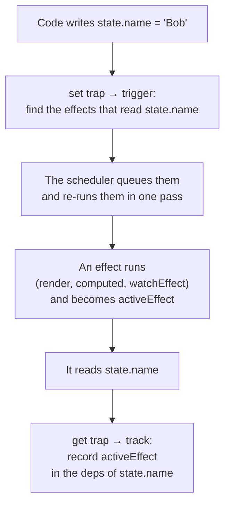

## What this lesson covers

Reactivity is the core of Vue: the template, `computed` and watchers re-run because Vue knows which data they read. This lesson covers the track and trigger mechanism, how `ref` and `reactive` work, why `reactive` returns a proxy, where reactivity is lost and how to get it back, `computed` and its cache, `shallowRef` and `readonly`. The examples run on Vue 3.5 in Node.js.

## ref and reactive

`ref(value)` keeps the value in its `.value` property. Reading `.value` registers a dependency of whatever is being computed right now (a template, a `computed`, a watcher), and writing notifies them. In a template you do not write `.value`: top-level refs are unwrapped automatically.

`reactive(obj)` returns a **proxy** of the object: it intercepts reads and writes of any property, including nested ones (nested objects are wrapped lazily on read). A `ref` holding an object does the same: it puts the result of `reactive` into `.value`.

```js run
import { reactive, ref, isReactive } from 'vue'

const original = { count: 0, nested: { deep: 1 } }
const state = reactive(original)

console.log('proxy, not the object:', state === original)
console.log('same proxy again:', reactive(original) === state)
console.log('nested is reactive:', isReactive(state.nested))

const user = ref({ name: 'Ann' })
console.log('ref wraps objects with reactive:', isReactive(user.value))

const warn = console.warn
console.warn = (message) => console.log('warning:', message.split('\n')[0])
console.log('reactive(0) returns', reactive(0))
console.warn = warn
```

```output
proxy, not the object: false
same proxy again: true
nested is reactive: true
ref wraps objects with reactive: true
warning: [Vue warn] value cannot be made reactive: 0
reactive(0) returns 0
```

- Vue does not see changes made through the **original object**: work with the proxy.
- `reactive` does not accept primitives: in development you get a warning and the original value, not an error. For primitives use `ref`.
- The docs recommend `ref` by default: `reactive` has more traps (below).

## How Vue learns about dependencies

Everything that re-runs when data changes (a component render, `computed`, `watch`, `watchEffect`) Vue calls an **effect**. The mechanism is two operations:



A simplified model you can explain in an interview:

```js run
// A tiny model of Vue reactivity: effects, track on read, trigger on write
let activeEffect = null
const deps = new WeakMap() // target → key → Set of effects

function track(target, key) {
  if (!activeEffect) return
  if (!deps.has(target)) deps.set(target, new Map())
  const byKey = deps.get(target)
  if (!byKey.has(key)) byKey.set(key, new Set())
  byKey.get(key).add(activeEffect)
}
function trigger(target, key) {
  deps.get(target)?.get(key)?.forEach((effect) => effect())
}
function reactive(obj) {
  return new Proxy(obj, {
    get(target, key, receiver) {
      track(target, key)
      return Reflect.get(target, key, receiver)
    },
    set(target, key, value, receiver) {
      const ok = Reflect.set(target, key, value, receiver)
      trigger(target, key)
      return ok
    },
  })
}
function effect(fn) {
  const run = () => {
    activeEffect = run
    try {
      fn()
    } finally {
      activeEffect = null
    }
  }
  run()
}

const state = reactive({ name: 'Ann', age: 30, unused: 0 })
effect(() => console.log(`render: ${state.name}, ${state.age}`))
state.age = 31 // tracked: the effect reran
state.unused = 1 // never read by the effect: nothing happens
state.name = 'Bob'
```

```output
render: Ann, 30
render: Ann, 31
render: Bob, 31
```

- **track** on read records the current effect in the deps of the "object + key" pair, **trigger** on write re-runs the recorded effects. That is why changing `unused` did nothing: nobody read it.
- Deps are collected again on every run, so they are **dynamic**: an `if` branch that did not run tracks nothing.
- `ref` works the same way but without a `Proxy`: it is an object with a `value` getter and setter that call track and trigger. That is why `ref` works with primitives and `reactive` does not (a proxy can only wrap an object).
- In real Vue effects are not re-run synchronously but through the scheduler (see the watchers lesson), and instead of a `Set`, 3.5 uses doubly linked lists and version counters (hence −56% memory). In 3.6 reactivity is being rewritten on top of alien-signals; the track/trigger model stays the same.

## Where reactivity is lost

Reactivity lives in the proxy and in `.value`. As soon as a value is "taken out" into a plain variable, the link is gone:

```js run
import { reactive, toRefs, watchEffect, nextTick } from 'vue'

const state = reactive({ count: 0, step: 1 })

let { count } = state // a plain number copied out of the proxy
const refs = toRefs(state) // refs linked to the proxy properties

watchEffect(() => console.log('effect sees', state.count, refs.count.value))
count++ // changes only the local variable
await nextTick()
refs.count.value = 5 // writes through to state.count
await nextTick()
console.log('local copy:', count, '| state:', state.count)
```

```output
effect sees 0 0
effect sees 5 5
local copy: 1 | state: 5
```

Typical places where it is lost:

- destructuring a `reactive`: `const { count } = state`; the fix is `toRefs(state)` or `toRef(state, 'count')`;
- passing a property into a function: `useThing(state.count)` passes a number, not a link; pass a ref or a getter `() => state.count`;
- replacing a whole `reactive`: `state = reactive({...})` breaks the link for everyone holding the old proxy; with a `ref` you can replace `.value` entirely;
- in `<script setup>`, destructuring `defineProps` **is reactive since Vue 3.5**: the compiler turns variable access into `props.x`.

## Ref unwrapping

- Templates unwrap **top-level** refs: `{{ count }}`, but `{{ obj.nested }}` for a ref inside a plain object is not unwrapped (it shows the ref object).
- Inside a `reactive`, refs are unwrapped on property access: `state.count` instead of `state.count.value`. In arrays and `Map`s they are not.

## computed

`computed(getter)` returns a read-only ref whose value is **lazy and cached**: the getter runs on the first read and again only after its dependencies change. Dependencies are dynamic: only what was read in the last call is tracked.

```js run
import { computed, ref } from 'vue'

const items = ref([3, 1, 2])
const showAll = ref(false)
let runs = 0
const visible = computed(() => {
  runs++
  const sorted = [...items.value].sort((a, b) => a - b)
  return showAll.value ? sorted : sorted.slice(0, 2)
})

console.log('created, runs:', runs)
console.log(visible.value, visible.value, 'runs:', runs)
items.value.push(0) // a mutation of the array inside the ref is tracked too
console.log(visible.value, 'runs:', runs)

const first = ref('Ann')
const last = ref('Lee')
const full = computed({
  get: () => `${first.value} ${last.value}`,
  set: (value) => ([first.value, last.value] = value.split(' ')),
})
full.value = 'Bob Ray'
console.log(first.value, '|', full.value)
```

```output
created, runs: 0
[ 1, 2 ] [ 1, 2 ] runs: 1
[ 0, 1 ] runs: 2
Bob | Bob Ray
```

- The getter must be pure: no requests, no writes to other refs, no mutation of the source data (`items.value.sort()` would sort the array itself, hence the copy).
- A `computed` cannot be async; for network data use `watch` or a data-fetching library.
- Since 3.4 a `computed` notifies dependents only if its result actually changed, and the getter receives the previous value as its first argument.

## shallowRef, readonly, markRaw

- `shallowRef` tracks only replacement of `.value`, not mutations inside: for large immutable structures and library instances. To update, assign a new object or call `triggerRef`.
- `shallowReactive` is reactive only at the top level.
- `readonly(obj)` returns a proxy that refuses writes (a warning in development); this is how a store or composable exposes state.
- `markRaw(obj)` excludes an object from reactivity for good (a map, an editor, large third-party objects).

## Key points

- An effect (render, `computed`, watcher) subscribes to data on read (track), and a write re-runs the subscribers (trigger).
- `ref` for any value (`.value` in code, none in templates), `reactive` for objects, returning a proxy.
- Changes through the original object are not tracked; `reactive(0)` gives a warning and 0.
- Destructuring and passing a property into a function lose reactivity; `toRefs`, `toRef` and getters help; `defineProps` destructures reactively since 3.5.
- `computed` is lazy, caches its result, has dynamic dependencies, and its getter is pure and synchronous.
- `shallowRef`, `readonly`, `markRaw` for large and foreign objects.
