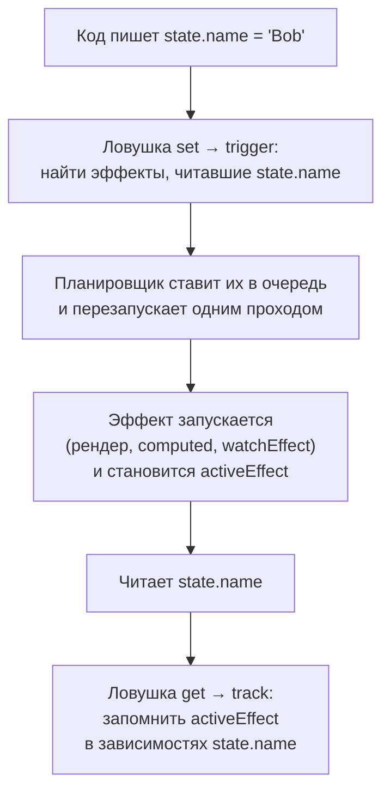

## О чём урок

Реактивность это основа Vue: шаблон, `computed` и наблюдатели перезапускаются, потому что Vue знает, какие данные они прочитали. Здесь механизм track и trigger, как устроены `ref` и `reactive`, почему `reactive` возвращает прокси, где теряется реактивность и как её вернуть, `computed` и его кэш, `shallowRef` и `readonly`. Примеры выполняются на Vue 3.5 в Node.js.

## ref и reactive

`ref(value)` хранит значение в свойстве `.value`. Чтение `.value` регистрирует зависимость у того, кто сейчас вычисляется (шаблон, `computed`, наблюдатель), запись уведомляет их. В шаблоне `.value` писать не нужно: ref верхнего уровня разворачивается автоматически.

`reactive(obj)` возвращает **прокси** объекта: перехватывает чтение и запись любых свойств, в том числе вложенных (вложенные объекты оборачиваются лениво при чтении). `ref` с объектом внутри делает то же: кладёт в `.value` результат `reactive`.

```js run
import { reactive, ref, isReactive } from 'vue'

const original = { count: 0, nested: { deep: 1 } }
const state = reactive(original)

console.log('proxy, not the object:', state === original)
console.log('same proxy again:', reactive(original) === state)
console.log('nested is reactive:', isReactive(state.nested))

const user = ref({ name: 'Ann' })
console.log('ref wraps objects with reactive:', isReactive(user.value))

const warn = console.warn
console.warn = (message) => console.log('warning:', message.split('\n')[0])
console.log('reactive(0) returns', reactive(0))
console.warn = warn
```

```output
proxy, not the object: false
same proxy again: true
nested is reactive: true
ref wraps objects with reactive: true
warning: [Vue warn] value cannot be made reactive: 0
reactive(0) returns 0
```

- Изменения через **исходный объект** Vue не видит: работать нужно с прокси.
- `reactive` не принимает примитивы: в разработке предупреждение и исходное значение, ошибки нет. Для примитивов `ref`.
- Документация рекомендует `ref` по умолчанию: у `reactive` больше ловушек (ниже).

## Как Vue узнаёт о зависимостях

Всё, что перезапускается при изменении данных (рендер компонента, `computed`, `watch`, `watchEffect`), Vue называет **эффектом**. Механизм состоит из двух операций:



Упрощённая модель, по которой это можно объяснить на собеседовании:

```js run
// A tiny model of Vue reactivity: effects, track on read, trigger on write
let activeEffect = null
const deps = new WeakMap() // target → key → Set of effects

function track(target, key) {
  if (!activeEffect) return
  if (!deps.has(target)) deps.set(target, new Map())
  const byKey = deps.get(target)
  if (!byKey.has(key)) byKey.set(key, new Set())
  byKey.get(key).add(activeEffect)
}
function trigger(target, key) {
  deps.get(target)?.get(key)?.forEach((effect) => effect())
}
function reactive(obj) {
  return new Proxy(obj, {
    get(target, key, receiver) {
      track(target, key)
      return Reflect.get(target, key, receiver)
    },
    set(target, key, value, receiver) {
      const ok = Reflect.set(target, key, value, receiver)
      trigger(target, key)
      return ok
    },
  })
}
function effect(fn) {
  const run = () => {
    activeEffect = run
    try {
      fn()
    } finally {
      activeEffect = null
    }
  }
  run()
}

const state = reactive({ name: 'Ann', age: 30, unused: 0 })
effect(() => console.log(`render: ${state.name}, ${state.age}`))
state.age = 31 // tracked: the effect reran
state.unused = 1 // never read by the effect: nothing happens
state.name = 'Bob'
```

```output
render: Ann, 30
render: Ann, 31
render: Bob, 31
```

- **track** при чтении записывает текущий эффект в зависимости пары «объект + ключ», **trigger** при записи перезапускает записанные эффекты. Поэтому изменение `unused` ничего не вызвало: его никто не читал.
- Зависимости собираются заново при каждом запуске, поэтому они **динамические**: ветка `if`, которая не выполнилась, ничего не отслеживает.
- `ref` устроен так же, но без `Proxy`: это объект с геттером и сеттером `value`, которые вызывают track и trigger. Поэтому `ref` работает с примитивами, а `reactive` нет (прокси можно создать только для объекта).
- В настоящем Vue эффекты перезапускаются не синхронно, а через планировщик (урок о наблюдателях), а вместо `Set` в 3.5 используются двусвязные списки и счётчики версий (отсюда −56% памяти). В 3.6 реактивность переписывается на основе alien-signals; модель track/trigger при этом та же.

## Где теряется реактивность

Реактивность живёт в прокси и в `.value`. Как только значение «достали» в обычную переменную, связь пропадает:

```js run
import { reactive, toRefs, watchEffect, nextTick } from 'vue'

const state = reactive({ count: 0, step: 1 })

let { count } = state // a plain number copied out of the proxy
const refs = toRefs(state) // refs linked to the proxy properties

watchEffect(() => console.log('effect sees', state.count, refs.count.value))
count++ // changes only the local variable
await nextTick()
refs.count.value = 5 // writes through to state.count
await nextTick()
console.log('local copy:', count, '| state:', state.count)
```

```output
effect sees 0 0
effect sees 5 5
local copy: 1 | state: 5
```

Типичные места потери:

- деструктуризация `reactive`: `const { count } = state`; решение `toRefs(state)` или `toRef(state, 'count')`;
- передача свойства в функцию: `useThing(state.count)` передаёт число, а не ссылку; передают ref или геттер `() => state.count`;
- замена всего `reactive`: `state = reactive({...})` ломает связь у всех, кто держал старый прокси; у `ref` можно заменить `.value` целиком;
- в `<script setup>` деструктуризация `defineProps` **реактивна с Vue 3.5**: компилятор превращает обращения к переменным в `props.x`.

## Разворачивание ref

- В шаблоне разворачиваются ref **верхнего уровня**: `{{ count }}`, но `{{ obj.nested }}` для ref внутри обычного объекта не развернётся (покажет объект ref).
- Внутри `reactive` ref разворачиваются при доступе к свойству: `state.count` вместо `state.count.value`. В массивах и `Map` не разворачиваются.

## computed

`computed(getter)` возвращает ref только для чтения, значение которого **ленивое и кэшируемое**: геттер выполняется при первом чтении и снова только после изменения зависимостей. Зависимости динамические: отслеживается только то, что прочитано в последнем вызове.

```js run
import { computed, ref } from 'vue'

const items = ref([3, 1, 2])
const showAll = ref(false)
let runs = 0
const visible = computed(() => {
  runs++
  const sorted = [...items.value].sort((a, b) => a - b)
  return showAll.value ? sorted : sorted.slice(0, 2)
})

console.log('created, runs:', runs)
console.log(visible.value, visible.value, 'runs:', runs)
items.value.push(0) // a mutation of the array inside the ref is tracked too
console.log(visible.value, 'runs:', runs)

const first = ref('Ann')
const last = ref('Lee')
const full = computed({
  get: () => `${first.value} ${last.value}`,
  set: (value) => ([first.value, last.value] = value.split(' ')),
})
full.value = 'Bob Ray'
console.log(first.value, '|', full.value)
```

```output
created, runs: 0
[ 1, 2 ] [ 1, 2 ] runs: 1
[ 0, 1 ] runs: 2
Bob | Bob Ray
```

- Геттер должен быть чистым: без запросов, записи в другие ref и мутации исходных данных (`items.value.sort()` отсортировал бы сам массив, поэтому копия).
- Асинхронным `computed` быть не может; для данных из сети это `watch` или библиотека запросов.
- С 3.4 `computed` уведомляет зависимых, только если результат действительно изменился, а геттер получает прошлое значение первым аргументом.

## shallowRef, readonly, markRaw

- `shallowRef` отслеживает только замену `.value`, а не мутации внутри: для больших неизменяемых структур и экземпляров библиотек. Обновление: присвоить новый объект или вызвать `triggerRef`.
- `shallowReactive` реактивен только на верхнем уровне.
- `readonly(obj)` возвращает прокси, запись в который запрещена (в разработке предупреждение); так стор или composable отдаёт состояние наружу.
- `markRaw(obj)` навсегда исключает объект из реактивности (карта, редактор, большие сторонние объекты).

## Главное

- Эффект (рендер, `computed`, наблюдатель) при чтении подписывается на данные (track), запись перезапускает подписчиков (trigger).
- `ref` для любых значений (`.value` в коде, без него в шаблоне), `reactive` для объектов, возвращает прокси.
- Изменения через исходный объект не отслеживаются; `reactive(0)` даёт предупреждение и 0.
- Деструктуризация и передача свойства в функцию теряют реактивность; помогают `toRefs`, `toRef`, геттеры; `defineProps` с 3.5 деструктурируется реактивно.
- `computed` ленивый, кэширует результат, зависимости динамические, геттер чистый и синхронный.
- `shallowRef`, `readonly`, `markRaw` для больших и чужих объектов.
