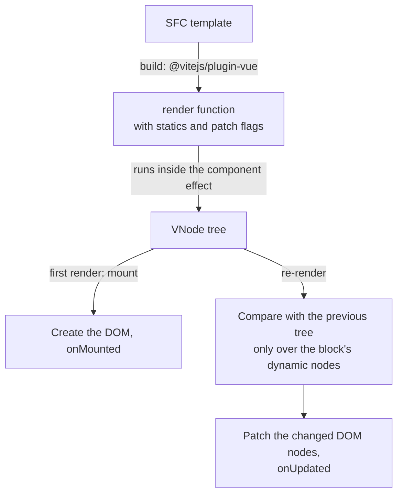

## What this lesson covers

How Vue turns a template into DOM and why it needs almost no manual optimization: the compiler marks what in a template can change, a component's render is tied to its reactive dependencies, and updates are collected into one pass. This lesson shows the real output of the Vue 3.5 compiler, a comparison with React, `v-memo` and `v-once`, keys, and Vapor Mode from Vue 3.6.

## Template → render function → Virtual DOM → DOM



1. **Compilation.** The template becomes a render function. In a Vite project this happens at build time (the `@vitejs/plugin-vue` plugin); the compiler never reaches the browser. Compiling on the fly is needed only by the full Vue build with string templates.
2. **Render.** The render function runs inside the component's reactive effect and returns a tree of VNodes; everything reactive it read becomes the component's dependencies.
3. **Patch.** The new tree is compared with the old one, and the difference goes into the DOM.

What sets Vue apart from a "pure" Virtual DOM is that the compiler knows the template in advance and gives the runtime hints:

```js run
import { compileTemplate } from 'vue/compiler-sfc'

const { code } = compileTemplate({
  id: 'demo',
  filename: 'Demo.vue',
  source: `<div class="card"><h2>Static title</h2><p :class="tone">{{ message }}</p><button @click="count++">+</button></div>`,
})
console.log(code.slice(code.indexOf('export function render')))
```

```output
export function render(_ctx, _cache) {
  return (_openBlock(), _createElementBlock("div", _hoisted_1, [
    _cache[1] || (_cache[1] = _createElementVNode("h2", null, "Static title", -1 /* CACHED */)),
    _createElementVNode("p", {
      class: _normalizeClass(_ctx.tone)
    }, _toDisplayString(_ctx.message), 3 /* TEXT, CLASS */),
    _createElementVNode("button", {
      onClick: _cache[0] || (_cache[0] = $event => (_ctx.count++))
    }, "+")
  ]))
}
```

- **Static content is cached**: `<h2>` is created once and marked `CACHED`, and it is not compared on updates; the `class="card"` attributes are hoisted into the constant `_hoisted_1`.
- **Patch flags**: the `3 /* TEXT, CLASS */` flag on `<p>` tells the runtime to compare only the text and the class, not every attribute.
- **Handlers are cached** (`_cache[0]`), so a child component does not get a "new function" on every render.
- **Blocks** (`openBlock`, `createElementBlock`) collect dynamic nodes into a flat list: on update Vue walks only them, not the whole tree.

## Which components render

Every component is a separate reactive effect. It renders again only if the data it read during its own render changed, or its props changed (compared shallowly). A parent's render does **not** re-render its children automatically, unlike React:

```js dom
import { createApp, defineComponent, h, nextTick, ref } from 'vue'

let childRenders = 0
const Child = defineComponent({
  props: { label: String },
  setup: (props) => () => (childRenders++, h('span', props.label)),
})

let parentRenders = 0
const count = ref(0)
const label = ref('A')
const Parent = defineComponent({
  setup: () => () => (parentRenders++, h('div', [h('b', count.value), h(Child, { label: label.value })])),
})

createApp(Parent).mount(document.createElement('div'))
count.value++
count.value++
await nextTick()
console.log('after count changes:', { parentRenders, childRenders })
label.value = 'B'
await nextTick()
console.log('after label change:', { parentRenders, childRenders })
```

```output
after count changes: { parentRenders: 2, childRenders: 1 }
after label change: { parentRenders: 3, childRenders: 2 }
```

- Two changes to `count` gave one extra render of the parent: the scheduler collects updates into one pass (a microtask), like watchers.
- The child did not render until its `label` prop changed. Vue does not need an equivalent of `React.memo`.
- New objects and functions in props still make the child update: `:options="{ a: 1 }"` in a template creates an object on every render; such values go into a `computed` or a constant.

## What causes a re-render and what does not

```js dom
import { createApp, nextTick, reactive } from 'vue'

let renders = 0
let plain = 0
const state = reactive({ shown: 'a', hidden: 'x' })
const el = document.createElement('div')
const vm = createApp({
  render() {
    renders++
    return `${state.shown} / plain ${plain}`
  },
}).mount(el)

state.hidden = 'y' // reactive, but the render never read it
plain++ // not reactive at all
await nextTick()
console.log('after hidden and plain changes:', renders, '|', el.textContent)
state.shown = 'b'
await nextTick()
console.log('after shown change:', renders, '|', el.textContent)
vm.$forceUpdate() // escape hatch: re-render without a reactive change
await nextTick()
console.log('after $forceUpdate:', renders)
```

```output
after hidden and plain changes: 1 | a / plain 0
after shown change: 2 | b / plain 1
after $forceUpdate: 3
```

| Causes a component render | Does not |
|---|---|
| A change to a `ref`/`reactive` read **during this render** | A change to reactive data the render did not read (`state.hidden`) |
| A change to a `computed` read during render, if its value really changed | A change to plain variables (`let plain`): Vue does not know about them |
| New prop values (shallow comparison) or slots | A parent render, if the child's props did not change |
| `$forceUpdate()` (an escape hatch) | Mutating the original object, bypassing the `reactive` proxy |

The plain variable reached the screen (`plain 1`) only because a render happened for another reason. This is what the "data changed but the screen did not" bug looks like: the state is not reactive. The right fix is to make it a `ref`, not to call `$forceUpdate` (in `<script setup>` you would also have to reach the instance through `getCurrentInstance`, which is not meant for application code).

## Manual hints

- `v-once` renders an element once and never updates it.
- `v-memo="[item.id === selectedId]"` skips updating a subtree until the values in the array change; it is used in large `v-for` lists where a selection changes a couple of rows out of a thousand.
- `shallowRef` and `markRaw` for large structures that do not need per-item tracking.
- Keys in `v-for` come from data: without them Vue reuses elements by position (in-place patch), and input state "slides".
- Heavy parts move into async components, long lists are virtualized (for example `useVirtualList` from VueUse).

## Vapor Mode (Vue 3.6)

Vue 3.6, currently a release candidate, adds **Vapor Mode**: an optional SFC compilation mode without a Virtual DOM. The template compiles into code that creates the DOM directly and binds fine-grained updates to reactive values, as in Solid or Svelte. The goal is a smaller baseline bundle and faster updates. The mode is enabled per component (`<script setup vapor>`), supports a subset of the API, and can be mixed with regular components. The same release rewrites reactivity on top of the alien-signals library. It is not a stable release yet: production apps use 3.5.

## Key points

- Templates are compiled at build time; the render function runs in the component's reactive effect.
- The compiler caches static content and handlers, sets patch flags and collects dynamic nodes into blocks.
- A component re-renders only because of its own dependencies or changed props; children do not render along with the parent.
- Data not read during render and non-reactive data do not trigger a render; `$forceUpdate` hides non-reactive state.
- Updates are batched into one pass; `v-once`, `v-memo`, `shallowRef` for special cases.
- Vapor Mode in 3.6 (RC) removes the Virtual DOM for chosen components.
