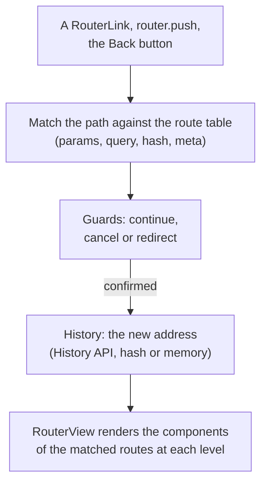
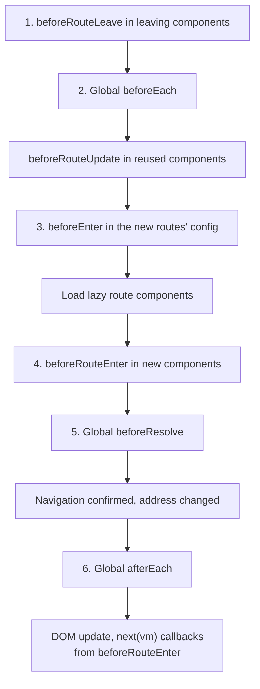

## What this lesson covers

Vue Router 5 in full: creating the router and history modes, matching paths with params, nested routes, the complete order of guards during navigation, component reuse on a param change, navigation failures, lazy pages, scrolling, and file-based routing, which became part of the core in version 5. The examples run on Vue Router 5.4.

## How the router works



`createRouter({ history, routes })` and `app.use(router)`. History modes:

| History | Address | When |
|---|---|---|
| `createWebHistory()` | `/orders/42` | The usual choice; the server must return `index.html` for any path, or a page reload gives 404 |
| `createWebHashHistory()` | `/#/orders/42` | Static hosting with no server setup; worse for SEO |
| `createMemoryHistory()` | no address bar | SSR, tests, embedded widgets |

## Guards and protected routes

```js dom
import { createApp, nextTick } from 'vue'
import { createMemoryHistory, createRouter, RouterView } from 'vue-router'

const session = { user: null }

const router = createRouter({
  history: createMemoryHistory(),
  routes: [
    { path: '/login', component: { template: `<p>Login page</p>` } },
    {
      path: '/orders/:id',
      component: { props: ['id'], template: `<p>Order {{ id }}</p>` },
      props: true, // route params become component props
      meta: { requiresAuth: true },
    },
  ],
})

router.beforeEach((to) => {
  if (to.meta.requiresAuth && !session.user) return { path: '/login', query: { redirect: to.fullPath } }
})

const el = document.createElement('div')
createApp({ components: { RouterView }, template: `<RouterView />` }).use(router).mount(el)

await router.push('/orders/42')
await nextTick()
console.log(router.currentRoute.value.fullPath, '→', el.textContent)

session.user = 'ann'
await router.push('/orders/42')
await nextTick()
console.log(router.currentRoute.value.fullPath, '→', el.textContent)
```

```output
/login?redirect=/orders/42 → Login page
/orders/42 → Order 42
```

- A guard returns a **route** to redirect, `false` to cancel, or nothing (`undefined`, `true`) to continue. It can be `async`. The third argument `next()` from Vue Router 3 is not needed in new code.
- `props: true` passes path params as props, so the component does not depend on `useRoute()`; there are object and function forms `props: (route) => ({ ... })`.
- `meta` holds arbitrary route data (`requiresAuth`, `title`, roles); for nested routes `to.meta` merges the `meta` of all levels. Type it by extending the `RouteMeta` interface in `declare module 'vue-router'`.
- A permission check in a guard improves the UI but does not protect data: the server checks permissions on every request.

## The full navigation order

```js dom
import { createApp, nextTick } from 'vue'
import { createMemoryHistory, createRouter, RouterView } from 'vue-router'

const log = (step) => console.log(step)
const Home = {
  template: `<p>Home</p>`,
  beforeRouteLeave() {
    log('1. beforeRouteLeave (Home)')
  },
}
const User = {
  props: ['id'],
  template: `<p>User {{ id }}</p>`,
  beforeRouteEnter() {
    log('4. beforeRouteEnter (User): no `this` yet')
  },
  beforeRouteUpdate(to) {
    log(`beforeRouteUpdate (User): same instance, id → ${to.params.id}`)
  },
}

const router = createRouter({
  history: createMemoryHistory(),
  routes: [
    { path: '/', component: Home },
    { path: '/users/:id', component: User, props: true, beforeEnter: () => log('3. beforeEnter (route)') },
  ],
})
router.beforeEach((to) => log(`2. beforeEach → ${to.fullPath}`))
router.beforeResolve(() => log('5. beforeResolve'))
router.afterEach((to) => log(`6. afterEach ${to.fullPath}: navigation confirmed`))

const el = document.createElement('div')
createApp({ components: { RouterView }, template: `<RouterView />` }).use(router).mount(el)
await router.isReady()
console.log('--- push /users/1')
await router.push('/users/1')
console.log('--- push /users/2')
await router.push('/users/2')
await nextTick()
console.log(el.textContent)
```

```output
2. beforeEach → /
5. beforeResolve
6. afterEach /: navigation confirmed
--- push /users/1
1. beforeRouteLeave (Home)
2. beforeEach → /users/1
3. beforeEnter (route)
4. beforeRouteEnter (User): no `this` yet
5. beforeResolve
6. afterEach /users/1: navigation confirmed
--- push /users/2
2. beforeEach → /users/2
beforeRouteUpdate (User): same instance, id → 2
5. beforeResolve
6. afterEach /users/2: navigation confirmed
User 2
```



- The initial navigation to `/` at startup goes through the same global guards; wait for it with `await router.isReady()` (important for SSR and tests).
- **Navigating `/users/1` → `/users/2` reuses the `User` instance**: the component is not recreated, the route's `beforeEnter` is not called (it runs only when entering the route), and `beforeRouteUpdate` is. If the component loads data in `setup`, it will not load user 2. Fixes: `watch(() => route.params.id, load, { immediate: true })`, `onBeforeRouteUpdate`, or `<RouterView :key="$route.fullPath" />` to recreate the component.
- `beforeRouteEnter` runs before the component is created, so there is no `this`. The Composition API has no equivalent; it has `onBeforeRouteLeave` and `onBeforeRouteUpdate`.
- `beforeResolve` suits a last check once all lazy components are loaded (for example, asking for camera permission); `afterEach` cannot cancel navigation: analytics, the page title, focus.

## Paths, params and navigation failures

```js run
import { createMemoryHistory, createRouter, isNavigationFailure, NavigationFailureType } from 'vue-router'

const page = { render: () => null }
const router = createRouter({
  history: createMemoryHistory(),
  routes: [
    { path: '/', component: page },
    { path: '/docs/:section?', name: 'docs', component: page }, // optional param
    { path: '/files/:path+', component: page }, // one or more segments
    { path: '/orders/:id(\\d+)', name: 'order', component: page }, // digits only
    { path: '/orders/new', component: page },
    { path: '/:pathMatch(.*)*', name: 'not-found', component: page }, // catch-all
  ],
})
for (const path of ['/docs', '/docs/api', '/files/a/b/c', '/orders/42', '/orders/new', '/orders/abc'])
  console.log(path.padEnd(13), '→', String(router.resolve(path).matched[0].path).padEnd(18), JSON.stringify(router.resolve(path).params))
console.log(router.resolve({ name: 'order', params: { id: 7 }, query: { tab: 'items' } }).fullPath)

router.beforeEach((to) => (to.path === '/orders/new' ? false : undefined))
await router.push('/')
const duplicated = await router.push('/')
const aborted = await router.push('/orders/new')
console.log('duplicated:', isNavigationFailure(duplicated, NavigationFailureType.duplicated))
console.log('aborted:', isNavigationFailure(aborted, NavigationFailureType.aborted), '| still at', router.currentRoute.value.path)
```

```output
/docs         → /docs/:section?    {}
/docs/api     → /docs/:section?    {"section":"api"}
/files/a/b/c  → /files/:path+      {"path":["a","b","c"]}
/orders/42    → /orders/:id(\d+)   {"id":"42"}
/orders/new   → /orders/new        {}
/orders/abc   → /:pathMatch(.*)*   {"pathMatch":["orders","abc"]}
/orders/7?tab=items
duplicated: true
aborted: true | still at /
```

- Params: `:id` required, `:id?` optional, `:path+` one or more segments (an array), `:path*` zero or more, `:id(\\d+)` with a regular expression. All values are strings: `id: 7` became `'7'` in the address.
- Declaration order does not matter: the router ranks paths by specificity, so the static `/orders/new` beats `/orders/:id`, and `/:pathMatch(.*)*` (the 404 page) matches last.
- Navigating by name (`{ name: 'order', params }`) survives URL changes and is type-checked with file-based routing.
- `router.push` returns a promise: `undefined` on success or a **navigation failure** if a guard cancelled it (`aborted`), a new navigation started before it finished (`cancelled`), or the address did not change (`duplicated`). No exception is thrown, so check the result with `isNavigationFailure`.
- `router.replace` adds no history entry, `router.go(-1)` goes back. `RouterLink` adds the classes `router-link-active` (the link points to the current route or its parent) and `router-link-exact-active`, plus `aria-current="page"`.

## Nested routes, lazy pages, scrolling

```ts
const routes = [
  {
    path: '/settings',
    component: () => import('./SettingsLayout.vue'), // its own chunk, loaded on first visit
    meta: { requiresAuth: true },
    children: [
      { path: '', name: 'settings', component: () => import('./SettingsProfile.vue') }, // /settings
      { path: 'billing', component: () => import('./SettingsBilling.vue') }, // /settings/billing
    ],
  },
  { path: '/', components: { default: Home, sidebar: Promo } }, // named views: <RouterView name="sidebar" />
  { path: '/home', redirect: '/' },
]

const router = createRouter({
  history: createWebHistory(),
  routes,
  scrollBehavior(to, from, saved) {
    if (saved) return saved // back/forward keeps the old position
    if (to.hash) return { el: to.hash, behavior: 'smooth' }
    return { top: 0 }
  },
})
```

- `SettingsLayout` contains its own `<RouterView />`, which renders the child route: each `matched` level is rendered by its own `RouterView`.
- `component: () => import(...)` creates a separate chunk per page; `defineAsyncComponent` is not needed for routes.
- `router.addRoute()` and `removeRoute()` add routes at runtime (plugins, role-based routes from the server).
- In a component: `useRoute()` (the current route, a reactive object; do not destructure it), `useRouter()` (navigation), `useLink()` for a custom link.

## File-based routing in Vue Router 5

**Vue Router 5** (January 2026) moved file-based routing from `unplugin-vue-router` into the core: the plugin from `vue-router/vite` builds routes from files in `src/pages` (`users/[id].vue` gives `/users/:id`, `[...path].vue` a 404 page), generates types for names and params, and `definePage()` in a component sets `meta` and the name. For a hand-written route table like the one above there are no breaking changes compared to Vue Router 4. Nuxt uses the same scheme in `app/pages`.

## Key points

- History: `createWebHistory` (needs a server fallback), hash for static hosting, memory for SSR and tests.
- Guards return a route, `false` or nothing; no `next()`; `meta` for rules, the server still checks permissions.
- Order: `beforeRouteLeave` → `beforeEach` → `beforeRouteUpdate` → `beforeEnter` → lazy components → `beforeRouteEnter` → `beforeResolve` → confirmation → `afterEach`.
- A param change reuses the component: watch `route.params` or change the `key`.
- Params `?`, `+`, `*`, regular expressions; ranking by specificity; `/:pathMatch(.*)*` for 404.
- `push` returns a navigation failure instead of throwing: `isNavigationFailure`.
- Nested routes render their own `RouterView`, pages load through `() => import()`, `scrollBehavior` controls scrolling; file-based routing is now in the core.
