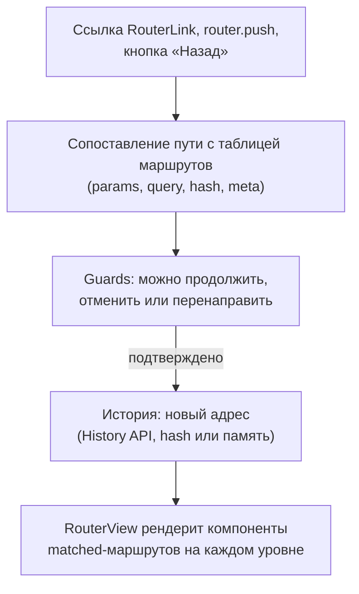
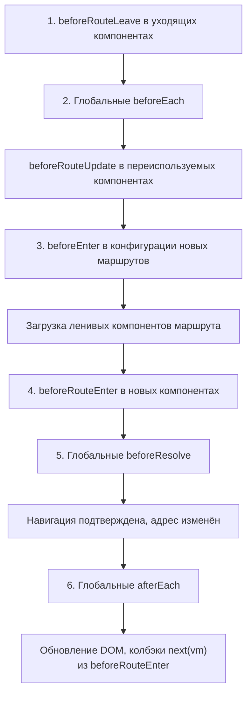

## О чём урок

Vue Router 5 целиком: создание роутера и режимы истории, сопоставление путей с параметрами, вложенные маршруты, полный порядок guards при навигации, переиспользование компонента при смене параметра, ошибки навигации, ленивые страницы, прокрутка и файловый роутинг, который в версии 5 стал частью ядра. Примеры выполняются на Vue Router 5.4.

## Как устроен роутер



`createRouter({ history, routes })` и `app.use(router)`. Режимы истории:

| История | Адрес | Когда |
|---|---|---|
| `createWebHistory()` | `/orders/42` | Обычный выбор; сервер должен отдавать `index.html` на любой путь, иначе обновление страницы даст 404 |
| `createWebHashHistory()` | `/#/orders/42` | Статический хостинг без настройки сервера; хуже для SEO |
| `createMemoryHistory()` | без адресной строки | SSR, тесты, встраиваемые виджеты |

## Guards и защита маршрутов

```js dom
import { createApp, nextTick } from 'vue'
import { createMemoryHistory, createRouter, RouterView } from 'vue-router'

const session = { user: null }

const router = createRouter({
  history: createMemoryHistory(),
  routes: [
    { path: '/login', component: { template: `<p>Login page</p>` } },
    {
      path: '/orders/:id',
      component: { props: ['id'], template: `<p>Order {{ id }}</p>` },
      props: true, // route params become component props
      meta: { requiresAuth: true },
    },
  ],
})

router.beforeEach((to) => {
  if (to.meta.requiresAuth && !session.user) return { path: '/login', query: { redirect: to.fullPath } }
})

const el = document.createElement('div')
createApp({ components: { RouterView }, template: `<RouterView />` }).use(router).mount(el)

await router.push('/orders/42')
await nextTick()
console.log(router.currentRoute.value.fullPath, '→', el.textContent)

session.user = 'ann'
await router.push('/orders/42')
await nextTick()
console.log(router.currentRoute.value.fullPath, '→', el.textContent)
```

```output
/login?redirect=/orders/42 → Login page
/orders/42 → Order 42
```

- Guard возвращает **маршрут** для перенаправления, `false` для отмены или ничего (`undefined`, `true`) для продолжения. Может быть `async`. Третий аргумент `next()` из Vue Router 3 в новом коде не нужен.
- `props: true` передаёт параметры пути в пропсы, и компонент не зависит от `useRoute()`; есть формы объектом и функцией `props: (route) => ({ ... })`.
- `meta` хранит произвольные данные маршрута (`requiresAuth`, `title`, роли); у вложенных маршрутов `to.meta` объединяет `meta` всех уровней. Тип задают расширением интерфейса `RouteMeta` в `declare module 'vue-router'`.
- Проверка прав в guard улучшает интерфейс, но не защищает данные: сервер проверяет права на каждом запросе.

## Полный порядок навигации

```js dom
import { createApp, nextTick } from 'vue'
import { createMemoryHistory, createRouter, RouterView } from 'vue-router'

const log = (step) => console.log(step)
const Home = {
  template: `<p>Home</p>`,
  beforeRouteLeave() {
    log('1. beforeRouteLeave (Home)')
  },
}
const User = {
  props: ['id'],
  template: `<p>User {{ id }}</p>`,
  beforeRouteEnter() {
    log('4. beforeRouteEnter (User): no `this` yet')
  },
  beforeRouteUpdate(to) {
    log(`beforeRouteUpdate (User): same instance, id → ${to.params.id}`)
  },
}

const router = createRouter({
  history: createMemoryHistory(),
  routes: [
    { path: '/', component: Home },
    { path: '/users/:id', component: User, props: true, beforeEnter: () => log('3. beforeEnter (route)') },
  ],
})
router.beforeEach((to) => log(`2. beforeEach → ${to.fullPath}`))
router.beforeResolve(() => log('5. beforeResolve'))
router.afterEach((to) => log(`6. afterEach ${to.fullPath}: navigation confirmed`))

const el = document.createElement('div')
createApp({ components: { RouterView }, template: `<RouterView />` }).use(router).mount(el)
await router.isReady()
console.log('--- push /users/1')
await router.push('/users/1')
console.log('--- push /users/2')
await router.push('/users/2')
await nextTick()
console.log(el.textContent)
```

```output
2. beforeEach → /
5. beforeResolve
6. afterEach /: navigation confirmed
--- push /users/1
1. beforeRouteLeave (Home)
2. beforeEach → /users/1
3. beforeEnter (route)
4. beforeRouteEnter (User): no `this` yet
5. beforeResolve
6. afterEach /users/1: navigation confirmed
--- push /users/2
2. beforeEach → /users/2
beforeRouteUpdate (User): same instance, id → 2
5. beforeResolve
6. afterEach /users/2: navigation confirmed
User 2
```



- Первая навигация на `/` при запуске проходит те же глобальные guards; дождаться её можно `await router.isReady()` (важно при SSR и в тестах).
- **Переход `/users/1` → `/users/2` переиспользует экземпляр** `User`: компонент не пересоздаётся, `beforeEnter` маршрута не вызывается (он срабатывает только при входе на маршрут), а вызывается `beforeRouteUpdate`. Если компонент загружает данные в `setup`, он не загрузит пользователя 2. Решения: `watch(() => route.params.id, load, { immediate: true })`, `onBeforeRouteUpdate`, или `<RouterView :key="$route.fullPath" />`, чтобы пересоздавать компонент.
- `beforeRouteEnter` выполняется до создания компонента, поэтому `this` нет. В Composition API аналога нет; есть `onBeforeRouteLeave` и `onBeforeRouteUpdate`.
- `beforeResolve` удобен для последней проверки, когда все ленивые компоненты уже загружены (например, запросить разрешение камеры); `afterEach` не может отменить навигацию: аналитика, заголовок страницы, фокус.

## Пути, параметры и ошибки навигации

```js run
import { createMemoryHistory, createRouter, isNavigationFailure, NavigationFailureType } from 'vue-router'

const page = { render: () => null }
const router = createRouter({
  history: createMemoryHistory(),
  routes: [
    { path: '/', component: page },
    { path: '/docs/:section?', name: 'docs', component: page }, // optional param
    { path: '/files/:path+', component: page }, // one or more segments
    { path: '/orders/:id(\\d+)', name: 'order', component: page }, // digits only
    { path: '/orders/new', component: page },
    { path: '/:pathMatch(.*)*', name: 'not-found', component: page }, // catch-all
  ],
})
for (const path of ['/docs', '/docs/api', '/files/a/b/c', '/orders/42', '/orders/new', '/orders/abc'])
  console.log(path.padEnd(13), '→', String(router.resolve(path).matched[0].path).padEnd(18), JSON.stringify(router.resolve(path).params))
console.log(router.resolve({ name: 'order', params: { id: 7 }, query: { tab: 'items' } }).fullPath)

router.beforeEach((to) => (to.path === '/orders/new' ? false : undefined))
await router.push('/')
const duplicated = await router.push('/')
const aborted = await router.push('/orders/new')
console.log('duplicated:', isNavigationFailure(duplicated, NavigationFailureType.duplicated))
console.log('aborted:', isNavigationFailure(aborted, NavigationFailureType.aborted), '| still at', router.currentRoute.value.path)
```

```output
/docs         → /docs/:section?    {}
/docs/api     → /docs/:section?    {"section":"api"}
/files/a/b/c  → /files/:path+      {"path":["a","b","c"]}
/orders/42    → /orders/:id(\d+)   {"id":"42"}
/orders/new   → /orders/new        {}
/orders/abc   → /:pathMatch(.*)*   {"pathMatch":["orders","abc"]}
/orders/7?tab=items
duplicated: true
aborted: true | still at /
```

- Параметры: `:id` обязательный, `:id?` необязательный, `:path+` один и больше сегментов (массив), `:path*` ноль и больше, `:id(\\d+)` с регулярным выражением. Все значения строки: `id: 7` превратился в `'7'` в адресе.
- Порядок объявления не важен: роутер ранжирует пути по специфичности, поэтому статический `/orders/new` выигрывает у `/orders/:id`, а `/:pathMatch(.*)*` (страница 404) срабатывает последним.
- Навигация по имени (`{ name: 'order', params }`) не ломается при смене адресов и проверяется типами при файловом роутинге.
- `router.push` возвращает промис: `undefined` при успехе или **ошибку навигации** (navigation failure), если guard отменил её (`aborted`), до её завершения началась новая (`cancelled`) или адрес не изменился (`duplicated`). Исключение не бросается, поэтому проверяют результат через `isNavigationFailure`.
- `router.replace` не добавляет запись в историю, `router.go(-1)` идёт назад. `RouterLink` добавляет классы `router-link-active` (ссылка ведёт на текущий маршрут или его родителя) и `router-link-exact-active`, а также `aria-current="page"`.

## Вложенные маршруты, ленивые страницы, прокрутка

```ts
const routes = [
  {
    path: '/settings',
    component: () => import('./SettingsLayout.vue'), // its own chunk, loaded on first visit
    meta: { requiresAuth: true },
    children: [
      { path: '', name: 'settings', component: () => import('./SettingsProfile.vue') }, // /settings
      { path: 'billing', component: () => import('./SettingsBilling.vue') }, // /settings/billing
    ],
  },
  { path: '/', components: { default: Home, sidebar: Promo } }, // named views: <RouterView name="sidebar" />
  { path: '/home', redirect: '/' },
]

const router = createRouter({
  history: createWebHistory(),
  routes,
  scrollBehavior(to, from, saved) {
    if (saved) return saved // back/forward keeps the old position
    if (to.hash) return { el: to.hash, behavior: 'smooth' }
    return { top: 0 }
  },
})
```

- `SettingsLayout` содержит свой `<RouterView />`, в который рендерится дочерний маршрут: каждый уровень `matched` рендерится своим `RouterView`.
- `component: () => import(...)` создаёт отдельный чанк на страницу; `defineAsyncComponent` для маршрутов не нужен.
- `router.addRoute()` и `removeRoute()` добавляют маршруты во время работы (плагины, маршруты по ролям с сервера).
- В компоненте: `useRoute()` (текущий маршрут, реактивный объект; деструктурировать его нельзя), `useRouter()` (навигация), `useLink()` для своей ссылки.

## Файловый роутинг в Vue Router 5

**Vue Router 5** (январь 2026) перенёс в ядро файловый роутинг из `unplugin-vue-router`: плагин из `vue-router/vite` строит маршруты по файлам в `src/pages` (`users/[id].vue` даёт `/users/:id`, `[...path].vue` страницу 404), генерирует типы имён и параметров, а `definePage()` в компоненте задаёт `meta` и имя. Для ручной таблицы маршрутов, как выше, ломающих изменений по сравнению с Vue Router 4 нет. Nuxt использует ту же схему в `app/pages`.

## Главное

- История: `createWebHistory` (нужен fallback на сервере), hash для статики, memory для SSR и тестов.
- Guards возвращают маршрут, `false` или ничего; `next()` не нужен; `meta` для правил, сервер всё равно проверяет права.
- Порядок: `beforeRouteLeave` → `beforeEach` → `beforeRouteUpdate` → `beforeEnter` → ленивые компоненты → `beforeRouteEnter` → `beforeResolve` → подтверждение → `afterEach`.
- Смена параметра переиспользует компонент: следить за `route.params` или менять `key`.
- Параметры `?`, `+`, `*`, регулярные выражения; ранжирование по специфичности; `/:pathMatch(.*)*` для 404.
- `push` возвращает ошибку навигации, а не бросает её: `isNavigationFailure`.
- Вложенные маршруты рендерят свои `RouterView`, страницы грузятся через `() => import()`, `scrollBehavior` управляет прокруткой; файловый роутинг теперь в ядре.
