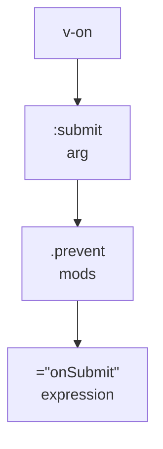
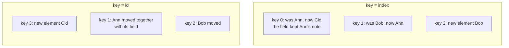
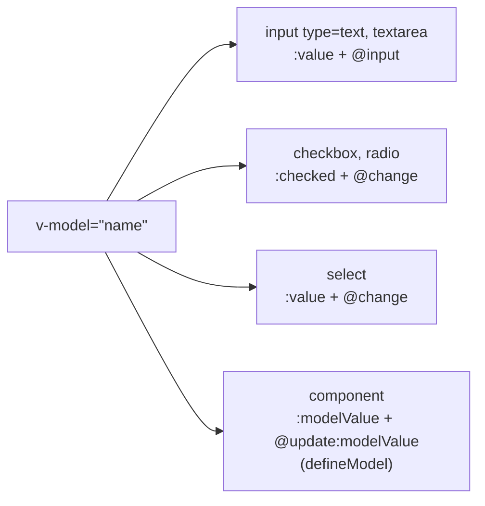

## What this lesson covers

Everything you write in a Vue template: interpolation and expressions, binding attributes, classes and styles, conditions and lists with keys, events with modifiers, `v-model` on form fields, the other built-in directives and custom directives. The templates run in jsdom on Vue 3.5 and are compiled at runtime; in a Vite project the same happens at build time.

## Anatomy of a directive

A directive is a `v-` prefixed attribute that Vue turns into render code. It has four parts:



- **Shorthands**: `:href` for `v-bind:href`, `@click` for `v-on:click`, `#header` for `v-slot:header`. Since 3.4, `:id` with no value means `:id="id"`.
- **Dynamic argument**: `:[attrName]="value"`, `@[eventName]="handler"`.
- **The value** is a single JavaScript expression, not a statement: `{{ ok ? 'Yes' : 'No' }}` works, `{{ if (ok) ... }}` does not. Only an allowlist of globals is available (`Math`, `Date`, `JSON` and others); add your own through `app.config.globalProperties`.
- `{{ }}` interpolation **escapes** HTML: the string `` is shown as text. That is why Vue templates are protected from XSS by default, except for `v-html` (below).

## Bindings, conditions and lists

```js dom
import { createApp, nextTick } from 'vue'

const el = document.createElement('div')
const vm = createApp({
  data: () => ({ status: 'error', active: true, size: 14, user: { name: 'Ann', role: 'admin' } }),
  template: `
    <p :class="['badge', status, { active }]" :style="{ fontSize: size + 'px' }">{{ status.toUpperCase() }}</p>
    <b v-if="status === 'ok'">fine</b>
    <b v-else-if="status === 'error'">broken</b>
    <b v-else>unknown</b>
    <i v-show="!active">hidden by display</i>
    <span v-for="(value, key, index) in user" :key="key">{{ index }}:{{ key }}={{ value }} </span>
    <em v-for="n in 3" :key="n">{{ n }}</em>`,
}).mount(el)
console.log(el.innerHTML.replace(/<!--v-if-->/g, '').replace(/\s+</g, '<'))
vm.status = 'ok'
vm.active = false
await nextTick()
console.log(el.querySelector('p').className, '|', el.querySelector('b').textContent, '|', el.querySelector('i').style.display)
```

```output
<p class="badge error active" style="font-size: 14px;">ERROR</p><b>broken</b><i style="display: none;">hidden by display</i><span>0:name=Ann</span><span>1:role=admin</span><em>1</em><em>2</em><em>3</em>
badge ok | fine |
```

- `:class` and `:style` accept a string, an array and an object `{ className: condition }`, and merge with a plain `class`. In `:style` write camelCase or `'font-size'`; Vue adds vendor prefixes itself.
- `v-if`, `v-else-if`, `v-else` go on adjacent sibling elements. Group several elements in a `<template v-if>`, which does not reach the DOM.
- `v-if` creates and removes the element (a component runs its hooks and loses its state); `v-show` only toggles `display: none`. The first is cheaper at start and for rarely shown content, the second for frequent toggling. `v-show` does not work on `<template>`.
- `v-for` iterates arrays, objects (`value, key, index`), numbers (`n in 3` gives 1, 2, 3, starting from one) and any iterable. An array inside `reactive` or `ref` is tracked as a whole: `push`, `splice`, `sort`, index assignment and changing `length` trigger an update.
- Do not combine `v-if` and `v-for` on the **same** element: in Vue 3 `v-if` runs first, and the loop variable is not defined in it yet (in Vue 2 it was the other way round). Filter with a `computed` or move `v-for` to a `<template>`.

## Keys in v-for

`key` tells Vue which DOM element corresponds to which data item. Without a key, or with the index, Vue matches elements **by position** and rewrites the text in place, while state that is not in the data (typed text, focus, a child component's state) stays at its old position:

```js dom
import { createApp, nextTick, ref } from 'vue'

const people = ref([{ id: 1, name: 'Ann' }, { id: 2, name: 'Bob' }])
const el = document.createElement('div')
createApp({
  setup: () => ({ people }),
  template: `
    <ul class="by-index"><li v-for="(p, i) in people" :key="i">{{ p.name }} <input></li></ul>
    <ul class="by-id"><li v-for="p in people" :key="p.id">{{ p.name }} <input></li></ul>`,
}).mount(el)

// the user types a note next to Ann in both lists
for (const ul of el.querySelectorAll('ul')) ul.querySelector('input').value = 'note for Ann'
people.value.unshift({ id: 3, name: 'Cid' })
await nextTick()
for (const ul of el.querySelectorAll('ul'))
  console.log(ul.className, [...ul.children].map((li) => `${li.textContent.trim()}:${li.querySelector('input').value || '-'}`).join(' '))
```

```output
by-index Cid:note for Ann Ann:- Bob:-
by-id Cid:- Ann:note for Ann Bob:-
```



Take the key from the data (`id`); it must be unique among siblings and stable between renders. `Math.random()` as a key recreates every element on every render. The same `key` on a single element or component forces it to be recreated when the value changes: `<UserForm :key="userId" />` resets the form when another user is selected.

## Events

- `@click="save"` passes the event to the handler; `@click="save(item, $event)"` calls it with arguments, the event is available as `$event`; `@click="count++"` runs an expression.
- **Event modifiers**: `.prevent` (`preventDefault`), `.stop` (`stopPropagation`), `.self` (only if the target is the element itself), `.capture` (capture phase), `.once`, `.passive` (will not call `preventDefault`, for scrolling and touch). Order matters: `@click.prevent.self` cancels all clicks inside, `@click.self.prevent` only clicks on the element itself.
- **Keys and mouse**: `@keyup.enter`, `.esc`, `.tab`, `.delete`, `.ctrl`, `.shift`, `.alt`, `.meta`, `.exact` (exactly these modifiers), `@click.right`, `.middle`.
- On a component, `@change` listens to an event the component declared in `defineEmits`. Undeclared listeners land in `$attrs` and are attached to the root element (see the components lesson).

## v-model on form fields

`v-model` is shorthand for a "value plus handler" pair that Vue picks by element type:



```js dom
import { createApp, nextTick } from 'vue'

const el = document.createElement('div')
const vm = createApp({
  data: () => ({ name: '', age: 0, tags: [], plan: 'free', agree: false }),
  template: `
    <input class="name" v-model.trim="name">
    <input class="age" v-model.number="age">
    <input type="checkbox" value="vue" v-model="tags"><input type="checkbox" value="ts" v-model="tags">
    <select v-model="plan"><option>free</option><option>pro</option></select>
    <input type="checkbox" class="agree" v-model="agree">`,
}).mount(el)
document.body.append(el)

const type = (selector, value, event = 'input') => {
  const input = el.querySelector(selector)
  input.value = value
  input.dispatchEvent(new Event(event))
}
type('.name', '  Ann  ')
type('.age', '42')
el.querySelectorAll('[type=checkbox]')[1].click() // checkboxes listen to change, which click fires
type('select', 'pro', 'change')
el.querySelector('.agree').click()
await nextTick()
console.log(JSON.stringify(vm.$data))
```

```output
{"name":"Ann","age":42,"tags":["ts"],"plan":"pro","agree":true}
```

- Several checkboxes bound to one array collect the checked `value`s into the array; a single checkbox gives `true`/`false` (or `true-value`/`false-value`).
- Modifiers: `.trim` strips whitespace, `.number` converts with `parseFloat` (if that fails, the string stays), `.lazy` updates on `change` instead of `input`.
- The `value`, `checked` and `selected` attributes in the markup are ignored: the state is the source of truth.
- For IME input (Chinese, Japanese) `v-model` does not update during composition; if you need every keystroke, listen to `@input` yourself.

## Other built-in directives

| Directive | What it does |
|---|---|
| `v-text` | Replaces the element's text, like `{{ }}` |
| `v-html` | Inserts a string as HTML **without escaping**: only for trusted or sanitized (DOMPurify) content, otherwise XSS |
| `v-pre` | Skips compiling the element: `{{ }}` is shown as is |
| `v-cloak` | Stays on the element until mount; with CSS `[v-cloak] { display: none }` it hides the raw template in no-build setups |
| `v-once` | Renders once and never updates |
| `v-memo` | Skips updating the subtree until the array values change |
| `v-slot` (`#`) | Passes content into a named or scoped slot |

## Custom directives

A directive is for low-level access to a DOM element: focus, click outside, visibility observation, highlighting. Everything else is better done as a component or a composable. A directive is an object with hooks similar to component hooks: `created`, `beforeMount`, `mounted`, `beforeUpdate`, `updated`, `beforeUnmount`, `unmounted`. Each receives the element and a `binding` with `value`, `oldValue`, `arg`, `modifiers`, `instance`.

```js dom
import { createApp, nextTick } from 'vue'

const vHighlight = {
  mounted(el, binding) {
    console.log('mounted:', binding.arg, binding.value, JSON.stringify(binding.modifiers))
    el.style[binding.arg === 'bg' ? 'background' : 'color'] = binding.value
  },
  updated(el, binding) {
    console.log('updated:', binding.oldValue, '→', binding.value)
    el.style[binding.arg === 'bg' ? 'background' : 'color'] = binding.value
  },
  unmounted() {
    console.log('unmounted: remove listeners and observers here')
  },
}

const el = document.createElement('div')
const vm = createApp({
  directives: { highlight: vHighlight },
  data: () => ({ color: 'yellow', show: true }),
  template: `<p v-if="show" v-highlight:bg.once="color">text</p>`,
}).mount(el)
vm.color = 'pink'
await nextTick()
console.log(el.innerHTML)
vm.show = false
await nextTick()
```

```output
mounted: bg yellow {"once":true}
updated: yellow → pink
<p style="background: pink;">text</p>
unmounted: remove listeners and observers here
```

- In `<script setup>` any variable named `vName` becomes a directive: `const vFocus = { mounted: (el) => el.focus() }` and `<input v-focus>` in the template. Globally: `app.directive('focus', vFocus)`.
- The short function form `(el, binding) => ...` runs on `mounted` and `updated`.
- On a component a directive applies to the root element; on a multi-root component it is ignored with a warning, which is why directives on components are not recommended.

## Key points

- A directive: name, argument, modifiers, an expression value; `:`, `@`, `#` as shorthands.
- `{{ }}` escapes HTML; `v-html` does not and is dangerous with untrusted data.
- `:class` and `:style` accept arrays and objects; `v-if` creates and removes, `v-show` hides.
- `v-for` with a key from the data; an index key moves field state onto other rows; no `v-if` and `v-for` on one element.
- Event modifiers `.prevent`, `.stop`, `.self`, `.once`, `.passive`, keys `.enter`, `.esc`, `.exact`.
- `v-model` becomes `:value` + `@input` (or `checked`/`change`); modifiers `.trim`, `.number`, `.lazy`.
- Custom directives only for DOM work: hooks like a component's, `binding.value`, `arg`, `modifiers`; `vName` in `<script setup>`.
