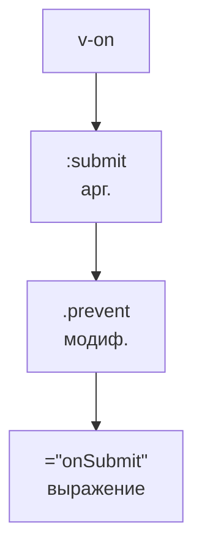
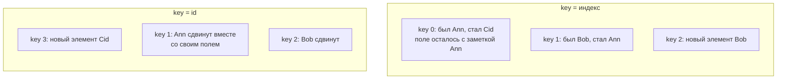
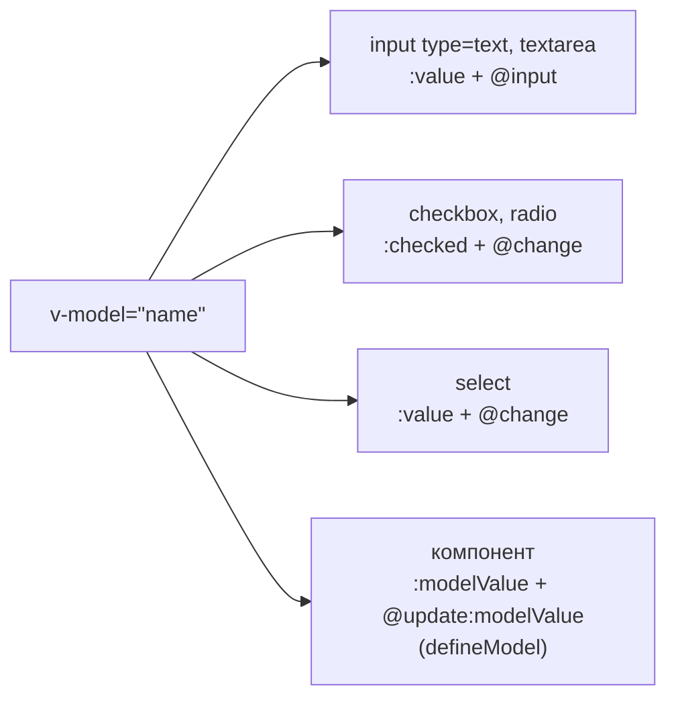

## О чём урок

Всё, что пишут в шаблоне Vue: интерполяция и выражения, привязка атрибутов, классов и стилей, условия и списки с ключами, события с модификаторами, `v-model` на полях формы, остальные встроенные директивы и собственные директивы. Шаблоны выполняются в jsdom на Vue 3.5 и компилируются во время выполнения; в проекте на Vite то же самое делается при сборке.

## Анатомия директивы

Директива это атрибут с префиксом `v-`, который Vue превращает в код рендера. У неё четыре части:



- **Сокращения**: `:href` вместо `v-bind:href`, `@click` вместо `v-on:click`, `#header` вместо `v-slot:header`. С 3.4 `:id` без значения означает `:id="id"`.
- **Динамический аргумент**: `:[attrName]="value"`, `@[eventName]="handler"`.
- **Значение** это одно выражение JavaScript, а не инструкция: `{{ ok ? 'Yes' : 'No' }}` можно, `{{ if (ok) ... }}` нельзя. Из глобальных объектов доступны только разрешённые (`Math`, `Date`, `JSON` и другие); свои глобальные значения добавляют через `app.config.globalProperties`.
- Интерполяция `{{ }}` **экранирует** HTML: строка `` выведется текстом. Поэтому шаблоны Vue по умолчанию защищены от XSS, кроме `v-html` (ниже).

## Привязки, условия и списки

```js dom
import { createApp, nextTick } from 'vue'

const el = document.createElement('div')
const vm = createApp({
  data: () => ({ status: 'error', active: true, size: 14, user: { name: 'Ann', role: 'admin' } }),
  template: `
    <p :class="['badge', status, { active }]" :style="{ fontSize: size + 'px' }">{{ status.toUpperCase() }}</p>
    <b v-if="status === 'ok'">fine</b>
    <b v-else-if="status === 'error'">broken</b>
    <b v-else>unknown</b>
    <i v-show="!active">hidden by display</i>
    <span v-for="(value, key, index) in user" :key="key">{{ index }}:{{ key }}={{ value }} </span>
    <em v-for="n in 3" :key="n">{{ n }}</em>`,
}).mount(el)
console.log(el.innerHTML.replace(/<!--v-if-->/g, '').replace(/\s+</g, '<'))
vm.status = 'ok'
vm.active = false
await nextTick()
console.log(el.querySelector('p').className, '|', el.querySelector('b').textContent, '|', el.querySelector('i').style.display)
```

```output
<p class="badge error active" style="font-size: 14px;">ERROR</p><b>broken</b><i style="display: none;">hidden by display</i><span>0:name=Ann</span><span>1:role=admin</span><em>1</em><em>2</em><em>3</em>
badge ok | fine |
```

- `:class` и `:style` принимают строку, массив и объект `{ класс: условие }` и объединяются с обычным `class`. В `:style` пишут camelCase или `'font-size'`, префиксы браузеров Vue добавляет сам.
- `v-if`, `v-else-if`, `v-else` идут подряд на соседних элементах. Несколько элементов группируют в `<template v-if>`, который не попадает в DOM.
- `v-if` создаёт и удаляет элемент (у компонента вызываются хуки, сбрасывается состояние); `v-show` только переключает `display: none`. Первый дешевле при старте и для редко показываемого, второй для частых переключений. `v-show` не работает на `<template>`.
- `v-for` перебирает массивы, объекты (`value, key, index`), числа (`n in 3` даёт 1, 2, 3, с единицы) и любые итерируемые значения. Массив в `reactive` или `ref` отслеживается целиком: `push`, `splice`, `sort`, присваивание по индексу и изменение `length` вызывают обновление.
- `v-if` и `v-for` на **одном** элементе не сочетают: в Vue 3 `v-if` выполняется первым, и переменная цикла в нём ещё не определена (в Vue 2 было наоборот). Фильтруют через `computed` или выносят `v-for` на `<template>`.

## Ключи в v-for

`key` говорит Vue, какой элемент DOM соответствует какому элементу данных. Без ключа или с индексом Vue сопоставляет элементы **по позиции** и переписывает текст на месте, а состояние, которого нет в данных (введённый текст, фокус, состояние дочернего компонента), остаётся на старой позиции:

```js dom
import { createApp, nextTick, ref } from 'vue'

const people = ref([{ id: 1, name: 'Ann' }, { id: 2, name: 'Bob' }])
const el = document.createElement('div')
createApp({
  setup: () => ({ people }),
  template: `
    <ul class="by-index"><li v-for="(p, i) in people" :key="i">{{ p.name }} <input></li></ul>
    <ul class="by-id"><li v-for="p in people" :key="p.id">{{ p.name }} <input></li></ul>`,
}).mount(el)

// the user types a note next to Ann in both lists
for (const ul of el.querySelectorAll('ul')) ul.querySelector('input').value = 'note for Ann'
people.value.unshift({ id: 3, name: 'Cid' })
await nextTick()
for (const ul of el.querySelectorAll('ul'))
  console.log(ul.className, [...ul.children].map((li) => `${li.textContent.trim()}:${li.querySelector('input').value || '-'}`).join(' '))
```

```output
by-index Cid:note for Ann Ann:- Bob:-
by-id Cid:- Ann:note for Ann Bob:-
```



Ключ берут из данных (`id`), он уникален среди соседей и стабилен между рендерами. `Math.random()` в ключе заставит пересоздавать все элементы на каждом рендере. Тот же `key` на одиночном элементе или компоненте принудительно пересоздаёт его при смене значения: `<UserForm :key="userId" />` сбрасывает форму при выборе другого пользователя.

## События

- `@click="save"` передаёт обработчику событие; `@click="save(item, $event)"` вызывает с аргументами, событие доступно как `$event`; `@click="count++"` выполняет выражение.
- **Модификаторы событий**: `.prevent` (`preventDefault`), `.stop` (`stopPropagation`), `.self` (только если цель сам элемент), `.capture` (фаза перехвата), `.once`, `.passive` (не вызовет `preventDefault`, для прокрутки и касаний). Порядок важен: `@click.prevent.self` отменяет все клики внутри, `@click.self.prevent` только по самому элементу.
- **Клавиши и мышь**: `@keyup.enter`, `.esc`, `.tab`, `.delete`, `.ctrl`, `.shift`, `.alt`, `.meta`, `.exact` (ровно эти модификаторы), `@click.right`, `.middle`.
- На компоненте `@change` слушает событие, которое компонент объявил в `defineEmits`. Необъявленные слушатели попадают в `$attrs` и навешиваются на корневой элемент (урок о компонентах).

## v-model на полях формы

`v-model` это сокращение для пары «значение плюс обработчик», которое Vue выбирает по типу элемента:



```js dom
import { createApp, nextTick } from 'vue'

const el = document.createElement('div')
const vm = createApp({
  data: () => ({ name: '', age: 0, tags: [], plan: 'free', agree: false }),
  template: `
    <input class="name" v-model.trim="name">
    <input class="age" v-model.number="age">
    <input type="checkbox" value="vue" v-model="tags"><input type="checkbox" value="ts" v-model="tags">
    <select v-model="plan"><option>free</option><option>pro</option></select>
    <input type="checkbox" class="agree" v-model="agree">`,
}).mount(el)
document.body.append(el)

const type = (selector, value, event = 'input') => {
  const input = el.querySelector(selector)
  input.value = value
  input.dispatchEvent(new Event(event))
}
type('.name', '  Ann  ')
type('.age', '42')
el.querySelectorAll('[type=checkbox]')[1].click() // checkboxes listen to change, which click fires
type('select', 'pro', 'change')
el.querySelector('.agree').click()
await nextTick()
console.log(JSON.stringify(vm.$data))
```

```output
{"name":"Ann","age":42,"tags":["ts"],"plan":"pro","agree":true}
```

- Несколько чекбоксов с одним массивом в `v-model` собирают отмеченные `value` в массив; одиночный чекбокс даёт `true`/`false` (или `true-value`/`false-value`).
- Модификаторы: `.trim` обрезает пробелы, `.number` приводит к числу через `parseFloat` (если не получилось, остаётся строка), `.lazy` обновляет по `change` вместо `input`.
- Атрибуты `value`, `checked`, `selected` в разметке игнорируются: источник правды это состояние.
- Для IME (китайский, японский ввод) `v-model` не обновляет значение во время составления символа; если нужно каждое нажатие, слушают `@input` вручную.

## Остальные встроенные директивы

| Директива | Что делает |
|---|---|
| `v-text` | Заменяет текст элемента, как `{{ }}` |
| `v-html` | Вставляет строку как HTML **без экранирования**: только для доверенного или очищенного (DOMPurify) содержимого, иначе XSS |
| `v-pre` | Не компилирует элемент: `{{ }}` выводится как есть |
| `v-cloak` | Остаётся на элементе до монтирования; с CSS `[v-cloak] { display: none }` скрывает сырой шаблон без сборки |
| `v-once` | Рендерит один раз и больше не обновляет |
| `v-memo` | Пропускает обновление поддерева, пока не изменились значения массива |
| `v-slot` (`#`) | Передаёт содержимое в именованный или scoped-слот |

## Собственные директивы

Директива нужна, когда требуется низкоуровневый доступ к DOM-элементу: фокус, клик снаружи, наблюдение за видимостью, подсветка. Всё остальное лучше делать компонентом или composable. Директива это объект с хуками, аналогичными хукам компонента: `created`, `beforeMount`, `mounted`, `beforeUpdate`, `updated`, `beforeUnmount`, `unmounted`. Каждый получает элемент и `binding` с полями `value`, `oldValue`, `arg`, `modifiers`, `instance`.

```js dom
import { createApp, nextTick } from 'vue'

const vHighlight = {
  mounted(el, binding) {
    console.log('mounted:', binding.arg, binding.value, JSON.stringify(binding.modifiers))
    el.style[binding.arg === 'bg' ? 'background' : 'color'] = binding.value
  },
  updated(el, binding) {
    console.log('updated:', binding.oldValue, '→', binding.value)
    el.style[binding.arg === 'bg' ? 'background' : 'color'] = binding.value
  },
  unmounted() {
    console.log('unmounted: remove listeners and observers here')
  },
}

const el = document.createElement('div')
const vm = createApp({
  directives: { highlight: vHighlight },
  data: () => ({ color: 'yellow', show: true }),
  template: `<p v-if="show" v-highlight:bg.once="color">text</p>`,
}).mount(el)
vm.color = 'pink'
await nextTick()
console.log(el.innerHTML)
vm.show = false
await nextTick()
```

```output
mounted: bg yellow {"once":true}
updated: yellow → pink
<p style="background: pink;">text</p>
unmounted: remove listeners and observers here
```

- В `<script setup>` любая переменная с именем `vИмя` становится директивой: `const vFocus = { mounted: (el) => el.focus() }` и в шаблоне `<input v-focus>`. Глобально: `app.directive('focus', vFocus)`.
- Короткая форма функцией `(el, binding) => ...` вызывается на `mounted` и `updated`.
- На компоненте директива применяется к корневому элементу; у компонента с несколькими корнями она игнорируется с предупреждением, поэтому на компонентах директивы не рекомендуют.

## Главное

- Директива: имя, аргумент, модификаторы, значение-выражение; `:`, `@`, `#` как сокращения.
- `{{ }}` экранирует HTML; `v-html` не экранирует и опасен с недоверенными данными.
- `:class` и `:style` принимают массивы и объекты; `v-if` создаёт и удаляет, `v-show` прячет.
- `v-for` с ключом из данных; индекс в ключе переносит состояние полей на чужие строки; `v-if` и `v-for` не на одном элементе.
- Модификаторы событий `.prevent`, `.stop`, `.self`, `.once`, `.passive`, клавиши `.enter`, `.esc`, `.exact`.
- `v-model` превращается в `:value` + `@input` (или `checked`/`change`); модификаторы `.trim`, `.number`, `.lazy`.
- Свои директивы только для работы с DOM: хуки как у компонента, `binding.value`, `arg`, `modifiers`; `vName` в `<script setup>`.
