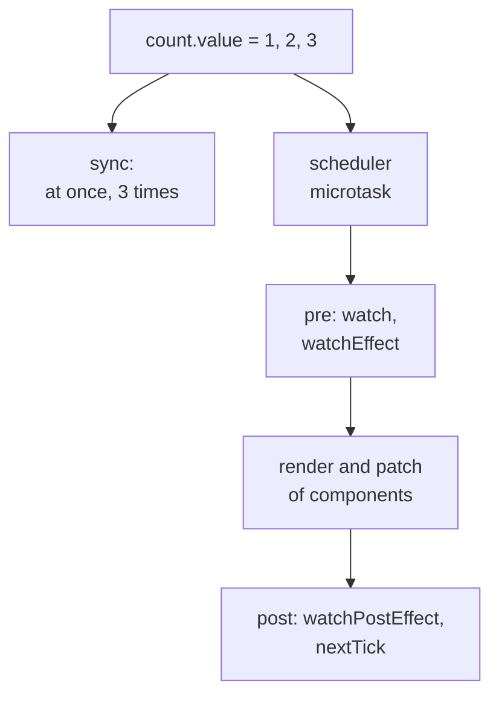

## What this lesson covers

Watchers (`watch`, `watchEffect`) run side effects when reactive data changes: requests, syncing with `localStorage`, DOM work. This lesson covers how they differ, when exactly they run relative to the DOM update (`flush`), how Vue batches changes and what `nextTick` is, tracking depth, cleanup and request races. The examples run on Vue 3.5.

## watch and watchEffect

- `watch(source, callback)` watches an **explicit** source: a ref, a `reactive`, a getter `() => state.x`, or an array of sources. The callback receives the new and old value and by default is **not** called right away (`immediate: true` changes that).
- `watchEffect(fn)` runs the function **at once** and tracks everything it read; there are no old values.

Both return a stop function (since 3.5 it also has `pause()` and `resume()`). Watchers created synchronously in `setup` stop with the component; ones created in `setTimeout` or after `await` must be stopped by hand.

## When they run: flush and nextTick

Vue does not update the DOM or call watchers on every assignment. Changes are queued, and everything runs in one pass in a microtask. The order of the pass:

1. watchers with `flush: 'pre'` (the default) before components update, so they still see the old DOM;
2. the component update (render and DOM patch);
3. watchers with `flush: 'post'` (`watchPostEffect`), already with the new DOM.

`flush: 'sync'` (`watchSyncEffect`) fires immediately on every change, without batching. `nextTick()` returns a promise that resolves after this pass.

```js dom
import { createApp, nextTick, ref, watch, watchEffect } from 'vue'

const count = ref(0)
const el = document.createElement('div')
createApp({ setup: () => ({ count }), template: `<b>{{ count }}</b>` }).mount(el)
const dom = () => el.textContent

watch(count, (now, before) => console.log(`pre:  ${before} → ${now}, DOM shows ${dom()}`))
watch(count, () => console.log(`post: DOM shows ${dom()}`), { flush: 'post' })
watch(count, (now) => console.log(`sync: ${now}`), { flush: 'sync' })
watchEffect(() => console.log('watchEffect runs at once:', count.value))

count.value = 1
count.value = 2
console.log('after assignments, DOM shows', dom())
await nextTick()
console.log('after nextTick, DOM shows', dom())
```

```output
watchEffect runs at once: 0
sync: 1
sync: 2
after assignments, DOM shows 0
pre:  0 → 2, DOM shows 0
watchEffect runs at once: 2
post: DOM shows 2
after nextTick, DOM shows 2
```

- Two assignments gave one run of `pre`, `post` and `watchEffect`, and `pre` saw the old `0` and the new `2` at once: nobody but `sync` noticed the intermediate `1`. Watchers of the same phase run in creation order.
- Before `nextTick` the DOM is still old: if you need to measure an element after a change, wait for `await nextTick()` or use `flush: 'post'`.
- `sync` is rarely useful (for example for debugging); with many changes it is expensive.

## watchEffect, watchPostEffect, watchSyncEffect

These are the same `watchEffect` with a different `flush`: `watchPostEffect(fn)` is `watchEffect(fn, { flush: 'post' })`, `watchSyncEffect(fn)` is `{ flush: 'sync' }`.

```js dom
import { createApp, nextTick, ref, watchEffect, watchPostEffect, watchSyncEffect } from 'vue'

const count = ref(0)
const el = document.createElement('div')
createApp({ setup: () => ({ count }), template: `<b>{{ count }}</b>` }).mount(el)
const dom = () => el.textContent

watchEffect(() => console.log(`watchEffect     count=${count.value} DOM=${dom()}`))
watchPostEffect(() => console.log(`watchPostEffect count=${count.value} DOM=${dom()}`))
watchSyncEffect(() => console.log(`watchSyncEffect count=${count.value} DOM=${dom()}`))
console.log('--- count = 1, 2, 3')
count.value = 1
count.value = 2
count.value = 3
await nextTick()
```

```output
watchEffect     count=0 DOM=0
watchSyncEffect count=0 DOM=0
--- count = 1, 2, 3
watchSyncEffect count=1 DOM=0
watchSyncEffect count=2 DOM=0
watchSyncEffect count=3 DOM=0
watchEffect     count=3 DOM=0
watchPostEffect count=3 DOM=3
```

- `watchSyncEffect` fired on each of the three assignments, with no batching.
- `watchEffect` ran once with the final `3`, but the DOM still showed `0`: it runs before the component update.
- `watchPostEffect` defers even its **first** run until after rendering, so it printed nothing at creation and then saw both the new value and the new DOM.



## All effects compared

| | Runs on creation | Old value | What it tracks | When it runs |
|---|---|---|---|---|
| `computed` | No, lazily on first read | Yes (getter argument, 3.4) | Everything read | On read, if deps changed |
| `watch` | No (`immediate: true` changes that) | Yes | An explicit source | Before render (`pre`), batched |
| `watchEffect` | Yes, synchronously | No | Everything read | Before render (`pre`), batched |
| `watchPostEffect` | Yes, but after render | No | Everything read | After render (`post`) |
| `watchSyncEffect` | Yes, synchronously | No | Everything read | Right on every change (`sync`) |

## Depth: deep, getter, once

```js run
import { nextTick, reactive, ref, watch } from 'vue'

const user = ref({ name: 'Ann', address: { city: 'Oslo' } })
const state = reactive({ user: { name: 'Ann' }, page: 1 })

watch(user, () => console.log('ref, shallow: never for inner changes'))
watch(user, () => console.log('ref, deep: city changed'), { deep: true })
watch(state, () => console.log('reactive object: deep by default'))
watch(() => state.page, (page) => console.log('getter: page', page))
watch(() => state.user, () => console.log('getter of an object: only on replacement'))
watch(() => state.page, () => console.log('once: first change only'), { once: true })

user.value.address.city = 'Rome'
state.user.name = 'Bob'
await nextTick()
state.page = 2
await nextTick()
state.page = 3
await nextTick()
```

```output
ref, deep: city changed
reactive object: deep by default
reactive object: deep by default
getter: page 2
once: first change only
reactive object: deep by default
getter: page 3
```

- `watch(ref)` reacts only to replacing `.value`; mutations inside are visible with `deep: true`.
- `watch(reactiveObj)` is deep by default, but also expensive: it walks the whole structure. Since 3.5 `deep` accepts a number of levels.
- A getter `() => state.x` watches exactly what it read. A getter returning an object fires only when the object is replaced, not when its fields change.
- `once: true` (3.4) removes the watcher after the first trigger.

## Cleanup and races

A watcher callback may start a request, and while waiting for the response the source may change again. Without cleanup the stale response overwrites the new one. A cleanup function is registered with `onWatcherCleanup` (3.5) or with the callback's third argument `onCleanup`; Vue calls it before the next run and when the watcher stops.

```js run
import { nextTick, onWatcherCleanup, ref, watch } from 'vue'

const delays = { 1: 50, 2: 10 }
const fetchUser = (id, signal) =>
  new Promise((resolve, reject) => {
    const timer = setTimeout(() => resolve(`user ${id}`), delays[id])
    signal.addEventListener('abort', () => {
      clearTimeout(timer)
      reject(new Error(`request ${id} aborted`))
    })
  })

const userId = ref(1)
const user = ref(null)
watch(
  userId,
  async (id) => {
    const controller = new AbortController()
    onWatcherCleanup(() => controller.abort()) // must be registered before the first await
    try {
      user.value = await fetchUser(id, controller.signal)
    } catch (e) {
      console.log(e.message)
    }
  },
  { immediate: true },
)
await nextTick()
userId.value = 2
await new Promise((r) => setTimeout(r, 100))
console.log('shown:', user.value)
```

```output
request 1 aborted
shown: user 2
```

`onWatcherCleanup` works only before the first `await` in an async callback: after it Vue no longer knows which watcher the call belongs to. The `onCleanup` argument has no such limit.

## What to choose

- A derived value: `computed`, not a watcher that writes into another ref.
- Reacting to a specific change, with the old value or without a run on creation: `watch`.
- Syncing with the outside world based on everything read: `watchEffect`.
- DOM work after the update: `flush: 'post'` or `nextTick`.

## Key points

- `watch` watches an explicit source and does not run immediately; `watchEffect` runs immediately and tracks everything read.
- Changes are batched: `pre` before the DOM update, `post` after it, `sync` on every assignment; `nextTick` waits for the pass.
- `watchPostEffect` and `watchSyncEffect` are `watchEffect` with `flush: 'post'` and `'sync'`; the first run of `watchPostEffect` is also after render.
- `watch(ref)` is shallow, `watch(reactive)` is deep; a getter watches what it read; `once` since 3.4, numeric `deep` since 3.5.
- Request races are closed by cleanup: `onWatcherCleanup` before the first `await`, or `onCleanup`.
