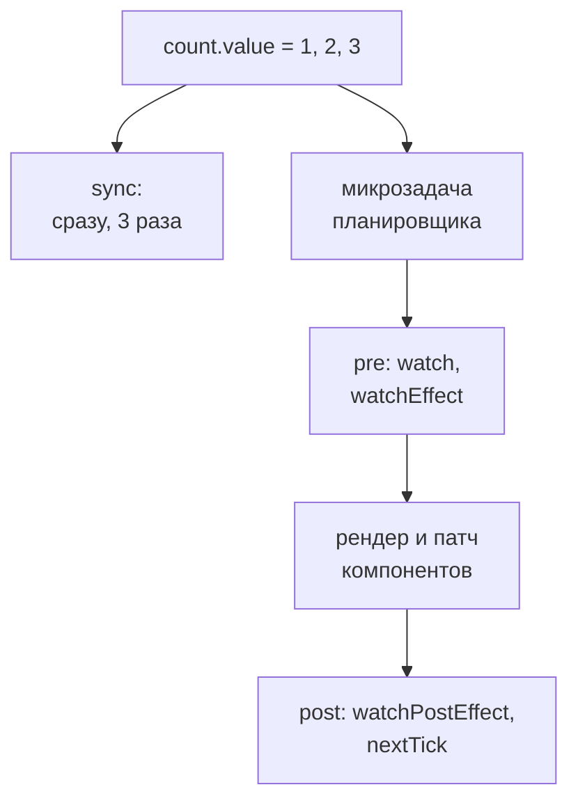

## О чём урок

Наблюдатели (`watch`, `watchEffect`) выполняют побочные действия, когда меняются реактивные данные: запросы, синхронизация с `localStorage`, работа с DOM. Здесь чем они отличаются, когда именно выполняются относительно обновления DOM (`flush`), как Vue группирует изменения и что такое `nextTick`, глубина отслеживания, очистка и гонки запросов. Примеры выполняются на Vue 3.5.

## watch и watchEffect

- `watch(source, callback)` следит за **явным** источником: ref, `reactive`, геттер `() => state.x` или массив источников. Колбэк получает новое и старое значение и по умолчанию **не** вызывается сразу (`immediate: true` меняет это).
- `watchEffect(fn)` выполняет функцию **сразу** и отслеживает всё, что она прочитала; старых значений нет.

Оба возвращают функцию остановки (с 3.5 у неё есть `pause()` и `resume()`). Созданные синхронно в `setup` останавливаются вместе с компонентом сами; созданные в `setTimeout` или после `await` нужно останавливать вручную.

## Когда выполняется: flush и nextTick

Vue не обновляет DOM и не вызывает наблюдатели на каждое присваивание. Изменения складываются в очередь, и всё выполняется одним проходом в микрозадаче. Порядок прохода:

1. наблюдатели с `flush: 'pre'` (по умолчанию) до обновления компонентов, поэтому они видят ещё старый DOM;
2. обновление компонентов (рендер и патч DOM);
3. наблюдатели с `flush: 'post'` (`watchPostEffect`) уже с новым DOM.

`flush: 'sync'` (`watchSyncEffect`) срабатывает сразу при каждом изменении, без группировки. `nextTick()` возвращает промис, который выполнится после этого прохода.

```js dom
import { createApp, nextTick, ref, watch, watchEffect } from 'vue'

const count = ref(0)
const el = document.createElement('div')
createApp({ setup: () => ({ count }), template: `<b>{{ count }}</b>` }).mount(el)
const dom = () => el.textContent

watch(count, (now, before) => console.log(`pre:  ${before} → ${now}, DOM shows ${dom()}`))
watch(count, () => console.log(`post: DOM shows ${dom()}`), { flush: 'post' })
watch(count, (now) => console.log(`sync: ${now}`), { flush: 'sync' })
watchEffect(() => console.log('watchEffect runs at once:', count.value))

count.value = 1
count.value = 2
console.log('after assignments, DOM shows', dom())
await nextTick()
console.log('after nextTick, DOM shows', dom())
```

```output
watchEffect runs at once: 0
sync: 1
sync: 2
after assignments, DOM shows 0
pre:  0 → 2, DOM shows 0
watchEffect runs at once: 2
post: DOM shows 2
after nextTick, DOM shows 2
```

- Два присваивания дали один запуск `pre`, `post` и `watchEffect`, причём `pre` сразу увидел старое `0` и новое `2`: промежуточное `1` никто, кроме `sync`, не заметил. Наблюдатели одной фазы выполняются в порядке создания.
- До `nextTick` DOM ещё старый: если после изменения нужно измерить элемент, ждут `await nextTick()` или используют `flush: 'post'`.
- `sync` полезен редко (например, для отладки); на большом количестве изменений он дорогой.

## watchEffect, watchPostEffect, watchSyncEffect

Это один и тот же `watchEffect` с разным `flush`: `watchPostEffect(fn)` это `watchEffect(fn, { flush: 'post' })`, `watchSyncEffect(fn)` это `{ flush: 'sync' }`.

```js dom
import { createApp, nextTick, ref, watchEffect, watchPostEffect, watchSyncEffect } from 'vue'

const count = ref(0)
const el = document.createElement('div')
createApp({ setup: () => ({ count }), template: `<b>{{ count }}</b>` }).mount(el)
const dom = () => el.textContent

watchEffect(() => console.log(`watchEffect     count=${count.value} DOM=${dom()}`))
watchPostEffect(() => console.log(`watchPostEffect count=${count.value} DOM=${dom()}`))
watchSyncEffect(() => console.log(`watchSyncEffect count=${count.value} DOM=${dom()}`))
console.log('--- count = 1, 2, 3')
count.value = 1
count.value = 2
count.value = 3
await nextTick()
```

```output
watchEffect     count=0 DOM=0
watchSyncEffect count=0 DOM=0
--- count = 1, 2, 3
watchSyncEffect count=1 DOM=0
watchSyncEffect count=2 DOM=0
watchSyncEffect count=3 DOM=0
watchEffect     count=3 DOM=0
watchPostEffect count=3 DOM=3
```

- `watchSyncEffect` сработал на каждое из трёх присваиваний, без группировки.
- `watchEffect` выполнился один раз с итоговым `3`, но DOM ещё показывал `0`: он идёт до обновления компонента.
- `watchPostEffect` даже **первый** запуск откладывает на после рендера, поэтому при создании ничего не напечатал, а затем увидел и новое значение, и новый DOM.



## Сравнение всех эффектов

| | Запуск при создании | Старое значение | Что отслеживает | Когда выполняется |
|---|---|---|---|---|
| `computed` | Нет, лениво при первом чтении | Есть (аргумент геттера, 3.4) | Всё прочитанное | При чтении, если зависимости изменились |
| `watch` | Нет (`immediate: true` меняет) | Есть | Явный источник | До рендера (`pre`), группируется |
| `watchEffect` | Да, синхронно | Нет | Всё прочитанное | До рендера (`pre`), группируется |
| `watchPostEffect` | Да, но после рендера | Нет | Всё прочитанное | После рендера (`post`) |
| `watchSyncEffect` | Да, синхронно | Нет | Всё прочитанное | Сразу на каждое изменение (`sync`) |

## Глубина: deep, getter, once

```js run
import { nextTick, reactive, ref, watch } from 'vue'

const user = ref({ name: 'Ann', address: { city: 'Oslo' } })
const state = reactive({ user: { name: 'Ann' }, page: 1 })

watch(user, () => console.log('ref, shallow: never for inner changes'))
watch(user, () => console.log('ref, deep: city changed'), { deep: true })
watch(state, () => console.log('reactive object: deep by default'))
watch(() => state.page, (page) => console.log('getter: page', page))
watch(() => state.user, () => console.log('getter of an object: only on replacement'))
watch(() => state.page, () => console.log('once: first change only'), { once: true })

user.value.address.city = 'Rome'
state.user.name = 'Bob'
await nextTick()
state.page = 2
await nextTick()
state.page = 3
await nextTick()
```

```output
ref, deep: city changed
reactive object: deep by default
reactive object: deep by default
getter: page 2
once: first change only
reactive object: deep by default
getter: page 3
```

- `watch(ref)` реагирует только на замену `.value`; мутации внутри видны с `deep: true`.
- `watch(reactiveObj)` глубокий по умолчанию, но и дорогой: обходит всю структуру. С 3.5 `deep` принимает число уровней.
- Геттер `() => state.x` следит ровно за прочитанным. Геттер, возвращающий объект, сработает только при замене объекта, а не при изменении его полей.
- `once: true` (3.4) снимает наблюдатель после первого срабатывания.

## Очистка и гонки

Колбэк наблюдателя может запустить запрос, а за время ответа источник изменится ещё раз. Без очистки устаревший ответ перезапишет новый. Функцию очистки регистрируют `onWatcherCleanup` (3.5) или третьим аргументом колбэка `onCleanup`; Vue вызывает её перед следующим запуском и при остановке.

```js run
import { nextTick, onWatcherCleanup, ref, watch } from 'vue'

const delays = { 1: 50, 2: 10 }
const fetchUser = (id, signal) =>
  new Promise((resolve, reject) => {
    const timer = setTimeout(() => resolve(`user ${id}`), delays[id])
    signal.addEventListener('abort', () => {
      clearTimeout(timer)
      reject(new Error(`request ${id} aborted`))
    })
  })

const userId = ref(1)
const user = ref(null)
watch(
  userId,
  async (id) => {
    const controller = new AbortController()
    onWatcherCleanup(() => controller.abort()) // must be registered before the first await
    try {
      user.value = await fetchUser(id, controller.signal)
    } catch (e) {
      console.log(e.message)
    }
  },
  { immediate: true },
)
await nextTick()
userId.value = 2
await new Promise((r) => setTimeout(r, 100))
console.log('shown:', user.value)
```

```output
request 1 aborted
shown: user 2
```

`onWatcherCleanup` работает только до первого `await` в асинхронном колбэке: после него Vue уже не знает, к какому наблюдателю относится вызов. Аргумент `onCleanup` такого ограничения не имеет.

## Что выбрать

- Производное значение: `computed`, а не наблюдатель, который пишет в другой ref.
- Реакция на конкретное изменение со старым значением или без запуска при создании: `watch`.
- Синхронизация с внешним миром по всему, что прочитано: `watchEffect`.
- Работа с DOM после обновления: `flush: 'post'` или `nextTick`.

## Главное

- `watch` следит за явным источником и не запускается сразу; `watchEffect` запускается сразу и отслеживает всё прочитанное.
- Изменения группируются: `pre` до обновления DOM, `post` после, `sync` на каждое присваивание; `nextTick` ждёт прохода.
- `watchPostEffect` и `watchSyncEffect` это `watchEffect` с `flush: 'post'` и `'sync'`; первый запуск `watchPostEffect` тоже после рендера.
- `watch(ref)` мелкий, `watch(reactive)` глубокий; геттер следит за прочитанным; `once` с 3.4, числовой `deep` с 3.5.
- Гонки запросов закрывает очистка: `onWatcherCleanup` до первого `await` или `onCleanup`.
